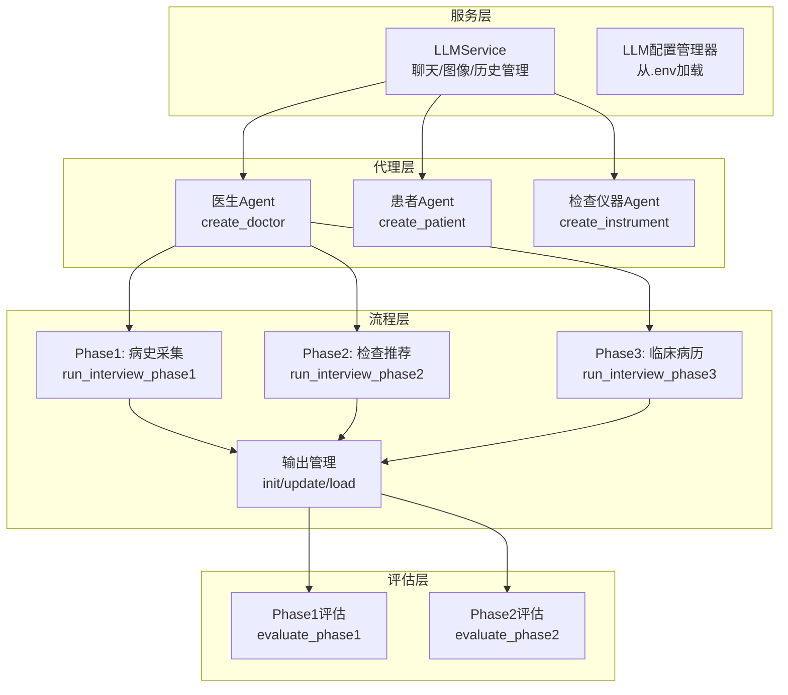
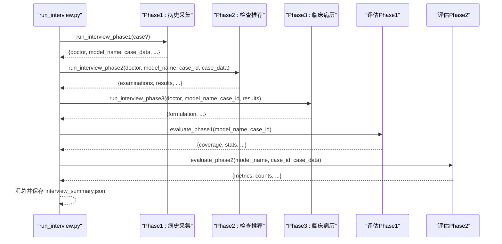
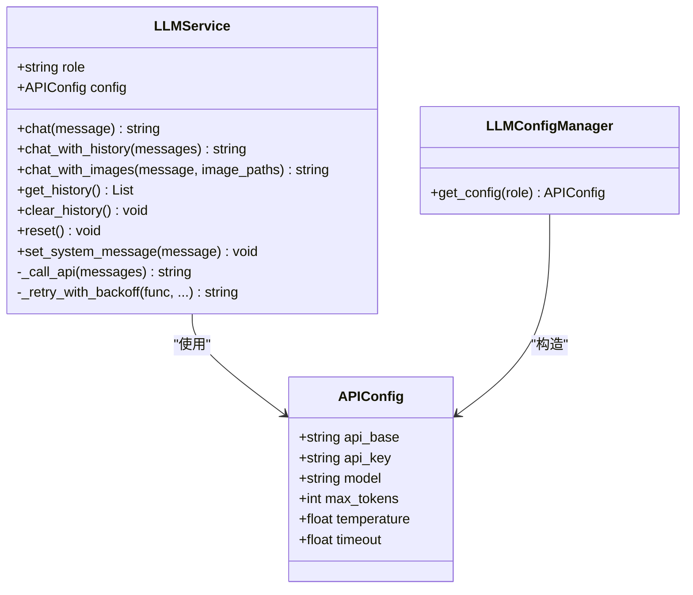
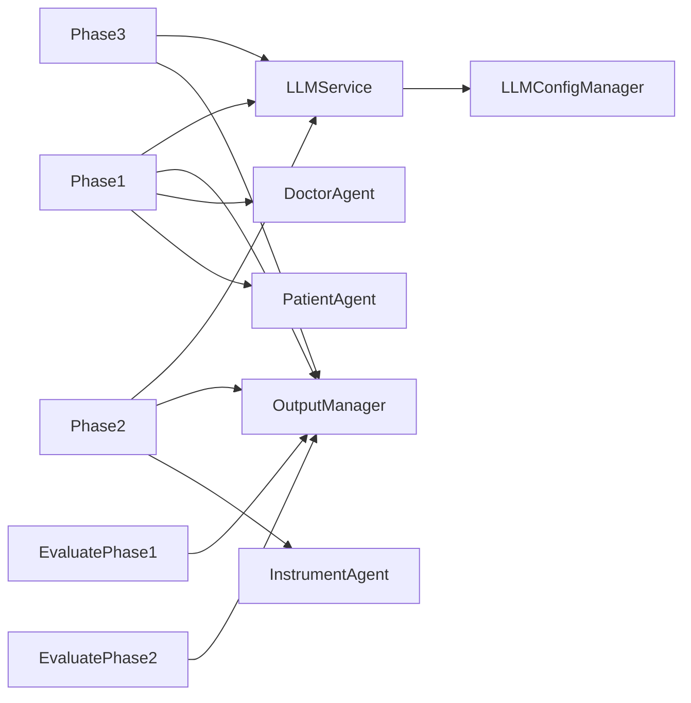

# API参考

<cite>
**本文引用的文件**
- [services/llm_api.py](file://services/llm_api.py)
- [run_interview.py](file://run_interview.py)
- [core/interview/interview_phase1.py](file://core/interview/interview_phase1.py)
- [core/interview/interview_phase2.py](file://core/interview/interview_phase2.py)
- [core/interview/interview_phase3.py](file://core/interview/interview_phase3.py)
- [core/interview/prompts.py](file://core/interview/prompts.py)
- [core/output_manager.py](file://core/output_manager.py)
- [agents/doctor/doctor.py](file://agents/doctor/doctor.py)
- [agents/patient/patient.py](file://agents/patient/patient.py)
- [agents/instrument/instrument.py](file://agents/instrument/instrument.py)
- [core/evaluate/interview_phase1_eval.py](file://core/evaluate/interview_phase1_eval.py)
- [core/evaluate/interview_phase2_eval.py](file://core/evaluate/interview_phase2_eval.py)
- [scripts/test_phase1_evaluation.py](file://scripts/test_phase1_evaluation.py)
</cite>

## 目录
1. [简介](#简介)
2. [项目结构](#项目结构)
3. [核心组件](#核心组件)
4. [架构总览](#架构总览)
5. [详细组件分析](#详细组件分析)
6. [依赖分析](#依赖分析)
7. [性能考虑](#性能考虑)
8. [故障排查指南](#故障排查指南)
9. [结论](#结论)
10. [附录](#附录)

## 简介
本API参考面向“精神科智能问诊与评估系统”的使用者与集成者，重点覆盖以下内容：
- LLMService类的完整公共接口与调用方式
- 六阶段访谈流程的run_interview_phaseX系列函数与evaluate_phaseX系列函数
- 参数列表、配置选项、返回值格式与典型使用场景
- 错误码与异常处理机制
- 性能优化建议与最佳实践
- 版本兼容性与迁移指南
- 调试工具与监控接口的使用说明

## 项目结构
该项目采用按功能域划分的模块化组织方式，核心模块包括：
- 服务层：LLM API封装与配置管理
- 代理层：医生、患者、检查仪器Agent
- 流程层：六阶段访谈执行与输出管理
- 评估层：阶段化评估与指标计算
- 运行入口：完整流程编排脚本

**图表来源**
- [services/llm_api.py:79-250](file://services/llm_api.py#L79-L250)
- [agents/doctor/doctor.py:32-55](file://agents/doctor/doctor.py#L32-L55)
- [agents/patient/patient.py:40-92](file://agents/patient/patient.py#L40-L92)
- [agents/instrument/instrument.py:13-45](file://agents/instrument/instrument.py#L13-L45)
- [core/interview/interview_phase1.py:241-428](file://core/interview/interview_phase1.py#L241-L428)
- [core/interview/interview_phase2.py:75-244](file://core/interview/interview_phase2.py#L75-L244)
- [core/interview/interview_phase3.py:83-181](file://core/interview/interview_phase3.py#L83-L181)
- [core/output_manager.py:50-189](file://core/output_manager.py#L50-L189)
- [core/evaluate/interview_phase1_eval.py:174-330](file://core/evaluate/interview_phase1_eval.py#L174-L330)
- [core/evaluate/interview_phase2_eval.py:153-255](file://core/evaluate/interview_phase2_eval.py#L153-L255)

**章节来源**
- [services/llm_api.py:1-250](file://services/llm_api.py#L1-L250)
- [core/output_manager.py:1-189](file://core/output_manager.py#L1-L189)

## 核心组件
本节聚焦LLMService类及其便捷工厂函数，涵盖初始化、聊天、历史管理、多模态输入与重试机制。

- 类：LLMService
  - 初始化
    - 参数
      - role: 角色名称（patient/doctor/evaluator）
      - system_message: 可选系统提示词
    - 行为：加载.env配置，创建OpenAI客户端，初始化对话历史，设置系统消息
  - 方法
    - chat(message: str) -> str：发送消息并获取回复，自动维护上下文
    - chat_with_history(messages: List[Dict[str, str]]) -> str：使用指定历史进行对话
    - chat_with_images(message: str, image_paths: Union[str, List[str]]) -> str：图文多模态对话
    - get_history() -> List[Dict[str, str]]：获取当前对话历史副本
    - clear_history()：清空对话历史（保留system消息）
    - reset()：完全重置（清空所有历史）
    - set_system_message(message: str)：设置/更新系统提示词
    - _call_api(messages: List[Dict[str, str]]) -> str：底层API调用（带重试）
    - _retry_with_backoff(func, max_retries: int = 3, delay: float = 1.0)：指数退避重试
  - 属性
    - config: APIConfig（api_base, api_key, model, max_tokens, temperature, timeout）
    - client: OpenAI客户端
    - _history: List[Dict[str, str]]

- 便捷工厂函数
  - get_patient_llm(system_message: str = "") -> LLMService
  - get_doctor_llm(system_message: str = "") -> LLMService
  - get_evaluator_llm(system_message: str = "") -> LLMService

- 配置来源
  - 从项目根目录.env文件加载，键名规则为：{ROLE}_API_BASE、{ROLE}_API_KEY、{ROLE}_MODEL，以及全局MAX_TOKENS、TEMPERATURE、TIMEOUT

**章节来源**
- [services/llm_api.py:47-250](file://services/llm_api.py#L47-L250)

## 架构总览
下图展示完整流程：从run_interview.py编排六个阶段，每个阶段调用对应的run_interview_phaseX函数，产出阶段输出；随后调用evaluate_phaseX函数进行评估，生成评估报告。

**图表来源**
- [run_interview.py:46-396](file://run_interview.py#L46-L396)
- [core/interview/interview_phase1.py:241-428](file://core/interview/interview_phase1.py#L241-L428)
- [core/interview/interview_phase2.py:75-244](file://core/interview/interview_phase2.py#L75-L244)
- [core/interview/interview_phase3.py:83-181](file://core/interview/interview_phase3.py#L83-L181)
- [core/evaluate/interview_phase1_eval.py:174-330](file://core/evaluate/interview_phase1_eval.py#L174-L330)
- [core/evaluate/interview_phase2_eval.py:153-255](file://core/evaluate/interview_phase2_eval.py#L153-L255)

## 详细组件分析

### LLMService类详解
- 设计要点
  - 实例生命周期内自动维护对话上下文，每次调用附带完整历史
  - 支持多模态输入（图文）
  - 内置指数退避重试，提升鲁棒性
  - 便捷工厂函数统一角色配置

**图表来源**
- [services/llm_api.py:47-250](file://services/llm_api.py#L47-L250)

**章节来源**
- [services/llm_api.py:79-250](file://services/llm_api.py#L79-L250)

### 六阶段访谈流程（run_interview_phaseX系列）

- Phase 1：病史采集
  - 函数：run_interview_phase1(case: Optional[Dict] = None) -> Dict
  - 输入：可选指定病例；若未提供则随机加载
  - 返回：包含case_id、conversation、chief_complaint_used、mental_status_used、coverage_stats、output_file、status、doctor、case_data
  - 关键行为：加载病例→初始化医生/患者→准备启动prompt→多轮对话→检测结束标记或达到轮次上限→保存输出
  - 依赖：PROMPTS["Clinical History Collection"]、输出管理、医生/患者Agent

- Phase 2：检查推荐
  - 函数：run_interview_phase2(doctor, model_name: str, case_id: str, case_data: Optional[Dict]) -> Dict
  - 输入：doctor（保持上下文）、model_name、case_id、case_data（含auxiliaryExamination）
  - 返回：examinations、examination_results、evaluation_metrics、raw_response、output_file、doctor
  - 关键行为：生成检查推荐→解析[EXAMINATIONS]→可选调用Instrument→保存输出
  - 依赖：PROMPTS["Examination Recommendation"]、输出管理、Instrument

- Phase 3：临床病历
  - 函数：run_interview_phase3(doctor, model_name: str, case_id: str, examination_results: Dict) -> Dict
  - 输入：doctor、model_name、case_id、examination_results
  - 返回：syntactic_formulation、raw_response、output_file、doctor
  - 关键行为：拼装检查结果→生成病历→解析[CLINICAL_FORMULATION]→保存输出
  - 依赖：PROMPTS["Clinical Formulation"]、输出管理

- 其他阶段（Phase 4-6）
  - Phase 4：诊断类别识别（函数：run_interview_phase4(...)）
  - Phase 5：诊断假设（函数：run_interview_phase5(...)）
  - Phase 6：鉴别诊断（函数：run_interview_phase6(...)）
  - 以上阶段均遵循相同模式：准备prompt→调用LLM→解析标记化输出→保存阶段输出

- Prompt模板
  - 位于core/interview/prompts.py，包含各阶段的标准system提示词模板

**章节来源**
- [core/interview/interview_phase1.py:241-428](file://core/interview/interview_phase1.py#L241-L428)
- [core/interview/interview_phase2.py:75-244](file://core/interview/interview_phase2.py#L75-L244)
- [core/interview/interview_phase3.py:83-181](file://core/interview/interview_phase3.py#L83-L181)
- [core/interview/prompts.py:1-233](file://core/interview/prompts.py#L1-L233)

### 评估模块（evaluate_phaseX系列）

- Phase 1评估
  - 函数：evaluate_phase1(model_name: str = None, case_id: str = None, output_file: Union[str, Path] = None, phase1_data: Dict = None, enable_empathy_eval: bool = True, enable_profession_eval: bool = True, parallel_eval: bool = True) -> Dict
  - 输入：可选通过model_name+case_id、output_file或phase1_data提供数据
  - 返回：coverage_stats、conversation_stats、status、empathy_evaluation（可选）、profession_evaluation（可选）、output_file
  - 关键行为：计算覆盖率与对话统计→可选并行评估共情度与专业度→保存评估结果

- Phase 2评估
  - 函数：evaluate_phase2(model_name: str = None, case_id: str = None, output_file: Union[str, Path] = None, phase2_data: Dict = None, case_data: Dict = None) -> Dict
  - 输入：可选通过model_name+case_id、output_file或phase2_data提供数据；可选case_data用于gold对比
  - 返回：metrics（Precision/Recall/F1/Jaccard）、counts、status、output_file
  - 关键行为：解析response/examination_query/auxiliary_examinations→计算TP/FP/FN→得出指标→保存评估结果

- 其他阶段评估
  - Phase 3-6评估：与Phase 1/2类似，分别计算对应阶段的指标与统计信息（此处不展开细节）

**章节来源**
- [core/evaluate/interview_phase1_eval.py:174-330](file://core/evaluate/interview_phase1_eval.py#L174-L330)
- [core/evaluate/interview_phase2_eval.py:153-255](file://core/evaluate/interview_phase2_eval.py#L153-L255)

### 输出管理与文件结构
- 输出目录
  - interview输出：data/output/interview/{model_name}/{case_id}/interview_phase{X}_output.json
  - evaluation输出：data/output/evaluation/{model_name}/{case_id}/evaluation_phase{X}_output.json
  - 汇总：interview_summary.json
- 关键函数
  - get_output_dir(model_name, case_id) -> Path
  - get_phase_output_file(model_name, case_id, phase) -> Path
  - init_phase_output(model_name, case_id, phase, initial_data) -> Path
  - update_phase_output(output_file, updates, status=None)
  - append_conversation(output_file, role, content, chief_complaint_used=None, mental_status_used=None)
  - load_phase_output(model_name, case_id, phase) -> Optional[Dict]

**章节来源**
- [core/output_manager.py:20-189](file://core/output_manager.py#L20-L189)

### Agent工厂函数
- 医生Agent：create_doctor() -> LLMService（使用Doctor Profile作为system prompt）
- 患者Agent：create_patient(basic_info, chief_complaint, mental_status) -> LLMService（注入病例信息）
- 检查仪器Agent：create_instrument(examination_query, auxiliary_examinations) -> LLMService（注入检查信息）

**章节来源**
- [agents/doctor/doctor.py:32-55](file://agents/doctor/doctor.py#L32-L55)
- [agents/patient/patient.py:40-92](file://agents/patient/patient.py#L40-L92)
- [agents/instrument/instrument.py:13-45](file://agents/instrument/instrument.py#L13-L45)

## 依赖分析
- 组件耦合
  - LLMService依赖LLMConfigManager与.env配置
  - 各阶段函数依赖Agent工厂与PROMPTS模板
  - 评估模块依赖输出管理与阶段输出文件
- 外部依赖
  - OpenAI SDK、httpx、python-dotenv、json_repair（可选）
- 循环依赖
  - 未发现循环依赖

**图表来源**
- [services/llm_api.py:58-104](file://services/llm_api.py#L58-L104)
- [core/interview/interview_phase1.py:241-428](file://core/interview/interview_phase1.py#L241-L428)
- [core/interview/interview_phase2.py:75-244](file://core/interview/interview_phase2.py#L75-L244)
- [core/interview/interview_phase3.py:83-181](file://core/interview/interview_phase3.py#L83-L181)
- [core/output_manager.py:50-189](file://core/output_manager.py#L50-L189)
- [agents/doctor/doctor.py:32-55](file://agents/doctor/doctor.py#L32-L55)
- [agents/patient/patient.py:40-92](file://agents/patient/patient.py#L40-L92)
- [agents/instrument/instrument.py:13-45](file://agents/instrument/instrument.py#L13-L45)
- [core/evaluate/interview_phase1_eval.py:174-330](file://core/evaluate/interview_phase1_eval.py#L174-L330)
- [core/evaluate/interview_phase2_eval.py:153-255](file://core/evaluate/interview_phase2_eval.py#L153-L255)

**章节来源**
- [services/llm_api.py:58-104](file://services/llm_api.py#L58-L104)
- [core/output_manager.py:50-189](file://core/output_manager.py#L50-L189)

## 性能考虑
- 重试与超时
  - LLMService内置指数退避重试（默认最多3次），超时时间可配置
- 上下文长度控制
  - 通过max_tokens与温度参数控制生成长度与多样性
- 并行评估
  - Phase 1评估支持并行评估共情度与专业度，减少等待时间
- I/O优化
  - 输出采用增量更新（update_phase_output），避免频繁读写
- 多模态输入
  - 图像编码为base64，注意大图带来的token与延迟开销

[本节为通用指导，无需特定文件来源]

## 故障排查指南
- 常见错误与处理
  - 缺少.env或配置不全：检查{ROLE}_API_BASE、{ROLE}_API_KEY、{ROLE}_MODEL、MAX_TOKENS、TEMPERATURE、TIMEOUT
  - API调用失败：查看日志中的重试记录；确认网络与证书设置（httpx.Client已禁用SSL校验）
  - 解析失败：Phase 1患者响应解析具备容错与正则提取；Phase 2/3检查结果解析失败时检查标记与JSON格式
  - 评估异常：确保输出文件存在；检查case_data是否提供gold数据
- 调试建议
  - 使用get_history()查看上下文
  - 使用get_output_dir()/get_phase_output_file()定位输出文件
  - 使用scripts/test_phase1_evaluation.py验证评估链路
- 监控接口
  - 输出文件包含timestamp、status、last_update等元信息，便于追踪流程状态

**章节来源**
- [services/llm_api.py:158-169](file://services/llm_api.py#L158-L169)
- [core/interview/interview_phase1.py:90-144](file://core/interview/interview_phase1.py#L90-L144)
- [core/interview/interview_phase2.py:46-73](file://core/interview/interview_phase2.py#L46-L73)
- [core/evaluate/interview_phase1_eval.py:254-298](file://core/evaluate/interview_phase1_eval.py#L254-L298)
- [core/output_manager.py:86-115](file://core/output_manager.py#L86-L115)

## 结论
本API参考系统性梳理了LLMService类与六阶段访谈流程的接口、参数、返回值与评估指标，提供了配置、错误处理、性能优化与调试监控的实用指南。建议在生产环境中：
- 明确.env配置与角色分工
- 使用增量输出与并行评估提升效率
- 通过输出文件与评估结果进行质量闭环

[本节为总结性内容，无需特定文件来源]

## 附录

### API清单与调用方式

- LLMService
  - 初始化：LLMService(role="patient|doctor|evaluator", system_message="")
  - 聊天：chat(message) -> str；chat_with_history(messages) -> str；chat_with_images(message, image_paths) -> str
  - 历史：get_history() -> List；clear_history()；reset()
  - 系统：set_system_message(message)
  - 工厂：get_patient_llm() / get_doctor_llm() / get_evaluator_llm()

- 六阶段流程
  - run_interview_phase1(case=None) -> Dict
  - run_interview_phase2(doctor, model_name, case_id, case_data=None) -> Dict
  - run_interview_phase3(doctor, model_name, case_id, examination_results) -> Dict
  - run_interview_phase4/doctor, model_name, case_id) -> Dict
  - run_interview_phase5(doctor, model_name, case_id) -> Dict
  - run_interview_phase6(doctor, model_name, case_id) -> Dict

- 评估
  - evaluate_phase1(model_name=None, case_id=None, output_file=None, phase1_data=None, enable_empathy_eval=True, enable_profession_eval=True, parallel_eval=True) -> Dict
  - evaluate_phase2(model_name=None, case_id=None, output_file=None, phase2_data=None, case_data=None) -> Dict

- 输出管理
  - get_output_dir(model_name, case_id) -> Path
  - get_phase_output_file(model_name, case_id, phase) -> Path
  - init_phase_output(model_name, case_id, phase, initial_data) -> Path
  - update_phase_output(output_file, updates, status=None)
  - append_conversation(output_file, role, content, chief_complaint_used=None, mental_status_used=None)
  - load_phase_output(model_name, case_id, phase) -> Optional[Dict]

**章节来源**
- [services/llm_api.py:79-250](file://services/llm_api.py#L79-L250)
- [core/interview/interview_phase1.py:241-428](file://core/interview/interview_phase1.py#L241-L428)
- [core/interview/interview_phase2.py:75-244](file://core/interview/interview_phase2.py#L75-L244)
- [core/interview/interview_phase3.py:83-181](file://core/interview/interview_phase3.py#L83-L181)
- [core/evaluate/interview_phase1_eval.py:174-330](file://core/evaluate/interview_phase1_eval.py#L174-L330)
- [core/evaluate/interview_phase2_eval.py:153-255](file://core/evaluate/interview_phase2_eval.py#L153-L255)
- [core/output_manager.py:50-189](file://core/output_manager.py#L50-L189)

### 参数与配置选项说明
- LLMService初始化
  - role：patient/doctor/evaluator
  - system_message：可选，作为system消息注入
- APIConfig
  - api_base：API基础URL
  - api_key：API密钥
  - model：模型名称
  - max_tokens：最大生成长度
  - temperature：采样温度
  - timeout：请求超时秒数
- .env配置键
  - {ROLE}_API_BASE、{ROLE}_API_KEY、{ROLE}_MODEL、MAX_TOKENS、TEMPERATURE、TIMEOUT
- Phase 1
  - MAX_TURNS：最大对话轮次（来自环境变量）
- Phase 2
  - examination_results：Instrument返回的检查结果（JSON对象）
- Phase 3
  - examination_results：检查结果字符串（格式化后拼装到prompt）

**章节来源**
- [services/llm_api.py:47-76](file://services/llm_api.py#L47-L76)
- [core/interview/interview_phase1.py:60-61](file://core/interview/interview_phase1.py#L60-L61)
- [core/interview/interview_phase2.py:177-228](file://core/interview/interview_phase2.py#L177-L228)
- [core/interview/interview_phase3.py:135-142](file://core/interview/interview_phase3.py#L135-L142)

### 错误码与异常处理机制
- LLMService
  - _retry_with_backoff：指数退避重试，最终抛出最后一次异常
  - _call_api：捕获底层API异常，触发重试
- Phase 1
  - parse_patient_response：具备容错与正则提取能力
  - check_end_interview：严格匹配结束标记
- Phase 2
  - parse_examinations：解析[EXAMINATIONS]标记内的JSON数组
- Phase 3
  - parse_clinical_formulation：解析[CLINICAL_FORMULATION]标记内的文本
- 评估
  - evaluate_phase1/evaluate_phase2：对输入进行严格JSON解析与类型校验，异常时记录并返回

**章节来源**
- [services/llm_api.py:144-169](file://services/llm_api.py#L144-L169)
- [core/interview/interview_phase1.py:90-144](file://core/interview/interview_phase1.py#L90-L144)
- [core/interview/interview_phase2.py:46-73](file://core/interview/interview_phase2.py#L46-L73)
- [core/interview/interview_phase3.py:40-62](file://core/interview/interview_phase3.py#L40-L62)
- [core/evaluate/interview_phase1_eval.py:254-298](file://core/evaluate/interview_phase1_eval.py#L254-L298)
- [core/evaluate/interview_phase2_eval.py:66-150](file://core/evaluate/interview_phase2_eval.py#L66-L150)

### 最佳实践与性能优化建议
- 配置管理
  - 在.env中集中管理各角色API配置，避免硬编码
- 上下文控制
  - 合理设置max_tokens与temperature，平衡生成长度与稳定性
- I/O策略
  - 使用增量更新（update_phase_output）与追加对话（append_conversation）降低I/O压力
- 评估链路
  - Phase 1评估支持并行评估，缩短端到端耗时
- 多模态
  - 图像输入需控制尺寸，避免过大base64导致token膨胀

**章节来源**
- [core/output_manager.py:86-169](file://core/output_manager.py#L86-L169)
- [core/evaluate/interview_phase1_eval.py:261-274](file://core/evaluate/interview_phase1_eval.py#L261-L274)

### 代码示例与使用场景
- 示例1：独立运行Phase 1
  - 导入：from core.interview.interview_phase1 import run_interview_phase1
  - 调用：result = run_interview_phase1()
  - 获取：doctor = result['doctor']（用于后续阶段）
- 示例2：完整流程
  - 导入：from run_interview import run_full_interview
  - 调用：result = run_full_interview()
  - 输出：interview_summary.json与各阶段输出文件
- 示例3：评估
  - 导入：from core.evaluate.interview_phase1_eval import evaluate_phase1
  - 调用：result = evaluate_phase1(model_name="qwen-flash", case_id="1009904")

**章节来源**
- [core/interview/interview_phase1.py:267-273](file://core/interview/interview_phase1.py#L267-L273)
- [run_interview.py:46-396](file://run_interview.py#L46-L396)
- [core/evaluate/interview_phase1_eval.py:8-16](file://core/evaluate/interview_phase1_eval.py#L8-L16)

### 版本兼容性与迁移指南
- 配置迁移
  - 从旧版硬编码配置迁移到.env集中管理
- Agent接口
  - create_doctor/create_patient/create_instrument保持稳定，新增字段时向后兼容
- 输出格式
  - 阶段输出文件结构稳定，新增字段时保留兼容字段
- 评估指标
  - 指标计算逻辑保持一致，新增指标时在评估结果中扩展

[本节为通用指导，无需特定文件来源]

### 调试工具与监控接口
- 调试
  - 使用get_history()查看上下文
  - 使用get_output_dir()/get_phase_output_file()定位输出文件
  - 使用scripts/test_phase1_evaluation.py验证评估链路
- 监控
  - 输出文件包含timestamp、status、last_update，便于追踪流程状态

**章节来源**
- [services/llm_api.py:171-173](file://services/llm_api.py#L171-L173)
- [core/output_manager.py:20-115](file://core/output_manager.py#L20-L115)
- [scripts/test_phase1_evaluation.py:16-58](file://scripts/test_phase1_evaluation.py#L16-L58)