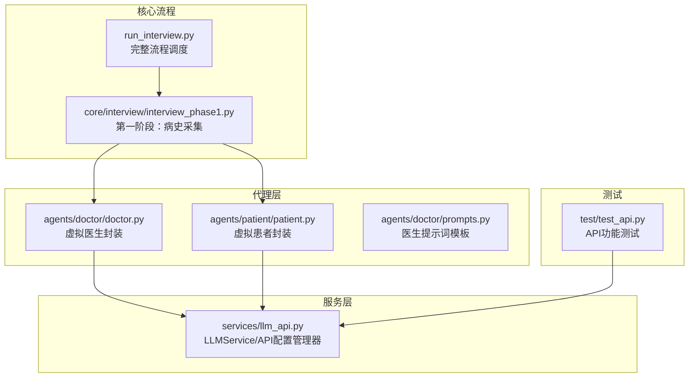
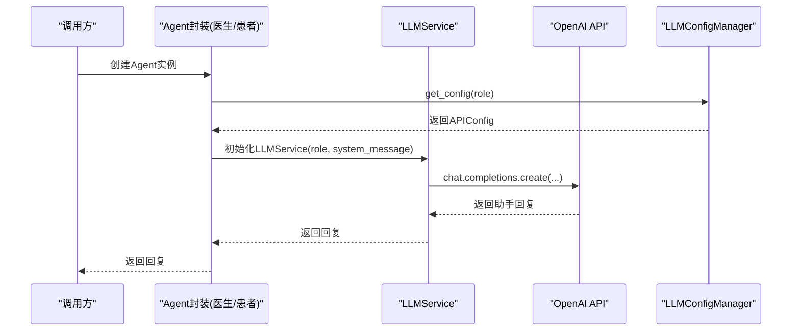
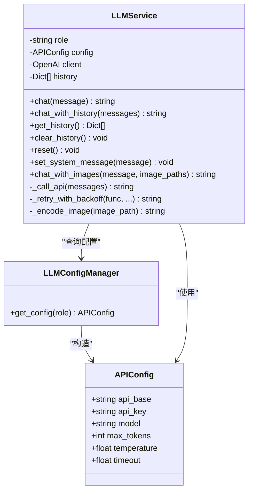
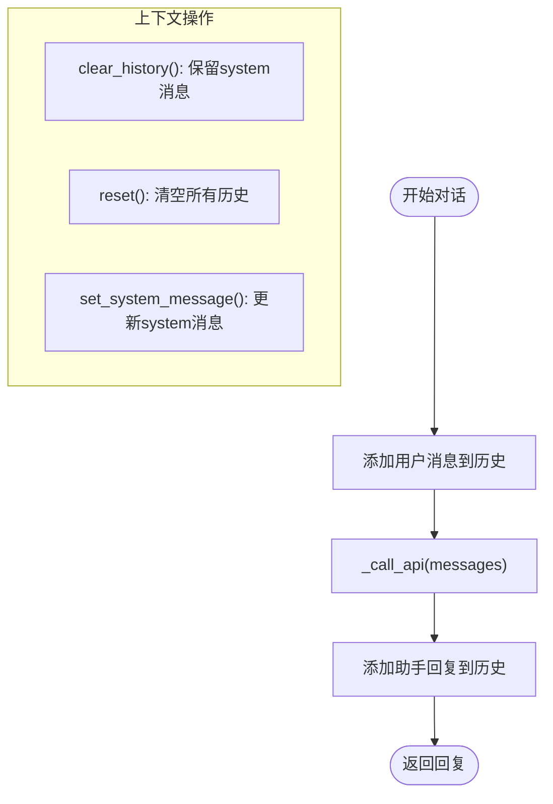
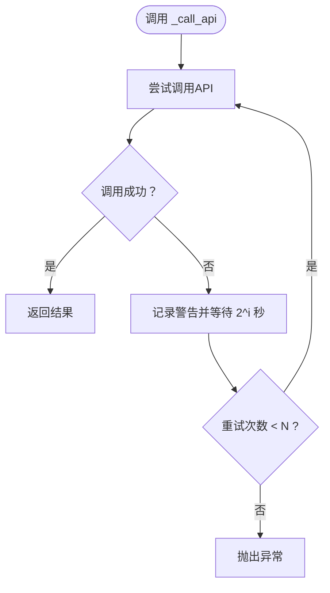
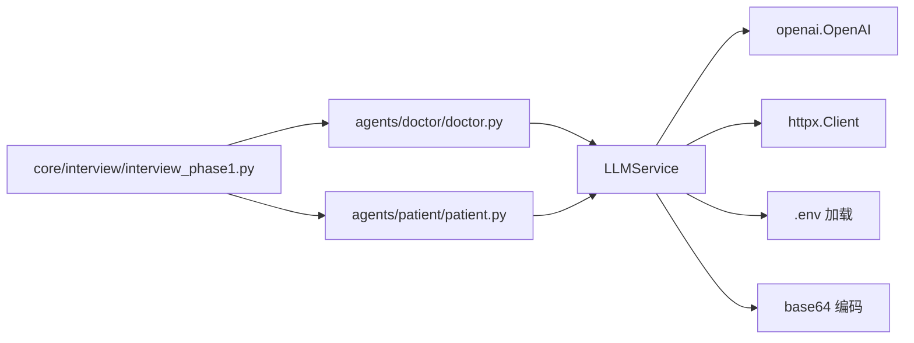

# LLM服务API

<cite>
**本文引用的文件**
- [llm_api.py](file://services/llm_api.py)
- [test_api.py](file://test/test_api.py)
- [run_interview.py](file://run_interview.py)
- [doctor.py](file://agents/doctor/doctor.py)
- [prompts.py](file://agents/doctor/prompts.py)
- [patient.py](file://agents/patient/patient.py)
- [interview_phase1.py](file://core/interview/interview_phase1.py)
</cite>

## 目录
1. [简介](#简介)
2. [项目结构](#项目结构)
3. [核心组件](#核心组件)
4. [架构总览](#架构总览)
5. [详细组件分析](#详细组件分析)
6. [依赖分析](#依赖分析)
7. [性能考虑](#性能考虑)
8. [故障排查指南](#故障排查指南)
9. [结论](#结论)
10. [附录](#附录)

## 简介
本文件面向使用者与开发者，系统化说明LLM服务API的设计与使用方式，重点覆盖以下方面：
- LLMService类的全部公共方法：chat()、chat_with_history()、get_history()、clear_history()、reset()、set_system_message()、chat_with_images()
- API配置管理器的工作原理与.env配置加载机制
- 对话上下文管理：历史记录的维护、清空与重置
- 多模态对话（图文）的使用方法与最佳实践
- 错误处理与重试机制
- 配置选项详解与性能优化建议

## 项目结构
本项目围绕“精神科访谈”流程组织，LLM服务位于services层，Agent层负责角色化封装，核心流程在core层串联各阶段。

图表来源
- [llm_api.py:1-250](file://services/llm_api.py#L1-L250)
- [doctor.py:1-95](file://agents/doctor/doctor.py#L1-L95)
- [prompts.py:1-21](file://agents/doctor/prompts.py#L1-L21)
- [patient.py:1-171](file://agents/patient/patient.py#L1-L171)
- [interview_phase1.py:1-200](file://core/interview/interview_phase1.py#L1-L200)
- [run_interview.py:1-408](file://run_interview.py#L1-L408)
- [test_api.py:1-234](file://test/test_api.py#L1-L234)

章节来源
- [llm_api.py:1-250](file://services/llm_api.py#L1-L250)
- [doctor.py:1-95](file://agents/doctor/doctor.py#L1-L95)
- [patient.py:1-171](file://agents/patient/patient.py#L1-L171)
- [interview_phase1.py:1-200](file://core/interview/interview_phase1.py#L1-L200)
- [run_interview.py:1-408](file://run_interview.py#L1-L408)
- [test_api.py:1-234](file://test/test_api.py#L1-L234)

## 核心组件
- LLMService：封装OpenAI Chat Completions API，负责对话上下文维护、系统提示词设置、多模态图文对话、错误重试等。
- LLMConfigManager：从.env文件按角色加载配置，统一管理API基础地址、密钥、模型、超时、温度、最大token等。
- APIConfig：承载单个角色的API配置对象。
- 便捷函数：get_patient_llm()、get_doctor_llm()、get_evaluator_llm()，快速获取指定角色的LLMService实例。

章节来源
- [llm_api.py:79-250](file://services/llm_api.py#L79-L250)

## 架构总览
下图展示LLMService与Agent层、核心流程之间的交互关系。

图表来源
- [llm_api.py:58-76](file://services/llm_api.py#L58-L76)
- [llm_api.py:79-112](file://services/llm_api.py#L79-L112)
- [doctor.py:32-55](file://agents/doctor/doctor.py#L32-L55)
- [patient.py:40-92](file://agents/patient/patient.py#L40-L92)

## 详细组件分析

### LLMService 类
- 角色化配置：通过LLMConfigManager按角色加载配置，支持patient、doctor、evaluator三类角色。
- 上下文管理：实例生命周期内维护对话历史，每次调用自动附加完整历史。
- 系统提示词：支持在初始化时设置，或运行时更新。
- 多模态支持：chat_with_images()支持文本+图片输入，自动编码图片为base64并拼接content。
- 错误重试：_retry_with_backoff()实现指数退避重试，提升网络波动下的稳定性。

图表来源
- [llm_api.py:47-76](file://services/llm_api.py#L47-L76)
- [llm_api.py:58-76](file://services/llm_api.py#L58-L76)
- [llm_api.py:79-250](file://services/llm_api.py#L79-L250)

章节来源
- [llm_api.py:79-250](file://services/llm_api.py#L79-L250)

### 方法定义与使用说明

#### chat(message: str) -> str
- 功能：发送消息并获取回复，自动维护上下文（将用户消息与助手回复追加至历史）。
- 参数：
  - message: str，用户输入文本
- 返回：str，助手回复内容
- 使用示例：参见测试用例中的单轮与多轮对话测试
- 注意：历史记录包含system消息（若存在）

章节来源
- [llm_api.py:113-131](file://services/llm_api.py#L113-L131)
- [test_api.py:19-52](file://test/test_api.py#L19-L52)

#### chat_with_history(messages: List[Dict[str, str]]) -> str
- 功能：使用指定的历史消息进行一次对话，不修改当前实例的历史。
- 参数：
  - messages: List[Dict[str, str]]，完整对话历史（每条包含role与content）
- 返回：str，助手回复内容
- 使用示例：适合需要临时注入外部历史或对比不同上下文的场景

章节来源
- [llm_api.py:133-142](file://services/llm_api.py#L133-L142)

#### get_history() -> List[Dict[str, str]]
- 功能：返回当前对话历史的副本（不暴露内部可变引用）。
- 返回：List[Dict[str, str]]，历史记录列表
- 使用示例：用于调试、持久化或分析对话过程

章节来源
- [llm_api.py:171-173](file://services/llm_api.py#L171-L173)
- [test_api.py:113-128](file://test/test_api.py#L113-L128)

#### clear_history()
- 功能：清空当前历史，但保留system消息（若存在）。
- 使用示例：在切换话题或重新开始时清理历史

章节来源
- [llm_api.py:175-179](file://services/llm_api.py#L175-L179)
- [test_api.py:131-148](file://test/test_api.py#L131-L148)

#### reset()
- 功能：完全重置，清空所有历史（包括system消息）。
- 使用示例：彻底新建对话，适用于全新会话

章节来源
- [llm_api.py:181-183](file://services/llm_api.py#L181-L183)

#### set_system_message(message: str)
- 功能：设置或更新系统提示词，会移除旧的system消息并插入新的system消息到历史开头。
- 使用示例：动态调整角色设定或任务约束

章节来源
- [llm_api.py:185-190](file://services/llm_api.py#L185-L190)

#### chat_with_images(message: str, image_paths: Union[str, List[str]]) -> str
- 功能：多模态对话（图文）。将文本与一张或多张图片拼接为content，发送给模型。
- 参数：
  - message: str，关于图片的提示文本
  - image_paths: str 或 List[str]，图片路径或路径列表
- 返回：str，助手回复内容
- 图片处理：内部将图片读取为base64编码，拼接到content中
- 使用示例：结合医生问诊场景，上传患者症状图片进行分析

章节来源
- [llm_api.py:192-227](file://services/llm_api.py#L192-L227)
- [llm_api.py:229-232](file://services/llm_api.py#L229-L232)

### API配置管理器（LLMConfigManager）
- 配置来源：项目根目录.env文件，按角色键名加载：
  - PATIENT_API_BASE、PATIENT_API_KEY、PATIENT_MODEL
  - DOCTOR_API_BASE、DOCTOR_API_KEY、DOCTOR_MODEL
  - EVALUATOR_API_BASE、EVALUATOR_API_KEY、EVALUATOR_MODEL
  - MAX_TOKENS、TEMPERATURE、TIMEOUT（全局默认值）
- 缓存策略：首次按角色加载后缓存，后续直接复用
- 默认模型：未指定时默认使用gpt-4o

章节来源
- [llm_api.py:58-76](file://services/llm_api.py#L58-L76)
- [llm_api.py:47-76](file://services/llm_api.py#L47-L76)

### 对话上下文管理机制
- 历史结构：每条记录为{"role": "user"/"assistant"/"system", "content": ...}
- 生命周期：
  - 初始化：可选设置system消息
  - chat()：追加用户消息→调用API→追加助手回复
  - chat_with_history()：仅调用API，不修改当前实例历史
  - clear_history()：保留system消息，清空其他历史
  - reset()：清空所有历史
  - set_system_message()：更新system消息位置在历史首位
- 作用域：实例级，不同实例互不影响

图表来源
- [llm_api.py:113-131](file://services/llm_api.py#L113-L131)
- [llm_api.py:175-190](file://services/llm_api.py#L175-L190)

章节来源
- [llm_api.py:113-190](file://services/llm_api.py#L113-L190)

### 多模态对话（图文）最佳实践
- 输入规范：
  - message：清晰描述希望模型关注的图片内容
  - image_paths：支持单张或多张图片；内部统一转换为列表
- 图像编码：自动读取图片并base64编码，拼接到content中
- 使用建议：
  - 控制图片数量与尺寸，避免超出token限制
  - 在message中明确任务目标（如“分析该皮肤图片”）
  - 若需跨轮次分析，确保历史中包含相关上下文

章节来源
- [llm_api.py:192-227](file://services/llm_api.py#L192-L227)
- [llm_api.py:229-232](file://services/llm_api.py#L229-L232)

### 错误处理与重试机制
- 底层调用：_call_api()封装OpenAI API调用，传入model、messages、max_tokens、temperature、timeout
- 重试策略：_retry_with_backoff()实现最多N次重试，指数退避（2^i秒延迟），记录警告日志
- 异常传播：超过最大重试次数后抛出最后一次异常

图表来源
- [llm_api.py:144-156](file://services/llm_api.py#L144-L156)
- [llm_api.py:158-169](file://services/llm_api.py#L158-L169)

章节来源
- [llm_api.py:144-169](file://services/llm_api.py#L144-L169)

### 配置选项详解
- 角色相关（按角色键名）：
  - API基础地址：PATIENT_API_BASE / DOCTOR_API_BASE / EVALUATOR_API_BASE
  - API密钥：PATIENT_API_KEY / DOCTOR_API_KEY / EVALUATOR_API_KEY
  - 模型：PATIENT_MODEL / DOCTOR_MODEL / EVALUATOR_MODEL（默认gpt-4o）
- 全局默认：
  - MAX_TOKENS：默认4096
  - TEMPERATURE：默认1.0
  - TIMEOUT：默认30.0秒

章节来源
- [llm_api.py:58-76](file://services/llm_api.py#L58-L76)

## 依赖分析
- LLMService依赖：
  - OpenAI SDK：调用chat.completions.create
  - httpx：自定义HTTP客户端（关闭SSL校验、设置超时）
  - dotenv：从.env加载环境变量
  - base64：图片base64编码
  - logging：日志记录（抑制httpx噪音）
- Agent层依赖：
  - doctor.py：通过LLMService(role="doctor", system_message=...)创建医生Agent
  - patient.py：通过LLMService(role="patient", system_message=...)创建患者Agent
- 核心流程依赖：
  - interview_phase1.py：加载.env、控制MAX_TURNS等全局参数，调用Agent进行对话

图表来源
- [llm_api.py:28-44](file://services/llm_api.py#L28-L44)
- [llm_api.py:99-104](file://services/llm_api.py#L99-L104)
- [doctor.py:28-55](file://agents/doctor/doctor.py#L28-L55)
- [patient.py:36-92](file://agents/patient/patient.py#L36-L92)
- [interview_phase1.py:37-61](file://core/interview/interview_phase1.py#L37-L61)

章节来源
- [llm_api.py:28-44](file://services/llm_api.py#L28-L44)
- [doctor.py:28-55](file://agents/doctor/doctor.py#L28-L55)
- [patient.py:36-92](file://agents/patient/patient.py#L36-L92)
- [interview_phase1.py:37-61](file://core/interview/interview_phase1.py#L37-L61)

## 性能考虑
- 超时与重试：合理设置TIMEOUT与重试次数，避免长时间阻塞；网络不稳定时可适当增加重试次数
- 模型选择：不同角色可配置不同模型，平衡成本与质量
- 上下文长度：尽量控制历史长度，避免超出模型上下文窗口；必要时定期清理历史
- 多模态开销：图片编码与传输会增加请求体积，建议压缩图片或限制数量
- 并发与隔离：不同角色实例相互独立，避免共享状态导致的竞态

[本节为通用指导，不直接分析具体文件]

## 故障排查指南
- 网络/超时问题：
  - 现象：调用失败、日志出现警告
  - 处理：检查TIMEOUT设置、网络连通性；观察重试日志
- 配置缺失：
  - 现象：角色配置为空
  - 处理：确认.env中对应键名是否存在且拼写正确
- 图片编码失败：
  - 现象：无法读取图片或base64编码异常
  - 处理：确认图片路径有效、权限正确、文件未损坏
- 历史污染：
  - 现象：历史中出现重复或system消息位置异常
  - 处理：使用clear_history()/reset()/set_system_message()进行修正

章节来源
- [llm_api.py:158-169](file://services/llm_api.py#L158-L169)
- [llm_api.py:175-190](file://services/llm_api.py#L175-L190)

## 结论
LLM服务API提供了简洁而强大的接口，支持角色化配置、上下文维护、多模态输入与稳健的错误重试。通过合理的配置与使用策略，可在精神科访谈等复杂场景中稳定地构建高质量的对话系统。

[本节为总结性内容，不直接分析具体文件]

## 附录

### 使用示例与测试参考
- 基础聊天与多轮对话：参见测试脚本中的单轮与多轮对话测试
- 名字记忆与上下文：参见测试脚本中的名字记忆测试
- 新实例新上下文：参见测试脚本中的新实例测试
- 系统提示词：参见测试脚本中的系统提示词测试
- 历史获取与清空：参见测试脚脚本中的历史测试
- 角色配置：参见测试脚本中的角色配置测试

章节来源
- [test_api.py:19-234](file://test/test_api.py#L19-L234)

### Agent与流程集成
- 医生Agent：通过doctor.py创建，使用doctor角色的API配置与提示词模板
- 患者Agent：通过patient.py创建，将病例信息注入系统提示词
- 完整流程：run_interview.py串联各阶段，加载.env并驱动Agent完成多阶段访谈

章节来源
- [doctor.py:32-55](file://agents/doctor/doctor.py#L32-L55)
- [prompts.py:5-20](file://agents/doctor/prompts.py#L5-L20)
- [patient.py:40-92](file://agents/patient/patient.py#L40-L92)
- [run_interview.py:46-396](file://run_interview.py#L46-L396)