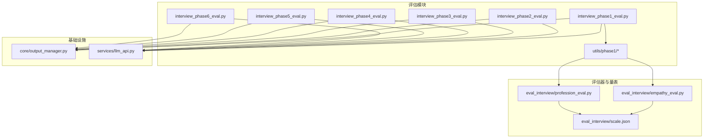
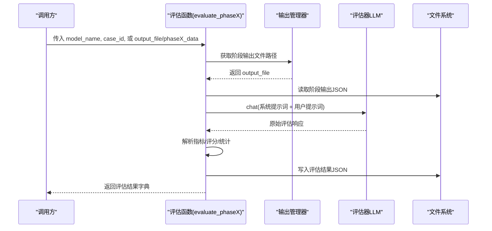
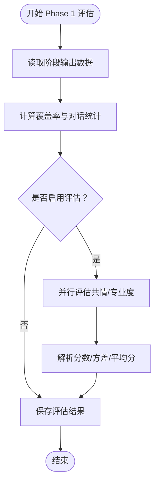
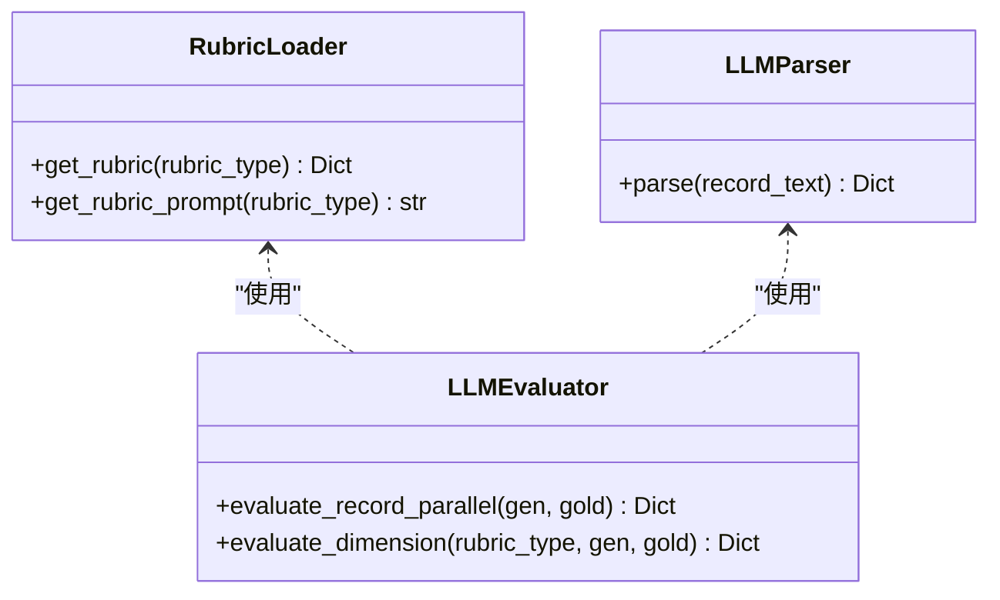
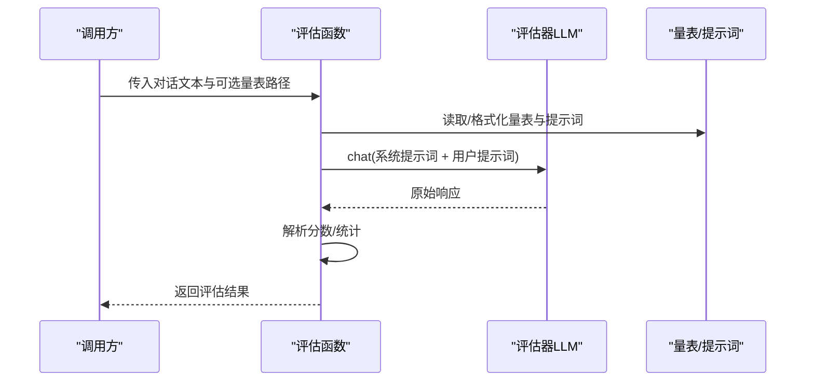
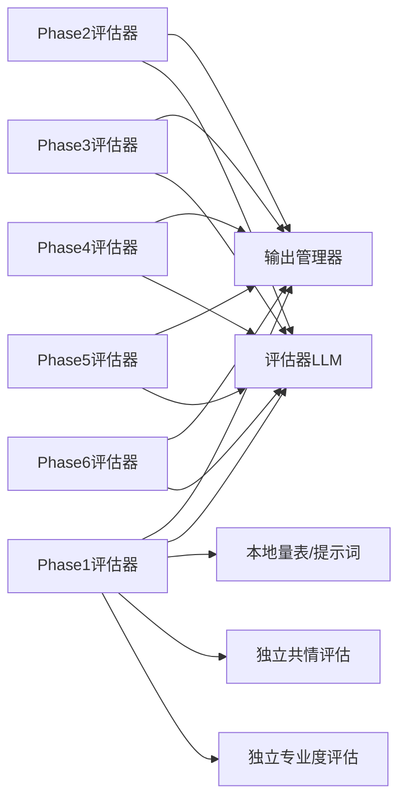

# 评估API

<cite>
**本文档引用的文件**   
- [core/evaluate/__init__.py](file://core/evaluate/__init__.py)
- [core/evaluate/interview_phase1_eval.py](file://core/evaluate/interview_phase1_eval.py)
- [core/evaluate/interview_phase2_eval.py](file://core/evaluate/interview_phase2_eval.py)
- [core/evaluate/interview_phase3_eval.py](file://core/evaluate/interview_phase3_eval.py)
- [core/evaluate/interview_phase4_eval.py](file://core/evaluate/interview_phase4_eval.py)
- [core/evaluate/interview_phase5_eval.py](file://core/evaluate/interview_phase5_eval.py)
- [core/evaluate/interview_phase6_eval.py](file://core/evaluate/interview_phase6_eval.py)
- [core/evaluate/utils/phase1/evaluator.py](file://core/evaluate/utils/phase1/evaluator.py)
- [core/evaluate/utils/phase1/prompts.py](file://core/evaluate/utils/phase1/prompts.py)
- [core/evaluate/utils/phase1/scales.py](file://core/evaluate/utils/phase1/scales.py)
- [eval_interview/empathy_eval.py](file://eval_interview/empathy_eval.py)
- [eval_interview/profession_eval.py](file://eval_interview/profession_eval.py)
- [eval_interview/scale.json](file://eval_interview/scale.json)
- [services/llm_api.py](file://services/llm_api.py)
- [core/output_manager.py](file://core/output_manager.py)
</cite>

## 目录
1. [简介](#简介)
2. [项目结构](#项目结构)
3. [核心组件](#核心组件)
4. [架构总览](#架构总览)
5. [详细组件分析](#详细组件分析)
6. [依赖分析](#依赖分析)
7. [性能考量](#性能考量)
8. [故障排查指南](#故障排查指南)
9. [结论](#结论)
10. [附录](#附录)

## 简介
本文件系统性梳理精神科访谈评估API，覆盖六个评估阶段（Phase 1 至 Phase 6），详述各阶段评估函数的使用方法、评估器代理接口与配置、共情度与专业度评估的实现与调用方式、评估量表的配置与自定义、评估结果的数据格式与字段含义、参数调整与优化建议、完整评估流程示例与使用场景，以及评估结果的存储与导出机制。

## 项目结构
评估模块位于 core/evaluate 下，按阶段拆分，每个阶段提供独立的 evaluate_phaseX_eval 函数；同时提供通用的输出管理器与 LLM 服务封装，以及 Phase 1 的本地量表与提示词工具。

图表来源
- [core/evaluate/interview_phase1_eval.py:1-376](file://core/evaluate/interview_phase1_eval.py#L1-L376)
- [core/evaluate/interview_phase2_eval.py:1-301](file://core/evaluate/interview_phase2_eval.py#L1-L301)
- [core/evaluate/interview_phase3_eval.py:1-598](file://core/evaluate/interview_phase3_eval.py#L1-L598)
- [core/evaluate/interview_phase4_eval.py:1-256](file://core/evaluate/interview_phase4_eval.py#L1-L256)
- [core/evaluate/interview_phase5_eval.py:1-256](file://core/evaluate/interview_phase5_eval.py#L1-L256)
- [core/evaluate/interview_phase6_eval.py:1-416](file://core/evaluate/interview_phase6_eval.py#L1-L416)
- [core/evaluate/utils/phase1/evaluator.py:1-160](file://core/evaluate/utils/phase1/evaluator.py#L1-L160)
- [eval_interview/empathy_eval.py:1-248](file://eval_interview/empathy_eval.py#L1-L248)
- [eval_interview/profession_eval.py:1-204](file://eval_interview/profession_eval.py#L1-L204)
- [eval_interview/scale.json:1-258](file://eval_interview/scale.json#L1-L258)
- [services/llm_api.py:1-250](file://services/llm_api.py#L1-L250)
- [core/output_manager.py:1-189](file://core/output_manager.py#L1-L189)

章节来源
- [core/evaluate/__init__.py:1-43](file://core/evaluate/__init__.py#L1-L43)

## 核心组件
- 评估入口聚合：通过 core/evaluate/__init__.py 导出六个阶段评估函数，便于统一调用。
- 阶段评估器：每个阶段独立的 evaluate_phaseX_eval 模块，负责读取对应阶段输出、执行评估、保存结果。
- 评估器代理（LLM）：基于 services/llm_api.py 的 LLMService，按角色（patient/doctor/evaluator）提供统一的聊天接口与系统提示词管理。
- 量表与提示词：Phase 1 采用本地量表与提示词工具；共情与专业度也可通过 eval_interview 下的独立函数直接评估。
- 输出管理：core/output_manager.py 统一管理各阶段输出文件路径与写入，支持增量更新与状态标注。

章节来源
- [core/evaluate/__init__.py:28-42](file://core/evaluate/__init__.py#L28-L42)
- [services/llm_api.py:79-250](file://services/llm_api.py#L79-L250)
- [core/output_manager.py:20-189](file://core/output_manager.py#L20-L189)

## 架构总览
评估API采用“阶段驱动 + LLM评估 + 量表/提示词”的分层设计。前端调用六个阶段评估函数，内部通过输出管理器定位阶段输出文件，读取对话或结构化数据，构造评估提示词，调用评估器LLM，解析结果并保存到评估输出目录。

图表来源
- [core/evaluate/interview_phase1_eval.py:174-330](file://core/evaluate/interview_phase1_eval.py#L174-L330)
- [core/evaluate/interview_phase2_eval.py:153-255](file://core/evaluate/interview_phase2_eval.py#L153-L255)
- [core/evaluate/interview_phase3_eval.py:422-552](file://core/evaluate/interview_phase3_eval.py#L422-L552)
- [core/evaluate/interview_phase4_eval.py:126-210](file://core/evaluate/interview_phase4_eval.py#L126-L210)
- [core/evaluate/interview_phase5_eval.py:126-210](file://core/evaluate/interview_phase5_eval.py#L126-L210)
- [core/evaluate/interview_phase6_eval.py:267-370](file://core/evaluate/interview_phase6_eval.py#L267-L370)
- [core/output_manager.py:35-83](file://core/output_manager.py#L35-L83)
- [services/llm_api.py:113-191](file://services/llm_api.py#L113-L191)

## 详细组件分析

### 阶段一：历史采集评估（Phase 1）
- 输入来源：可从 output_manager 默认路径读取 interview_phase1_output.json，或直接传入 output_file 或 phase1_data。
- 评估内容：
  - 覆盖率统计：主诉与精神状态条目的覆盖率与整体覆盖率。
  - 对话统计：轮次、患者/医生发言次数、对话长度。
  - 可选：共情度与专业度评估（默认启用，支持并行）。
- 评估器代理：调用 core/evaluate/utils/phase1/evaluator.py 中的 evaluate_empathy/evaluate_profession，支持 evaluate_both 并行。
- 输出：保存 evaluation_phase1_output.json，包含覆盖率、对话统计、状态、可选评估结果与输出文件路径。

图表来源
- [core/evaluate/interview_phase1_eval.py:174-330](file://core/evaluate/interview_phase1_eval.py#L174-L330)
- [core/evaluate/utils/phase1/evaluator.py:133-160](file://core/evaluate/utils/phase1/evaluator.py#L133-L160)

章节来源
- [core/evaluate/interview_phase1_eval.py:174-330](file://core/evaluate/interview_phase1_eval.py#L174-L330)
- [core/evaluate/utils/phase1/evaluator.py:50-160](file://core/evaluate/utils/phase1/evaluator.py#L50-L160)
- [core/evaluate/utils/phase1/prompts.py:111-280](file://core/evaluate/utils/phase1/prompts.py#L111-L280)
- [core/evaluate/utils/phase1/scales.py:10-464](file://core/evaluate/utils/phase1/scales.py#L10-L464)

### 阶段二：检查推荐评估（Phase 2）
- 输入来源：读取 interview_phase2_output.json，包含检查项目数组与检查结果字典。
- 评估内容：基于金标准辅助检查，计算 Precision、Recall、F1、Jaccard 指标，统计 TP/FP/FN 等。
- 输出：保存 evaluation_phase2_output.json，包含指标、统计与警告信息。

章节来源
- [core/evaluate/interview_phase2_eval.py:153-255](file://core/evaluate/interview_phase2_eval.py#L153-L255)

### 阶段三：病历合成评估（Phase 3）
- 输入来源：读取 interview_phase3_output.json，包含语法化病历字符串。
- 评估内容：使用 LLM 将生成与真值病历划分到四个区域（主诉、体格检查、精神检查、既往史家族史），并基于 rubric 逐项覆盖度与准确度评分，支持四维并行评估。
- 输出：保存 evaluation_phase3_output.json，包含总百分比、加权得分、各维度详情与解析后的记录。

图表来源
- [core/evaluate/interview_phase3_eval.py:41-391](file://core/evaluate/interview_phase3_eval.py#L41-L391)

章节来源
- [core/evaluate/interview_phase3_eval.py:422-552](file://core/evaluate/interview_phase3_eval.py#L422-L552)

### 阶段四：诊断类别识别评估（Phase 4）
- 输入来源：读取 interview_phase4_output.json，包含预测诊断类别列表。
- 评估内容：从 ground_truth.jsonl 加载真实诊断类别，计算集合匹配指标（Precision/Recall/F1/Jaccard）。
- 输出：保存 evaluation_phase4_output.json，包含指标与预测/真实类别。

章节来源
- [core/evaluate/interview_phase4_eval.py:126-210](file://core/evaluate/interview_phase4_eval.py#L126-L210)

### 阶段五：诊断假设评估（Phase 5）
- 输入来源：读取 interview_phase5_output.json，包含预测诊断假设列表。
- 评估内容：从 ground_truth.jsonl 加载真实诊断，计算集合匹配指标。
- 输出：保存 evaluation_phase5_output.json，包含指标与预测/真实诊断。

章节来源
- [core/evaluate/interview_phase5_eval.py:126-210](file://core/evaluate/interview_phase5_eval.py#L126-L210)

### 阶段六：鉴别诊断评估（Phase 6）
- 输入来源：读取 interview_phase6_output.json，包含最终鉴别诊断列表。
- 评估内容：从 ground_truth.jsonl 加载真实诊断，计算：
  - 集合匹配指标：Precision、Recall、F1、Jaccard
  - 主诊断排序指标：Exact Match、Hit@K、Reciprocal Rank
  - 排序一致性指标：Pairwise Order Accuracy（POA）、归一化折损累积增益（nDCG）
- 输出：保存 evaluation_phase6_output.json，包含三类指标与诊断列表。

章节来源
- [core/evaluate/interview_phase6_eval.py:267-370](file://core/evaluate/interview_phase6_eval.py#L267-L370)

### 评估器代理接口与配置
- 角色与系统提示词：LLMService(role="evaluator") 提供评估器角色，支持设置/更新系统提示词。
- 聊天接口：chat(message) 自动维护上下文历史，chat_with_history(messages) 支持外部历史。
- 便捷函数：get_evaluator_llm(system_message) 直接获取评估器实例。
- 配置来源：从项目根目录 .env 读取 API 基础地址、密钥、模型、温度、最大token等。

章节来源
- [services/llm_api.py:79-250](file://services/llm_api.py#L79-L250)

### 共情度评估与专业度评估
- 本地量表与提示词（Phase 1）：
  - 量表：EMPATHY_SCALE（16题）与 PROFESSION_SCALE（12题），定义问题、定义、评分标准与关注点。
  - 提示词：EMPATHY_SYSTEM_PROMPT 与 PROFESSION_SYSTEM_PROMPT，配合 format_scale_text 生成用户提示词。
  - 评估：evaluate_empathy/evaluate_profession 解析模型输出分数，计算总分、平均分、方差（仅共情）。
- 独立函数（eval_interview）：
  - evaluate_empathy/conversation_text/scale_path：自动查找量表文件，组装提示词，调用评估器LLM，返回 prompts、原始结果与解析信息。
  - evaluate_profession/conversation_text/scale_path：同上，支持自定义量表路径。
- 量表文件：
  - eval_interview/scale.json：共情量表（16题）。
  - eval_interview/profession_scale.json：专业度量表（多表结构兼容）。

图表来源
- [eval_interview/empathy_eval.py:9-248](file://eval_interview/empathy_eval.py#L9-L248)
- [eval_interview/profession_eval.py:9-204](file://eval_interview/profession_eval.py#L9-L204)
- [core/evaluate/utils/phase1/evaluator.py:50-131](file://core/evaluate/utils/phase1/evaluator.py#L50-L131)
- [core/evaluate/utils/phase1/prompts.py:111-280](file://core/evaluate/utils/phase1/prompts.py#L111-L280)
- [core/evaluate/utils/phase1/scales.py:10-464](file://core/evaluate/utils/phase1/scales.py#L10-L464)

章节来源
- [eval_interview/empathy_eval.py:9-248](file://eval_interview/empathy_eval.py#L9-L248)
- [eval_interview/profession_eval.py:9-204](file://eval_interview/profession_eval.py#L9-L204)
- [eval_interview/scale.json:1-258](file://eval_interview/scale.json#L1-L258)

### 评估量表的配置与自定义
- 共情量表（16题）：支持从 data/scale.json、data/共情量表.json、data/*量表*.json 等路径自动发现与加载，兼容非严格JSON格式。
- 专业度量表：支持从 data/profession_scale.json、data/profession_scale、data/*profession*scale*.json 等路径自动发现与加载。
- 自定义路径：调用 evaluate_empathy/profession 时可通过 scale_path 显式指定量表文件路径。
- 量表结构：支持 list 与 dict（多表）两种结构，统一拍平为题目数组，按 id 排序输出。

章节来源
- [eval_interview/empathy_eval.py:23-96](file://eval_interview/empathy_eval.py#L23-L96)
- [eval_interview/profession_eval.py:23-91](file://eval_interview/profession_eval.py#L23-L91)

### 评估结果的数据格式与字段含义
- 通用字段（各阶段评估结果字典包含）：
  - metrics/counts/status/predicted_* / true_* / dimensions / total_* / output_file / model_name / case_id
- 阶段特有字段：
  - Phase 1：coverage_stats（主诉/精神状态覆盖率、整体覆盖率、使用/总数）、conversation_stats（轮次、患者/医生发言数、长度）、empathy_evaluation（总分、平均分、方差、题目数、解析分数）、profession_evaluation（总分、平均分、题目数、解析分数）。
  - Phase 2：metrics（Precision/Recall/F1/Jaccard）、counts（TP/FP/FN/none_count等）、warnings。
  - Phase 3：total_percentage、total_weighted_score、total_actual_score、total_actual_max、dimensions（四维评分详情）、generated_record/true_record。
  - Phase 4/5/6：predicted_categories/truth_categories/diagnostic_categories/differential_diagnosis、set_metrics/primary_metrics/ranking_metrics。
- 输出文件：evaluation_phaseX_output.json，包含上述字段与时间戳、模型名、病例ID等元信息。

章节来源
- [core/evaluate/interview_phase1_eval.py:241-330](file://core/evaluate/interview_phase1_eval.py#L241-L330)
- [core/evaluate/interview_phase2_eval.py:201-255](file://core/evaluate/interview_phase2_eval.py#L201-L255)
- [core/evaluate/interview_phase3_eval.py:515-552](file://core/evaluate/interview_phase3_eval.py#L515-L552)
- [core/evaluate/interview_phase4_eval.py:182-210](file://core/evaluate/interview_phase4_eval.py#L182-L210)
- [core/evaluate/interview_phase5_eval.py:183-210](file://core/evaluate/interview_phase5_eval.py#L183-L210)
- [core/evaluate/interview_phase6_eval.py:327-370](file://core/evaluate/interview_phase6_eval.py#L327-L370)

### 参数调整与优化建议
- 并行评估：Phase 1 默认并行评估共情与专业度，可关闭并行以降低并发开销。
- 量表路径：优先使用传入的 scale_path，否则自动扫描 data 目录，确保量表文件命名与结构正确。
- 指标口径：Phase 2/4/5/6 的指标计算严格遵循约定口径，注意输入数据类型（数组/对象/字符串）与 JSON 格式。
- LLM 配置：通过 .env 调整评估器模型、温度、超时与最大token，以平衡准确性与稳定性。
- 错误处理：各阶段评估函数捕获异常并打印堆栈，便于定位问题。

章节来源
- [core/evaluate/interview_phase1_eval.py:254-298](file://core/evaluate/interview_phase1_eval.py#L254-L298)
- [core/evaluate/interview_phase2_eval.py:36-63](file://core/evaluate/interview_phase2_eval.py#L36-L63)
- [services/llm_api.py:58-77](file://services/llm_api.py#L58-L77)

### 评估流程示例与使用场景
- 典型流程：
  1) 运行各阶段访谈生成 interview_phaseX_output.json。
  2) 调用 evaluate_phaseX(model_name, case_id) 或 evaluate_phaseX(output_file=...)。
  3) 查看 evaluation_phaseX_output.json 与终端输出。
- 使用场景：
  - Phase 1：评估医生在历史采集阶段的共情与专业表现，辅助教学与反馈。
  - Phase 2：评估检查推荐的准确性，指导临床决策训练。
  - Phase 3：评估病历合成质量，关注结构化与覆盖度。
  - Phase 4/5/6：评估诊断识别、假设与鉴别诊断的集合匹配与排序质量。

章节来源
- [core/evaluate/interview_phase1_eval.py:1-24](file://core/evaluate/interview_phase1_eval.py#L1-L24)
- [core/evaluate/interview_phase2_eval.py:1-22](file://core/evaluate/interview_phase2_eval.py#L1-L22)
- [core/evaluate/interview_phase3_eval.py:1-22](file://core/evaluate/interview_phase3_eval.py#L1-L22)
- [core/evaluate/interview_phase4_eval.py:1-22](file://core/evaluate/interview_phase4_eval.py#L1-L22)
- [core/evaluate/interview_phase5_eval.py:1-22](file://core/evaluate/interview_phase5_eval.py#L1-L22)
- [core/evaluate/interview_phase6_eval.py:1-24](file://core/evaluate/interview_phase6_eval.py#L1-L24)

### 评估结果的存储与导出机制
- 存储路径：data/output/evaluation/{model_name}/{case_id}/evaluation_phaseX_output.json。
- 写入策略：各阶段评估函数内部统一调用 save_evaluation_result，写入包含元数据与评估结果的JSON。
- 输出管理器：提供 get_evaluation_dir/get_evaluation_output_file/save_evaluation_result 的统一接口，确保路径一致与文件原子写入。

章节来源
- [core/evaluate/interview_phase1_eval.py:47-172](file://core/evaluate/interview_phase1_eval.py#L47-L172)
- [core/evaluate/interview_phase2_eval.py:35-36](file://core/evaluate/interview_phase2_eval.py#L35-L36)
- [core/evaluate/interview_phase3_eval.py:497-529](file://core/evaluate/interview_phase3_eval.py#L497-L529)
- [core/evaluate/interview_phase4_eval.py:37-189](file://core/evaluate/interview_phase4_eval.py#L37-L189)
- [core/evaluate/interview_phase5_eval.py:37-189](file://core/evaluate/interview_phase5_eval.py#L37-L189)
- [core/evaluate/interview_phase6_eval.py:40-337](file://core/evaluate/interview_phase6_eval.py#L40-L337)
- [core/output_manager.py:20-83](file://core/output_manager.py#L20-L83)

## 依赖分析
- 模块耦合：
  - 各阶段评估器依赖 output_manager 获取输出文件路径与读取阶段数据。
  - Phase 1 评估器依赖本地量表与提示词工具，亦可调用 eval_interview 下的独立评估函数。
  - 所有评估器通过 LLMService 统一调用评估器LLM，避免重复配置。
- 外部依赖：
  - .env 配置文件提供 API 基础地址、密钥与模型等。
  - data 目录下的量表文件与 ground_truth.jsonl 提供评估依据。

图表来源
- [core/evaluate/interview_phase1_eval.py:212-218](file://core/evaluate/interview_phase1_eval.py#L212-L218)
- [core/evaluate/interview_phase2_eval.py:184-189](file://core/evaluate/interview_phase2_eval.py#L184-L189)
- [core/evaluate/interview_phase3_eval.py:500-511](file://core/evaluate/interview_phase3_eval.py#L500-L511)
- [core/evaluate/interview_phase4_eval.py:159-164](file://core/evaluate/interview_phase4_eval.py#L159-L164)
- [core/evaluate/interview_phase5_eval.py:159-164](file://core/evaluate/interview_phase5_eval.py#L159-L164)
- [core/evaluate/interview_phase6_eval.py:302-307](file://core/evaluate/interview_phase6_eval.py#L302-L307)
- [services/llm_api.py:247-250](file://services/llm_api.py#L247-L250)

## 性能考量
- 并行评估：Phase 1 默认并行评估共情与专业度，显著缩短等待时间；如需串行可关闭并行。
- I/O 优化：统一通过 output_manager 读写文件，避免重复路径解析与竞态。
- LLM 调用：合理设置温度与最大token，平衡生成质量与延迟；必要时增加重试与指数退避。
- 指标计算：集合匹配与排序指标为纯Python计算，复杂度与输入规模线性相关，建议批量评估时合并处理。

## 故障排查指南
- 量表文件缺失：确保 data 目录存在共情/专业度量表文件，或通过 scale_path 指定。
- 数据格式错误：Phase 2/4/5/6 的输入需满足 JSON 类型要求，否则抛出解析错误。
- LLM 调用失败：检查 .env 配置与网络连通性；查看日志重试与退避机制。
- 输出路径异常：确认 model_name 与 case_id 正确，或直接传入 output_file。

章节来源
- [eval_interview/empathy_eval.py:43-44](file://eval_interview/empathy_eval.py#L43-L44)
- [eval_interview/profession_eval.py:41-42](file://eval_interview/profession_eval.py#L41-L42)
- [core/evaluate/interview_phase2_eval.py:36-63](file://core/evaluate/interview_phase2_eval.py#L36-L63)
- [services/llm_api.py:158-169](file://services/llm_api.py#L158-L169)

## 结论
本评估API以阶段化设计贯穿整个精神科访谈流程，结合本地量表与统一的评估器LLM，提供从共情与专业度到诊断识别与鉴别诊断的全链路评估能力。通过标准化的输出管理与丰富的指标体系，既满足教学反馈需求，也为临床决策训练提供了可量化的质量度量。

## 附录
- API一览（调用方式概览）
  - evaluate_phase1(model_name, case_id) 或 evaluate_phase1(output_file=...) 或 evaluate_phase1(phase1_data=...)
  - evaluate_phase2(model_name, case_id) 或 evaluate_phase2(output_file=...) 或 evaluate_phase2(phase2_data=...)
  - evaluate_phase3(model_name, case_id) 或 evaluate_phase3(output_file=...) 或 evaluate_phase3(phase3_data=...)
  - evaluate_phase4(model_name, case_id) 或 evaluate_phase4(output_file=...) 或 evaluate_phase4(phase4_data=...)
  - evaluate_phase5(model_name, case_id) 或 evaluate_phase5(output_file=...) or evaluate_phase5(phase5_data=...)
  - evaluate_phase6(model_name, case_id) 或 evaluate_phase6(output_file=...) or evaluate_phase6(phase6_data=...)

章节来源
- [core/evaluate/__init__.py:6-26](file://core/evaluate/__init__.py#L6-L26)