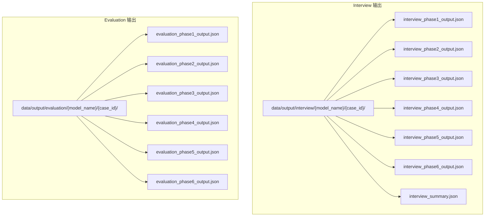
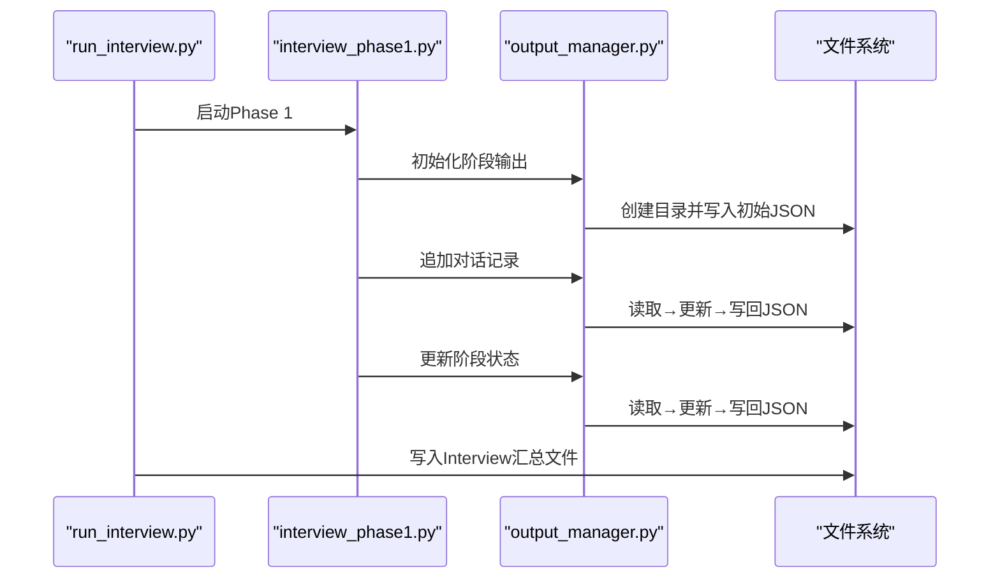
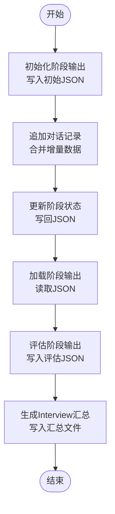
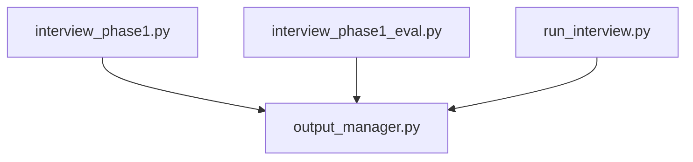

# 输出管理API

<cite>
**本文档引用的文件**
- [core/output_manager.py](file://core/output_manager.py)
- [run_interview.py](file://run_interview.py)
- [core/interview/interview_phase1.py](file://core/interview/interview_phase1.py)
- [core/evaluate/interview_phase1_eval.py](file://core/evaluate/interview_phase1_eval.py)
- [data/output/interview/qwen-flash/1009904/interview_phase1_output.json](file://data/output/interview/qwen-flash/1009904/interview_phase1_output.json)
- [data/output/evaluation/qwen-flash/1009904/evaluation_phase1_output.json](file://data/output/evaluation/qwen-flash/1009904/evaluation_phase1_output.json)
</cite>

## 目录
1. [简介](#简介)
2. [项目结构](#项目结构)
3. [核心组件](#核心组件)
4. [架构总览](#架构总览)
5. [详细组件分析](#详细组件分析)
6. [依赖分析](#依赖分析)
7. [性能考虑](#性能考虑)
8. [故障排除指南](#故障排除指南)
9. [结论](#结论)
10. [附录](#附录)

## 简介
本文件面向输出管理API，系统性说明输出文件的组织结构、文件命名规则、数据持久化接口、JSON数据结构规范，以及数据导出与导入的API使用方式。重点覆盖以下方面：
- OutputManager类的公共接口与方法
- 文件系统管理（目录创建、文件写入、读取）
- 数据持久化接口与配置选项
- 输出格式与文件命名规则
- 数据导出与导入的API接口
- 错误处理与异常机制
- 性能优化与批量操作最佳实践
- 输出文件的组织结构与访问方式

## 项目结构
输出管理API围绕统一的输出目录结构组织，Interview与Evaluation分别维护独立的输出路径，确保阶段化数据的可追溯与可复现。

图表来源
- [core/output_manager.py:1-189](file://core/output_manager.py#L1-L189)
- [run_interview.py:367-393](file://run_interview.py#L367-L393)

章节来源
- [core/output_manager.py:1-189](file://core/output_manager.py#L1-L189)
- [run_interview.py:367-393](file://run_interview.py#L367-L393)

## 核心组件
本节概述输出管理API的核心能力与职责边界：
- 统一输出目录管理：按模型名与病例ID自动创建并返回阶段输出文件路径
- 阶段输出初始化：为每个阶段创建初始JSON结构，包含元数据与初始数据
- 实时更新与追加：支持对现有输出文件进行增量更新与对话记录追加
- 数据加载：提供阶段输出数据的加载接口，便于评估与后续处理
- 评估输出管理：提供评估阶段的输出目录与文件命名规则

章节来源
- [core/output_manager.py:20-189](file://core/output_manager.py#L20-L189)

## 架构总览
输出管理API贯穿访谈流程与评估流程，形成“访谈阶段输出 → 评估阶段输出”的闭环。Interview输出由各阶段执行模块写入，Evaluation输出由评估模块写入；最终由顶层流程脚本汇总生成Interview摘要。

图表来源
- [run_interview.py:367-396](file://run_interview.py#L367-L396)
- [core/interview/interview_phase1.py:41-46](file://core/interview/interview_phase1.py#L41-L46)
- [core/output_manager.py:50-115](file://core/output_manager.py#L50-L115)

## 详细组件分析

### OutputManager类与公共接口
尽管代码中未定义名为OutputManager的类，但通过一组函数实现了统一的输出管理能力。以下为对外公开的接口清单与职责说明。

- 目录与文件路径管理
  - 获取输出目录：按模型名与病例ID返回Interview输出目录
  - 获取阶段输出文件：按模型名、病例ID与阶段编号返回对应JSON文件路径
  - 获取评估输出目录：按模型名与病例ID返回Evaluation输出目录
  - 获取评估输出文件：按模型名、病例ID与阶段编号返回评估JSON文件路径

- 阶段输出生命周期管理
  - 初始化阶段输出：创建初始JSON，包含阶段、病例ID、模型名、时间戳、状态与初始数据
  - 更新阶段输出：读取现有JSON，合并增量数据，更新最后更新时间与可选状态，立即写回
  - 追加对话记录（Phase 1专用）：为对话数组追加新轮次，同时维护主诉与精神状态使用集合，去重并更新最后更新时间
  - 加载阶段输出：按路径读取JSON，若文件不存在返回空值

- 评估输出管理
  - 计算覆盖率统计：基于主诉与精神状态全集与使用集，计算覆盖率与计数
  - 计算对话统计：统计轮次数、患者与医生发言轮次、对话长度
  - 格式化对话文本：将对话数组转为人类可读文本
  - 保存评估结果：将评估数据写入评估输出文件，包含阶段、病例ID、模型名、时间戳与评估数据

章节来源
- [core/output_manager.py:20-189](file://core/output_manager.py#L20-L189)
- [core/evaluate/interview_phase1_eval.py:32-200](file://core/evaluate/interview_phase1_eval.py#L32-L200)

### 文件系统管理API
- 目录创建
  - 通过路径对象自动创建多级目录，确保父目录存在
  - Interview与Evaluation目录均采用相同策略，保证幂等性

- 文件写入
  - 使用UTF-8编码写入JSON，缩进格式化，确保可读性
  - 写入前不进行并发锁控制，需在上层流程中避免并发写同一文件

- 文件读取
  - 使用UTF-8编码读取JSON，若文件不存在返回空值（加载接口）
  - 评估模块提供从文件或数据源读取的灵活入口

章节来源
- [core/output_manager.py:30-32](file://core/output_manager.py#L30-L32)
- [core/output_manager.py:80-83](file://core/output_manager.py#L80-L83)
- [core/output_manager.py:99-100](file://core/output_manager.py#L99-L100)
- [core/output_manager.py:113-114](file://core/output_manager.py#L113-L114)
- [core/output_manager.py:167-168](file://core/output_manager.py#L167-L168)
- [core/evaluate/interview_phase1_eval.py:168-171](file://core/evaluate/interview_phase1_eval.py#L168-L171)

### 数据持久化接口与配置选项
- 持久化接口
  - 初始化阶段输出：写入包含元数据与初始数据的JSON
  - 更新阶段输出：合并增量数据并写回
  - 追加对话记录：针对Phase 1的对话数组与使用集合进行增量更新
  - 保存评估结果：写入评估阶段的JSON

- 配置选项
  - JSON序列化参数：UTF-8编码、缩进格式化
  - 时间戳格式：ISO 8601标准字符串
  - 状态字段：支持运行中与完成状态的切换
  - 评估统计：覆盖率、对话统计、情感与专业度评估（可选）

章节来源
- [core/output_manager.py:70-83](file://core/output_manager.py#L70-L83)
- [core/output_manager.py:102-114](file://core/output_manager.py#L102-L114)
- [core/output_manager.py:142-168](file://core/output_manager.py#L142-L168)
- [core/evaluate/interview_phase1_eval.py:160-171](file://core/evaluate/interview_phase1_eval.py#L160-L171)

### 输出格式说明与文件命名规则
- Interview输出文件命名规则
  - interview_phase{phase}_output.json（phase ∈ [1,6]）
  - interview_summary.json（顶层汇总文件）

- Evaluation输出文件命名规则
  - evaluation_phase{phase}_output.json（phase ∈ [1,6]）

- JSON数据结构要点
  - 元数据字段：阶段、病例ID、模型名、时间戳、状态、最后更新时间
  - Phase 1特有字段：基础信息、主诉与精神状态全量列表、对话数组、使用集合、覆盖统计
  - 评估阶段字段：覆盖率统计、对话统计、情感与专业度评估结果等

章节来源
- [core/output_manager.py:46-47](file://core/output_manager.py#L46-L47)
- [core/evaluate/interview_phase1_eval.py:58-59](file://core/evaluate/interview_phase1_eval.py#L58-L59)
- [data/output/interview/qwen-flash/1009904/interview_phase1_output.json:1-193](file://data/output/interview/qwen-flash/1009904/interview_phase1_output.json#L1-L193)
- [data/output/evaluation/qwen-flash/1009904/evaluation_phase1_output.json:1-122](file://data/output/evaluation/qwen-flash/1009904/evaluation_phase1_output.json#L1-L122)

### 数据导出与导入API接口
- 导出接口
  - Interview阶段：通过初始化与更新接口写入阶段输出文件
  - Interview汇总：顶层流程脚本写入Interview汇总文件
  - Evaluation阶段：评估模块写入评估输出文件

- 导入接口
  - 加载阶段输出：按路径读取JSON，若文件不存在返回空值
  - 评估模块：支持从文件路径或数据字典读取，灵活适配不同场景

- 导入/导出流程示意

图表来源
- [core/output_manager.py:50-115](file://core/output_manager.py#L50-L115)
- [core/output_manager.py:171-189](file://core/output_manager.py#L171-L189)
- [core/evaluate/interview_phase1_eval.py:141-171](file://core/evaluate/interview_phase1_eval.py#L141-L171)
- [run_interview.py:367-396](file://run_interview.py#L367-L396)

章节来源
- [core/output_manager.py:50-189](file://core/output_manager.py#L50-L189)
- [core/evaluate/interview_phase1_eval.py:141-200](file://core/evaluate/interview_phase1_eval.py#L141-L200)
- [run_interview.py:367-396](file://run_interview.py#L367-L396)

### 错误处理与异常情况
- 文件不存在
  - 加载阶段输出：若目标文件不存在，返回空值，调用方需进行空值检查
- JSON解析容错
  - Phase 1患者响应解析：支持直接JSON解析、JSON修复与正则提取三阶段容错
- 并发写入
  - 当前实现未内置锁机制，需上层流程避免并发写同一文件
- 异常传播
  - 顶层流程脚本捕获异常并打印堆栈，便于定位问题

章节来源
- [core/output_manager.py:184-188](file://core/output_manager.py#L184-L188)
- [core/interview/interview_phase1.py:102-143](file://core/interview/interview_phase1.py#L102-L143)
- [run_interview.py:404-407](file://run_interview.py#L404-L407)

## 依赖分析
输出管理API的依赖关系简洁清晰，核心依赖为文件系统与JSON序列化，评估模块依赖输出管理API提供的路径与文件命名规则。

图表来源
- [core/interview/interview_phase1.py:41-46](file://core/interview/interview_phase1.py#L41-L46)
- [core/evaluate/interview_phase1_eval.py:32-59](file://core/evaluate/interview_phase1_eval.py#L32-L59)
- [run_interview.py:367-396](file://run_interview.py#L367-L396)

章节来源
- [core/interview/interview_phase1.py:41-46](file://core/interview/interview_phase1.py#L41-L46)
- [core/evaluate/interview_phase1_eval.py:32-59](file://core/evaluate/interview_phase1_eval.py#L32-L59)
- [run_interview.py:367-396](file://run_interview.py#L367-L396)

## 性能考虑
- 即时写入策略
  - 初始化、更新与追加均采用即时写入，确保数据一致性，但可能带来I/O开销
- 批量操作建议
  - 在需要多次更新的场景，建议先聚合变更，再一次性写回，减少文件读写次数
- JSON序列化
  - 使用缩进格式化提升可读性，但在大规模日志场景可考虑关闭缩进以降低体积
- 并发与锁
  - 若需并发写入，建议引入文件锁或进程间同步机制，避免竞态条件

## 故障排除指南
- 输出目录未创建
  - 检查模型名与病例ID是否正确，确认目录权限
- 文件写入失败
  - 检查磁盘空间与文件权限，确认编码设置为UTF-8
- JSON解析错误
  - Phase 1患者响应解析失败时，检查响应格式，必要时启用JSON修复或正则提取
- 加载文件为空
  - 确认文件路径与命名是否符合阶段输出规则，检查文件是否存在

章节来源
- [core/output_manager.py:30-32](file://core/output_manager.py#L30-L32)
- [core/output_manager.py:184-188](file://core/output_manager.py#L184-L188)
- [core/interview/interview_phase1.py:102-143](file://core/interview/interview_phase1.py#L102-L143)

## 结论
输出管理API通过统一的目录与文件命名规则，提供了简洁可靠的阶段化输出能力。Interview与Evaluation双轨输出体系确保了数据的完整性与可评估性。建议在实际部署中关注I/O性能与并发写入风险，并结合本文档的接口与最佳实践，构建稳定高效的输出流水线。

## 附录
- 示例输出文件
  - Interview阶段输出示例：[interview_phase1_output.json](file://data/output/interview/qwen-flash/1009904/interview_phase1_output.json)
  - Evaluation阶段输出示例：[evaluation_phase1_output.json](file://data/output/evaluation/qwen-flash/1009904/evaluation_phase1_output.json)