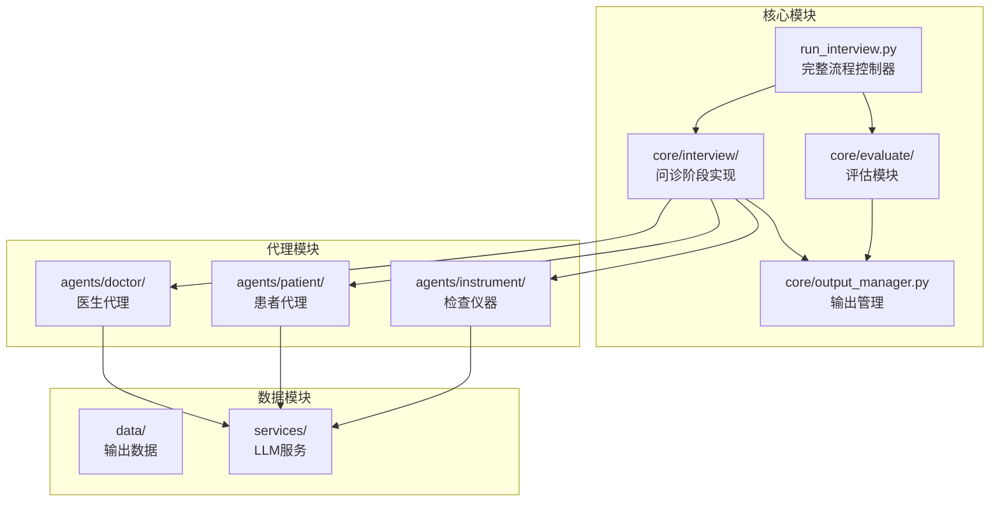
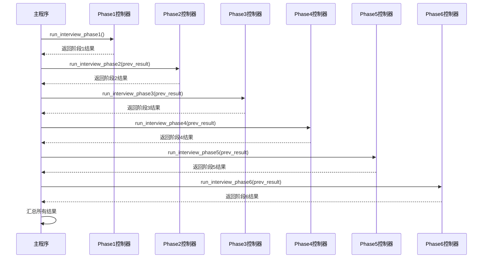
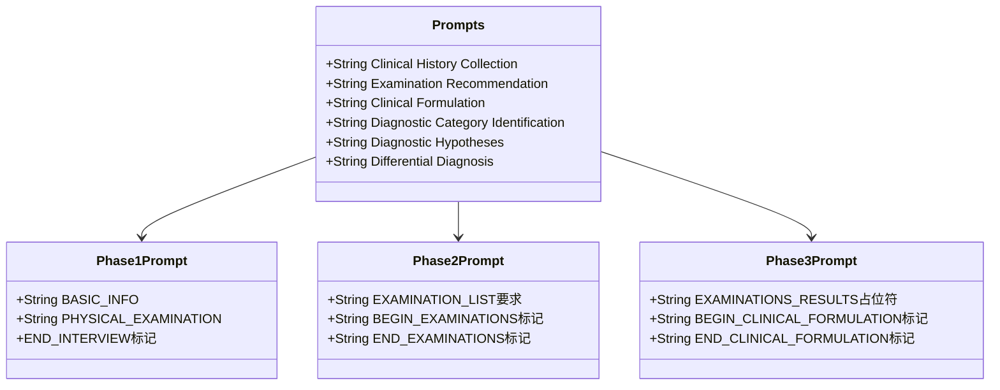
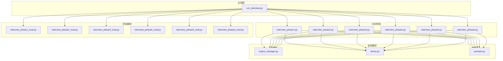
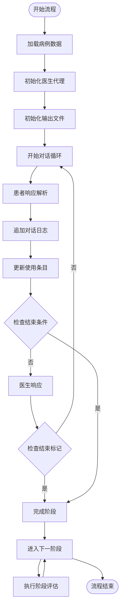

# 问诊流程API

<cite>
**本文档引用的文件**
- [run_interview.py](file://run_interview.py)
- [interview_phase1.py](file://core/interview/interview_phase1.py)
- [interview_phase2.py](file://core/interview/interview_phase2.py)
- [interview_phase3.py](file://core/interview/interview_phase3.py)
- [interview_phase4.py](file://core/interview/interview_phase4.py)
- [interview_phase5.py](file://core/interview/interview_phase5.py)
- [interview_phase6.py](file://core/interview/interview_phase6.py)
- [prompts.py](file://core/interview/prompts.py)
- [output_manager.py](file://core/output_manager.py)
- [interview_phase1_eval.py](file://core/evaluate/interview_phase1_eval.py)
- [interview_phase2_eval.py](file://core/evaluate/interview_phase2_eval.py)
- [interview_phase3_eval.py](file://core/evaluate/interview_phase3_eval.py)
- [interview_phase4_eval.py](file://core/evaluate/interview_phase4_eval.py)
- [interview_phase5_eval.py](file://core/evaluate/interview_phase5_eval.py)
- [interview_phase6_eval.py](file://core/evaluate/interview_phase6_eval.py)
- [doctor.py](file://agents/doctor/doctor.py)
</cite>

## 目录
1. [简介](#简介)
2. [项目结构](#项目结构)
3. [核心组件](#核心组件)
4. [架构概览](#架构概览)
5. [详细组件分析](#详细组件分析)
6. [依赖关系分析](#依赖关系分析)
7. [性能考虑](#性能考虑)
8. [故障排除指南](#故障排除指南)
9. [结论](#结论)
10. [附录](#附录)

## 简介
本项目实现了一个完整的六阶段精神科问诊流程API，涵盖从病史采集到最终鉴别诊断的全过程。系统采用模块化设计，每个阶段独立封装为可复用的函数，支持完整的端到端运行和阶段级别的独立测试。

## 项目结构
项目采用功能驱动的模块组织方式，主要目录结构如下：



**图表来源**
- [run_interview.py:1-408](file://run_interview.py#L1-L408)
- [output_manager.py:1-189](file://core/output_manager.py#L1-L189)

**章节来源**
- [run_interview.py:1-408](file://run_interview.py#L1-L408)
- [output_manager.py:1-189](file://core/output_manager.py#L1-L189)

## 核心组件
系统的核心组件包括：

### 主流程控制器
- `run_full_interview()`: 主函数，协调六个阶段的完整执行
- 支持可选的病例参数，支持随机病例加载
- 提供完整的流程状态管理和结果汇总

### 六个问诊阶段
1. **Phase 1**: 病史采集 (Clinical History Collection)
2. **Phase 2**: 检查推荐 (Examination Recommendation)
3. **Phase 3**: 临床病历 (Clinical Formulation)
4. **Phase 4**: 诊断类别识别 (Diagnostic Category Identification)
5. **Phase 5**: 诊断假设 (Diagnostic Hypotheses)
6. **Phase 6**: 鉴别诊断 (Differential Diagnosis)

### 评估模块
每个阶段都有对应的评估模块，提供自动化的质量评估和指标计算。

**章节来源**
- [run_interview.py:46-396](file://run_interview.py#L46-L396)

## 架构概览
系统采用分层架构设计，实现了高度的模块化和可扩展性：



**图表来源**
- [run_interview.py:46-396](file://run_interview.py#L46-L396)

## 详细组件分析

### 主函数 run_full_interview()

#### 函数签名和参数
```python
def run_full_interview(case: Dict[str, Any] = None) -> Dict[str, Any]:
```

**参数说明:**
- `case`: 可选参数，指定病例数据。如果不提供，则随机加载一个病例

**返回值:**
- 完整流程的结果字典，包含所有阶段的状态和评估结果

#### 执行流程
1. **初始化阶段**: 打印流程标题和阶段标识
2. **阶段执行**: 依次执行六个问诊阶段
3. **评估阶段**: 每个阶段后执行相应的评估
4. **结果汇总**: 将所有阶段结果整合为最终报告

**章节来源**
- [run_interview.py:46-396](file://run_interview.py#L46-L396)

### Phase 1: 病史采集 (Clinical History Collection)

#### 函数实现
```python
def run_interview_phase1(case: Dict[str, Any] = None) -> Dict[str, Any]:
```

**输入参数:**
- `case`: 病例数据字典，包含以下字段：
  - `id`: 病例ID
  - `basicInfomation`: 患者基本信息
  - `chiefComplaint`: 主诉列表
  - `mentalStatus`: 精神状态列表
  - `physicalExamination`: 体格检查结果

**输出格式:**
- `case_id`: 病例ID
- `model_name`: 医生模型名称
- `conversation`: 对话记录列表
- `chief_complaint_used`: 使用的主诉条目（去重）
- `mental_status_used`: 使用的精神状态条目（去重）
- `output_file`: 输出文件路径
- `status`: 完成状态
- `doctor`: 医生LLM实例（用于传递到下一阶段）
- `case_data`: 完整病例数据

**预期行为:**
1. 加载随机或指定的病例数据
2. 初始化医生和患者代理
3. 启动多轮对话，直到检测到结束标记
4. 实时保存对话记录和使用过的条目
5. 返回阶段结果和医生实例

**章节来源**
- [interview_phase1.py:241-428](file://core/interview/interview_phase1.py#L241-L428)

### Phase 2: 检查推荐 (Examination Recommendation)

#### 函数实现
```python
def run_interview_phase2(
    doctor,
    model_name: str,
    case_id: str,
    case_data: Dict[str, Any] = None
) -> Dict[str, Any]:
```

**输入参数:**
- `doctor`: 从Phase 1传递的医生实例
- `model_name`: 医生模型名称
- `case_id`: 病例ID
- `case_data`: 病例数据，包含`auxiliaryExamination`字段

**输出格式:**
- `examinations`: 推荐的检查项目列表
- `examination_results`: 检查结果（通过Instrument获取）
- `raw_response`: 医生的原始响应
- `output_file`: 输出文件路径
- `doctor`: 医生实例（保持上下文）

**预期行为:**
1. 医生基于对话上下文推荐辅助检查项目
2. 使用Instrument服务获取检查结果
3. 解析并验证检查结果
4. 返回推荐列表和检查结果

**章节来源**
- [interview_phase2.py:75-244](file://core/interview/interview_phase2.py#L75-L244)

### Phase 3: 临床病历 (Clinical Formulation)

#### 函数实现
```python
def run_interview_phase3(
    doctor,
    model_name: str,
    case_id: str,
    examination_results: Dict[str, Any]
) -> Dict[str, Any]:
```

**输入参数:**
- `doctor`: 从Phase 2传递的医生实例
- `model_name`: 医生模型名称
- `case_id`: 病例ID
- `examination_results`: Phase 2的检查结果

**输出格式:**
- `syntactic_formulation`: 临床病历正文
- `raw_response`: 医生的原始响应
- `output_file`: 输出文件路径
- `doctor`: 医生实例

**预期行为:**
1. 医生基于对话和检查结果生成临床病历
2. 使用特定的格式化模板
3. 返回结构化的病历内容

**章节来源**
- [interview_phase3.py:83-181](file://core/interview/interview_phase3.py#L83-L181)

### Phase 4: 诊断类别识别 (Diagnostic Category Identification)

#### 函数实现
```python
def run_interview_phase4(
    doctor,
    model_name: str,
    case_id: str
) -> Dict[str, Any]:
```

**输入参数:**
- `doctor`: 从Phase 3传递的医生实例
- `model_name`: 医生模型名称
- `case_id`: 病例ID

**输出格式:**
- `diagnostic_categories`: 诊断类别列表
- `raw_response`: 医生的原始响应
- `output_file`: 输出文件路径
- `doctor`: 医生实例

**预期行为:**
1. 医生基于前三阶段信息识别可能的诊断类别
2. 从预定义的诊断类别列表中选择
3. 返回排序后的诊断类别

**章节来源**
- [interview_phase4.py:67-158](file://core/interview/interview_phase4.py#L67-L158)

### Phase 5: 诊断假设 (Diagnostic Hypotheses)

#### 函数实现
```python
def run_interview_phase5(
    doctor,
    model_name: str,
    case_id: str
) -> Dict[str, Any]:
```

**输入参数:**
- `doctor`: 从Phase 4传递的医生实例
- `model_name`: 医生模型名称
- `case_id`: 病例ID

**输出格式:**
- `diagnostic_hypotheses`: 诊断假设列表
- `raw_response`: 医生的原始响应
- `output_file`: 输出文件路径
- `doctor`: 医生实例

**预期行为:**
1. 医生生成可能的诊断假设列表
2. 基于候选诊断列表进行假设生成
3. 返回按可信度排序的假设列表

**章节来源**
- [interview_phase5.py:67-158](file://core/interview/interview_phase5.py#L67-L158)

### Phase 6: 鉴别诊断 (Differential Diagnosis)

#### 函数实现
```python
def run_interview_phase6(
    doctor,
    model_name: str,
    case_id: str
) -> Dict[str, Any]:
```

**输入参数:**
- `doctor`: 从Phase 5传递的医生实例
- `model_name`: 医生模型名称
- `case_id`: 病例ID

**输出格式:**
- `differential_diagnosis`: 最终诊断序列
- `raw_response`: 医生的原始响应
- `output_file`: 输出文件路径
- `doctor`: 医生实例

**预期行为:**
1. 医生在诊断假设基础上进行鉴别诊断
2. 生成最终的诊断序列
3. 返回按确定性排序的诊断结果

**章节来源**
- [interview_phase6.py:66-158](file://core/interview/interview_phase6.py#L66-L158)

### 对话提示词配置和自定义

#### 提示词结构
系统使用统一的提示词管理系统，每个阶段都有专门的提示词模板：



**图表来源**
- [prompts.py:1-233](file://core/interview/prompts.py#L1-L233)

**自定义方法:**
1. **修改现有提示词**: 直接编辑prompts.py中的相应模板
2. **添加新阶段**: 在PROMPTS字典中添加新的键值对
3. **参数化配置**: 使用占位符动态插入变量

**章节来源**
- [prompts.py:1-233](file://core/interview/prompts.py#L1-L233)

## 依赖关系分析

### 模块间依赖关系



**图表来源**
- [run_interview.py:32-43](file://run_interview.py#L32-L43)
- [output_manager.py:1-189](file://core/output_manager.py#L1-L189)

### 数据流和状态管理



**图表来源**
- [interview_phase1.py:350-398](file://core/interview/interview_phase1.py#L350-L398)
- [output_manager.py:117-169](file://core/output_manager.py#L117-L169)

**章节来源**
- [run_interview.py:32-43](file://run_interview.py#L32-L43)
- [output_manager.py:1-189](file://core/output_manager.py#L1-189)

## 性能考虑
系统在设计时考虑了以下性能优化策略：

### 异步处理
- Phase 1支持实时对话记录和增量更新
- 评估模块支持并行处理（部分评估模块）

### 内存管理
- 使用生成器模式处理大型数据集
- 及时释放不再使用的中间结果

### 缓存机制
- 输出文件系统避免重复计算
- 评估结果缓存减少重复评估

## 故障排除指南

### 常见错误类型

#### 1. 病例数据加载错误
**症状**: `ValueError: 未找到任何病例数据`
**解决方案**: 
- 检查cases.jsonl文件是否存在
- 验证文件格式的正确性
- 确认文件编码为UTF-8

#### 2. 模型配置错误
**症状**: LLM服务连接失败
**解决方案**:
- 检查.env文件中的API配置
- 验证API密钥的有效性
- 确认网络连接正常

#### 3. 文件权限错误
**症状**: 无法创建或写入输出文件
**解决方案**:
- 检查输出目录的写入权限
- 确认磁盘空间充足
- 验证路径的正确性

#### 4. JSON解析错误
**症状**: 响应内容解析失败
**解决方案**:
- 检查响应格式的完整性
- 启用json_repair功能
- 验证响应内容的合法性

**章节来源**
- [interview_phase1.py:84-87](file://core/interview/interview_phase1.py#L84-L87)
- [interview_phase1.py:102-143](file://core/interview/interview_phase1.py#L102-L143)

## 结论
本问诊流程API提供了完整、模块化的六阶段精神科问诊解决方案。系统具有以下特点：

1. **模块化设计**: 每个阶段独立封装，便于维护和扩展
2. **完整的评估体系**: 每个阶段都有对应的评估模块
3. **灵活的配置**: 支持提示词自定义和参数配置
4. **强大的错误处理**: 提供完善的异常处理和恢复机制
5. **高性能实现**: 采用异步处理和内存优化策略

该系统适用于医疗AI研究、教学演示和实际临床辅助场景。

## 附录

### 使用示例

#### 完整流程运行
```python
from run_interview import run_full_interview

# 运行完整流程
result = run_full_interview()

# 获取特定阶段结果
phase1_result = run_full_interview()['phase1']
```

#### 单独阶段测试
```python
from core.interview.interview_phase1 import run_interview_phase1
from core.interview.interview_phase2 import run_interview_phase2

# 测试Phase 1
phase1_result = run_interview_phase1()

# 测试Phase 2
phase2_result = run_interview_phase2(
    doctor=phase1_result['doctor'],
    model_name=phase1_result['model_name'],
    case_id=phase1_result['case_id'],
    case_data=phase1_result['case_data']
)
```

### 最佳实践指南

#### 1. 病例数据准备
- 确保病例数据的完整性和准确性
- 遵循统一的数据格式标准
- 定期备份重要的病例数据

#### 2. 模型配置优化
- 根据硬件资源选择合适的模型
- 调整超参数以获得最佳性能
- 监控模型的推理时间和质量

#### 3. 评估指标解读
- Phase 1: 关注覆盖率和对话质量
- Phase 2: 重视检查推荐的准确性
- Phase 3: 注重病历的完整性和结构
- Phase 4-6: 分析诊断的精确性和排序质量

#### 4. 错误处理策略
- 实现重试机制处理临时性错误
- 建立监控系统及时发现问题
- 准备应急预案处理严重故障