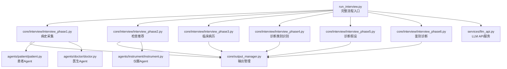
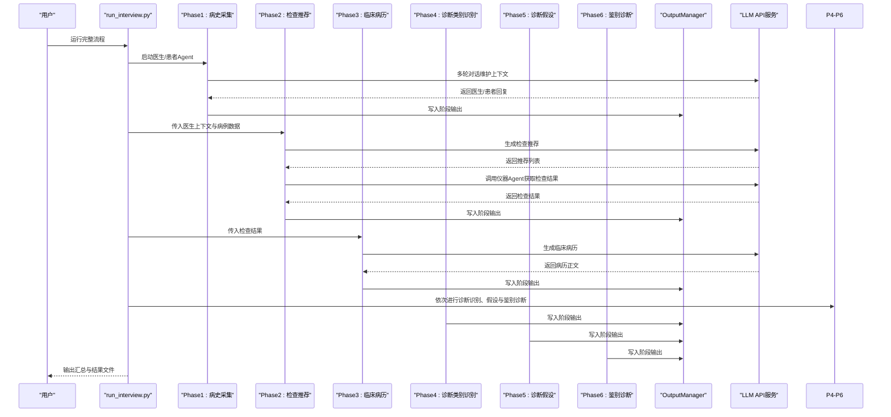
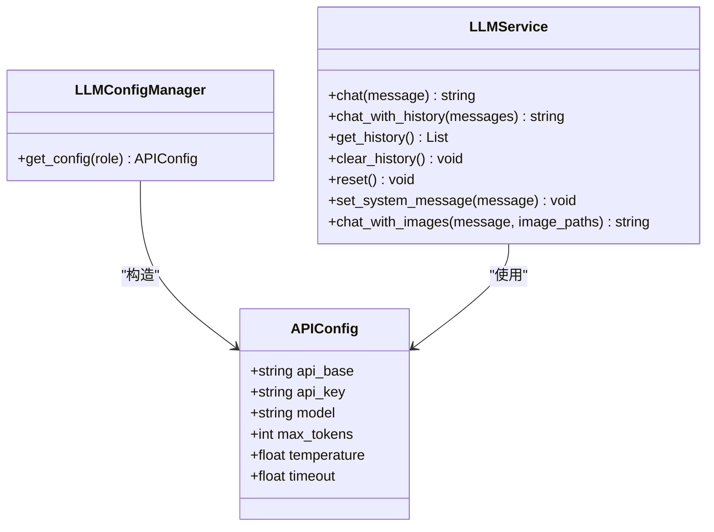
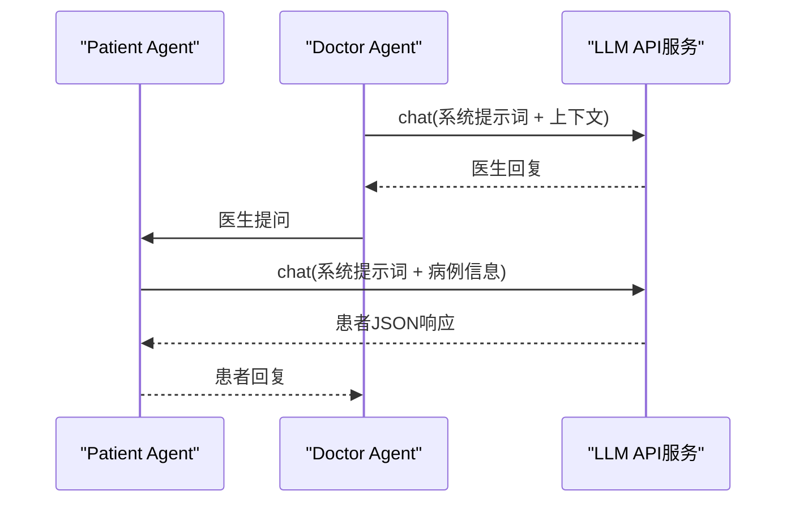
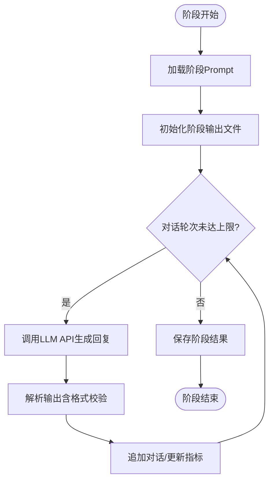
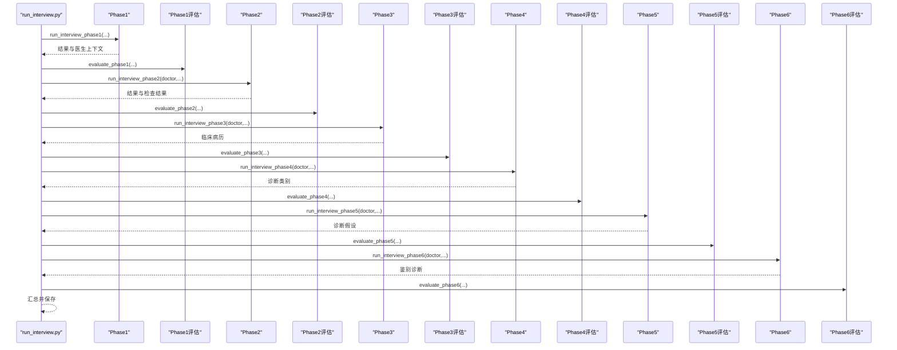
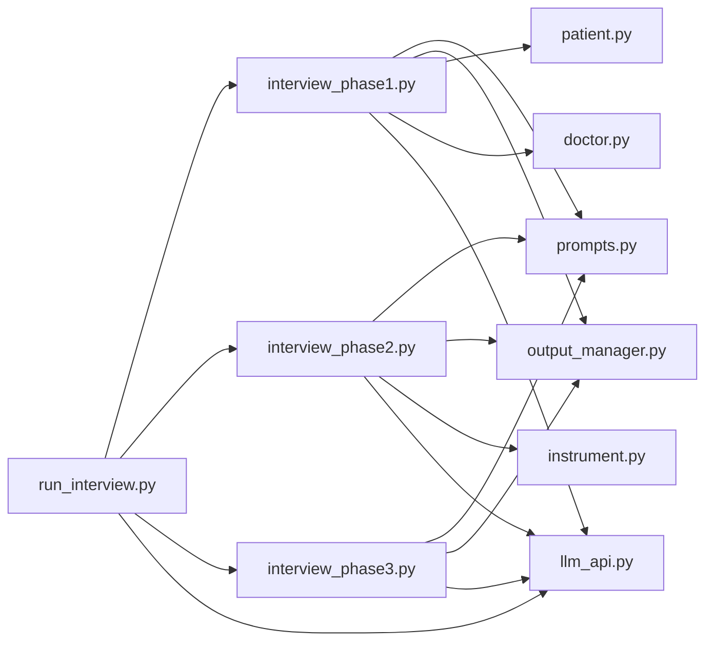

# 快速开始

<cite>
**本文引用的文件**
- [run_interview.py](file://run_interview.py)
- [services/llm_api.py](file://services/llm_api.py)
- [agents/doctor/doctor.py](file://agents/doctor/doctor.py)
- [agents/patient/patient.py](file://agents/patient/patient.py)
- [core/interview/prompts.py](file://core/interview/prompts.py)
- [core/output_manager.py](file://core/output_manager.py)
- [scripts/test_phase1_evaluation.py](file://scripts/test_phase1_evaluation.py)
- [test/test_api.py](file://test/test_api.py)
- [core/interview/interview_phase1.py](file://core/interview/interview_phase1.py)
- [core/interview/interview_phase2.py](file://core/interview/interview_phase2.py)
- [core/interview/interview_phase3.py](file://core/interview/interview_phase3.py)
- [core/evaluate/interview_phase1_eval.py](file://core/evaluate/interview_phase1_eval.py)
- [agents/instrument/instrument.py](file://agents/instrument/instrument.py)
</cite>

## 目录
1. [简介](#简介)
2. [项目结构](#项目结构)
3. [核心组件](#核心组件)
4. [架构总览](#架构总览)
5. [详细组件分析](#详细组件分析)
6. [依赖关系分析](#依赖关系分析)
7. [性能考虑](#性能考虑)
8. [故障排除指南](#故障排除指南)
9. [结论](#结论)
10. [附录](#附录)

## 简介
本指南面向首次接触“精神卫生智能问诊系统”的用户，帮助你在30分钟内完成环境准备、LLM API配置、安装与依赖安装，并成功运行一个完整的六阶段问诊流程。系统采用多智能体协作模式，包含医生、患者、仪器与评估器四个角色，贯穿从病史采集到鉴别诊断的完整流程，并提供阶段输出与评估结果。

## 项目结构
项目采用按功能域划分的层次化组织方式：
- agents：智能体层（医生、患者、仪器）
- core：核心业务逻辑（访谈阶段、评估、输出管理）
- services：基础设施（LLM API封装）
- data：输出目录（面试与评估结果）
- scripts：脚本工具（如单阶段评估测试）
- test：API功能测试
- run_interview.py：完整流程入口

图表来源
- [run_interview.py:1-408](file://run_interview.py#L1-L408)
- [core/interview/interview_phase1.py:1-200](file://core/interview/interview_phase1.py#L1-L200)
- [core/interview/interview_phase2.py:1-200](file://core/interview/interview_phase2.py#L1-L200)
- [core/interview/interview_phase3.py:1-200](file://core/interview/interview_phase3.py#L1-L200)
- [core/output_manager.py:1-189](file://core/output_manager.py#L1-L189)
- [agents/patient/patient.py:1-171](file://agents/patient/patient.py#L1-L171)
- [agents/doctor/doctor.py:1-95](file://agents/doctor/doctor.py#L1-L95)
- [agents/instrument/instrument.py:1-200](file://agents/instrument/instrument.py#L1-L200)
- [services/llm_api.py:1-250](file://services/llm_api.py#L1-L250)

章节来源
- [run_interview.py:1-408](file://run_interview.py#L1-L408)

## 核心组件
- LLM API服务：统一管理不同角色（患者、医生、评估器、仪器）的API配置与调用，支持多轮对话上下文、重试与系统提示词。
- 智能体Agent：
  - 患者Agent：根据病例信息生成标准化JSON响应，便于系统解析与评估。
  - 医生Agent：基于系统提示词引导对话，维持上下文，驱动各阶段推进。
  - 仪器Agent：根据检查请求与真实检查结果计算推荐指标（精确率、召回率、F1、Jaccard）。
- 输出管理：统一管理各阶段输出文件路径与写入，支持即时更新与对话追加。
- 评估模块：对各阶段输出进行指标计算与报告生成。

章节来源
- [services/llm_api.py:1-250](file://services/llm_api.py#L1-L250)
- [agents/patient/patient.py:1-171](file://agents/patient/patient.py#L1-L171)
- [agents/doctor/doctor.py:1-95](file://agents/doctor/doctor.py#L1-L95)
- [agents/instrument/instrument.py:1-200](file://agents/instrument/instrument.py#L1-L200)
- [core/output_manager.py:1-189](file://core/output_manager.py#L1-L189)

## 架构总览
系统以“完整流程入口”为中心，串联六个阶段的访谈与评估。每个阶段内部通过Agent与Prompt驱动，借助LLM API完成对话与推理；输出管理负责持久化；评估模块在阶段完成后进行指标计算。

图表来源
- [run_interview.py:46-396](file://run_interview.py#L46-L396)
- [core/interview/interview_phase1.py:1-200](file://core/interview/interview_phase1.py#L1-L200)
- [core/interview/interview_phase2.py:1-200](file://core/interview/interview_phase2.py#L1-L200)
- [core/interview/interview_phase3.py:1-200](file://core/interview/interview_phase3.py#L1-L200)
- [core/output_manager.py:1-189](file://core/output_manager.py#L1-L189)
- [services/llm_api.py:1-250](file://services/llm_api.py#L1-L250)

## 详细组件分析

### LLM API服务与配置
- 支持的角色：patient、doctor、evaluator、instrument（通过角色区分API Base、Key、Model等配置）。
- 配置来源：项目根目录.env文件，键命名规则为“ROLE_API_BASE/KEY/MODEL”，并支持全局超时、最大Token、温度等参数。
- 特性：实例级对话上下文自动维护、多轮对话、系统提示词设置、重试与指数退避、图片多模态支持（可选）。

图表来源
- [services/llm_api.py:47-250](file://services/llm_api.py#L47-L250)

章节来源
- [services/llm_api.py:1-250](file://services/llm_api.py#L1-L250)

### 患者Agent与医生Agent
- 患者Agent：接收基本信息、主诉、精神状态，生成标准化JSON响应，便于系统解析与评估。
- 医生Agent：加载系统提示词（Doctor Profile），与患者进行多轮对话，维持上下文，驱动阶段推进。

图表来源
- [agents/patient/patient.py:40-93](file://agents/patient/patient.py#L40-L93)
- [agents/doctor/doctor.py:32-55](file://agents/doctor/doctor.py#L32-L55)
- [services/llm_api.py:113-132](file://services/llm_api.py#L113-L132)

章节来源
- [agents/patient/patient.py:1-171](file://agents/patient/patient.py#L1-L171)
- [agents/doctor/doctor.py:1-95](file://agents/doctor/doctor.py#L1-L95)

### 阶段Prompt与输出管理
- Prompt：每个阶段都有明确的系统提示词，指导Agent行为与输出格式（如BEGIN/END标记）。
- 输出管理：统一输出目录结构，支持阶段初始化、对话追加、即时更新与状态标记。

图表来源
- [core/interview/prompts.py:1-233](file://core/interview/prompts.py#L1-L233)
- [core/output_manager.py:50-169](file://core/output_manager.py#L50-L169)

章节来源
- [core/interview/prompts.py:1-233](file://core/interview/prompts.py#L1-L233)
- [core/output_manager.py:1-189](file://core/output_manager.py#L1-L189)

### 完整流程入口与阶段串联
- run_interview.py负责顺序执行六个阶段，并在每个阶段后调用对应的评估模块（如Phase1评估）。
- 输出汇总：将各阶段结果聚合到summary文件，并打印关键指标。

图表来源
- [run_interview.py:46-396](file://run_interview.py#L46-L396)

章节来源
- [run_interview.py:1-408](file://run_interview.py#L1-L408)

## 依赖关系分析
- 运行时依赖：Python标准库（pathlib、json、os、typing）、第三方库（openai、httpx、python-dotenv、json_repair）。
- 模块耦合：run_interview.py对各阶段模块强依赖；阶段模块依赖Prompt与OutputManager；Agent依赖LLM API服务；评估模块依赖阶段输出文件。

图表来源
- [run_interview.py:32-43](file://run_interview.py#L32-L43)
- [core/interview/interview_phase1.py:37-46](file://core/interview/interview_phase1.py#L37-L46)
- [core/interview/interview_phase2.py:37-40](file://core/interview/interview_phase2.py#L37-L40)
- [core/interview/interview_phase3.py:33-35](file://core/interview/interview_phase3.py#L33-L35)
- [core/interview/prompts.py:1-233](file://core/interview/prompts.py#L1-L233)
- [core/output_manager.py:20-32](file://core/output_manager.py#L20-L32)
- [agents/patient/patient.py:36-37](file://agents/patient/patient.py#L36-L37)
- [agents/doctor/doctor.py:28-29](file://agents/doctor/doctor.py#L28-L29)
- [agents/instrument/instrument.py:9](file://agents/instrument/instrument.py#L9)
- [services/llm_api.py:36-38](file://services/llm_api.py#L36-L38)

章节来源
- [run_interview.py:1-408](file://run_interview.py#L1-L408)
- [services/llm_api.py:1-250](file://services/llm_api.py#L1-L250)

## 性能考虑
- API调用重试与退避：在LLM API服务中内置指数退避重试，降低网络抖动影响。
- 输出即时写入：输出管理模块在每次更新时立即落盘，避免长时间运行导致的数据丢失。
- 多轮对话上下文：保持上下文有助于减少重复信息，但需关注Token上限，必要时可截断或压缩历史。
- 评估并行化：评估模块支持并行评估（如共情度与专业度），可缩短总耗时。

章节来源
- [services/llm_api.py:158-169](file://services/llm_api.py#L158-L169)
- [core/output_manager.py:86-115](file://core/output_manager.py#L86-L115)
- [core/evaluate/interview_phase1_eval.py:174-200](file://core/evaluate/interview_phase1_eval.py#L174-L200)

## 故障排除指南
- 环境变量未配置或错误
  - 现象：API调用失败、角色配置为空。
  - 处理：确认项目根目录存在.env文件，键名为“ROLE_API_BASE/KEY/MODEL”，并确保网络可达。
- 网络连接异常
  - 现象：API超时或连接失败。
  - 处理：检查代理设置、防火墙策略；适当增大TIMEOUT；启用重试。
- 输出目录权限不足
  - 现象：无法写入阶段输出文件。
  - 处理：确保data/output目录可写；或调整输出路径。
- 患者响应格式不规范
  - 现象：解析失败或覆盖率统计异常。
  - 处理：启用json_repair（如可用）；检查Prompt约束与Agent输出格式。
- 评估指标异常
  - 现象：指标为0或NaN。
  - 处理：确认gold数据与预测数据格式一致；检查NONE计数逻辑。

章节来源
- [services/llm_api.py:64-76](file://services/llm_api.py#L64-L76)
- [core/interview/interview_phase1.py:90-144](file://core/interview/interview_phase1.py#L90-L144)
- [agents/instrument/instrument.py:78-163](file://agents/instrument/instrument.py#L78-L163)

## 结论
通过本指南，你可以在30分钟内完成环境准备、LLM API配置与依赖安装，并成功运行一次完整的六阶段问诊流程。建议先单独运行阶段测试脚本与API测试脚本，验证各组件工作正常后再执行完整流程。

## 附录

### 环境配置与安装步骤
- Python版本要求
  - 建议使用Python 3.8及以上版本。
- 安装依赖
  - 使用pip安装以下包：openai、httpx、python-dotenv、json_repair（可选）。
- 克隆代码库
  - 将仓库克隆至本地后，进入项目根目录。
- 配置LLM API
  - 在项目根目录创建.env文件，设置以下键值：
    - PATIENT_API_BASE/PATIENT_API_KEY/PATIENT_MODEL
    - DOCTOR_API_BASE/DOCTOR_API_KEY/DOCTOR_MODEL
    - EVALUATOR_API_BASE/EVALUATOR_API_KEY/EVALUATOR_MODEL
    - MAX_TOKENS（可选，默认4096）
    - TEMPERATURE（可选，默认1.0）
    - TIMEOUT（可选，默认30.0）
- 验证API连通性
  - 运行测试脚本：python test/test_api.py，确保各角色API均可访问。

章节来源
- [test/test_api.py:1-234](file://test/test_api.py#L1-L234)
- [services/llm_api.py:40-42](file://services/llm_api.py#L40-L42)

### 完整安装与首次运行
- 步骤概览
  - 克隆仓库
  - 安装依赖
  - 配置.env
  - 运行完整流程：python run_interview.py
  - 查看输出：data/output/interview/<model>/<case_id>/ 下的各阶段输出文件
- 输出文件说明
  - interview_phase1/2/3/4/5/6_output.json：各阶段输出
  - interview_summary.json：完整流程汇总
  - evaluation_*_output.json：各阶段评估结果

章节来源
- [run_interview.py:367-393](file://run_interview.py#L367-L393)
- [core/output_manager.py:20-32](file://core/output_manager.py#L20-L32)

### 基本使用示例
- 运行完整六阶段流程
  - 执行：python run_interview.py
  - 查看控制台输出与data/output目录下的JSON文件
- 单个阶段测试
  - Phase1：python core/interview/interview_phase1.py
  - Phase2：python core/interview/interview_phase2.py
  - Phase3：python core/interview/interview_phase3.py
  - 单阶段评估：python scripts/test_phase1_evaluation.py

章节来源
- [run_interview.py:399-408](file://run_interview.py#L399-L408)
- [scripts/test_phase1_evaluation.py:16-58](file://scripts/test_phase1_evaluation.py#L16-L58)