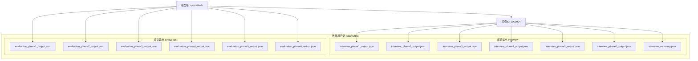
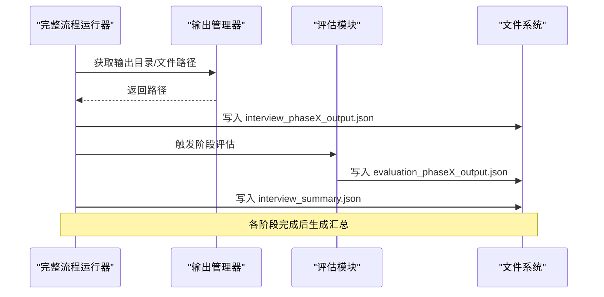
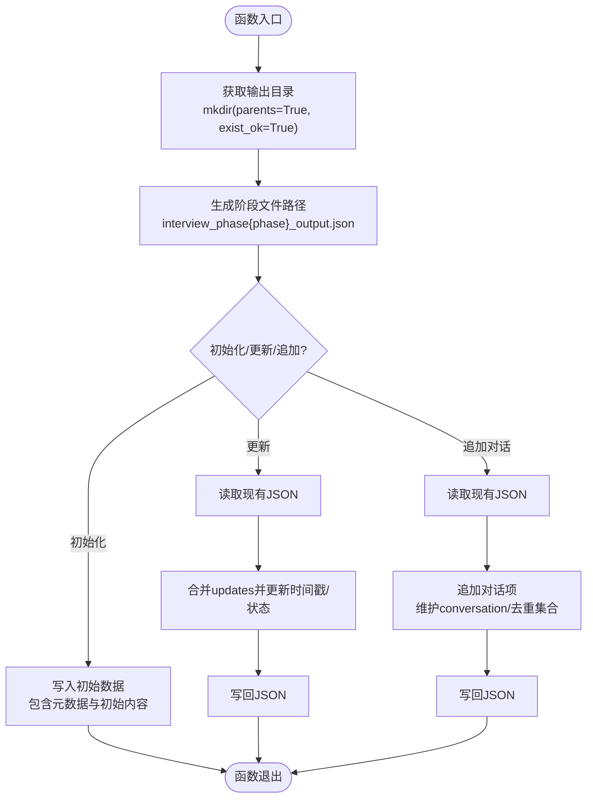
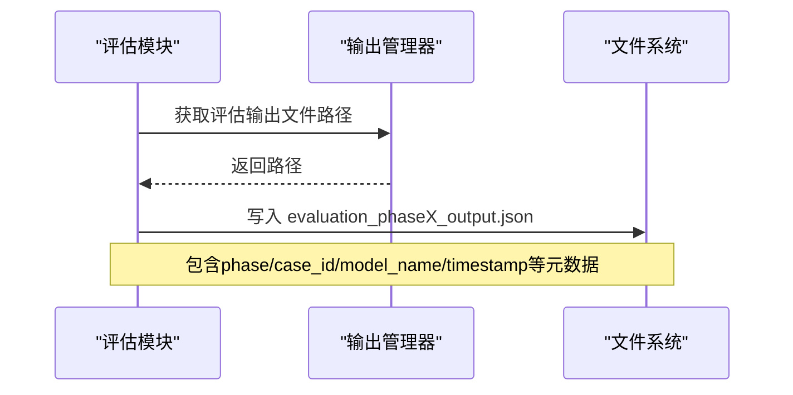
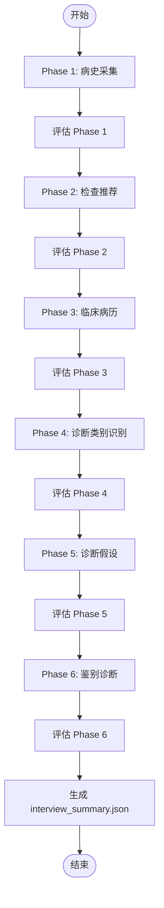
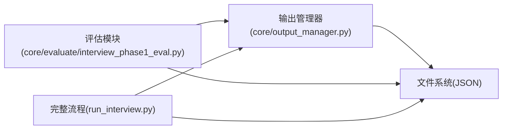

# 数据管理

<cite>
**本文引用的文件**
- [output_manager.py](file://core/output_manager.py)
- [run_interview.py](file://run_interview.py)
- [interview_phase1_eval.py](file://core/evaluate/interview_phase1_eval.py)
- [interview_summary.json](file://data/output/interview/qwen-flash/1009904/interview_summary.json)
- [evaluation_phase1_output.json](file://data/output/evaluation/qwen-flash/1009904/evaluation_phase1_output.json)
- [scale.json](file://eval_interview/scale.json)
- [profession_scale.json](file://eval_interview/profession_scale.json)
</cite>

## 目录
1. [简介](#简介)
2. [项目结构](#项目结构)
3. [核心组件](#核心组件)
4. [架构总览](#架构总览)
5. [详细组件分析](#详细组件分析)
6. [依赖分析](#依赖分析)
7. [性能考量](#性能考量)
8. [故障排查指南](#故障排查指南)
9. [结论](#结论)
10. [附录](#附录)

## 简介
本技术文档面向数据管理系统，聚焦输出管理器的设计与实现，系统性阐述文件系统组织结构、数据持久化策略、目录管理机制，以及问诊结果与评估数据的存储格式、命名规则与检索方法。同时，基于现有代码与数据样本，说明数据导出与导入的可行性路径、备份与恢复策略建议、数据清理与归档最佳实践，并给出扩展存储方案以支持更多数据格式与存储后端的建议。

## 项目结构
系统采用“阶段化访谈 + 评估”的流水线设计，数据以JSON文件形式落地，分为两类输出：
- 问诊输出：按阶段保存在 data/output/interview/{model_name}/{case_id}/ 下，文件名为 interview_phaseX_output.json，另有 interview_summary.json 汇总完整流程结果。
- 评估输出：按阶段保存在 data/output/evaluation/{model_name}/{case_id}/ 下，文件名为 evaluation_phaseX_output.json。

图表来源
- [output_manager.py:4-11](file://core/output_manager.py#L4-L11)
- [run_interview.py:385-392](file://run_interview.py#L385-L392)

章节来源
- [output_manager.py:1-189](file://core/output_manager.py#L1-L189)
- [run_interview.py:367-393](file://run_interview.py#L367-L393)

## 核心组件
- 输出管理器：负责统一管理各阶段输出文件路径、初始化阶段输出、增量更新、追加对话记录、加载阶段输出。
- 完整流程运行器：串联六阶段访谈与评估，生成汇总文件 interview_summary.json。
- 评估模块：按阶段计算覆盖率、对话统计、可选的共情/专业度评估，并将评估结果保存为 evaluation_phaseX_output.json。

章节来源
- [output_manager.py:20-189](file://core/output_manager.py#L20-L189)
- [run_interview.py:46-396](file://run_interview.py#L46-L396)
- [interview_phase1_eval.py:32-171](file://core/evaluate/interview_phase1_eval.py#L32-L171)

## 架构总览
输出管理器与评估模块协同工作，前者负责文件路径与持久化，后者负责评估逻辑与结果落盘。完整流程运行器在各阶段结束后，将阶段性结果汇总到 interview_summary.json，并在评估目录生成对应的 evaluation_phaseX_output.json。

图表来源
- [run_interview.py:367-393](file://run_interview.py#L367-L393)
- [interview_phase1_eval.py:141-171](file://core/evaluate/interview_phase1_eval.py#L141-L171)
- [output_manager.py:50-83](file://core/output_manager.py#L50-L83)

## 详细组件分析

### 输出管理器（Output Manager）
职责与特性
- 统一路径生成：按模型名与病例ID生成标准化目录结构。
- 文件命名规范：阶段文件命名为 interview_phaseX_output.json。
- 持久化策略：初始化时写入初始数据；更新时读取-合并-写回；追加对话时维护 conversation 数组与去重集合。
- 元数据管理：自动注入 phase、case_id、model_name、timestamp、status 等字段；每次更新追加 last_update。

图表来源
- [output_manager.py:20-189](file://core/output_manager.py#L20-L189)

章节来源
- [output_manager.py:20-189](file://core/output_manager.py#L20-L189)

### 评估模块（Phase 1 示例）
职责与特性
- 目录与文件命名：评估输出位于 evaluation/{model_name}/{case_id}/evaluation_phase{phase}_output.json。
- 评估指标：计算覆盖率、对话统计；可选共情/专业度评估。
- 结果落盘：将评估结果与元数据合并后写入文件。

图表来源
- [interview_phase1_eval.py:32-60](file://core/evaluate/interview_phase1_eval.py#L32-L60)
- [interview_phase1_eval.py:141-171](file://core/evaluate/interview_phase1_eval.py#L141-L171)

章节来源
- [interview_phase1_eval.py:32-171](file://core/evaluate/interview_phase1_eval.py#L32-L171)

### 完整流程运行器（Run Interview）
职责与特性
- 串联六阶段：从 Phase 1 到 Phase 6，逐阶段运行并保存输出。
- 汇总文件：在 interview 目录生成 interview_summary.json，包含各阶段状态、指标与评估结果文件路径。
- 评估输出：在 evaluation 目录生成各阶段评估文件。

图表来源
- [run_interview.py:46-396](file://run_interview.py#L46-L396)

章节来源
- [run_interview.py:46-396](file://run_interview.py#L46-L396)

### 数据存储格式与命名规则
- 存储介质：本地文件系统（JSON）。
- 目录结构：
  - 问诊输出：data/output/interview/{model_name}/{case_id}/
  - 评估输出：data/output/evaluation/{model_name}/{case_id}/
- 文件命名：
  - 问诊阶段文件：interview_phase{phase}_output.json（phase=1..6）
  - 汇总文件：interview_summary.json
  - 评估阶段文件：evaluation_phase{phase}_output.json（phase=1..6）

章节来源
- [output_manager.py:4-11](file://core/output_manager.py#L4-L11)
- [run_interview.py:385-392](file://run_interview.py#L385-L392)

### 数据检索方法
- 加载阶段输出：通过输出管理器提供的加载函数按 model_name、case_id、phase 读取对应 JSON。
- 评估结果：通过评估模块提供的路径函数定位 evaluation 文件。
- 汇总查询：读取 interview_summary.json 获取各阶段状态与评估文件路径。

章节来源
- [output_manager.py:171-189](file://core/output_manager.py#L171-L189)
- [interview_phase1_eval.py:47-59](file://core/evaluate/interview_phase1_eval.py#L47-L59)

### 数据导出与导入（基于现有实现的可行路径）
- 导出（现有能力）：完整流程运行器在结束后会写入 interview_summary.json 与各阶段评估文件，可作为“导出”产物。
- 导入（现有能力）：评估模块支持从 interview_phaseX_output.json 读取数据进行评估，亦可直接传入数据字典进行评估。
- 批量处理：可在顶层脚本中遍历 data/output/interview 下的模型与病例目录，批量触发评估或汇总生成。

章节来源
- [run_interview.py:367-393](file://run_interview.py#L367-L393)
- [interview_phase1_eval.py:174-330](file://core/evaluate/interview_phase1_eval.py#L174-L330)

### 数据备份与恢复策略（建议）
- 备份策略
  - 定期快照：对 data/output 目录进行增量备份，保留最近 N 天的版本。
  - 归档：对已完成的模型-病例组合进行压缩归档，按年/季度分桶。
- 恢复策略
  - 原子性恢复：优先恢复 interview_summary.json 与对应阶段文件，确保流程完整性。
  - 校验：恢复后校验 JSON 结构与关键字段（phase、case_id、model_name、timestamp）。
- 安全性
  - 访问控制：限制 data/output 目录访问权限。
  - 日志审计：记录备份/恢复操作与失败重试。

[本节为通用建议，不直接分析特定文件，故无章节来源]

### 数据清理与归档最佳实践（建议）
- 清理
  - 过期数据：按时间阈值清理未完成或长时间停滞的会话。
  - 重复数据：定期比对相同模型-病例组合的多份输出，保留最新且完整的版本。
- 归档
  - 分层归档：按模型/年/月/病例ID分层归档，便于检索。
  - 压缩：使用高效压缩算法（如 zstd）降低存储成本。
- 指标监控
  - 存储用量与增长趋势监控，设定告警阈值。

[本节为通用建议，不直接分析特定文件，故无章节来源]

### 扩展存储方案（建议）
- 支持更多数据格式
  - CSV/Parquet：适合结构化指标与统计结果导出，便于分析工具读取。
  - Protocol Buffers/MessagePack：在性能敏感场景替代 JSON。
- 支持更多存储后端
  - 对象存储：将 data/output 上传至 S3/OSS，配合索引服务实现检索。
  - 关系数据库：将评估指标与元数据写入数据库，文件仅存摘要或URL。
- 传输与批处理
  - 增加批量导出/导入接口，支持跨环境迁移与并行处理。

[本节为通用建议，不直接分析特定文件，故无章节来源]

## 依赖分析
- 输出管理器依赖 Python 标准库（json、pathlib、datetime、typing）。
- 评估模块依赖输出管理器以获取阶段输出文件路径，同时依赖评估量表定义（共情/专业度）。
- 完整流程运行器依赖各阶段模块与输出管理器，最后生成汇总文件。

图表来源
- [output_manager.py:14-17](file://core/output_manager.py#L14-L17)
- [interview_phase1_eval.py:26-29](file://core/evaluate/interview_phase1_eval.py#L26-L29)
- [run_interview.py:32-43](file://run_interview.py#L32-L43)

章节来源
- [output_manager.py:14-17](file://core/output_manager.py#L14-L17)
- [interview_phase1_eval.py:26-29](file://core/evaluate/interview_phase1_eval.py#L26-L29)
- [run_interview.py:32-43](file://run_interview.py#L32-L43)

## 性能考量
- I/O 模式：采用即时写入（初始化/更新/追加对话）策略，确保数据一致性，但可能带来频繁小文件写入开销。
- JSON 解析：评估模块在读取阶段输出时进行解析，建议在大规模批量处理时缓存必要数据。
- 并行评估：评估模块支持并行评估共情与专业度，可提升吞吐。

[本节提供通用指导，不直接分析特定文件，故无章节来源]

## 故障排查指南
- 文件不存在
  - 现象：加载阶段输出返回 None。
  - 排查：确认 data/output 目录结构与文件命名是否符合约定。
- JSON 解析错误
  - 现象：读取阶段输出或评估文件时报错。
  - 排查：检查文件编码（UTF-8）与格式完整性；必要时使用修复工具。
- 评估失败
  - 现象：评估模块抛出异常。
  - 排查：查看日志与异常栈，确认评估依赖（如 LLM API）可用性与网络连通性。

章节来源
- [output_manager.py:171-189](file://core/output_manager.py#L171-L189)
- [interview_phase1_eval.py:294-298](file://core/evaluate/interview_phase1_eval.py#L294-L298)

## 结论
输出管理器以简洁的路径生成与即时写入策略，实现了阶段化数据的可靠持久化；评估模块与完整流程运行器分别承担指标计算与流程编排职责，共同构成完整的数据管理体系。现有实现以 JSON 文件为核心载体，具备良好的可读性与可移植性。建议在生产环境中引入定期备份、归档与容量监控，并在需要时扩展为多格式与多后端存储方案。

## 附录

### 数据样本与字段说明
- interview_summary.json
  - 包含各阶段状态、对话轮数、覆盖率、评估指标与评估文件路径等。
- evaluation_phase1_output.json
  - 包含覆盖率统计、对话统计、使用过的主诉/精神状态条目、可选的共情/专业度评估结果等。

章节来源
- [interview_summary.json:1-443](file://data/output/interview/qwen-flash/1009904/interview_summary.json#L1-L443)
- [evaluation_phase1_output.json:1-122](file://data/output/evaluation/qwen-flash/1009904/evaluation_phase1_output.json#L1-L122)