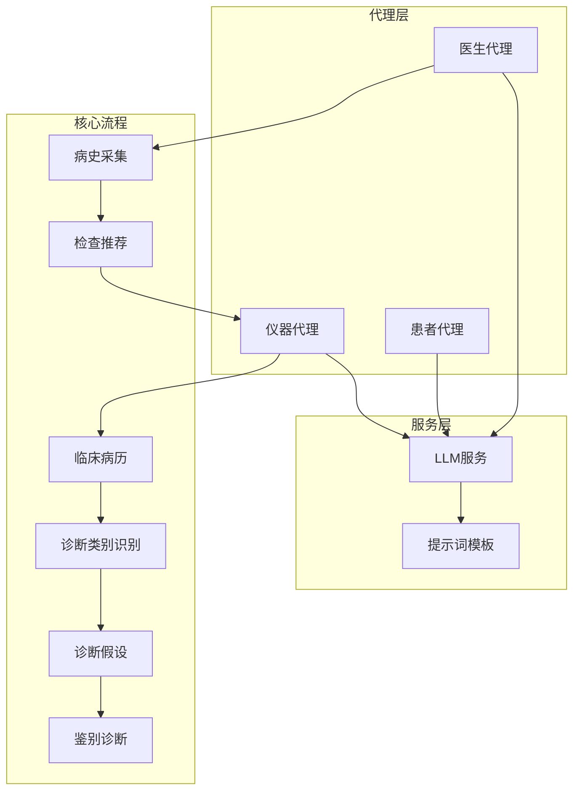
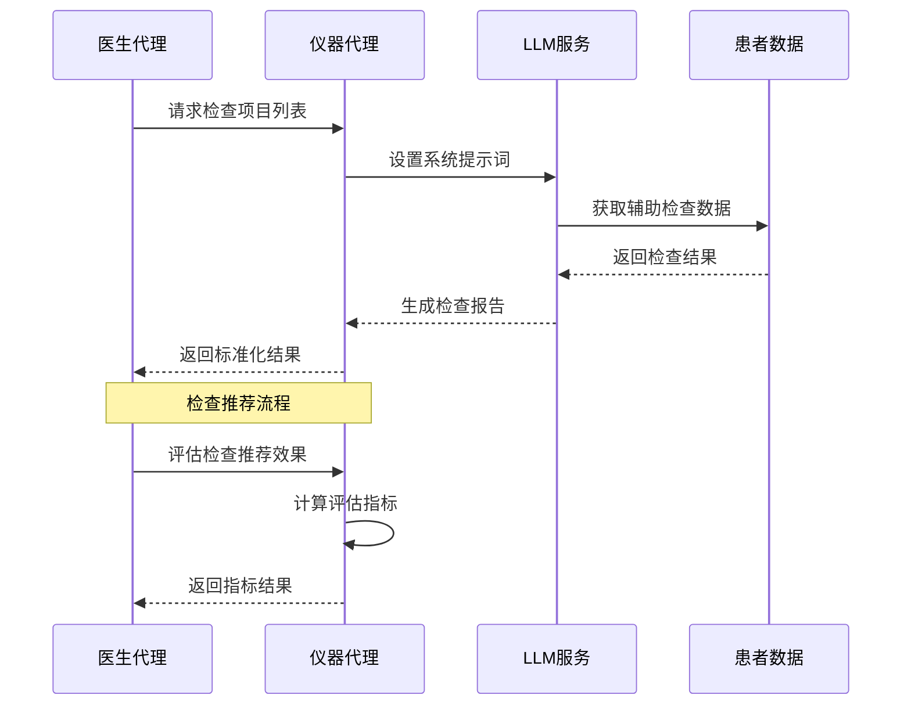
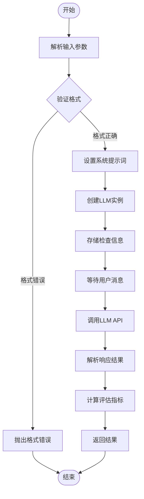
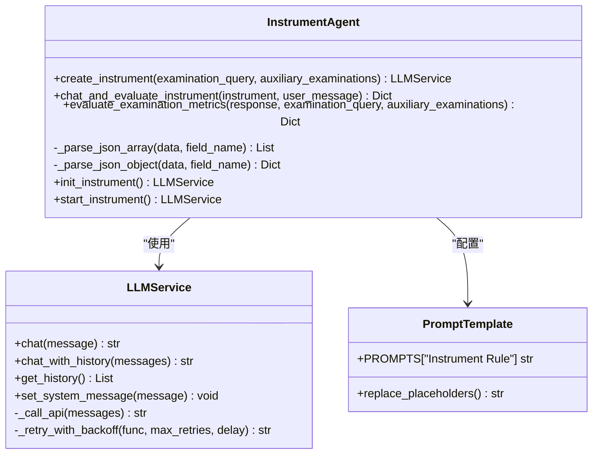
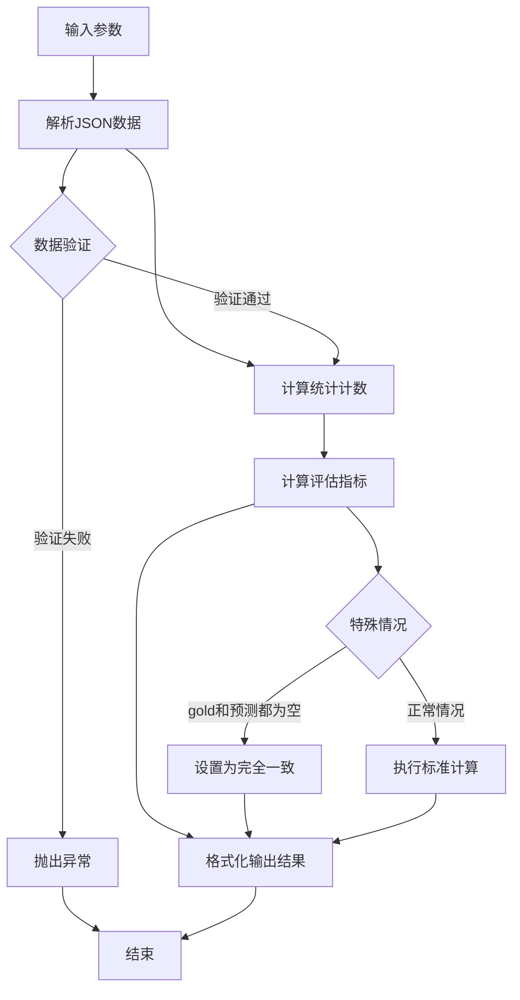
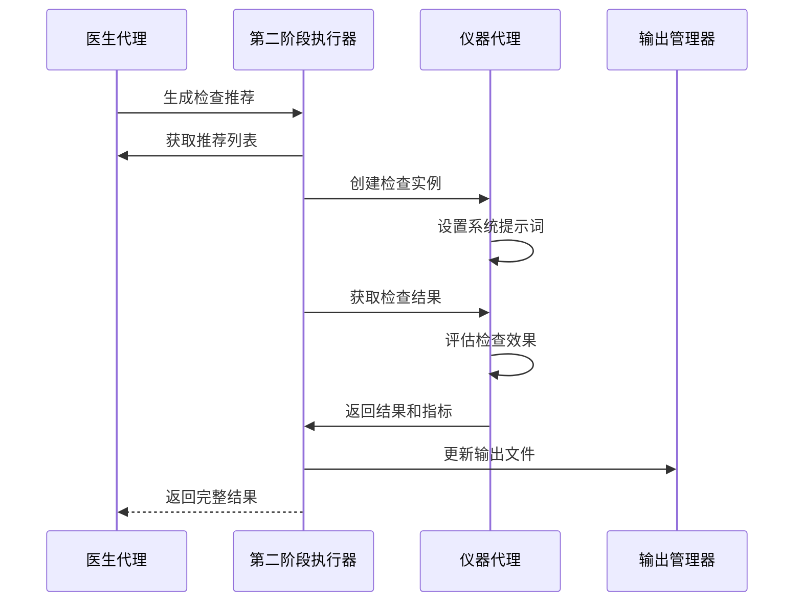
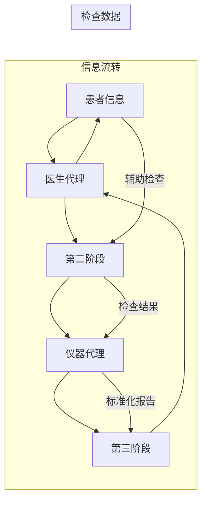
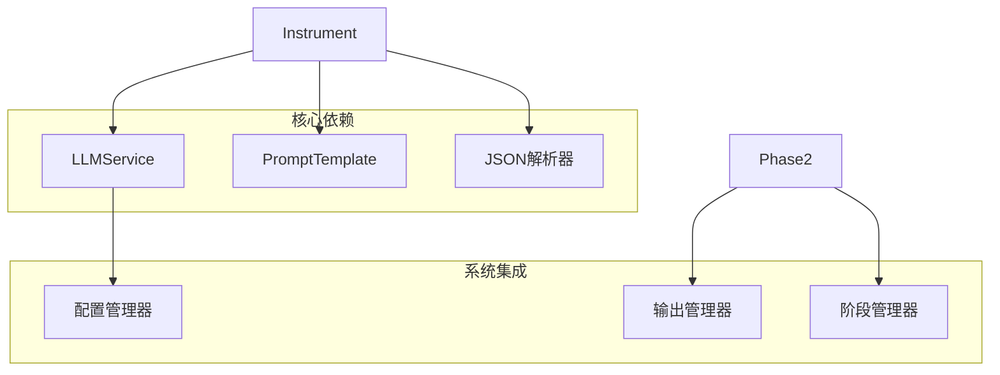

# 仪器代理

<cite>
**本文档引用的文件**
- [instrument.py](file://agents/instrument/instrument.py)
- [prompts.py](file://agents/instrument/prompts.py)
- [llm_api.py](file://services/llm_api.py)
- [interview_phase2.py](file://core/interview/interview_phase2.py)
- [run_interview.py](file://run_interview.py)
- [doctor.py](file://agents/doctor/doctor.py)
- [patient.py](file://agents/patient/patient.py)
- [interview_phase1_output.json](file://data/output/interview/qwen-flash/1009904/interview_phase1_output.json)
- [interview_phase2_output.json](file://data/output/interview/qwen-flash/1009904/interview_phase2_output.json)
</cite>

## 目录
1. [简介](#简介)
2. [项目结构](#项目结构)
3. [核心组件](#核心组件)
4. [架构概览](#架构概览)
5. [详细组件分析](#详细组件分析)
6. [依赖关系分析](#依赖关系分析)
7. [性能考虑](#性能考虑)
8. [故障排除指南](#故障排除指南)
9. [结论](#结论)

## 简介

仪器代理（Instrument Agent）是精神科智能问诊系统中的关键组件，专门负责模拟医疗仪器的辅助诊断功能。该代理通过分析医生的检查请求和患者的辅助检查结果，提供客观、标准化的检查报告，为完整的问诊流程提供重要的客观数据支撑。

在精神科诊疗场景中，仪器代理扮演着"客观检查数据提供者"的角色，它能够：
- 根据医生的检查请求返回相应的检查结果
- 严格遵循检查项目的精确匹配原则
- 提供标准化的检查报告格式
- 支持检查推荐效果的自动化评估

## 项目结构

系统采用模块化的架构设计，将不同的代理角色分离到独立的模块中：

**图表来源**
- [instrument.py:1-243](file://agents/instrument/instrument.py#L1-L243)
- [llm_api.py:79-250](file://services/llm_api.py#L79-L250)
- [run_interview.py:46-396](file://run_interview.py#L46-L396)

**章节来源**
- [instrument.py:1-243](file://agents/instrument/instrument.py#L1-L243)
- [run_interview.py:1-408](file://run_interview.py#L1-L408)

## 核心组件

### 仪器代理核心功能

仪器代理的核心功能围绕"检查结果返回"这一中心目标构建，具备以下关键特性：

#### 1. 检查请求处理
- 接收医生的检查项目数组请求
- 解析并验证检查项目的格式和内容
- 与现有辅助检查数据进行语义匹配

#### 2. 结果生成机制
- 基于已知检查数据返回对应结果
- 对无法匹配的项目返回"NONE"标识
- 保持与医生请求完全一致的输出格式

#### 3. 评估指标计算
- 计算检查推荐的准确性指标
- 支持Precision、Recall、F1、Jaccard等指标
- 提供详细的统计分析报告

**章节来源**
- [instrument.py:13-45](file://agents/instrument/instrument.py#L13-L45)
- [instrument.py:78-163](file://agents/instrument/instrument.py#L78-L163)

## 架构概览

仪器代理在整个问诊系统中承担着"数据桥梁"的重要作用，连接医生的主观诊断需求和客观的检查数据：

**图表来源**
- [interview_phase2.py:174-228](file://core/interview/interview_phase2.py#L174-L228)
- [instrument.py:166-182](file://agents/instrument/instrument.py#L166-L182)

### 数据流分析

仪器代理的数据处理遵循严格的输入-处理-输出模式：

**图表来源**
- [instrument.py:13-45](file://agents/instrument/instrument.py#L13-L45)
- [instrument.py:166-182](file://agents/instrument/instrument.py#L166-L182)

**章节来源**
- [instrument.py:13-182](file://agents/instrument/instrument.py#L13-L182)

## 详细组件分析

### 仪器代理类结构

**图表来源**
- [instrument.py:13-188](file://agents/instrument/instrument.py#L13-L188)
- [llm_api.py:79-250](file://services/llm_api.py#L79-L250)
- [prompts.py:3-58](file://agents/instrument/prompts.py#L3-L58)

### 检查评估指标计算

仪器代理实现了完整的检查推荐效果评估体系，采用严格的统计方法：

#### 指标定义
- **TP (真正例)**: 非NONE的返回数量
- **FP (假正例)**: NONE的数量  
- **FN (假负例)**: gold数量 - TP

#### 计算公式
- **Precision**: TP / (TP + FP)
- **Recall**: TP / (TP + FN)
- **F1**: 2PR / (P + R)
- **Jaccard**: TP / (TP + FP + FN)

**图表来源**
- [instrument.py:78-163](file://agents/instrument/instrument.py#L78-L163)

**章节来源**
- [instrument.py:78-163](file://agents/instrument/instrument.py#L78-L163)

### 与医生代理的协作机制

仪器代理与医生代理通过检查推荐流程紧密协作：

**图表来源**
- [interview_phase2.py:75-244](file://core/interview/interview_phase2.py#L75-L244)
- [instrument.py:166-182](file://agents/instrument/instrument.py#L166-L182)

**章节来源**
- [interview_phase2.py:75-244](file://core/interview/interview_phase2.py#L75-L244)

### 与患者代理的信息共享

虽然仪器代理不直接与患者代理交互，但它通过医生代理间接获取患者信息：

**图表来源**
- [patient.py:40-92](file://agents/patient/patient.py#L40-L92)
- [interview_phase2.py:174-228](file://core/interview/interview_phase2.py#L174-L228)

**章节来源**
- [patient.py:40-92](file://agents/patient/patient.py#L40-L92)

## 依赖关系分析

### 外部依赖

仪器代理主要依赖以下外部组件：

**图表来源**
- [instrument.py:9-10](file://agents/instrument/instrument.py#L9-L10)
- [llm_api.py:58-76](file://services/llm_api.py#L58-L76)
- [interview_phase2.py:39-43](file://core/interview/interview_phase2.py#L39-L43)

### 内部耦合关系

仪器代理与其他组件的耦合关系相对松散，主要体现在：

1. **接口耦合**: 通过LLMService接口与底层API通信
2. **数据耦合**: 通过JSON格式进行数据交换
3. **流程耦合**: 在完整问诊流程中的顺序依赖

**章节来源**
- [instrument.py:1-243](file://agents/instrument/instrument.py#L1-L243)
- [llm_api.py:1-250](file://services/llm_api.py#L1-L250)

## 性能考虑

### API调用优化

仪器代理在API调用方面采用了多项优化策略：

1. **指数退避重试**: 最多重试3次，延迟按2的幂次增长
2. **超时控制**: 默认30秒超时，可根据环境调整
3. **批量处理**: 支持一次性处理多个检查项目

### 内存管理

- 对话历史自动清理，避免内存泄漏
- JSON解析采用流式处理，减少内存占用
- 结果缓存机制，避免重复计算

### 并发处理

系统支持多实例并发运行，每个仪器代理实例独立维护其检查信息和对话历史。

## 故障排除指南

### 常见问题及解决方案

#### 1. JSON格式错误
**问题**: 输入的检查项目或结果不是有效的JSON格式
**解决方案**: 
- 检查输入数据的JSON格式
- 确保使用正确的引号和括号
- 验证数据编码格式

#### 2. API调用失败
**问题**: LLM API调用返回错误
**解决方案**:
- 检查网络连接状态
- 验证API密钥和端点配置
- 查看重试日志了解失败原因

#### 3. 检查匹配失败
**问题**: 医生请求的检查项目无法匹配到现有结果
**解决方案**:
- 确认检查项目的命名一致性
- 检查是否存在拼写错误
- 验证检查数据的完整性

**章节来源**
- [instrument.py:48-75](file://agents/instrument/instrument.py#L48-L75)
- [llm_api.py:158-169](file://services/llm_api.py#L158-L169)

### 调试技巧

1. **启用详细日志**: 查看API调用的详细过程
2. **检查中间结果**: 验证JSON解析和数据转换
3. **单元测试**: 对关键函数进行独立测试

## 结论

仪器代理作为精神科智能问诊系统的核心组件，通过其专业的检查结果返回能力和严格的评估指标计算，为完整的问诊流程提供了可靠的客观数据支撑。其设计理念体现了以下几个关键特点：

1. **专业性**: 专注于检查结果的专业生成，确保结果的准确性和可靠性
2. **标准化**: 采用统一的输出格式和评估标准，便于系统集成
3. **可评估性**: 内置完整的评估机制，支持检查推荐效果的量化分析
4. **可扩展性**: 模块化设计便于功能扩展和定制

在实际应用中，仪器代理不仅为医生提供了客观的检查数据，更重要的是通过其评估能力帮助医生改进检查推荐策略，最终提升整体的诊断质量和效率。这种"工具+评估"的双重价值使得仪器代理成为现代智能医疗系统中不可或缺的重要组成部分。