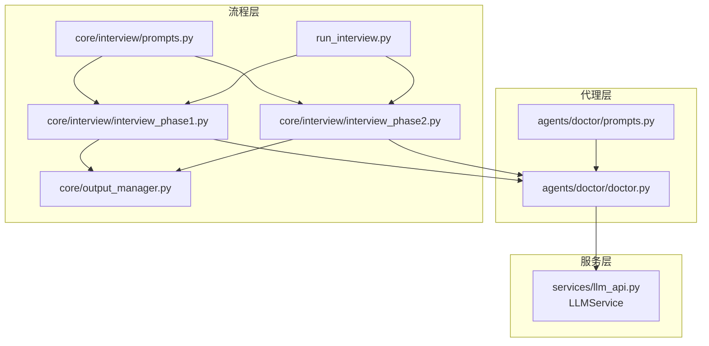
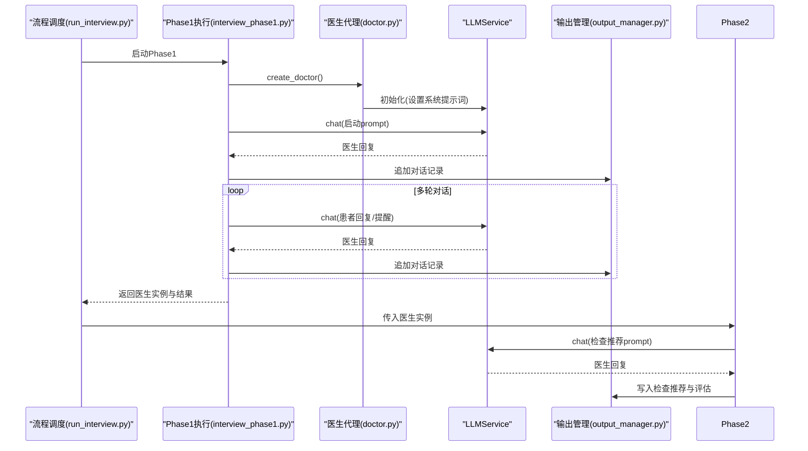
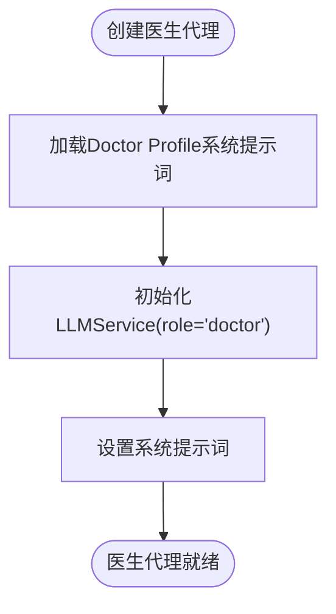
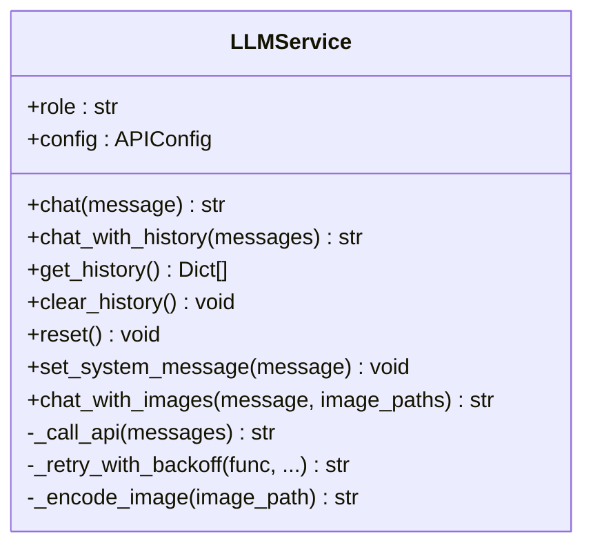
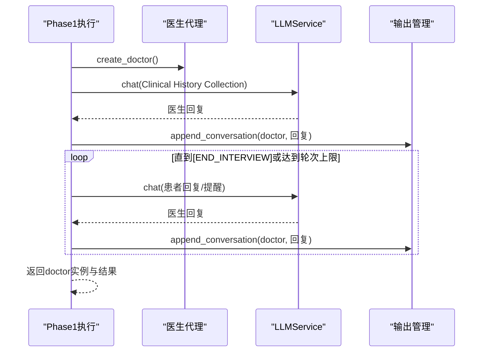
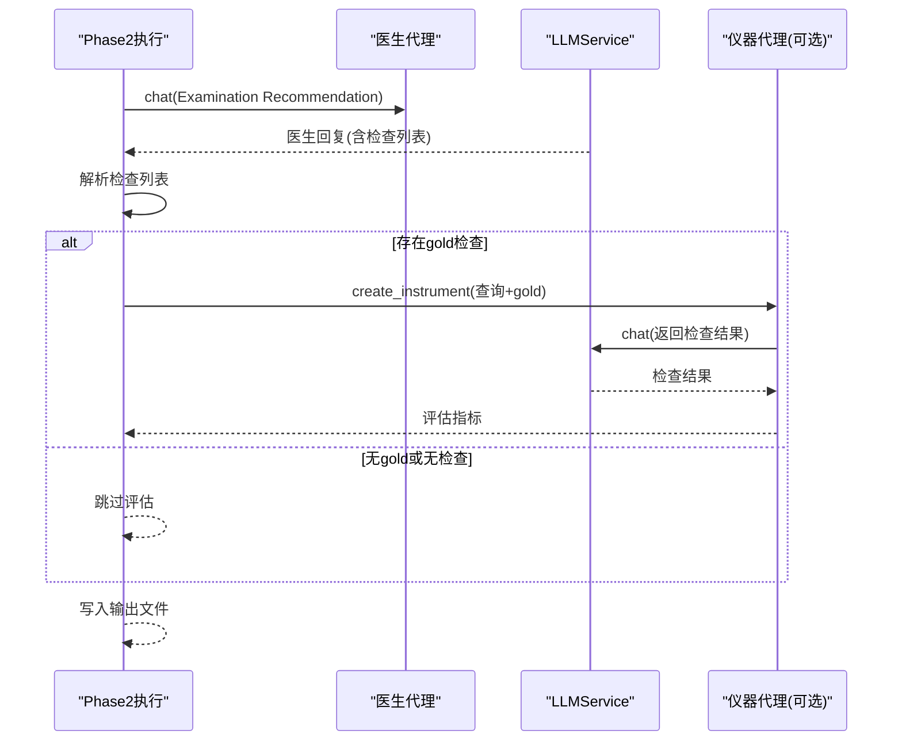
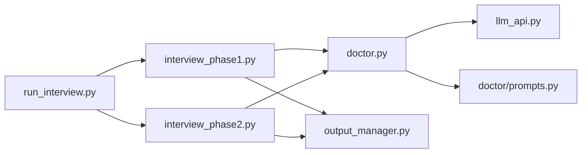

# 医生代理

<cite>
**本文引用的文件**
- [agents/doctor/doctor.py](file://agents/doctor/doctor.py)
- [agents/doctor/prompts.py](file://agents/doctor/prompts.py)
- [services/llm_api.py](file://services/llm_api.py)
- [core/interview/interview_phase1.py](file://core/interview/interview_phase1.py)
- [core/interview/interview_phase2.py](file://core/interview/interview_phase2.py)
- [core/interview/prompts.py](file://core/interview/prompts.py)
- [core/output_manager.py](file://core/output_manager.py)
- [run_interview.py](file://run_interview.py)
</cite>

## 目录
1. [简介](#简介)
2. [项目结构](#项目结构)
3. [核心组件](#核心组件)
4. [架构总览](#架构总览)
5. [详细组件分析](#详细组件分析)
6. [依赖关系分析](#依赖关系分析)
7. [性能考量](#性能考量)
8. [故障排查指南](#故障排查指南)
9. [结论](#结论)
10. [附录](#附录)

## 简介
本文件面向“医生代理”的设计与实现，重点阐述如何通过 LLMService 创建虚拟医生角色，以及其在精神科问诊流程中的关键作用。文档覆盖以下主题：
- 设计理念与实现原理：如何以系统提示词驱动医生行为，如何通过 LLMService 维护多轮对话上下文。
- 核心功能：多轮对话上下文管理、系统提示词配置、历史记录维护。
- 在问诊流程中的作用：引导患者提供病史信息、进行症状评估、制定检查计划。
- 使用示例：初始化医生代理、发起对话、处理多轮交互、获取对话历史。
- 提示词工程：Doctor Profile 提示词的设计思路与优化策略。
- 最佳实践与常见问题解决方案。

## 项目结构
医生代理位于 agents/doctor 目录，配合 services/llm_api 提供的通用 LLMService 能力，参与 core/interview 的完整流程。

图表来源
- [agents/doctor/doctor.py:1-95](file://agents/doctor/doctor.py#L1-L95)
- [agents/doctor/prompts.py:1-21](file://agents/doctor/prompts.py#L1-L21)
- [services/llm_api.py:79-250](file://services/llm_api.py#L79-L250)
- [core/interview/interview_phase1.py:298-398](file://core/interview/interview_phase1.py#L298-L398)
- [core/interview/interview_phase2.py:75-244](file://core/interview/interview_phase2.py#L75-L244)
- [core/interview/prompts.py:1-233](file://core/interview/prompts.py#L1-L233)
- [core/output_manager.py:50-189](file://core/output_manager.py#L50-L189)
- [run_interview.py:46-396](file://run_interview.py#L46-L396)

章节来源
- [agents/doctor/doctor.py:1-95](file://agents/doctor/doctor.py#L1-L95)
- [services/llm_api.py:79-250](file://services/llm_api.py#L79-L250)
- [core/interview/interview_phase1.py:298-398](file://core/interview/interview_phase1.py#L298-L398)
- [core/interview/interview_phase2.py:75-244](file://core/interview/interview_phase2.py#L75-L244)
- [core/interview/prompts.py:1-233](file://core/interview/prompts.py#L1-L233)
- [core/output_manager.py:50-189](file://core/output_manager.py#L50-L189)
- [run_interview.py:46-396](file://run_interview.py#L46-L396)

## 核心组件
- 医生代理工厂：create_doctor 返回一个已设置系统提示词的 LLMService 实例，角色为 doctor。
- 系统提示词：Doctor Profile 定义医生的行为边界、输出约束与开场白要求。
- LLMService：统一的 LLM 调用封装，负责维护对话历史、系统提示词、重试与多模态能力。
- 流程集成：在 Phase 1（病史采集）与 Phase 2（检查推荐）中复用医生实例，确保上下文延续。

章节来源
- [agents/doctor/doctor.py:32-55](file://agents/doctor/doctor.py#L32-L55)
- [agents/doctor/prompts.py:5-20](file://agents/doctor/prompts.py#L5-L20)
- [services/llm_api.py:79-191](file://services/llm_api.py#L79-L191)
- [core/interview/interview_phase1.py:298-398](file://core/interview/interview_phase1.py#L298-L398)
- [core/interview/interview_phase2.py:75-244](file://core/interview/interview_phase2.py#L75-L244)

## 架构总览
医生代理通过系统提示词驱动，借助 LLMService 的上下文管理能力，参与多阶段问诊流程。在 Phase 1 中引导患者提供病史信息，在 Phase 2 中基于上下文推荐辅助检查。

图表来源
- [run_interview.py:46-396](file://run_interview.py#L46-L396)
- [core/interview/interview_phase1.py:298-398](file://core/interview/interview_phase1.py#L298-L398)
- [core/interview/interview_phase2.py:75-244](file://core/interview/interview_phase2.py#L75-L244)
- [agents/doctor/doctor.py:32-55](file://agents/doctor/doctor.py#L32-L55)
- [services/llm_api.py:113-131](file://services/llm_api.py#L113-L131)
- [core/output_manager.py:117-168](file://core/output_manager.py#L117-L168)

## 详细组件分析

### 医生代理工厂与系统提示词
- 医生代理工厂：create_doctor 从 PROMPTS 中读取 Doctor Profile，构造 LLMService（role=doctor），并设置系统提示词。
- Doctor Profile 的设计要点：
  - 明确角色定位（精神科医生）、对话节奏（每次围绕一个问题）、信息来源（当前已知信息与后续新信息）。
  - 禁止编造信息、不提前进入后续阶段、仅输出当前轮次内容。
  - 开场白要求简洁、关怀，便于建立信任与沟通氛围。

图表来源
- [agents/doctor/doctor.py:32-55](file://agents/doctor/doctor.py#L32-L55)
- [agents/doctor/prompts.py:5-20](file://agents/doctor/prompts.py#L5-L20)

章节来源
- [agents/doctor/doctor.py:32-55](file://agents/doctor/doctor.py#L32-L55)
- [agents/doctor/prompts.py:5-20](file://agents/doctor/prompts.py#L5-L20)

### LLMService 上下文管理与历史维护
- 对话历史：以 [{"role": "user"/"assistant"/"system", "content": str}] 形式存储，自动在每次 chat 调用前后追加用户与助手消息。
- 系统提示词：首次调用 chat 时注入；可通过 set_system_message 动态更新。
- 历史操作：get_history 返回副本；clear_history 保留 system 消息；reset 清空所有历史。
- 错误处理：内置指数退避重试，提升稳定性。

图表来源
- [services/llm_api.py:79-250](file://services/llm_api.py#L79-L250)

章节来源
- [services/llm_api.py:79-191](file://services/llm_api.py#L79-L191)

### Phase 1：病史采集中的医生代理
- 医生代理在 Phase 1 中承担“引导者”角色：使用 Clinical History Collection prompt 启动对话，持续与患者多轮交互，直至输出 [END_INTERVIEW]。
- 医生实例贯穿流程：Phase 1 返回的 doctor 实例携带完整历史，供 Phase 2 使用。
- 输出管理：append_conversation 即时写入对话记录与覆盖率统计字段，保证实时可观测性。

图表来源
- [core/interview/interview_phase1.py:298-398](file://core/interview/interview_phase1.py#L298-L398)
- [core/interview/prompts.py:4-22](file://core/interview/prompts.py#L4-L22)
- [core/output_manager.py:117-168](file://core/output_manager.py#L117-L168)

章节来源
- [core/interview/interview_phase1.py:241-428](file://core/interview/interview_phase1.py#L241-L428)
- [core/interview/prompts.py:4-22](file://core/interview/prompts.py#L4-L22)
- [core/output_manager.py:117-168](file://core/output_manager.py#L117-L168)

### Phase 2：检查推荐中的医生代理
- 医生代理基于 Phase 1 的上下文，生成“拟申请的辅助检查项目列表”，并以 [BEGIN_EXAMINATIONS]/[END_EXAMINATIONS] 包裹。
- 解析与评估：解析医生响应中的检查列表，结合病例 gold 数据，计算 Precision/Recall/F1/Jaccard 指标。
- 仪器代理：可选调用 Instrument 生成检查结果并评估，形成闭环。

图表来源
- [core/interview/interview_phase2.py:75-244](file://core/interview/interview_phase2.py#L75-L244)
- [core/interview/prompts.py:25-57](file://core/interview/prompts.py#L25-L57)
- [agents/instrument/instrument.py:13-187](file://agents/instrument/instrument.py#L13-L187)

章节来源
- [core/interview/interview_phase2.py:75-244](file://core/interview/interview_phase2.py#L75-L244)
- [core/interview/prompts.py:25-57](file://core/interview/prompts.py#L25-L57)
- [agents/instrument/instrument.py:13-187](file://agents/instrument/instrument.py#L13-L187)

### 使用示例与最佳实践
- 初始化医生代理
  - 通过 create_doctor 获取 LLMService 实例，内部已设置 Doctor Profile 系统提示词。
- 发起对话
  - doctor.chat("你好，请问有什么不舒服？") 即可获得医生回复。
- 多轮交互
  - 连续调用 doctor.chat(...)，LLMService 自动维护上下文，无需手动拼接历史。
- 获取历史
  - doctor.get_history() 返回当前对话历史副本，便于调试与审计。
- 最佳实践
  - 保持系统提示词稳定，避免频繁变更导致行为漂移。
  - 在 Phase 1 中严格控制结束标记 [END_INTERVIEW] 的输出时机，确保流程推进。
  - 在 Phase 2 中要求医生输出严格的 [BEGIN_EXAMINATIONS]/[END_EXAMINATIONS] 包裹，便于解析。
  - 使用输出管理模块 append_conversation 即时写入，便于监控与回放。

章节来源
- [agents/doctor/doctor.py:32-55](file://agents/doctor/doctor.py#L32-L55)
- [services/llm_api.py:113-131](file://services/llm_api.py#L113-L131)
- [core/output_manager.py:117-168](file://core/output_manager.py#L117-L168)

### 提示词工程：Doctor Profile 设计思路与优化策略
- 设计思路
  - 角色定义：明确医生身份与职责范围，限定输出粒度（每次围绕一个问题）。
  - 信息约束：强调基于已知信息与新信息开展工作，禁止编造。
  - 行为约束：不提前进入后续阶段、仅输出当前轮次内容、保持简洁与关怀。
- 优化策略
  - 明确结束条件：在 Doctor Profile 中强调“仅在当前阶段明确要求时才进入后续任务”，避免越权行为。
  - 输出格式约束：在 Doctor Profile 中要求“只输出当前轮次应给出的医生内容，不要输出解释、备注或角色说明”，减少多余信息。
  - 开场白策略：在 Doctor Profile 中要求“用关怀且简短的开场白开启对话”，有助于建立信任。
- 与其他阶段提示词的衔接
  - Phase 1 的 Clinical History Collection 会替换占位符，确保医生在对话中了解患者基本信息与体格检查结果。
  - Phase 2 的 Examination Recommendation 强制要求 [BEGIN_EXAMINATIONS]/[END_EXAMINATIONS] 包裹，便于结构化解析。

章节来源
- [agents/doctor/prompts.py:5-20](file://agents/doctor/prompts.py#L5-L20)
- [core/interview/prompts.py:4-22](file://core/interview/prompts.py#L4-L22)
- [core/interview/prompts.py:25-57](file://core/interview/prompts.py#L25-L57)

## 依赖关系分析
- 医生代理依赖 LLMService 提供的上下文管理与 API 调用能力。
- Phase 1/2 依赖输出管理模块进行实时写入与状态更新。
- 流程调度 run_interview.py 将各阶段串联，传递医生实例以维持上下文。

图表来源
- [agents/doctor/doctor.py:28-29](file://agents/doctor/doctor.py#L28-L29)
- [services/llm_api.py:79-191](file://services/llm_api.py#L79-L191)
- [core/interview/interview_phase1.py:37-46](file://core/interview/interview_phase1.py#L37-L46)
- [core/interview/interview_phase2.py:37-40](file://core/interview/interview_phase2.py#L37-L40)
- [core/output_manager.py:50-115](file://core/output_manager.py#L50-L115)
- [run_interview.py:32-43](file://run_interview.py#L32-L43)

章节来源
- [agents/doctor/doctor.py:28-29](file://agents/doctor/doctor.py#L28-L29)
- [services/llm_api.py:79-191](file://services/llm_api.py#L79-L191)
- [core/interview/interview_phase1.py:37-46](file://core/interview/interview_phase1.py#L37-L46)
- [core/interview/interview_phase2.py:37-40](file://core/interview/interview_phase2.py#L37-L40)
- [core/output_manager.py:50-115](file://core/output_manager.py#L50-L115)
- [run_interview.py:32-43](file://run_interview.py#L32-L43)

## 性能考量
- 上下文长度控制：随着多轮对话增加，历史消息累积可能导致上下文超限。建议：
  - 在 Phase 1 中适时输出 [END_INTERVIEW]，避免无谓延长。
  - 在 Phase 2 中严格要求结构化输出，减少冗余解释，降低 token 消耗。
- 重试与超时：LLMService 内置指数退避重试与超时控制，可在网络波动时提升稳定性。
- 输出写入：append_conversation 即时写入，避免大体量一次性落盘，提高可观测性与可靠性。

[本节为通用指导，不直接分析具体文件]

## 故障排查指南
- 无法连接 LLM API
  - 检查 .env 中 DOCTOR_API_* 配置是否正确。
  - 观察 LLMService 的重试日志，确认是否触发指数退避。
- 医生未输出 [END_INTERVIEW]
  - 检查 Phase 1 的结束检测逻辑与 Doctor Profile 的约束是否一致。
- 检查推荐解析失败
  - 确认医生输出严格使用 [BEGIN_EXAMINATIONS]/[END_EXAMINATIONS] 包裹。
  - 检查 Phase 2 的解析正则与 JSON 格式是否匹配。
- 输出文件未更新
  - 确认 append_conversation 与 update_phase_output 的调用顺序与路径正确。

章节来源
- [services/llm_api.py:158-169](file://services/llm_api.py#L158-L169)
- [core/interview/interview_phase1.py:194-207](file://core/interview/interview_phase1.py#L194-L207)
- [core/interview/interview_phase2.py:46-73](file://core/interview/interview_phase2.py#L46-L73)
- [core/output_manager.py:117-168](file://core/output_manager.py#L117-L168)

## 结论
医生代理通过系统提示词与 LLMService 的上下文管理，实现了稳定、可控、可评估的问诊流程。在 Phase 1 中引导病史采集，在 Phase 2 中基于上下文推荐检查，形成闭环。建议在提示词工程与输出格式上持续优化，确保流程的稳定性与可解释性。

[本节为总结性内容，不直接分析具体文件]

## 附录
- 完整流程入口：run_interview.py 提供 1-6 阶段的完整执行与汇总。
- 输出结构：各阶段输出文件遵循统一命名规则，便于评估与归档。

章节来源
- [run_interview.py:46-396](file://run_interview.py#L46-L396)
- [core/output_manager.py:20-47](file://core/output_manager.py#L20-L47)