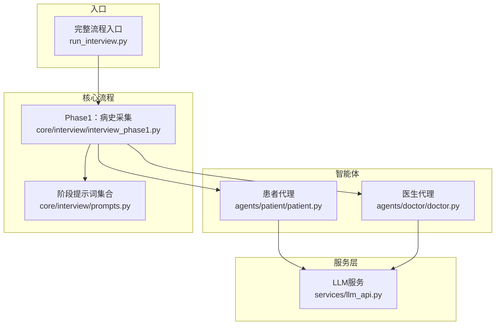
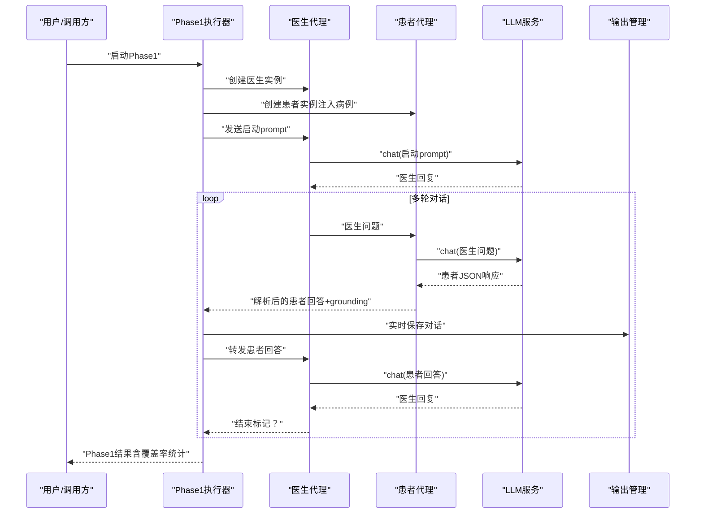
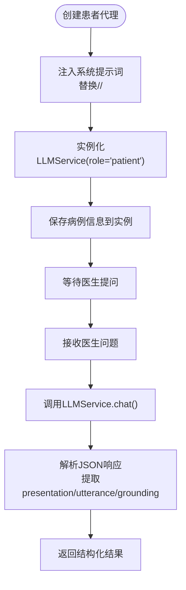
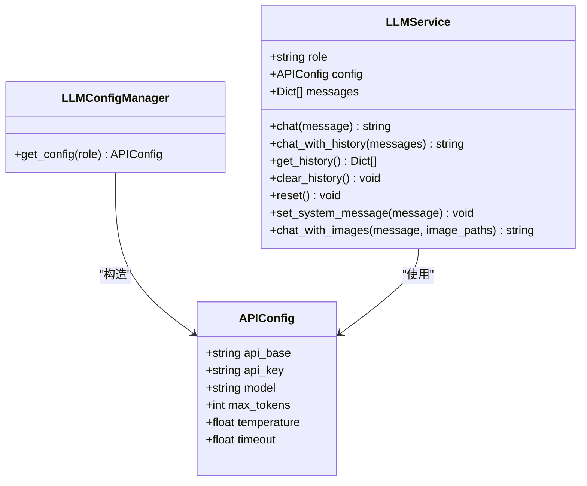
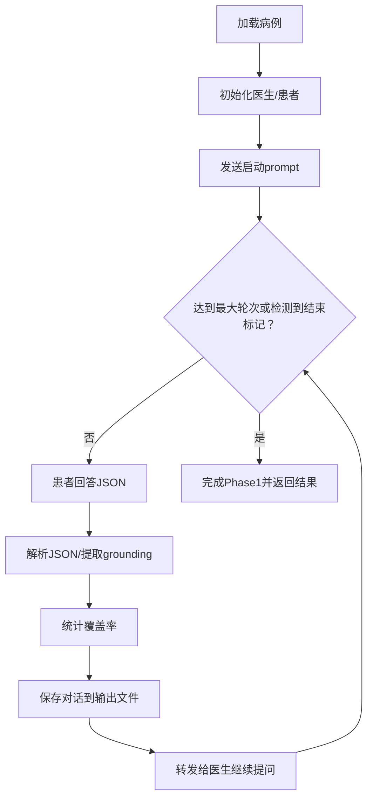
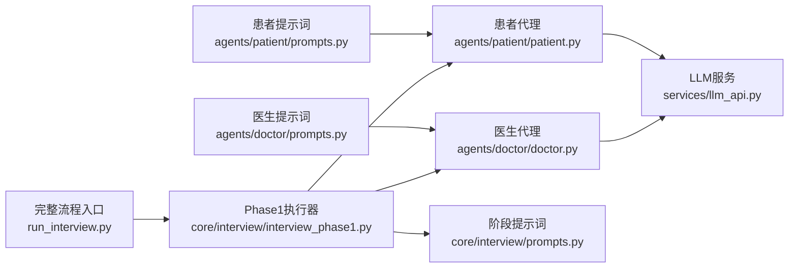

# 患者代理

<cite>
**本文档引用的文件**
- [agents/patient/patient.py](file://agents/patient/patient.py)
- [agents/patient/prompts.py](file://agents/patient/prompts.py)
- [agents/doctor/doctor.py](file://agents/doctor/doctor.py)
- [agents/doctor/prompts.py](file://agents/doctor/prompts.py)
- [services/llm_api.py](file://services/llm_api.py)
- [core/interview/interview_phase1.py](file://core/interview/interview_phase1.py)
- [core/interview/prompts.py](file://core/interview/prompts.py)
- [run_interview.py](file://run_interview.py)
- [test/test_api.py](file://test/test_api.py)
</cite>

## 目录
1. [简介](#简介)
2. [项目结构](#项目结构)
3. [核心组件](#核心组件)
4. [架构总览](#架构总览)
5. [详细组件分析](#详细组件分析)
6. [依赖关系分析](#依赖关系分析)
7. [性能考虑](#性能考虑)
8. [故障排查指南](#故障排查指南)
9. [结论](#结论)
10. [附录](#附录)

## 简介
本文件面向“患者代理”的设计与实现，系统阐述其在精神科问诊系统中的作用：通过标准化的提示词与病例数据，模拟真实患者的自然语言对话行为，包括提供症状描述、配合检查、表达情感状态等。文档覆盖以下要点：
- 设计思路与实现机制：基于LLM的系统提示词驱动、上下文维护与JSON结构化输出。
- 核心功能：基于病例数据生成自然语言响应、维持角色一致性、处理多轮对话、解析与回放grounding信息。
- 在问诊流程中的作用：作为第一阶段“病史采集”的关键角色，支撑后续检查推荐、病历整理、诊断识别与鉴别诊断。
- 使用示例：创建患者代理、传入病例数据、进行问诊互动、获取结构化响应与grounding。
- 提示词设计影响：如何通过提示词控制表达方式、情感倾向与信息披露节奏。
- 扩展指南与性能优化建议。

## 项目结构
本项目采用按职责分层的组织方式：
- agents：智能体模块，包含医生与患者两个Agent及其提示词。
- services：通用服务层，提供LLM API封装与配置管理。
- core：核心业务流程，包含问诊阶段与评估阶段的实现。
- data：输出目录，保存各阶段的对话与评估结果。
- scripts、eval_interview、models、test：脚本、评估工具、模型与测试模块。
- run_interview.py：完整六阶段流程入口。

图表来源
- [agents/patient/patient.py:1-171](file://agents/patient/patient.py#L1-L171)
- [agents/doctor/doctor.py:1-95](file://agents/doctor/doctor.py#L1-L95)
- [services/llm_api.py:1-250](file://services/llm_api.py#L1-L250)
- [core/interview/interview_phase1.py:1-462](file://core/interview/interview_phase1.py#L1-L462)
- [core/interview/prompts.py:1-233](file://core/interview/prompts.py#L1-L233)
- [run_interview.py:1-408](file://run_interview.py#L1-L408)

章节来源
- [run_interview.py:1-408](file://run_interview.py#L1-L408)

## 核心组件
- 患者代理（Patient Agent）
  - 通过工厂函数创建，注入系统提示词与病例信息，返回LLMService实例。
  - 以“标准化精神科患者”角色回答医生问题，遵循严格的grounding约束与JSON输出格式。
- 医生代理（Doctor Agent）
  - 通过工厂函数创建，加载“医生档案”提示词，支持多轮对话上下文。
- LLM服务（LLMService）
  - 封装OpenAI Chat Completions API，自动维护对话历史，支持重试与多模态图文对话。
  - 支持不同角色（patient/doctor/evaluator）的独立配置。
- Phase1执行器（Interview Phase1）
  - 负责加载病例、初始化医生与患者、启动对话、解析患者JSON响应并统计覆盖率。
- 阶段提示词（Prompts）
  - 提供各阶段的系统提示词模板，贯穿完整问诊流程。

章节来源
- [agents/patient/patient.py:40-92](file://agents/patient/patient.py#L40-L92)
- [agents/doctor/doctor.py:32-55](file://agents/doctor/doctor.py#L32-L55)
- [services/llm_api.py:79-233](file://services/llm_api.py#L79-L233)
- [core/interview/interview_phase1.py:241-428](file://core/interview/interview_phase1.py#L241-L428)
- [core/interview/prompts.py:1-233](file://core/interview/prompts.py#L1-L233)

## 架构总览
患者代理在问诊系统中的位置与交互如下：

图表来源
- [core/interview/interview_phase1.py:336-398](file://core/interview/interview_phase1.py#L336-L398)
- [agents/patient/patient.py:100-171](file://agents/patient/patient.py#L100-L171)
- [agents/doctor/doctor.py:63-95](file://agents/doctor/doctor.py#L63-L95)
- [services/llm_api.py:113-131](file://services/llm_api.py#L113-L131)

## 详细组件分析

### 患者代理（Patient Agent）
- 角色与职责
  - 以“标准化精神科患者”身份回答医生问题，严格依据病例信息与当前上下文。
  - 输出JSON结构，包含外显表现、话语与grounding（主诉与精神状态条目）。
- 输入与输出
  - 输入：基本信息、主诉列表、精神状态列表。
  - 输出：JSON字符串，包含presentation、utterance、grounding。
- 关键实现要点
  - 系统提示词模板注入：将基本信息、主诉、精神状态替换到模板中，形成角色设定。
  - JSON输出约束：grounding仅包含本轮实际使用到的条目，且必须与输入数组原样复制。
  - 多轮一致性：通过LLMService的历史维护，确保上下文连贯。
- 错误处理与容错
  - 当模型输出非标准JSON时，Phase1执行器提供解析与修复策略（正则提取、JSON修复、兜底原文）。

图表来源
- [agents/patient/patient.py:40-92](file://agents/patient/patient.py#L40-L92)
- [services/llm_api.py:113-131](file://services/llm_api.py#L113-L131)
- [core/interview/interview_phase1.py:90-144](file://core/interview/interview_phase1.py#L90-L144)

章节来源
- [agents/patient/patient.py:40-92](file://agents/patient/patient.py#L40-L92)
- [agents/patient/prompts.py:1-48](file://agents/patient/prompts.py#L1-L48)
- [core/interview/interview_phase1.py:90-144](file://core/interview/interview_phase1.py#L90-L144)

### 医生代理（Doctor Agent）
- 角色与职责
  - 以“精神科医生”身份发起与推进问诊，遵循阶段提示词与上下文。
- 关键实现要点
  - 仅加载“医生档案”提示词，不附加额外病例信息。
  - 通过LLMService维护对话历史，支持多轮连续问答。
- 与患者代理的协作
  - 医生向患者提问，患者返回JSON；医生再将患者回答转发给模型继续推进。

章节来源
- [agents/doctor/doctor.py:32-55](file://agents/doctor/doctor.py#L32-L55)
- [agents/doctor/prompts.py:1-21](file://agents/doctor/prompts.py#L1-L21)

### LLM服务（LLMService）
- 角色配置与历史管理
  - 基于.env按角色加载API配置，实例生命周期内自动维护对话历史。
  - 支持清空历史、重置、设置系统提示词等操作。
- API调用与重试
  - 封装OpenAI Chat Completions API，带指数退避重试机制。
- 多模态支持
  - 支持图文对话，将图片编码为base64并拼接到消息内容中。
- 测试验证
  - 提供多轮对话、上下文记忆、新实例隔离、系统提示词等测试用例。

图表来源
- [services/llm_api.py:47-233](file://services/llm_api.py#L47-L233)

章节来源
- [services/llm_api.py:47-233](file://services/llm_api.py#L47-L233)
- [test/test_api.py:19-234](file://test/test_api.py#L19-L234)

### Phase1：病史采集（Interview Phase1）
- 流程概述
  - 加载随机或指定病例，初始化医生与患者，发送启动prompt，进入多轮对话。
  - 每轮解析患者JSON响应，提取grounding条目，统计覆盖率。
  - 检测结束标记或达到最大轮次后结束。
- 关键能力
  - JSON解析与修复：支持直接解析、JSON修复、正则提取与兜底原文。
  - 覆盖率统计：统计主诉与精神状态的使用情况。
  - 实时输出：每轮对话实时写入输出文件，便于调试与评估。

图表来源
- [core/interview/interview_phase1.py:241-428](file://core/interview/interview_phase1.py#L241-L428)
- [core/interview/interview_phase1.py:90-144](file://core/interview/interview_phase1.py#L90-L144)
- [core/interview/prompts.py:1-23](file://core/interview/prompts.py#L1-L23)

章节来源
- [core/interview/interview_phase1.py:241-428](file://core/interview/interview_phase1.py#L241-L428)
- [core/interview/interview_phase1.py:90-144](file://core/interview/interview_phase1.py#L90-L144)
- [core/interview/prompts.py:1-23](file://core/interview/prompts.py#L1-L23)

## 依赖关系分析
- 患者代理依赖
  - LLM服务：负责实际的API调用与上下文维护。
  - 提示词模板：注入系统提示词，定义角色与输出格式。
- Phase1执行器依赖
  - 患者代理与医生代理：作为对话双方。
  - 阶段提示词：提供各阶段系统提示词。
  - 输出管理：负责实时保存对话与统计结果。
- 完整流程入口
  - run_interview.py串联六个阶段，Phase1作为起点。

图表来源
- [agents/patient/prompts.py:1-48](file://agents/patient/prompts.py#L1-L48)
- [agents/patient/patient.py:36-37](file://agents/patient/patient.py#L36-L37)
- [agents/doctor/prompts.py:1-21](file://agents/doctor/prompts.py#L1-L21)
- [agents/doctor/doctor.py:28-29](file://agents/doctor/doctor.py#L28-L29)
- [services/llm_api.py:36-37](file://services/llm_api.py#L36-L37)
- [core/interview/interview_phase1.py:38-39](file://core/interview/interview_phase1.py#L38-L39)
- [core/interview/prompts.py:1-233](file://core/interview/prompts.py#L1-L233)
- [run_interview.py:32-43](file://run_interview.py#L32-L43)

章节来源
- [agents/patient/patient.py:36-37](file://agents/patient/patient.py#L36-L37)
- [agents/doctor/doctor.py:28-29](file://agents/doctor/doctor.py#L28-L29)
- [services/llm_api.py:36-37](file://services/llm_api.py#L36-L37)
- [core/interview/interview_phase1.py:38-39](file://core/interview/interview_phase1.py#L38-L39)
- [run_interview.py:32-43](file://run_interview.py#L32-L43)

## 性能考虑
- API调用与重试
  - LLMService内置指数退避重试，降低网络抖动对稳定性的影响。
- 上下文长度控制
  - 建议在提示词中明确“简短、自然、口语化”的输出要求，减少冗长回复导致的token浪费。
- JSON解析容错
  - Phase1对非标准JSON提供修复与正则提取策略，提高鲁棒性，但会增加解析开销；可在稳定输出格式后关闭修复逻辑。
- 并发与批量
  - 当前实现为串行对话；如需并发，需谨慎管理共享历史与资源竞争。
- 配置优化
  - 通过.env调整温度、最大token等参数，平衡创造性与稳定性。

章节来源
- [services/llm_api.py:158-169](file://services/llm_api.py#L158-L169)
- [core/interview/interview_phase1.py:90-144](file://core/interview/interview_phase1.py#L90-L144)

## 故障排查指南
- 无法加载.env或配置缺失
  - 确认.env文件存在且包含角色API配置（如PATIENT_API_BASE、PATIENT_API_KEY、PATIENT_MODEL等）。
- 患者JSON解析失败
  - 检查模型输出是否严格遵循JSON格式；必要时启用JSON修复或正则提取策略。
- 上下文丢失或记忆错误
  - 确保使用同一LLMService实例进行多轮对话；不同实例之间不会共享历史。
- 输出文件未生成
  - 检查输出管理初始化与权限；确认调用链路中包含实时保存步骤。
- 网络超时或不稳定
  - 查看重试日志；适当增大超时时间或减少并发请求。

章节来源
- [test/test_api.py:171-204](file://test/test_api.py#L171-L204)
- [services/llm_api.py:158-169](file://services/llm_api.py#L158-L169)
- [core/interview/interview_phase1.py:90-144](file://core/interview/interview_phase1.py#L90-L144)

## 结论
患者代理通过系统提示词与病例数据，实现了对真实患者行为的高保真模拟：自然语言表达、角色一致性、多轮上下文维护与grounding标注。在问诊系统中，它作为第一阶段的关键角色，为后续检查推荐、病历整理与诊断推理提供了高质量的对话基础。通过合理的提示词设计与配置优化，可进一步提升其稳定性与性能。

## 附录

### 使用示例：创建患者代理并进行问诊
- 步骤
  - 导入工厂函数，传入基本信息、主诉列表、精神状态列表。
  - 调用chat()接收患者JSON响应，解析presentation、utterance与grounding。
  - 可通过get_history()查看完整对话历史。
- 示例路径
  - [agents/patient/patient.py:100-171](file://agents/patient/patient.py#L100-L171)
  - [core/interview/interview_phase1.py:350-398](file://core/interview/interview_phase1.py#L350-L398)

章节来源
- [agents/patient/patient.py:100-171](file://agents/patient/patient.py#L100-L171)
- [core/interview/interview_phase1.py:350-398](file://core/interview/interview_phase1.py#L350-L398)

### 提示词设计对行为模拟的影响
- 角色设定
  - “标准化精神科患者”角色与严格规则，确保回答基于事实、避免编造。
- 输出格式
  - JSON结构化输出与grounding约束，使系统能自动抽取主诉与精神状态使用情况。
- 情感与表达
  - MENTAL STATUS用于控制外显表现与语气，grounding仅在明确受影响时使用，避免过度引用。
- 示例路径
  - [agents/patient/prompts.py:1-48](file://agents/patient/prompts.py#L1-L48)

章节来源
- [agents/patient/prompts.py:1-48](file://agents/patient/prompts.py#L1-L48)

### 扩展指南
- 新增角色
  - 参考LLMService的角色配置与工厂函数，新增角色提示词与工厂方法。
- 自定义提示词
  - 在相应prompts.py中扩展模板，注意输出格式与grounding约束的一致性。
- 多模态支持
  - 利用chat_with_images()接口，结合图片信息进行更丰富的交互。
- 性能优化
  - 控制输出长度、减少冗余上下文、启用稳定的JSON输出格式以降低解析成本。

章节来源
- [services/llm_api.py:237-249](file://services/llm_api.py#L237-L249)
- [services/llm_api.py:192-227](file://services/llm_api.py#L192-L227)