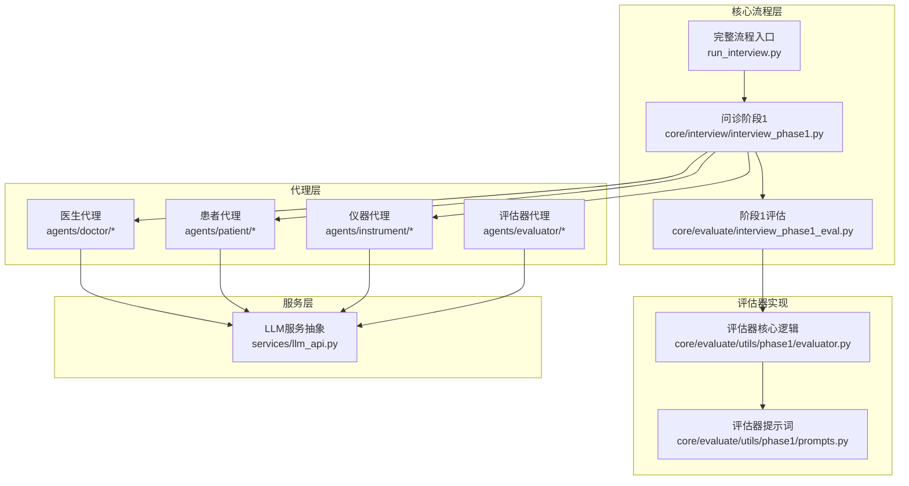
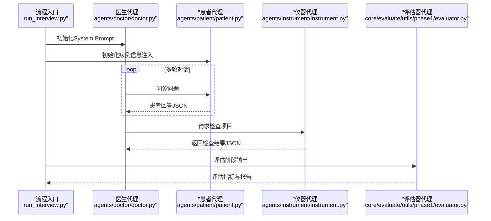
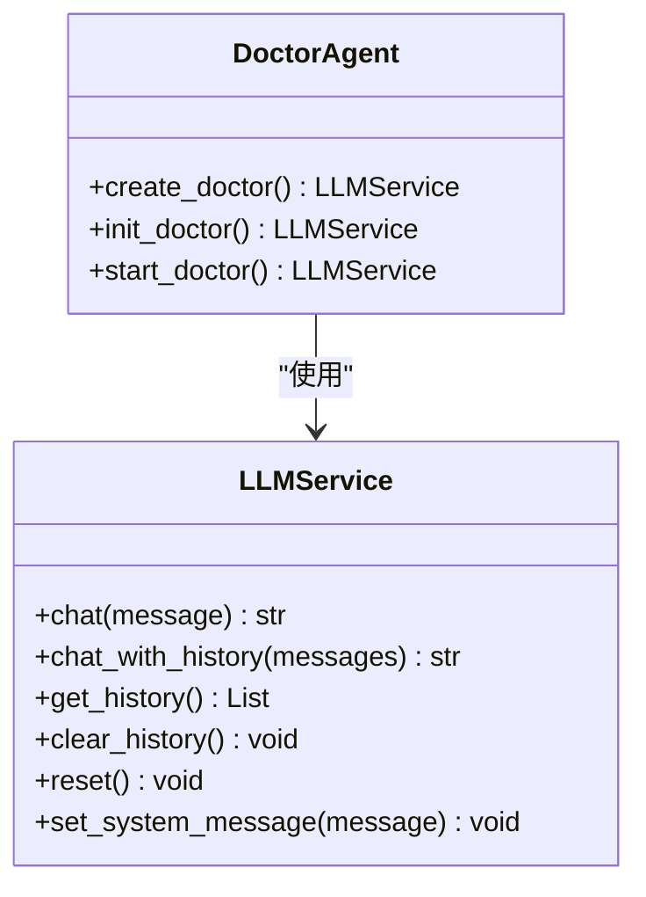
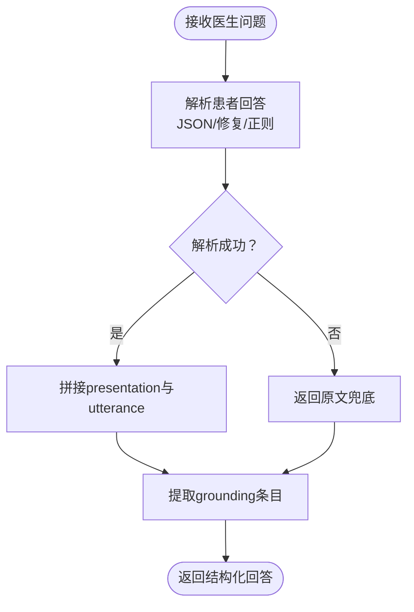
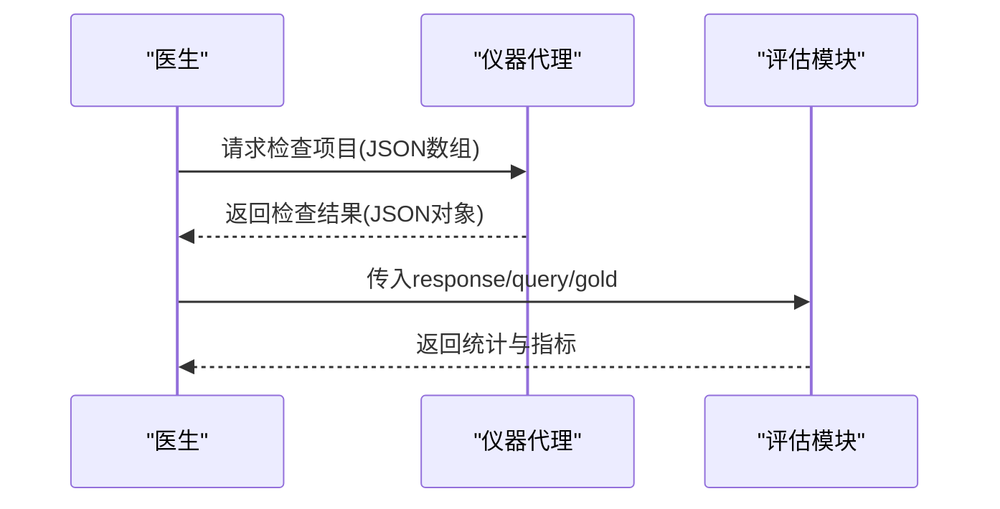
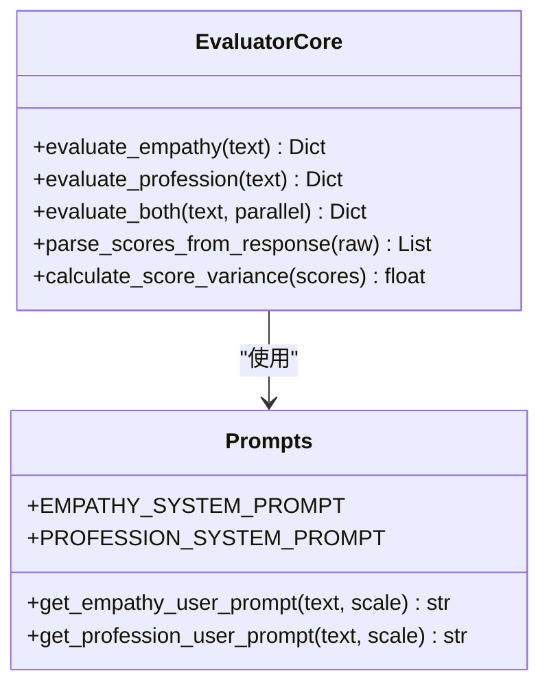
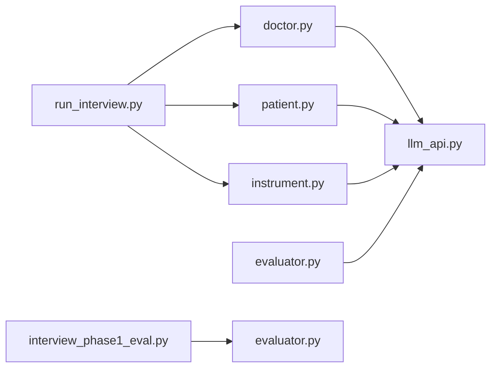

# 智能代理系统

<cite>
**本文档引用的文件**
- [run_interview.py](file://run_interview.py)
- [llm_api.py](file://services/llm_api.py)
- [doctor.py](file://agents/doctor/doctor.py)
- [prompts.py（医生）](file://agents/doctor/prompts.py)
- [patient.py](file://agents/patient/patient.py)
- [prompts.py（患者）](file://agents/patient/prompts.py)
- [instrument.py](file://agents/instrument/instrument.py)
- [prompts.py（仪器）](file://agents/instrument/prompts.py)
- [interview_phase1.py](file://core/interview/interview_phase1.py)
- [interview_phase1_eval.py](file://core/evaluate/interview_phase1_eval.py)
- [evaluator.py（评估器核心）](file://core/evaluate/utils/phase1/evaluator.py)
- [prompts.py（评估器）](file://core/evaluate/utils/phase1/prompts.py)
- [test_api.py](file://test/test_api.py)
</cite>

## 目录
1. [简介](#简介)
2. [项目结构](#项目结构)
3. [核心组件](#核心组件)
4. [架构总览](#架构总览)
5. [详细组件分析](#详细组件分析)
6. [依赖分析](#依赖分析)
7. [性能考虑](#性能考虑)
8. [故障排查指南](#故障排查指南)
9. [结论](#结论)
10. [附录](#附录)

## 简介
本项目是一个面向精神科问诊的智能代理系统，围绕“医生代理、患者代理、仪器代理、评估器代理”构建，配合“问诊阶段化流程”与“评估指标体系”，实现从病史采集、检查推荐、临床病历整理、诊断类别识别、诊断假设生成到鉴别诊断的完整闭环。系统强调：
- 对话管理：通过统一的LLM服务层维护上下文，确保多轮对话连贯性
- 提示词工程：通过精心设计的System Prompt与User Prompt，约束AI行为、提升输出质量
- 可扩展性：新增代理类型或修改行为只需遵循统一接口与提示词约定
- 可验证性：配套评估模块与指标，量化问诊质量

## 项目结构
系统采用“代理层 + 核心流程层 + 评估层 + 服务层”的分层组织：
- 代理层：医生、患者、仪器、评估器四类代理，封装角色职责与提示词
- 核心流程层：按阶段组织的问诊流程与输出管理
- 评估层：覆盖问诊质量、检查推荐、诊断识别等多个维度的评估
- 服务层：统一的LLM服务抽象，负责API调用、上下文维护、重试与多模态支持

图表来源
- [run_interview.py:46-396](file://run_interview.py#L46-L396)
- [interview_phase1.py:1-200](file://core/interview/interview_phase1.py#L1-L200)
- [llm_api.py:79-233](file://services/llm_api.py#L79-L233)

章节来源
- [run_interview.py:1-408](file://run_interview.py#L1-L408)
- [llm_api.py:1-250](file://services/llm_api.py#L1-L250)

## 核心组件
- LLM服务层（LLMService）：统一管理API配置、上下文历史、重试机制与多模态能力，为各代理提供一致的对话接口
- 医生代理：以“医生角色”的System Prompt驱动，负责引导问诊、推进阶段任务
- 患者代理：基于标准化患者模板，严格依据给定信息与上下文输出，保证回答的真实性与一致性
- 仪器代理：根据医生请求与已知辅助检查，返回对应检查结果，支持评估指标计算
- 评估器代理：基于量表与系统提示词，对问诊过程进行共情度与专业度评估

章节来源
- [llm_api.py:79-233](file://services/llm_api.py#L79-L233)
- [doctor.py:32-55](file://agents/doctor/doctor.py#L32-L55)
- [patient.py:40-92](file://agents/patient/patient.py#L40-L92)
- [instrument.py:13-45](file://agents/instrument/instrument.py#L13-L45)
- [evaluator.py（评估器核心）:50-160](file://core/evaluate/utils/phase1/evaluator.py#L50-L160)

## 架构总览
系统以“完整流程入口”为调度中心，按阶段串联各代理与评估模块。医生与患者在阶段内进行多轮对话，仪器代理在需要时介入提供检查结果，评估器代理在阶段结束后进行质量评估。

图表来源
- [run_interview.py:46-396](file://run_interview.py#L46-L396)
- [doctor.py:32-55](file://agents/doctor/doctor.py#L32-L55)
- [patient.py:40-92](file://agents/patient/patient.py#L40-L92)
- [instrument.py:166-182](file://agents/instrument/instrument.py#L166-L182)
- [evaluator.py（评估器核心）:133-160](file://core/evaluate/utils/phase1/evaluator.py#L133-L160)

## 详细组件分析

### 医生代理
- 角色定位：精神科医生，负责引导问诊、推进阶段任务
- 职责范围：维护对话上下文、按阶段推进、生成阶段性产出
- 交互机制：通过LLMService进行多轮对话，System Prompt限定行为边界
- 上下文与历史：由LLMService自动维护，支持查看与重置
- 扩展建议：新增阶段时，可在流程入口中接入新阶段的调用与评估

图表来源
- [llm_api.py:79-233](file://services/llm_api.py#L79-L233)
- [doctor.py:32-61](file://agents/doctor/doctor.py#L32-L61)

章节来源
- [doctor.py:1-95](file://agents/doctor/doctor.py#L1-L95)
- [prompts.py（医生）:5-20](file://agents/doctor/prompts.py#L5-L20)
- [llm_api.py:79-233](file://services/llm_api.py#L79-L233)

### 患者代理
- 角色定位：标准化精神科患者，严格依据给定信息与上下文回答
- 职责范围：输出JSON格式回答，包含外显表现、话语与grounding
- 交互机制：接收医生问题，返回结构化回答；支持历史解析与grounding抽取
- 上下文与历史：由LLMService维护；解析模块具备容错与正则提取能力
- 扩展建议：可增加多模态输入（如图像）以模拟更复杂场景

图表来源
- [interview_phase1.py:90-191](file://core/interview/interview_phase1.py#L90-L191)
- [patient.py:40-92](file://agents/patient/patient.py#L40-L92)

章节来源
- [patient.py:1-171](file://agents/patient/patient.py#L1-L171)
- [prompts.py（患者）:3-48](file://agents/patient/prompts.py#L3-L48)
- [interview_phase1.py:90-191](file://core/interview/interview_phase1.py#L90-L191)

### 仪器代理
- 角色定位：医学检查结果返回模块，严格按医生请求返回对应结果
- 职责范围：根据检查清单与已知检查结果，返回JSON；支持评估指标计算
- 交互机制：接收检查请求，返回结果；可与评估模块联动计算Precision/Recall/F1/Jaccard
- 上下文与历史：独立于医生/患者，仅在评估时参与
- 扩展建议：可扩展为“检查推荐”代理，基于问诊信息生成检查清单

图表来源
- [instrument.py:166-182](file://agents/instrument/instrument.py#L166-L182)
- [instrument.py:78-163](file://agents/instrument/instrument.py#L78-L163)

章节来源
- [instrument.py:1-243](file://agents/instrument/instrument.py#L1-L243)
- [prompts.py（仪器）:3-58](file://agents/instrument/prompts.py#L3-L58)

### 评估器代理
- 角色定位：基于量表的共情度与专业度评估
- 职责范围：解析模型输出分数，计算方差与平均分，输出结构化评估报告
- 交互机制：接收对话文本，构造User Prompt，调用LLMService进行评估
- 上下文与历史：评估器自身不维护对话历史，仅在评估时临时使用System Prompt
- 扩展建议：可增加更多维度（如伦理、沟通技巧）与并行评估策略

图表来源
- [evaluator.py（评估器核心）:50-160](file://core/evaluate/utils/phase1/evaluator.py#L50-L160)
- [prompts.py（评估器）:35-200](file://core/evaluate/utils/phase1/prompts.py#L35-L200)

章节来源
- [evaluator.py（评估器核心）:1-160](file://core/evaluate/utils/phase1/evaluator.py#L1-L160)
- [prompts.py（评估器）:1-200](file://core/evaluate/utils/phase1/prompts.py#L1-L200)

## 依赖分析
- 组件耦合：代理层通过LLMService解耦，核心流程层与评估层通过统一的输出文件对接
- 外部依赖：OpenAI Chat Completions API、.env配置、可选的json_repair库
- 循环依赖：未发现循环依赖，模块间调用方向清晰

图表来源
- [doctor.py:28-29](file://agents/doctor/doctor.py#L28-L29)
- [patient.py:36-37](file://agents/patient/patient.py#L36-L37)
- [instrument.py:9-10](file://agents/instrument/instrument.py#L9-L10)
- [evaluator.py（评估器核心）:11-18](file://core/evaluate/utils/phase1/evaluator.py#L11-L18)
- [run_interview.py:32-43](file://run_interview.py#L32-L43)

章节来源
- [run_interview.py:1-408](file://run_interview.py#L1-L408)
- [llm_api.py:1-250](file://services/llm_api.py#L1-L250)

## 性能考虑
- 上下文长度与成本：多轮对话会累积消息历史，建议在阶段切换时清理不必要的历史，或拆分长对话
- 重试与超时：LLMService内置指数退避重试，合理设置超时与最大重试次数
- 并行评估：评估器支持并行评估共情与专业度，可显著缩短评估时间
- 输出稳定性：通过System Prompt与结构化输出约束，减少后处理开销

## 故障排查指南
- API配置问题：确认.env中对应角色的API Base/Key/Model配置正确
- JSON解析失败：阶段1的患者回答解析具备修复与正则提取能力，若仍失败，检查输出格式与Grounding字段
- 评估器异常：确保传入的对话文本非空，检查量表与提示词是否正确加载
- 仪器评估指标异常：检查response、examination_query与gold格式一致性，确保键值对数量匹配

章节来源
- [test_api.py:171-185](file://test/test_api.py#L171-L185)
- [interview_phase1.py:90-191](file://core/interview/interview_phase1.py#L90-L191)
- [evaluator.py（评估器核心）:50-160](file://core/evaluate/utils/phase1/evaluator.py#L50-L160)
- [instrument.py:78-163](file://agents/instrument/instrument.py#L78-L163)

## 结论
本系统通过“统一的LLM服务层 + 明确的代理职责 + 结构化的阶段流程 + 严谨的评估指标”，实现了从问诊到评估的全链路自动化与可验证化。提示词工程是系统稳定性的关键，建议在新增代理或调整行为时，同步完善System Prompt与输出约束，确保行为一致性与可解释性。

## 附录

### 提示词工程最佳实践
- 明确角色边界：System Prompt应清晰界定角色职责、输出格式与约束条件
- 结构化输出：要求模型输出固定格式（如JSON），便于解析与评估
- 上下文注入：在System Prompt中注入必要背景信息，避免模型臆造
- 评估导向：评估器提示词应强调证据导向与独立评分原则，避免主观偏见

### 扩展指南
- 新增代理类型：在agents目录下创建新代理包，实现create_*工厂函数与提示词模板，注册到流程入口
- 修改现有代理：调整prompts.py中的System Prompt与输出约束，确保与评估模块兼容
- 新增评估维度：在评估器模块中扩展量表与评分逻辑，保持并行评估策略