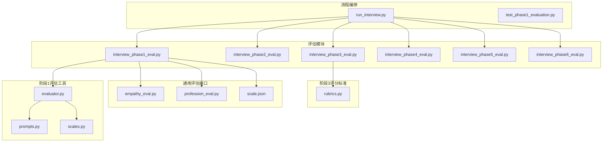
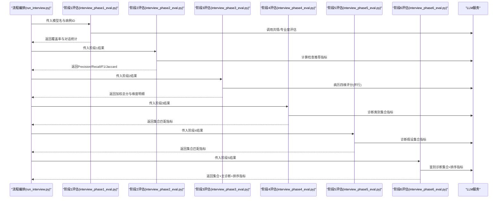
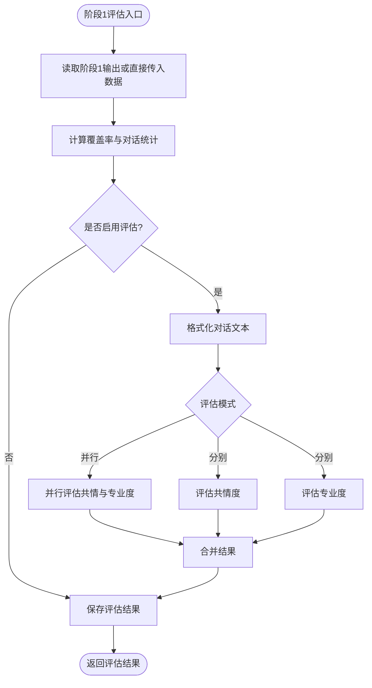
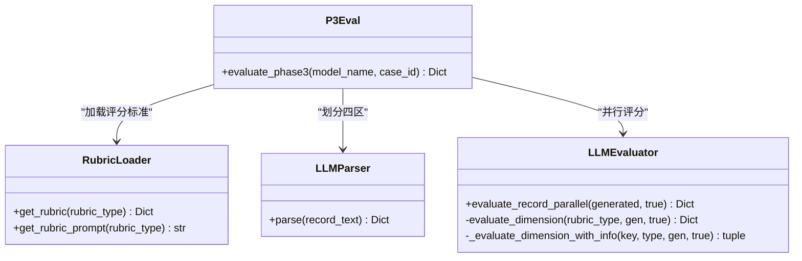
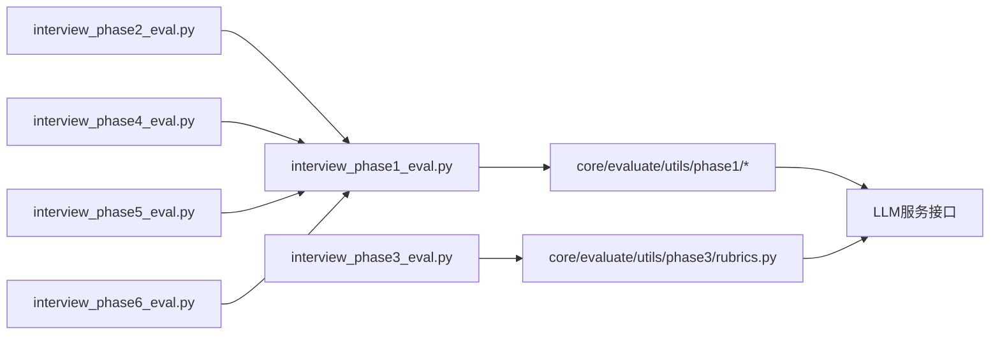

# 评估器代理

<cite>
**本文档引用的文件**
- [run_interview.py](file://run_interview.py)
- [interview_phase1_eval.py](file://core/evaluate/interview_phase1_eval.py)
- [interview_phase2_eval.py](file://core/evaluate/interview_phase2_eval.py)
- [interview_phase3_eval.py](file://core/evaluate/interview_phase3_eval.py)
- [interview_phase4_eval.py](file://core/evaluate/interview_phase4_eval.py)
- [interview_phase5_eval.py](file://core/evaluate/interview_phase5_eval.py)
- [interview_phase6_eval.py](file://core/evaluate/interview_phase6_eval.py)
- [evaluator.py](file://core/evaluate/utils/phase1/evaluator.py)
- [prompts.py](file://core/evaluate/utils/phase1/prompts.py)
- [scales.py](file://core/evaluate/utils/phase1/scales.py)
- [rubrics.py](file://core/evaluate/utils/phase3/rubrics.py)
- [empathy_eval.py](file://eval_interview/empathy_eval.py)
- [profession_eval.py](file://eval_interview/profession_eval.py)
- [scale.json](file://eval_interview/scale.json)
- [test_phase1_evaluation.py](file://scripts/test_phase1_evaluation.py)
</cite>

## 目录
1. [简介](#简介)
2. [项目结构](#项目结构)
3. [核心组件](#核心组件)
4. [架构总览](#架构总览)
5. [详细组件分析](#详细组件分析)
6. [依赖关系分析](#依赖关系分析)
7. [性能考量](#性能考量)
8. [故障排查指南](#故障排查指南)
9. [结论](#结论)
10. [附录](#附录)

## 简介
本文件系统性阐述“评估器代理”的设计原理与评估机制，聚焦AI对精神科问诊过程的客观评价。评估器代理贯穿六阶段问诊流程，提供覆盖度、对话统计、共情度、专业度、检查推荐、病历质量、诊断类别识别、诊断假设、鉴别诊断等多维度评估，支撑质量控制与持续改进。

评估器代理的核心职责：
- 建立标准化评估指标与评分体系
- 通过LLM对问诊对话与产物进行自动化评分
- 生成可解释的评估报告与改进建议
- 为医生培训、质量监控与算法迭代提供数据支撑

## 项目结构
评估器代理位于核心评估模块，配合访谈阶段模块与输出管理模块协同工作。整体采用“阶段化评估 + 统一输出”的组织方式，便于扩展与维护。

图表来源
- [run_interview.py:1-408](file://run_interview.py#L1-L408)
- [interview_phase1_eval.py:1-376](file://core/evaluate/interview_phase1_eval.py#L1-L376)
- [interview_phase2_eval.py:1-301](file://core/evaluate/interview_phase2_eval.py#L1-L301)
- [interview_phase3_eval.py:1-598](file://core/evaluate/interview_phase3_eval.py#L1-L598)
- [interview_phase4_eval.py:1-256](file://core/evaluate/interview_phase4_eval.py#L1-L256)
- [interview_phase5_eval.py:1-256](file://core/evaluate/interview_phase5_eval.py#L1-L256)
- [interview_phase6_eval.py:1-416](file://core/evaluate/interview_phase6_eval.py#L1-L416)
- [evaluator.py:1-160](file://core/evaluate/utils/phase1/evaluator.py#L1-L160)
- [prompts.py:1-280](file://core/evaluate/utils/phase1/prompts.py#L1-L280)
- [scales.py:1-464](file://core/evaluate/utils/phase1/scales.py#L1-L464)
- [rubrics.py:1-423](file://core/evaluate/utils/phase3/rubrics.py#L1-L423)
- [empathy_eval.py:1-248](file://eval_interview/empathy_eval.py#L1-L248)
- [profession_eval.py:1-204](file://eval_interview/profession_eval.py#L1-L204)
- [scale.json:1-258](file://eval_interview/scale.json#L1-L258)
- [test_phase1_evaluation.py:1-63](file://scripts/test_phase1_evaluation.py#L1-L63)

章节来源
- [run_interview.py:1-408](file://run_interview.py#L1-L408)

## 核心组件
- 阶段化评估器：按阶段封装评估逻辑，统一输出格式与存储路径
- 通用评估接口：面向共情度与专业度的独立评估函数，支持量表加载与LLM评分
- 评分标准与提示词：内置量表与提示词，确保评估一致性与可解释性
- 输出管理：统一评估结果保存与路径生成，便于后续报告与可视化

章节来源
- [interview_phase1_eval.py:174-330](file://core/evaluate/interview_phase1_eval.py#L174-L330)
- [interview_phase2_eval.py:153-255](file://core/evaluate/interview_phase2_eval.py#L153-L255)
- [interview_phase3_eval.py:422-552](file://core/evaluate/interview_phase3_eval.py#L422-L552)
- [interview_phase4_eval.py:126-210](file://core/evaluate/interview_phase4_eval.py#L126-L210)
- [interview_phase5_eval.py:126-210](file://core/evaluate/interview_phase5_eval.py#L126-L210)
- [interview_phase6_eval.py:267-370](file://core/evaluate/interview_phase6_eval.py#L267-L370)
- [evaluator.py:50-160](file://core/evaluate/utils/phase1/evaluator.py#L50-L160)
- [prompts.py:111-280](file://core/evaluate/utils/phase1/prompts.py#L111-L280)
- [scales.py:10-464](file://core/evaluate/utils/phase1/scales.py#L10-L464)
- [rubrics.py:15-423](file://core/evaluate/utils/phase3/rubrics.py#L15-L423)
- [empathy_eval.py:9-248](file://eval_interview/empathy_eval.py#L9-L248)
- [profession_eval.py:9-204](file://eval_interview/profession_eval.py#L9-L204)
- [scale.json:1-258](file://eval_interview/scale.json#L1-L258)

## 架构总览
评估器代理采用“阶段驱动 + 通用评估 + 标准化输出”的架构。流程编排脚本负责串联各阶段与评估器，阶段评估器负责读取数据、计算指标、调用通用评估接口或评分标准，并将结果持久化到统一目录。

图表来源
- [run_interview.py:46-396](file://run_interview.py#L46-L396)
- [interview_phase1_eval.py:174-330](file://core/evaluate/interview_phase1_eval.py#L174-L330)
- [interview_phase2_eval.py:153-255](file://core/evaluate/interview_phase2_eval.py#L153-L255)
- [interview_phase3_eval.py:422-552](file://core/evaluate/interview_phase3_eval.py#L422-L552)
- [interview_phase4_eval.py:126-210](file://core/evaluate/interview_phase4_eval.py#L126-L210)
- [interview_phase5_eval.py:126-210](file://core/evaluate/interview_phase5_eval.py#L126-L210)
- [interview_phase6_eval.py:267-370](file://core/evaluate/interview_phase6_eval.py#L267-L370)

## 详细组件分析

### 阶段1评估：病史采集与共情/专业度
- 功能要点
  - 计算覆盖率统计：主诉覆盖率、精神状态覆盖率、整体覆盖率
  - 统计对话轮次与发言分布
  - 可选启用共情度与专业度评估，支持并行评估
  - 保存统一格式的评估结果
- 评估维度
  - 覆盖率：衡量问诊是否覆盖关键要素
  - 对话统计：轮次、发言分布
  - 共情度：16项量表评分，含总分、平均分、方差
  - 专业度：12项量表评分，含总分、平均分
- 关键实现
  - 量表与提示词：内置共情/专业度量表与严格提示词
  - LLM调用：统一通过评估器LLM接口
  - 并行评估：阶段1支持并行评估共情与专业度

图表来源
- [interview_phase1_eval.py:174-330](file://core/evaluate/interview_phase1_eval.py#L174-L330)
- [evaluator.py:133-160](file://core/evaluate/utils/phase1/evaluator.py#L133-L160)
- [prompts.py:111-280](file://core/evaluate/utils/phase1/prompts.py#L111-L280)
- [scales.py:10-464](file://core/evaluate/utils/phase1/scales.py#L10-L464)
- [empathy_eval.py:9-248](file://eval_interview/empathy_eval.py#L9-L248)
- [profession_eval.py:9-204](file://eval_interview/profession_eval.py#L9-L204)

章节来源
- [interview_phase1_eval.py:62-114](file://core/evaluate/interview_phase1_eval.py#L62-L114)
- [interview_phase1_eval.py:174-330](file://core/evaluate/interview_phase1_eval.py#L174-L330)
- [evaluator.py:50-160](file://core/evaluate/utils/phase1/evaluator.py#L50-L160)
- [prompts.py:111-280](file://core/evaluate/utils/phase1/prompts.py#L111-L280)
- [scales.py:10-464](file://core/evaluate/utils/phase1/scales.py#L10-L464)
- [empathy_eval.py:9-248](file://eval_interview/empathy_eval.py#L9-L248)
- [profession_eval.py:9-204](file://eval_interview/profession_eval.py#L9-L204)
- [scale.json:1-258](file://eval_interview/scale.json#L1-L258)

### 阶段2评估：检查推荐
- 功能要点
  - 基于Instrument返回与Gold辅助检查，计算Precision/Recall/F1/Jaccard
  - 统计TP/FP/FN与冗余/遗漏数量
- 评估维度
  - 集合匹配指标：Precision/Recall/F1/Jaccard
  - 统计信息：gold/predicted/response数量与各类计数
- 关键实现
  - JSON解析与校验，确保输入格式正确
  - 严格定义NONE判定，避免误判

章节来源
- [interview_phase2_eval.py:66-150](file://core/evaluate/interview_phase2_eval.py#L66-L150)
- [interview_phase2_eval.py:153-255](file://core/evaluate/interview_phase2_eval.py#L153-L255)

### 阶段3评估：临床病历质量
- 功能要点
  - 使用LLM将生成病历与真值病历划分到四维区域
  - 四维度并行评分：主诉、体格检查、精神检查、既往史家族史
  - 加权聚合：按权重计算总分与百分比
- 评估维度
  - 覆盖度与准确度：每个要素0/1评分
  - 维度权重：各维度25%
  - 总分与百分比：加权总分与百分比
- 关键实现
  - RubricLoader：加载评分标准与提示
  - LLMParser：将文本划分到四区
  - LLMEvaluator：并行评分与权重聚合

图表来源
- [interview_phase3_eval.py:41-391](file://core/evaluate/interview_phase3_eval.py#L41-L391)
- [rubrics.py:15-423](file://core/evaluate/utils/phase3/rubrics.py#L15-L423)

章节来源
- [interview_phase3_eval.py:422-552](file://core/evaluate/interview_phase3_eval.py#L422-L552)
- [rubrics.py:15-423](file://core/evaluate/utils/phase3/rubrics.py#L15-L423)

### 阶段4评估：诊断类别识别
- 功能要点
  - 集合匹配指标：Precision/Recall/F1/Jaccard
  - 支持从真值文件加载真实类别
- 关键实现
  - 集合运算与指标计算

章节来源
- [interview_phase4_eval.py:66-124](file://core/evaluate/interview_phase4_eval.py#L66-L124)
- [interview_phase4_eval.py:126-210](file://core/evaluate/interview_phase4_eval.py#L126-L210)

### 阶段5评估：诊断假设
- 功能要点
  - 集合匹配指标：Precision/Recall/F1/Jaccard
  - 支持从真值文件加载真实诊断
- 关键实现
  - 集合运算与指标计算

章节来源
- [interview_phase5_eval.py:66-124](file://core/evaluate/interview_phase5_eval.py#L66-L124)
- [interview_phase5_eval.py:126-210](file://core/evaluate/interview_phase5_eval.py#L126-L210)

### 阶段6评估：鉴别诊断
- 功能要点
  - 集合匹配指标：Precision/Recall/F1/Jaccard
  - 主诊断排序指标：Exact Match、Hit@K、Reciprocal Rank
  - 排序一致性指标：POA、nDCG
- 关键实现
  - 多种指标计算函数与统一输出

章节来源
- [interview_phase6_eval.py:69-265](file://core/evaluate/interview_phase6_eval.py#L69-L265)
- [interview_phase6_eval.py:267-370](file://core/evaluate/interview_phase6_eval.py#L267-L370)

## 依赖关系分析
- 模块耦合
  - 阶段评估器依赖统一的输出目录与保存函数
  - 阶段1通用评估依赖量表与提示词模块
  - 阶段3评估依赖评分标准模块与LLM服务
- 外部依赖
  - LLM服务：评估器LLM接口
  - 数据文件：真值文件、量表文件
- 潜在循环依赖
  - 评估器模块间通过统一接口调用，无直接循环依赖

图表来源
- [interview_phase1_eval.py:208-299](file://core/evaluate/interview_phase1_eval.py#L208-L299)
- [interview_phase2_eval.py:153-231](file://core/evaluate/interview_phase2_eval.py#L153-L231)
- [interview_phase3_eval.py:497-528](file://core/evaluate/interview_phase3_eval.py#L497-L528)
- [interview_phase4_eval.py:126-189](file://core/evaluate/interview_phase4_eval.py#L126-L189)
- [interview_phase5_eval.py:126-189](file://core/evaluate/interview_phase5_eval.py#L126-L189)
- [interview_phase6_eval.py:267-336](file://core/evaluate/interview_phase6_eval.py#L267-L336)

章节来源
- [interview_phase1_eval.py:208-299](file://core/evaluate/interview_phase1_eval.py#L208-L299)
- [interview_phase2_eval.py:153-231](file://core/evaluate/interview_phase2_eval.py#L153-L231)
- [interview_phase3_eval.py:497-528](file://core/evaluate/interview_phase3_eval.py#L497-L528)
- [interview_phase4_eval.py:126-189](file://core/evaluate/interview_phase4_eval.py#L126-L189)
- [interview_phase5_eval.py:126-189](file://core/evaluate/interview_phase5_eval.py#L126-L189)
- [interview_phase6_eval.py:267-336](file://core/evaluate/interview_phase6_eval.py#L267-L336)

## 性能考量
- 并行评估
  - 阶段1支持共情与专业度并行评估，提升吞吐
  - 阶段3采用多线程并行四维评分，缩短等待时间
- I/O优化
  - 统一输出目录与文件命名，便于批量处理与缓存
- LLM调用
  - 通过统一接口抽象，便于替换与限流
- 内存与稳定性
  - 量表与提示词预加载，减少重复解析
  - 异常捕获与降级处理，保证流程健壮性

## 故障排查指南
- 常见问题
  - 缺少输入数据：检查模型名、病例ID或输出文件路径
  - 量表文件缺失：确认data目录下存在scale.json或profession_scale.json
  - LLM调用失败：检查环境变量与服务可用性
  - 真值文件缺失：确认ground_truth.jsonl存在且包含目标病例
- 排查步骤
  - 查看评估器打印日志与异常栈
  - 核对输出目录与文件是否存在
  - 验证输入数据格式（JSON、字段完整性）

章节来源
- [interview_phase1_eval.py:294-298](file://core/evaluate/interview_phase1_eval.py#L294-L298)
- [interview_phase3_eval.py:497-500](file://core/evaluate/interview_phase3_eval.py#L497-L500)
- [test_phase1_evaluation.py:16-58](file://scripts/test_phase1_evaluation.py#L16-L58)

## 结论
评估器代理通过“阶段化评估 + 通用评估接口 + 标准化输出”的设计，实现了对精神科问诊过程的全链路、可解释、可量化的质量评估。其核心优势在于：
- 明确的评估维度与权重分配
- 可并行、可扩展的评估流程
- 统一的数据格式与输出规范
- 面向质量控制与持续改进的实用价值

## 附录

### 使用示例
- 配置评估器
  - 设置模型名与病例ID，或直接传入输出文件路径
  - 可选择启用共情度/专业度评估与并行评估
- 导入问诊数据
  - 通过阶段输出文件或直接传入数据字典
- 执行评估任务
  - 调用对应阶段评估函数，如阶段1评估
- 获取评估报告
  - 评估结果包含指标、统计数据与输出文件路径

章节来源
- [interview_phase1_eval.py:174-330](file://core/evaluate/interview_phase1_eval.py#L174-L330)
- [test_phase1_evaluation.py:16-58](file://scripts/test_phase1_evaluation.py#L16-L58)
- [run_interview.py:46-396](file://run_interview.py#L46-L396)

### 评估维度与评分标准
- 阶段1：覆盖率、对话统计、共情度（16项）、专业度（12项）
- 阶段2：Precision/Recall/F1/Jaccard
- 阶段3：四维覆盖度与准确度，权重25%×4
- 阶段4/5：集合匹配指标
- 阶段6：集合匹配+主诊断排序+排序一致性

章节来源
- [interview_phase1_eval.py:62-114](file://core/evaluate/interview_phase1_eval.py#L62-L114)
- [interview_phase2_eval.py:66-150](file://core/evaluate/interview_phase2_eval.py#L66-L150)
- [interview_phase3_eval.py:197-391](file://core/evaluate/interview_phase3_eval.py#L197-L391)
- [interview_phase4_eval.py:66-124](file://core/evaluate/interview_phase4_eval.py#L66-L124)
- [interview_phase5_eval.py:66-124](file://core/evaluate/interview_phase5_eval.py#L66-L124)
- [interview_phase6_eval.py:69-265](file://core/evaluate/interview_phase6_eval.py#L69-L265)

### 扩展与自定义
- 自定义评估规则
  - 在对应阶段评估器中新增指标计算函数
  - 扩展量表或Rubric标准，更新提示词与评分逻辑
- 新增评估阶段
  - 参照既有阶段评估器结构，实现数据读取、指标计算与结果保存
- 评估器接口扩展
  - 通过统一LLM接口抽象，接入新的评估模型或服务

章节来源
- [prompts.py:111-280](file://core/evaluate/utils/phase1/prompts.py#L111-L280)
- [scales.py:10-464](file://core/evaluate/utils/phase1/scales.py#L10-L464)
- [rubrics.py:15-423](file://core/evaluate/utils/phase3/rubrics.py#L15-L423)