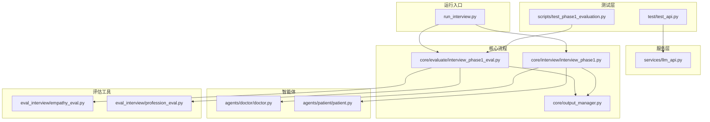
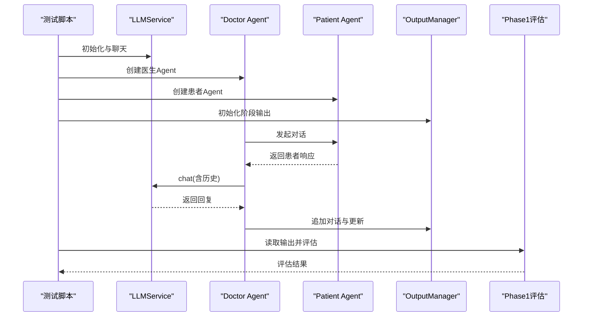
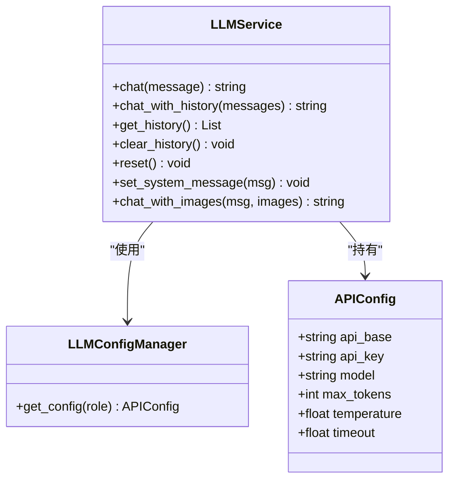
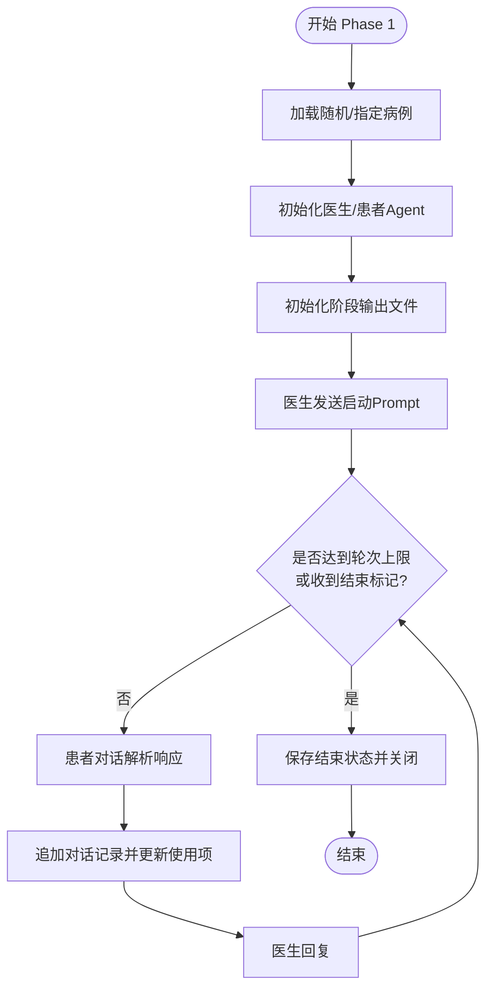
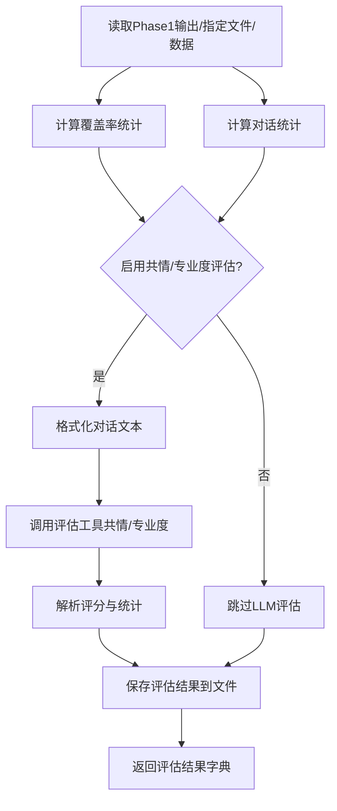
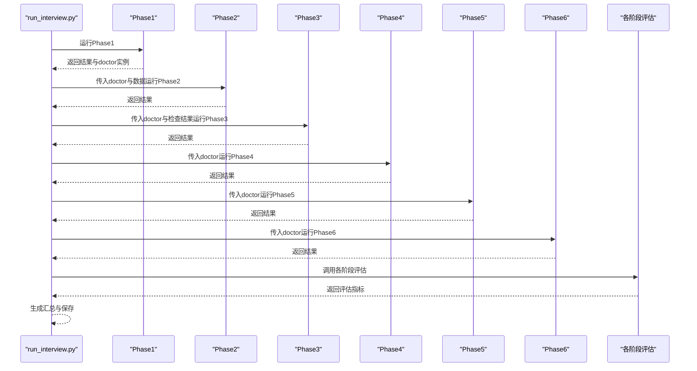
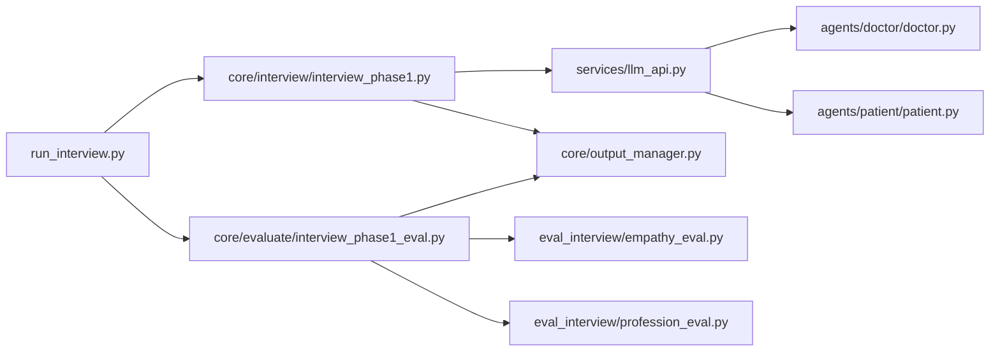

# 测试与验证

<cite>
**本文档引用的文件**
- [test/test_api.py](file://test/test_api.py)
- [scripts/test_phase1_evaluation.py](file://scripts/test_phase1_evaluation.py)
- [run_interview.py](file://run_interview.py)
- [services/llm_api.py](file://services/llm_api.py)
- [core/evaluate/interview_phase1_eval.py](file://core/evaluate/interview_phase1_eval.py)
- [core/interview/interview_phase1.py](file://core/interview/interview_phase1.py)
- [core/output_manager.py](file://core/output_manager.py)
- [eval_interview/empathy_eval.py](file://eval_interview/empathy_eval.py)
- [eval_interview/profession_eval.py](file://eval_interview/profession_eval.py)
- [agents/doctor/doctor.py](file://agents/doctor/doctor.py)
- [agents/patient/patient.py](file://agents/patient/patient.py)
</cite>

## 目录
1. [简介](#简介)
2. [项目结构](#项目结构)
3. [核心组件](#核心组件)
4. [架构总览](#架构总览)
5. [详细组件分析](#详细组件分析)
6. [依赖分析](#依赖分析)
7. [性能考虑](#性能考虑)
8. [故障排查指南](#故障排查指南)
9. [结论](#结论)
10. [附录](#附录)

## 简介
本指南面向“精神科访谈与评估系统”的测试与验证工作，覆盖单元测试、API测试、集成测试与端到端测试、性能与压力测试、测试数据准备与管理、测试结果分析与报告、持续集成与自动化测试配置，以及测试驱动开发（TDD）工作流建议。文档基于仓库现有实现进行梳理，帮助研发与测试团队高效落地质量保障体系。

## 项目结构
项目采用“功能域+层次化”组织方式：
- agents：智能体（医生、患者、评估器）及其提示词
- core：核心业务流程（访谈阶段与评估阶段）、输出管理
- services：LLM服务封装与配置
- eval_interview：评估工具（共情度、专业度）
- test：API与服务级测试脚本
- scripts：阶段性功能测试脚本
- data：输出目录与测试用例数据（cases.jsonl）

**图表来源**
- [test/test_api.py:1-234](file://test/test_api.py#L1-L234)
- [scripts/test_phase1_evaluation.py:1-63](file://scripts/test_phase1_evaluation.py#L1-L63)
- [run_interview.py:1-408](file://run_interview.py#L1-L408)
- [services/llm_api.py:1-250](file://services/llm_api.py#L1-L250)
- [core/interview/interview_phase1.py:1-462](file://core/interview/interview_phase1.py#L1-L462)
- [core/evaluate/interview_phase1_eval.py:1-376](file://core/evaluate/interview_phase1_eval.py#L1-L376)
- [core/output_manager.py:1-189](file://core/output_manager.py#L1-L189)
- [eval_interview/empathy_eval.py:1-248](file://eval_interview/empathy_eval.py#L1-L248)
- [eval_interview/profession_eval.py:1-204](file://eval_interview/profession_eval.py#L1-L204)
- [agents/doctor/doctor.py:1-95](file://agents/doctor/doctor.py#L1-L95)
- [agents/patient/patient.py:1-171](file://agents/patient/patient.py#L1-L171)

**章节来源**
- [test/test_api.py:1-234](file://test/test_api.py#L1-L234)
- [scripts/test_phase1_evaluation.py:1-63](file://scripts/test_phase1_evaluation.py#L1-L63)
- [run_interview.py:1-408](file://run_interview.py#L1-L408)

## 核心组件
- LLM服务与配置管理：统一管理三角色（患者/医生/评估器）的API配置、上下文维护、重试与历史管理。
- 智能体（Agent）：医生与患者Agent封装，基于提示词与角色配置进行对话。
- 访谈阶段（Phase 1）：加载随机或指定病例，启动对话，多轮交互，实时保存输出，检测结束条件。
- 评估模块（Phase 1）：覆盖率统计、对话统计、可选共情度/专业度LLM评估、结果落盘。
- 输出管理：统一输出目录结构、阶段文件初始化与增量更新、对话记录追加。
- 评估工具：共情度与专业度量表解析与LLM评分流程。

**章节来源**
- [services/llm_api.py:1-250](file://services/llm_api.py#L1-L250)
- [agents/doctor/doctor.py:1-95](file://agents/doctor/doctor.py#L1-L95)
- [agents/patient/patient.py:1-171](file://agents/patient/patient.py#L1-L171)
- [core/interview/interview_phase1.py:1-462](file://core/interview/interview_phase1.py#L1-L462)
- [core/evaluate/interview_phase1_eval.py:1-376](file://core/evaluate/interview_phase1_eval.py#L1-L376)
- [core/output_manager.py:1-189](file://core/output_manager.py#L1-L189)
- [eval_interview/empathy_eval.py:1-248](file://eval_interview/empathy_eval.py#L1-L248)
- [eval_interview/profession_eval.py:1-204](file://eval_interview/profession_eval.py#L1-L204)

## 架构总览
系统围绕“阶段化访谈 + 阶段化评估 + 统一输出”的闭环展开。测试覆盖点包括：
- 单元测试：LLM服务、输出管理、评估工具内部函数
- API测试：LLM服务接口行为、上下文与历史管理
- 集成测试：Phase 1访谈流程与评估流程的协同
- 端到端测试：完整流程（1-6阶段）执行与汇总
- 性能与压力测试：大样本/并发场景下的稳定性与吞吐
- 数据与报告：测试数据准备、评估结果解析与报告生成
- CI/自动化：测试脚本与流程的自动化执行
- TDD：以测试驱动需求演进与重构

**图表来源**
- [test/test_api.py:1-234](file://test/test_api.py#L1-L234)
- [services/llm_api.py:1-250](file://services/llm_api.py#L1-L250)
- [core/interview/interview_phase1.py:1-462](file://core/interview/interview_phase1.py#L1-L462)
- [core/output_manager.py:1-189](file://core/output_manager.py#L1-L189)
- [core/evaluate/interview_phase1_eval.py:1-376](file://core/evaluate/interview_phase1_eval.py#L1-L376)

## 详细组件分析

### LLM服务与配置管理（API测试重点）
- 关键职责：角色配置加载、上下文维护、历史查询与清空、重试与退避、多模态图文支持
- 测试要点：
  - 单轮/多轮对话正确性与上下文延续
  - 名字记忆与上下文一致性
  - 新实例上下文隔离
  - 系统提示词生效
  - 历史获取与清空行为
  - 三角色独立配置加载

**图表来源**
- [services/llm_api.py:47-250](file://services/llm_api.py#L47-L250)

**章节来源**
- [services/llm_api.py:1-250](file://services/llm_api.py#L1-L250)
- [test/test_api.py:19-148](file://test/test_api.py#L19-L148)

### Phase 1 访谈流程（集成测试重点）
- 关键职责：随机加载病例、初始化医生/患者Agent、启动对话、多轮交互、实时保存、结束条件检测
- 测试要点：
  - 病例加载与字段完整性
  - 医生/患者Agent初始化与角色配置
  - 对话轮次上限与提醒机制
  - 结束标记检测与状态更新
  - 输出文件结构与增量更新

**图表来源**
- [core/interview/interview_phase1.py:241-428](file://core/interview/interview_phase1.py#L241-L428)
- [core/output_manager.py:50-169](file://core/output_manager.py#L50-L169)

**章节来源**
- [core/interview/interview_phase1.py:1-462](file://core/interview/interview_phase1.py#L1-L462)
- [core/output_manager.py:1-189](file://core/output_manager.py#L1-L189)

### Phase 1 评估模块（评估工具与数据流）
- 关键职责：覆盖率统计、对话统计、可选共情/专业度LLM评估、结果落盘
- 测试要点：
  - 覆盖率计算准确性
  - 对话统计字段完整性
  - 量表文件解析与格式兼容
  - LLM评估流程与结果解析
  - 输出文件命名与目录结构

**图表来源**
- [core/evaluate/interview_phase1_eval.py:174-330](file://core/evaluate/interview_phase1_eval.py#L174-L330)
- [eval_interview/empathy_eval.py:9-248](file://eval_interview/empathy_eval.py#L9-L248)
- [eval_interview/profession_eval.py:9-204](file://eval_interview/profession_eval.py#L9-L204)

**章节来源**
- [core/evaluate/interview_phase1_eval.py:1-376](file://core/evaluate/interview_phase1_eval.py#L1-L376)
- [eval_interview/empathy_eval.py:1-248](file://eval_interview/empathy_eval.py#L1-L248)
- [eval_interview/profession_eval.py:1-204](file://eval_interview/profession_eval.py#L1-L204)

### 完整流程（端到端测试）
- 关键职责：串联1-6阶段，汇总各阶段结果，生成完整摘要与输出目录
- 测试要点：
  - 阶段间数据传递与上下文保持
  - 各阶段评估指标与维度输出
  - 汇总文件生成与路径校验
  - 异常处理与错误回溯

**图表来源**
- [run_interview.py:46-396](file://run_interview.py#L46-L396)

**章节来源**
- [run_interview.py:1-408](file://run_interview.py#L1-L408)

## 依赖分析
- 组件耦合与内聚
  - LLMService与LLMConfigManager：低耦合，职责清晰
  - Agent（医生/患者）依赖LLMService，通过提示词注入角色
  - OutputManager为各阶段提供统一IO接口，内聚性高
  - 评估模块依赖Agent输出与量表文件，与评估工具解耦
- 外部依赖
  - OpenAI SDK、httpx、python-dotenv
  - 可选json_repair用于患者响应解析容错
- 潜在循环依赖
  - 当前未发现循环依赖；评估模块通过工具函数调用评估器LLM，避免直接循环

**图表来源**
- [services/llm_api.py:1-250](file://services/llm_api.py#L1-L250)
- [agents/doctor/doctor.py:1-95](file://agents/doctor/doctor.py#L1-L95)
- [agents/patient/patient.py:1-171](file://agents/patient/patient.py#L1-L171)
- [core/interview/interview_phase1.py:1-462](file://core/interview/interview_phase1.py#L1-L462)
- [core/output_manager.py:1-189](file://core/output_manager.py#L1-L189)
- [core/evaluate/interview_phase1_eval.py:1-376](file://core/evaluate/interview_phase1_eval.py#L1-L376)
- [eval_interview/empathy_eval.py:1-248](file://eval_interview/empathy_eval.py#L1-L248)
- [eval_interview/profession_eval.py:1-204](file://eval_interview/profession_eval.py#L1-L204)
- [run_interview.py:1-408](file://run_interview.py#L1-L408)

**章节来源**
- [services/llm_api.py:1-250](file://services/llm_api.py#L1-L250)
- [core/interview/interview_phase1.py:1-462](file://core/interview/interview_phase1.py#L1-L462)
- [core/evaluate/interview_phase1_eval.py:1-376](file://core/evaluate/interview_phase1_eval.py#L1-L376)
- [core/output_manager.py:1-189](file://core/output_manager.py#L1-L189)
- [eval_interview/empathy_eval.py:1-248](file://eval_interview/empathy_eval.py#L1-L248)
- [eval_interview/profession_eval.py:1-204](file://eval_interview/profession_eval.py#L1-L204)
- [run_interview.py:1-408](file://run_interview.py#L1-L408)

## 性能考虑
- API调用与重试
  - LLMService内置指数退避重试，建议在测试中模拟网络抖动与超时，验证稳定性
- 并发与批量
  - 评估工具支持并行评估（共情与专业度），建议在CI中以不同并发度对比吞吐
- I/O与落盘
  - OutputManager采用增量写入，建议在压力测试中验证磁盘写入瓶颈与文件锁竞争
- 资源限制
  - MAX_TURNS与timeout参数影响流程时长，建议在测试中调整以覆盖边界场景

[本节为通用指导，不直接分析具体文件]

## 故障排查指南
- API测试失败
  - 检查.env配置项（PATIENT_*、DOCTOR_*、EVALUATOR_*）是否齐全
  - 核对API Base/Key/Model是否正确
  - 观察重试日志与异常栈，定位网络或鉴权问题
- Phase 1流程异常
  - 病例加载失败：确认cases.jsonl存在且格式正确
  - 结束标记误判：检查医生回复是否包含[END_INTERVIEW]变体
  - 输出文件损坏：检查OutputManager写入权限与磁盘空间
- 评估模块异常
  - 量表文件缺失：确认data目录下存在共情/专业度量表文件
  - LLM评估失败：检查评估器LLM配置与网络连通性
- 完整流程中断
  - 捕获异常并打印堆栈，定位具体阶段与环节

**章节来源**
- [test/test_api.py:1-234](file://test/test_api.py#L1-L234)
- [core/interview/interview_phase1.py:1-462](file://core/interview/interview_phase1.py#L1-L462)
- [core/evaluate/interview_phase1_eval.py:1-376](file://core/evaluate/interview_phase1_eval.py#L1-L376)
- [core/output_manager.py:1-189](file://core/output_manager.py#L1-L189)

## 结论
本项目已具备完善的测试与验证基础：LLM服务API测试、阶段化访谈与评估流程、统一输出管理与评估工具。建议在此基础上完善性能与压力测试、构建CI流水线、引入单元测试补充覆盖率，并以TDD推动迭代质量。

[本节为总结性内容，不直接分析具体文件]

## 附录

### 单元测试编写方法与测试框架使用
- 建议使用pytest或unittest组织测试用例
- 针对LLMService：构造/析构测试、上下文隔离、历史管理、重试机制
- 针对OutputManager：文件初始化、增量更新、对话追加、数据加载
- 针对评估工具：量表解析、格式兼容、评分解析、异常分支
- 示例参考
  - [test/test_api.py:19-148](file://test/test_api.py#L19-L148)
  - [scripts/test_phase1_evaluation.py:16-58](file://scripts/test_phase1_evaluation.py#L16-L58)

**章节来源**
- [test/test_api.py:1-234](file://test/test_api.py#L1-L234)
- [scripts/test_phase1_evaluation.py:1-63](file://scripts/test_phase1_evaluation.py#L1-L63)

### API测试实施策略
- 单元测试：服务接口行为验证（上下文、历史、重试）
- 集成测试：Agent初始化与对话链路
- 端到端测试：完整流程执行与汇总
- 参考脚本
  - [test/test_api.py:207-234](file://test/test_api.py#L207-L234)
  - [run_interview.py:399-408](file://run_interview.py#L399-L408)

**章节来源**
- [test/test_api.py:1-234](file://test/test_api.py#L1-L234)
- [run_interview.py:1-408](file://run_interview.py#L1-L408)

### 性能测试与压力测试实施方案
- 场景设计
  - 大样本量评估：批量运行Phase 1并评估，统计吞吐与延迟
  - 并发压力：多进程/多线程并发调用LLMService，观察资源占用
  - I/O瓶颈：大量写入输出文件，监控磁盘与文件系统
- 指标采集
  - 请求时延、成功率、重试次数、CPU/内存/磁盘使用
- 工具建议
  - locust（负载测试）、pytest-benchmark（基准测试）、pytest-xdist（并发）

[本节为通用指导，不直接分析具体文件]

### 测试数据准备与管理
- 病例数据
  - 使用cases.jsonl作为随机加载源，建议准备多条不同特征的病例
  - 评估阶段可直接指定输出文件或模型/病例ID组合
- 量表数据
  - 共情度与专业度量表文件放置于data目录，支持多种文件名与结构
- 输出目录
  - interview与evaluation双路径，统一由OutputManager管理

**章节来源**
- [core/interview/interview_phase1.py:63-87](file://core/interview/interview_phase1.py#L63-L87)
- [core/evaluate/interview_phase1_eval.py:32-59](file://core/evaluate/interview_phase1_eval.py#L32-L59)
- [core/output_manager.py:20-47](file://core/output_manager.py#L20-L47)

### 测试结果分析与报告生成
- 评估结果字段
  - 覆盖率统计、对话统计、可选共情/专业度评分与汇总
- 报告建议
  - 汇总各阶段指标、生成可视化图表（覆盖率、平均分、方差）
  - 记录失败用例与异常原因，便于回归追踪

**章节来源**
- [core/evaluate/interview_phase1_eval.py:174-330](file://core/evaluate/interview_phase1_eval.py#L174-L330)

### 持续集成与自动化测试配置
- 建议流水线步骤
  - 安装依赖、加载.env、运行API测试、运行阶段测试、运行完整流程、生成报告
- 触发策略
  - Pull Request触发、定时全量回归、关键变更强制检查
- 缓存与并行
  - 缓存Python依赖、并行执行不同阶段测试

[本节为通用指导，不直接分析具体文件]

### 测试驱动开发（TDD）工作流程
- 基于现有测试脚本扩展
  - 以test/test_api.py为起点，逐步增加更细粒度的单元测试
  - 以scripts/test_phase1_evaluation.py为参考，补充评估模块的单元测试
- 建议实践
  - 先写失败用例，再实现最小可行代码，持续重构与优化

**章节来源**
- [test/test_api.py:1-234](file://test/test_api.py#L1-L234)
- [scripts/test_phase1_evaluation.py:1-63](file://scripts/test_phase1_evaluation.py#L1-L63)