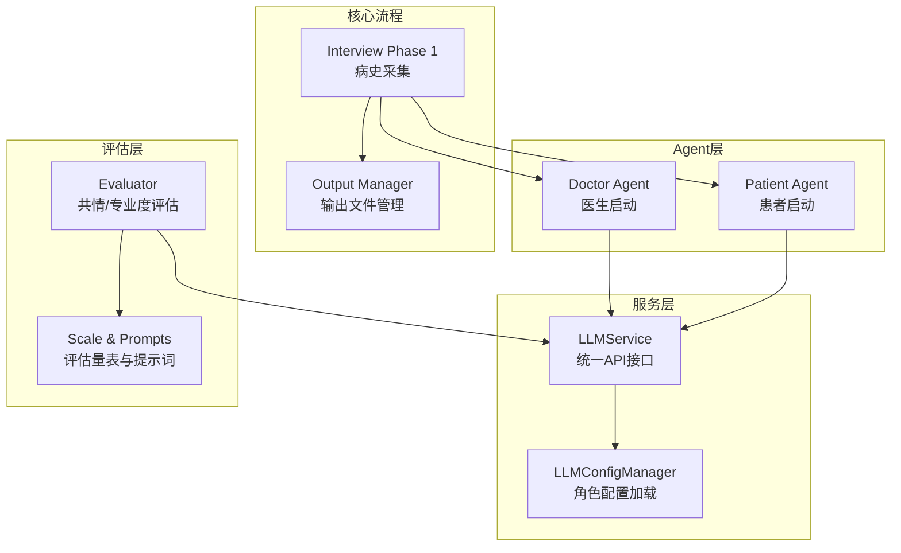
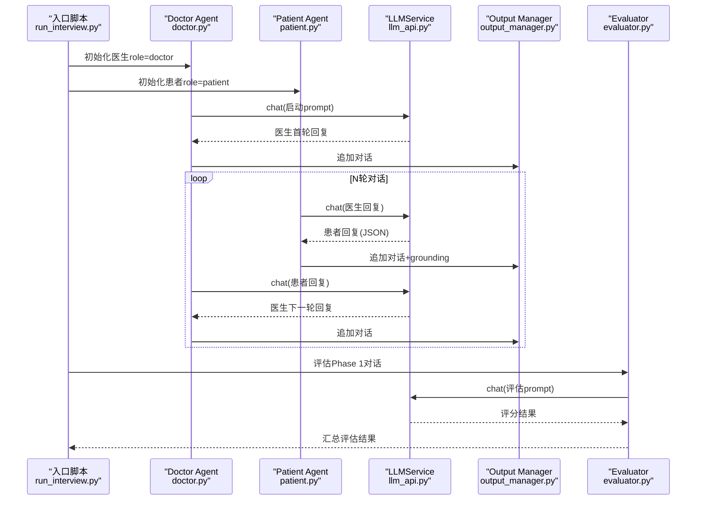
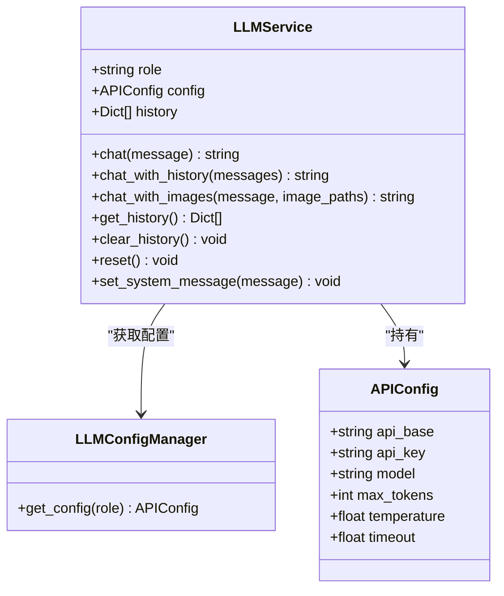
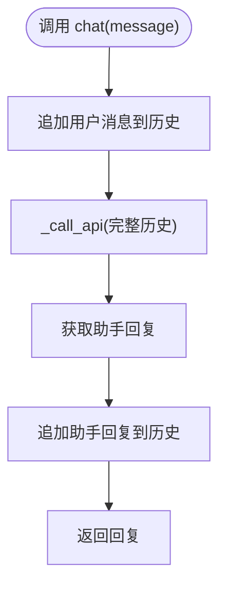
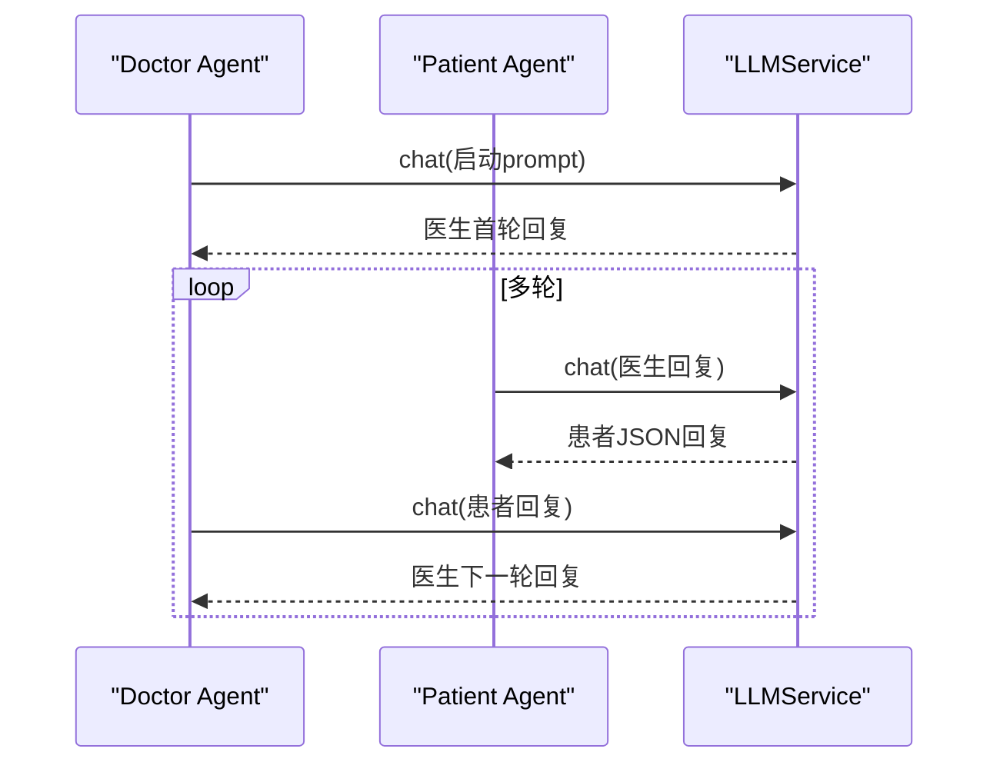
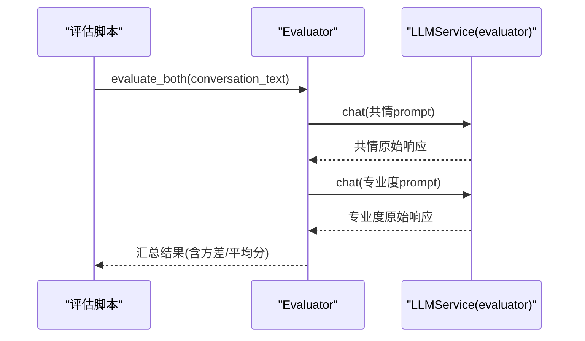
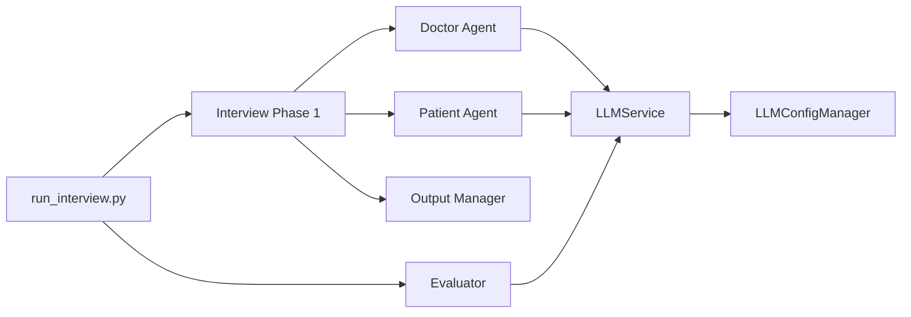

# LLM服务架构

<cite>
**本文档引用的文件**
- [llm_api.py](file://services/llm_api.py)
- [run_interview.py](file://run_interview.py)
- [doctor.py](file://agents/doctor/doctor.py)
- [patient.py](file://agents/patient/patient.py)
- [prompts.py（医生）](file://agents/doctor/prompts.py)
- [prompts.py（患者）](file://agents/patient/prompts.py)
- [evaluator.py（评估器）](file://core/evaluate/utils/phase1/evaluator.py)
- [test_api.py](file://test/test_api.py)
- [test_phase1_evaluation.py](file://scripts/test_phase1_evaluation.py)
- [interview_phase1.py](file://core/interview/interview_phase1.py)
- [output_manager.py](file://core/output_manager.py)
- [prompts.py（评估）](file://core/evaluate/utils/phase1/prompts.py)
- [scales.py（评估）](file://core/evaluate/utils/phase1/scales.py)
</cite>

## 目录
1. [简介](#简介)
2. [项目结构](#项目结构)
3. [核心组件](#核心组件)
4. [架构总览](#架构总览)
5. [详细组件分析](#详细组件分析)
6. [依赖关系分析](#依赖关系分析)
7. [性能考量](#性能考量)
8. [故障排查指南](#故障排查指南)
9. [结论](#结论)
10. [附录](#附录)

## 简介
本项目围绕“精神科问诊全流程”的多阶段对话与评估构建了统一的LLM服务架构。核心是LLMService类，它提供统一的OpenAI Chat Completions API调用接口，内置角色配置管理、上下文维护、错误重试与退避、多模态图文对话等能力。配合Agent层（医生、患者）、评估器（共情与专业度）与输出管理模块，形成从“病史采集—检查推荐—临床病历—诊断识别—假设生成—鉴别诊断”的完整流水线。

## 项目结构
项目采用按功能域划分的目录结构：
- services：统一的LLM服务封装与便捷工厂函数
- agents：角色Agent（医生、患者）的启动与Prompt管理
- core：核心业务流程（访谈阶段）与评估工具
- data：输出目录与评估结果
- scripts：评估与测试脚本
- test：API功能测试

图表来源
- [llm_api.py:79-250](file://services/llm_api.py#L79-L250)
- [doctor.py:32-55](file://agents/doctor/doctor.py#L32-L55)
- [patient.py:40-92](file://agents/patient/patient.py#L40-L92)
- [interview_phase1.py:241-428](file://core/interview/interview_phase1.py#L241-L428)
- [output_manager.py:20-189](file://core/output_manager.py#L20-L189)
- [evaluator.py（评估器）:50-160](file://core/evaluate/utils/phase1/evaluator.py#L50-L160)

章节来源
- [run_interview.py:46-396](file://run_interview.py#L46-L396)
- [llm_api.py:1-250](file://services/llm_api.py#L1-L250)

## 核心组件
- LLMService：统一的LLM调用接口，负责实例生命周期内的上下文维护、系统提示词设置、API调用与重试、多模态图文对话等。
- LLMConfigManager：从.env按角色加载API配置（base_url、api_key、model、max_tokens、temperature、timeout）。
- Agent层：Doctor Agent与Patient Agent通过LLMService实例化并注入各自Role的System Prompt。
- 评估器：基于预定义量表与提示词，对对话进行共情与专业度评分，支持并行评估。
- 输出管理：统一管理各阶段输出文件的创建、追加与更新。

章节来源
- [llm_api.py:58-250](file://services/llm_api.py#L58-L250)
- [doctor.py:32-55](file://agents/doctor/doctor.py#L32-L55)
- [patient.py:40-92](file://agents/patient/patient.py#L40-L92)
- [evaluator.py（评估器）:50-160](file://core/evaluate/utils/phase1/evaluator.py#L50-L160)
- [output_manager.py:20-189](file://core/output_manager.py#L20-L189)

## 架构总览
下图展示了从入口到各阶段执行、评估与输出的整体流程：

图表来源
- [run_interview.py:46-396](file://run_interview.py#L46-L396)
- [doctor.py:32-55](file://agents/doctor/doctor.py#L32-L55)
- [patient.py:40-92](file://agents/patient/patient.py#L40-L92)
- [llm_api.py:113-191](file://services/llm_api.py#L113-L191)
- [output_manager.py:117-169](file://core/output_manager.py#L117-L169)
- [evaluator.py（评估器）:50-160](file://core/evaluate/utils/phase1/evaluator.py#L50-L160)

## 详细组件分析

### LLMService 设计与实现
- 统一接口：chat、chat_with_history、chat_with_images，支持纯文本与图文多模态。
- 上下文管理：实例内部维护历史消息列表，每次调用自动附加完整历史；支持clear_history与reset。
- 角色配置：通过LLMConfigManager按角色加载配置，支持patient/doctor/evaluator三类角色。
- 错误处理：_retry_with_backoff实现指数退避重试，默认最多3次。
- 多模态支持：chat_with_images将图片编码为base64并拼接到content中。
- 便捷工厂：get_patient_llm、get_doctor_llm、get_evaluator_llm。

图表来源
- [llm_api.py:47-250](file://services/llm_api.py#L47-L250)

章节来源
- [llm_api.py:79-250](file://services/llm_api.py#L79-L250)

### 角色配置管理系统
- 配置来源：项目根目录.env文件，键名格式为“ROLE_API_BASE/KEY/MODEL”，以及全局参数MAX_TOKENS、TEMPERATURE、TIMEOUT。
- 缓存策略：LLMConfigManager内部缓存已加载的配置，避免重复读取。
- 角色隔离：不同角色拥有独立的API端点与模型，便于在多Agent协作时隔离资源与成本。

章节来源
- [llm_api.py:58-77](file://services/llm_api.py#L58-L77)

### 上下文管理机制
- 历史结构：列表中每个元素为{"role": "...", "content": "..."}，支持"user"/"assistant"/"system"。
- 生命周期：实例创建即生效，reset可清空所有历史；clear_history仅保留system消息。
- 交互模式：chat自动将用户消息加入历史，再调用API，最后将助手回复加入历史。

图表来源
- [llm_api.py:113-131](file://services/llm_api.py#L113-L131)

章节来源
- [llm_api.py:106-191](file://services/llm_api.py#L106-L191)

### 错误处理策略
- 重试机制：_retry_with_backoff默认最多3次，指数退避延迟，记录警告日志。
- 异常传播：超过最大重试次数后抛出最后一次异常，便于上层捕获与处理。
- 超时控制：由API配置timeout统一控制，避免长时间阻塞。

章节来源
- [llm_api.py:144-169](file://services/llm_api.py#L144-L169)

### 多模态对话支持
- 图文输入：chat_with_images支持单张或多张图片，自动base64编码并拼接到content。
- 内容结构：首元素为文本，后续为image_url对象，符合多模态API规范。
- 历史记录：用户消息content为混合数组，助手回复为字符串。

章节来源
- [llm_api.py:192-232](file://services/llm_api.py#L192-L232)

### Agent层：医生与患者
- 医生Agent：使用Doctor Profile作为system prompt，面向Phase 1-6的多轮对话与任务推进。
- 患者Agent：将病例信息注入到Patient Profile中，确保回答严格基于给定信息与grounding要求。
- 传递上下文：Phase 1产出的doctor实例可直接传递到后续阶段，保持对话连续性。

图表来源
- [doctor.py:32-55](file://agents/doctor/doctor.py#L32-L55)
- [patient.py:40-92](file://agents/patient/patient.py#L40-L92)
- [interview_phase1.py:350-397](file://core/interview/interview_phase1.py#L350-L397)

章节来源
- [doctor.py:32-55](file://agents/doctor/doctor.py#L32-L55)
- [patient.py:40-92](file://agents/patient/patient.py#L40-L92)
- [interview_phase1.py:295-428](file://core/interview/interview_phase1.py#L295-L428)

### 评估器：共情与专业度
- 评估流程：构造评估prompt，调用评估器LLM（role=evaluator），解析模型输出中的分数，计算统计指标。
- 并行评估：evaluate_both支持并行执行共情与专业度评估，提升吞吐。
- 量表与提示词：包含16题共情量表与12题专业度量表，配套格式化提示词。

图表来源
- [evaluator.py（评估器）:133-160](file://core/evaluate/utils/phase1/evaluator.py#L133-L160)
- [prompts.py（评估）:111-174](file://core/evaluate/utils/phase1/prompts.py#L111-L174)
- [scales.py（评估）:10-267](file://core/evaluate/utils/phase1/scales.py#L10-L267)

章节来源
- [evaluator.py（评估器）:50-160](file://core/evaluate/utils/phase1/evaluator.py#L50-L160)
- [prompts.py（评估）:111-279](file://core/evaluate/utils/phase1/prompts.py#L111-L279)
- [scales.py（评估）:10-464](file://core/evaluate/utils/phase1/scales.py#L10-L464)

### 输出管理：阶段化文件与实时追加
- 目录结构：data/output/interview/{model_name}/{case_id}/ 下的各阶段输出文件。
- 初始化：init_phase_output写入初始数据（含元信息与基础字段）。
- 实时追加：append_conversation在Phase 1中即时写入对话与grounding信息。
- 状态更新：update_phase_output支持状态变更与时间戳更新。

章节来源
- [output_manager.py:20-189](file://core/output_manager.py#L20-L189)
- [interview_phase1.py:210-428](file://core/interview/interview_phase1.py#L210-L428)

## 依赖关系分析
- LLMService依赖LLMConfigManager与OpenAI SDK，通过.env加载配置。
- Agent层依赖LLMService与各自Prompts。
- 评估器依赖LLMService与评估量表/提示词。
- Interview阶段依赖Agent层与输出管理。
- run_interview.py串联各阶段并汇总结果。

图表来源
- [llm_api.py:79-250](file://services/llm_api.py#L79-L250)
- [doctor.py:32-55](file://agents/doctor/doctor.py#L32-L55)
- [patient.py:40-92](file://agents/patient/patient.py#L40-L92)
- [evaluator.py（评估器）:50-160](file://core/evaluate/utils/phase1/evaluator.py#L50-L160)
- [interview_phase1.py:241-428](file://core/interview/interview_phase1.py#L241-L428)
- [output_manager.py:20-189](file://core/output_manager.py#L20-L189)
- [run_interview.py:46-396](file://run_interview.py#L46-L396)

章节来源
- [run_interview.py:46-396](file://run_interview.py#L46-L396)
- [llm_api.py:79-250](file://services/llm_api.py#L79-L250)

## 性能考量
- 请求重试与退避：默认最多3次重试，指数退避，降低瞬时峰值与抖动影响。
- 并行评估：评估器支持并行执行共情与专业度评估，缩短端到端时延。
- 配置缓存：LLMConfigManager缓存角色配置，避免重复读取.env。
- 超时控制：统一timeout参数，防止长尾请求阻塞。
- 输出写入：Phase 1采用实时追加写入，降低内存占用并提升可观测性。

章节来源
- [llm_api.py:144-169](file://services/llm_api.py#L144-L169)
- [evaluator.py（评估器）:145-154](file://core/evaluate/utils/phase1/evaluator.py#L145-L154)
- [output_manager.py:117-169](file://core/output_manager.py#L117-L169)

## 故障排查指南
- 环境变量未配置：确认.env中包含对应角色的API端点、密钥与模型，以及全局参数。
- 网络超时/不稳定：检查timeout设置与网络连通性；观察重试日志。
- 响应解析失败：Phase 1对患者JSON响应提供容错与正则提取，必要时启用json_repair。
- 上下文污染：若发现上下文异常，使用clear_history或reset清理历史。
- 角色配置不一致：通过LLMConfigManager.get_config(role)验证各角色配置是否正确加载。

章节来源
- [test_api.py:19-234](file://test/test_api.py#L19-L234)
- [interview_phase1.py:90-192](file://core/interview/interview_phase1.py#L90-L192)

## 结论
本架构以LLMService为核心，通过角色化配置、上下文管理与统一API接口，实现了从“问诊对话”到“评估反馈”的闭环。配合Agent层与评估器，形成可扩展、可维护、可评测的多阶段精神科问诊系统。建议在生产环境中结合监控与限流策略，进一步提升稳定性与吞吐能力。

## 附录

### .env配置要点
- 角色相关键名：{ROLE}_API_BASE、{ROLE}_API_KEY、{ROLE}_MODEL
- 全局参数：MAX_TOKENS、TEMPERATURE、TIMEOUT
- 示例键：PATIENT_API_BASE、PATIENT_API_KEY、PATIENT_MODEL、DOCTOR_API_BASE、EVALUATOR_API_KEY、MAX_TOKENS、TEMPERATURE、TIMEOUT

章节来源
- [llm_api.py:68-76](file://services/llm_api.py#L68-L76)

### 使用示例（路径指引）
- 单轮/多轮对话：[llm_api.py:113-131](file://services/llm_api.py#L113-L131)
- 设置系统提示词：[llm_api.py:185-191](file://services/llm_api.py#L185-L191)
- 清空/重置历史：[llm_api.py:171-184](file://services/llm_api.py#L171-L184)
- 多模态图文对话：[llm_api.py:192-227](file://services/llm_api.py#L192-L227)
- 获取角色LLM实例：[llm_api.py:237-249](file://services/llm_api.py#L237-L249)
- 医生Agent启动：[doctor.py:32-55](file://agents/doctor/doctor.py#L32-L55)
- 患者Agent启动：[patient.py:40-92](file://agents/patient/patient.py#L40-L92)
- Phase 1完整流程：[interview_phase1.py:241-428](file://core/interview/interview_phase1.py#L241-L428)
- 评估共情/专业度：[evaluator.py（评估器）:50-160](file://core/evaluate/utils/phase1/evaluator.py#L50-L160)
- 输出文件管理：[output_manager.py:50-169](file://core/output_manager.py#L50-L169)