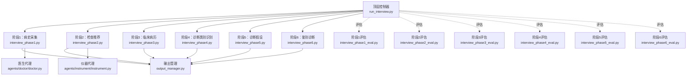
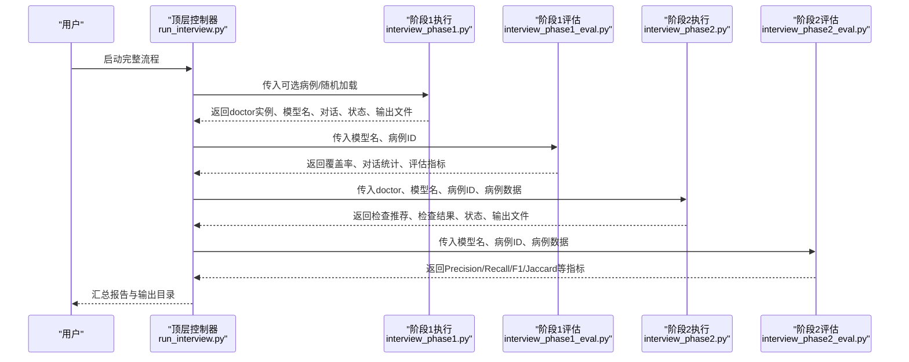
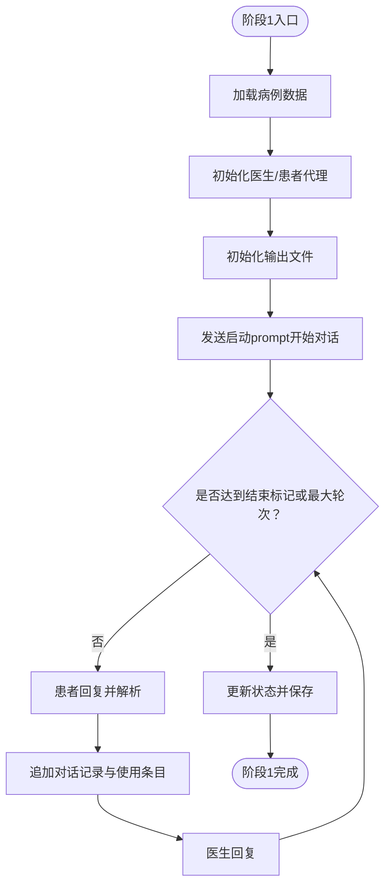
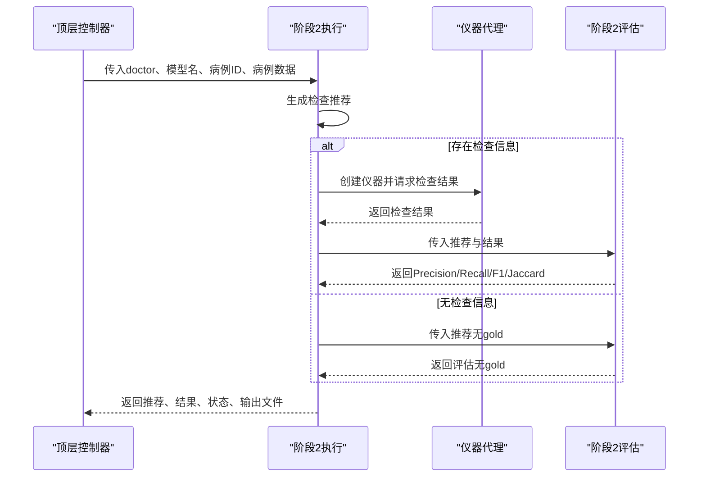
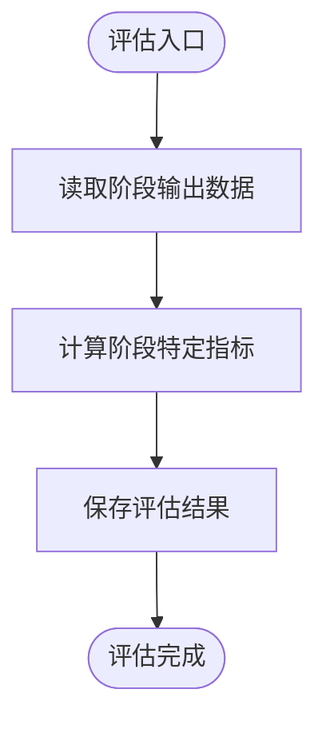
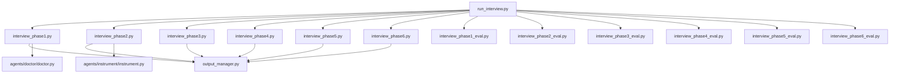

# 工作流协调架构

<cite>
**本文引用的文件**
- [run_interview.py](file://run_interview.py)
- [interview_phase1.py](file://core/interview/interview_phase1.py)
- [interview_phase2.py](file://core/interview/interview_phase2.py)
- [interview_phase3.py](file://core/interview/interview_phase3.py)
- [interview_phase4.py](file://core/interview/interview_phase4.py)
- [interview_phase5.py](file://core/interview/interview_phase5.py)
- [interview_phase6.py](file://core/interview/interview_phase6.py)
- [interview_phase1_eval.py](file://core/evaluate/interview_phase1_eval.py)
- [interview_phase2_eval.py](file://core/evaluate/interview_phase2_eval.py)
- [interview_phase3_eval.py](file://core/evaluate/interview_phase3_eval.py)
- [interview_phase4_eval.py](file://core/evaluate/interview_phase4_eval.py)
- [interview_phase5_eval.py](file://core/evaluate/interview_phase5_eval.py)
- [interview_phase6_eval.py](file://core/evaluate/interview_phase6_eval.py)
- [output_manager.py](file://core/output_manager.py)
- [doctor.py](file://agents/doctor/doctor.py)
</cite>

## 目录
1. [简介](#简介)
2. [项目结构](#项目结构)
3. [核心组件](#核心组件)
4. [架构总览](#架构总览)
5. [详细组件分析](#详细组件分析)
6. [依赖关系分析](#依赖关系分析)
7. [性能考量](#性能考量)
8. [故障排查指南](#故障排查指南)
9. [结论](#结论)
10. [附录](#附录)

## 简介
本项目实现了一个精神科访谈的六阶段工作流，采用“阶段化、串行化”的协调机制，确保每个阶段的输入、处理、输出与评估闭环清晰可控。工作流由顶层控制器统一编排，各阶段通过明确的接口与数据契约进行衔接，评估模块独立于主流程，负责对各阶段产出进行指标化评估，并将结果持久化到统一的输出目录。

## 项目结构
项目采用“按功能域分层 + 按阶段拆分”的组织方式：
- 顶层入口：run_interview.py 负责串联六个阶段与评估模块，汇总最终结果。
- 阶段执行：core/interview 下的六个文件分别实现 Phase 1–6 的具体流程。
- 评估模块：core/evaluate 下的六个文件分别实现对应阶段的评估逻辑。
- 输出管理：core/output_manager.py 统一管理各阶段输出文件的创建、更新与读取。
- 代理与服务：agents/doctor/doctor.py 提供医生角色的 LLM 服务封装；services.llm_api.py 提供底层 LLM 调用能力（在评估模块中使用）。

图表来源
- [run_interview.py:46-396](file://run_interview.py#L46-L396)
- [interview_phase1.py:241-428](file://core/interview/interview_phase1.py#L241-L428)
- [interview_phase2.py:75-244](file://core/interview/interview_phase2.py#L75-L244)
- [interview_phase3.py:83-181](file://core/interview/interview_phase3.py#L83-L181)
- [interview_phase4.py:67-158](file://core/interview/interview_phase4.py#L67-L158)
- [interview_phase5.py:67-158](file://core/interview/interview_phase5.py#L67-L158)
- [interview_phase6.py:66-158](file://core/interview/interview_phase6.py#L66-L158)
- [output_manager.py:50-189](file://core/output_manager.py#L50-L189)
- [doctor.py:32-55](file://agents/doctor/doctor.py#L32-L55)

章节来源
- [run_interview.py:46-396](file://run_interview.py#L46-L396)
- [output_manager.py:20-189](file://core/output_manager.py#L20-L189)

## 核心组件
- 顶层控制器：负责按序调度六个阶段，串联评估模块，并汇总最终报告。
- 阶段执行器：每个阶段文件封装独立的业务流程、提示词、数据解析与输出管理。
- 评估器：每个阶段的评估模块独立运行，基于统一的输出目录读取数据并计算指标。
- 输出管理器：提供统一的文件路径、初始化、增量更新与对话追加能力。
- 医生代理：提供 LLMService 实例，承载系统提示与多轮对话上下文。

章节来源
- [run_interview.py:46-396](file://run_interview.py#L46-L396)
- [output_manager.py:50-189](file://core/output_manager.py#L50-L189)
- [doctor.py:32-55](file://agents/doctor/doctor.py#L32-L55)

## 架构总览
工作流采用“串行阶段 + 独立评估”的设计，阶段间通过显式的参数传递与输出文件实现数据衔接。顶层控制器负责：
- 顺序驱动：依次调用 Phase 1–6 的执行函数。
- 数据传递：将上一阶段的 doctor 实例、模型名、病例ID与关键数据作为参数传入下一阶段。
- 评估串联：在每个阶段完成后调用对应的评估模块，生成指标并持久化。
- 结果汇总：将各阶段的评估结果与输出文件路径整合为最终报告。

图表来源
- [run_interview.py:46-396](file://run_interview.py#L46-L396)
- [interview_phase1.py:241-428](file://core/interview/interview_phase1.py#L241-L428)
- [interview_phase2.py:75-244](file://core/interview/interview_phase2.py#L75-L244)
- [interview_phase1_eval.py:174-330](file://core/evaluate/interview_phase1_eval.py#L174-L330)
- [interview_phase2_eval.py:153-255](file://core/evaluate/interview_phase2_eval.py#L153-L255)

## 详细组件分析

### 阶段1：病史采集（Clinical History Collection）
- 设计要点
  - 通过医生代理与患者代理进行多轮对话，实时更新输出文件。
  - 支持结束标记检测与最大轮次保护。
  - 解析患者响应，提取主诉与精神状态使用情况，用于覆盖率统计。
- 关键接口
  - 输入：可选外部病例或随机加载；医生实例（首次创建）。
  - 输出：对话记录、使用的主诉/精神状态、覆盖率统计、状态、doctor 实例、模型名、输出文件路径。
- 数据传递
  - 顶层控制器将 doctor 实例、模型名、病例ID与完整病例数据传递给下一阶段。
- 异常处理
  - 对话轮次达到上限时更新状态为“max_turns_reached”。
  - 医生直接结束标记时更新状态为“completed”。

图表来源
- [interview_phase1.py:241-428](file://core/interview/interview_phase1.py#L241-L428)
- [output_manager.py:117-169](file://core/output_manager.py#L117-L169)

章节来源
- [interview_phase1.py:241-428](file://core/interview/interview_phase1.py#L241-L428)
- [output_manager.py:50-189](file://core/output_manager.py#L50-L189)

### 阶段2：检查推荐（Examination Recommendation）
- 设计要点
  - 基于阶段1上下文生成检查推荐列表。
  - 若存在病例中的辅助检查信息，调用仪器代理获取检查结果并进行评估。
- 关键接口
  - 输入：doctor 实例、模型名、病例ID、完整病例数据。
  - 输出：检查推荐列表、检查结果、评估指标、状态、输出文件路径。
- 数据传递
  - 顶层控制器将 doctor、模型名、病例ID与病例数据传递给阶段3。
- 异常处理
  - 仪器调用失败时更新状态为“completed_with_error”，但仍保存阶段性结果。

图表来源
- [interview_phase2.py:75-244](file://core/interview/interview_phase2.py#L75-L244)
- [interview_phase2_eval.py:153-255](file://core/evaluate/interview_phase2_eval.py#L153-L255)

章节来源
- [interview_phase2.py:75-244](file://core/interview/interview_phase2.py#L75-L244)
- [interview_phase2_eval.py:153-255](file://core/evaluate/interview_phase2_eval.py#L153-L255)

### 阶段3：临床病历（Clinical Formulation）
- 设计要点
  - 基于阶段1-2上下文与检查结果生成结构化病历。
  - 解析医生响应中的病历片段并保存。
- 关键接口
  - 输入：doctor 实例、模型名、病例ID、检查结果。
  - 输出：病历正文、原始响应、状态、输出文件路径。
- 数据传递
  - 顶层控制器将 doctor、模型名、病例ID与检查结果传递给阶段4。

章节来源
- [interview_phase3.py:83-181](file://core/interview/interview_phase3.py#L83-L181)

### 阶段4：诊断类别识别（Diagnostic Category Identification）
- 设计要点
  - 基于阶段3上下文识别可能的诊断类别集合。
  - 解析医生响应中的类别列表并保存。
- 关键接口
  - 输入：doctor 实例、模型名、病例ID。
  - 输出：诊断类别列表、原始响应、状态、输出文件路径。

章节来源
- [interview_phase4.py:67-158](file://core/interview/interview_phase4.py#L67-L158)

### 阶段5：诊断假设（Diagnostic Hypotheses）
- 设计要点
  - 基于阶段4上下文生成诊断假设列表。
  - 解析医生响应中的假设列表并保存。
- 关键接口
  - 输入：doctor 实例、模型名、病例ID。
  - 输出：假设列表、原始响应、状态、输出文件路径。

章节来源
- [interview_phase5.py:67-158](file://core/interview/interview_phase5.py#L67-L158)

### 阶段6：鉴别诊断（Differential Diagnosis）
- 设计要点
  - 基于阶段5上下文进行鉴别诊断，输出最终诊断序列。
  - 解析医生响应中的诊断序列并保存。
- 关键接口
  - 输入：doctor 实例、模型名、病例ID。
  - 输出：最终诊断序列、原始响应、状态、输出文件路径。

章节来源
- [interview_phase6.py:66-158](file://core/interview/interview_phase6.py#L66-L158)

### 评估模块（阶段1–6）
- 设计要点
  - 各阶段评估模块独立运行，读取对应阶段的输出文件或直接接收数据。
  - 计算阶段特定指标并保存评估结果到统一目录。
  - 阶段1支持并行评估共情度与专业度（可配置）。
- 关键接口
  - 输入：模型名、病例ID、输出文件路径或直接数据。
  - 输出：评估指标、统计信息、评估结果文件路径。
- 并发策略
  - 阶段3的多维度评分采用线程池并行评估，提升吞吐。

图表来源
- [interview_phase1_eval.py:174-330](file://core/evaluate/interview_phase1_eval.py#L174-L330)
- [interview_phase2_eval.py:153-255](file://core/evaluate/interview_phase2_eval.py#L153-L255)
- [interview_phase3_eval.py:422-552](file://core/evaluate/interview_phase3_eval.py#L422-L552)
- [interview_phase4_eval.py:126-210](file://core/evaluate/interview_phase4_eval.py#L126-L210)
- [interview_phase5_eval.py:126-210](file://core/evaluate/interview_phase5_eval.py#L126-L210)
- [interview_phase6_eval.py:267-370](file://core/evaluate/interview_phase6_eval.py#L267-L370)

章节来源
- [interview_phase1_eval.py:174-330](file://core/evaluate/interview_phase1_eval.py#L174-L330)
- [interview_phase3_eval.py:344-391](file://core/evaluate/interview_phase3_eval.py#L344-L391)

### 输出管理器
- 设计要点
  - 统一输出目录结构：data/output/interview/{model_name}/{case_id}/。
  - 提供初始化、增量更新、对话追加与读取能力。
  - 支持阶段1的实时对话追加与覆盖率统计更新。
- 关键接口
  - 初始化：写入初始数据与元信息。
  - 更新：合并增量数据并更新时间戳与状态。
  - 追加：阶段1专用，追加对话并去重更新使用条目。

章节来源
- [output_manager.py:50-189](file://core/output_manager.py#L50-L189)

### 医生代理
- 设计要点
  - 基于 LLMService 创建医生角色，注入系统提示，维持多轮对话上下文。
  - 顶层控制器将 doctor 实例跨阶段传递，保证上下文连续性。

章节来源
- [doctor.py:32-55](file://agents/doctor/doctor.py#L32-L55)

## 依赖关系分析
- 控制器依赖
  - 顶层控制器依赖六个阶段执行器与六个评估器，形成强耦合的串行控制流。
- 阶段内聚
  - 每个阶段内部高度内聚，仅依赖输出管理器与必要的代理（如阶段2的仪器代理）。
- 评估解耦
  - 评估模块通过统一的输出文件路径读取数据，避免与主流程直接耦合。
- 外部依赖
  - LLMService 提供底层推理能力；阶段3评估模块引入线程池并发。

图表来源
- [run_interview.py:46-396](file://run_interview.py#L46-L396)
- [output_manager.py:50-189](file://core/output_manager.py#L50-L189)
- [doctor.py:32-55](file://agents/doctor/doctor.py#L32-L55)

章节来源
- [run_interview.py:46-396](file://run_interview.py#L46-L396)
- [output_manager.py:50-189](file://core/output_manager.py#L50-L189)

## 性能考量
- 并行策略
  - 阶段3评估采用线程池并行评估四个维度，显著降低评估耗时。
  - 阶段1评估可选择并行评估共情度与专业度（默认开启）。
- I/O 优化
  - 阶段1采用“边对话边写入”的策略，减少内存占用并提升可观测性。
  - 输出管理器提供增量更新与对话追加，避免重复读写。
- 评估成本
  - 评估模块依赖 LLMService 进行二次评分（阶段3），应合理控制并发与批处理规模。
- 资源限制
  - 阶段1设置最大轮次上限，防止长时间运行导致资源耗尽。

章节来源
- [interview_phase3_eval.py:363-391](file://core/evaluate/interview_phase3_eval.py#L363-L391)
- [interview_phase1_eval.py:261-274](file://core/evaluate/interview_phase1_eval.py#L261-L274)
- [interview_phase1.py:351-398](file://core/interview/interview_phase1.py#L351-L398)

## 故障排查指南
- 常见问题
  - 阶段1对话提前结束：检查医生响应是否包含结束标记；确认 MAX_TURNS 设置。
  - 阶段2仪器调用失败：检查病例中的辅助检查信息是否存在；查看状态为“completed_with_error”时的输出文件。
  - 阶段3评估失败：检查生成病历与真值病历是否为空；关注解析失败的错误信息。
  - 顶层控制器异常：捕获异常并打印堆栈，定位具体阶段与模块。
- 日志与观测
  - 阶段1实时输出对话与覆盖率统计；顶层控制器输出各阶段摘要与最终汇总。
  - 评估模块输出指标与警告信息，便于快速定位问题。
- 回滚与恢复
  - 当前实现未提供自动回滚机制；若某阶段失败，可在该阶段重新运行并覆盖输出文件，顶层控制器会读取最新文件继续后续流程。

章节来源
- [interview_phase1.py:194-208](file://core/interview/interview_phase1.py#L194-L208)
- [interview_phase2.py:217-228](file://core/interview/interview_phase2.py#L217-L228)
- [interview_phase3_eval.py:264-319](file://core/evaluate/interview_phase3_eval.py#L264-L319)
- [run_interview.py:399-408](file://run_interview.py#L399-L408)

## 结论
该工作流通过“阶段化、串行化、模块化”的设计，实现了从病史采集到鉴别诊断的完整闭环，并以独立评估模块保障质量度量。顶层控制器承担编排职责，阶段间通过明确的数据契约与统一的输出管理实现稳定衔接。评估模块采用可配置的并行策略，在保证准确性的同时提升了整体吞吐。建议在生产环境中结合日志与监控完善异常处理与回滚策略，进一步提升鲁棒性。

## 附录
- 扩展指南
  - 新增阶段：参考现有阶段模板，实现 run_interview.py 中的调用与评估串联。
  - 自定义评估：在 core/evaluate 下新增评估模块，遵循统一的输入/输出规范。
  - 代理扩展：在 agents 下新增代理模块，按需注入系统提示与上下文。
- 最佳实践
  - 明确阶段边界与数据契约，避免跨阶段隐式依赖。
  - 使用输出管理器进行增量更新，确保中间态可恢复。
  - 在评估模块中保留错误与警告信息，便于问题定位。
  - 控制评估并发度，避免 LLM 调用成为瓶颈。