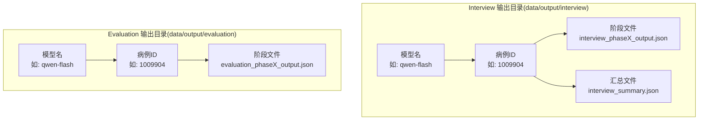
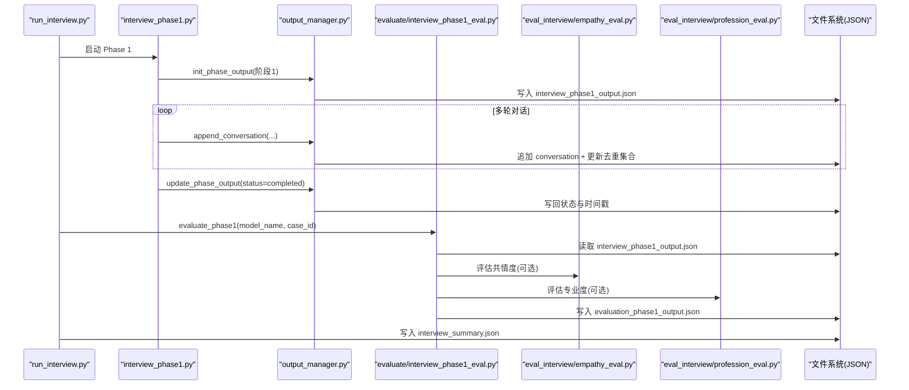
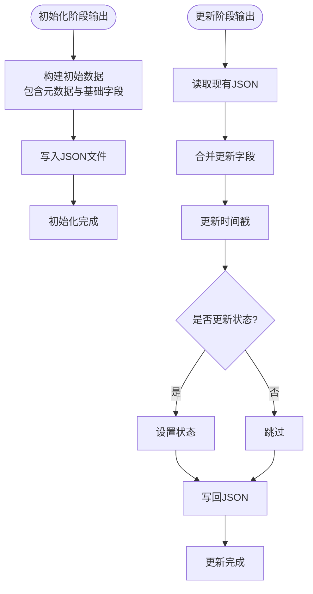
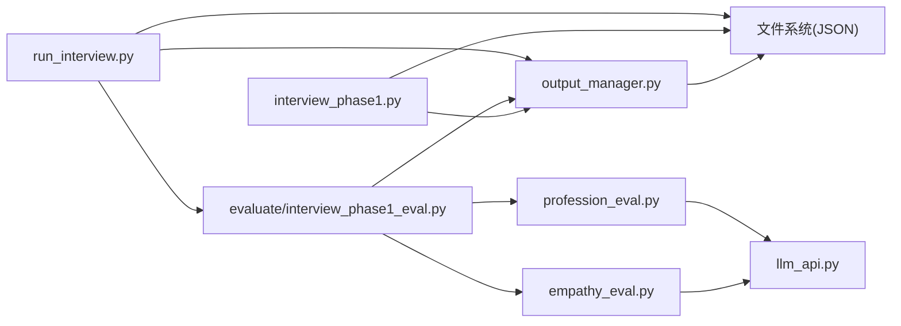

# 数据管理架构

<cite>
**本文档引用的文件**
- [core/output_manager.py](file://core/output_manager.py)
- [run_interview.py](file://run_interview.py)
- [core/interview/interview_phase1.py](file://core/interview/interview_phase1.py)
- [core/evaluate/interview_phase1_eval.py](file://core/evaluate/interview_phase1_eval.py)
- [eval_interview/empathy_eval.py](file://eval_interview/empathy_eval.py)
- [eval_interview/profession_eval.py](file://eval_interview/profession_eval.py)
- [services/llm_api.py](file://services/llm_api.py)
- [data/output/interview/qwen-flash/1009904/interview_summary.json](file://data/output/interview/qwen-flash/1009904/interview_summary.json)
- [data/output/evaluation/qwen-flash/1009904/evaluation_phase1_output.json](file://data/output/evaluation/qwen-flash/1009904/evaluation_phase1_output.json)
- [eval_interview/scale.json](file://eval_interview/scale.json)
- [eval_interview/profession_scale.json](file://eval_interview/profession_scale.json)
</cite>

## 目录
1. [简介](#简介)
2. [项目结构](#项目结构)
3. [核心组件](#核心组件)
4. [架构总览](#架构总览)
5. [详细组件分析](#详细组件分析)
6. [依赖关系分析](#依赖关系分析)
7. [性能考量](#性能考量)
8. [故障排查指南](#故障排查指南)
9. [结论](#结论)
10. [附录](#附录)

## 简介
本文件面向数据管理架构，系统性阐述输出管理器的设计原理、文件系统组织结构、数据持久化策略、对话历史存储格式、评估结果数据结构、多阶段输出管理机制，以及从内存到磁盘的数据流转换过程（JSON 序列化、文件命名规则、路径管理）。同时覆盖版本控制与备份策略建议、大规模数据处理的性能优化方案、数据访问模式、缓存策略与并发安全机制，并提供数据迁移与清理的工具与方法。

## 项目结构
项目采用“功能域+阶段”的组织方式，核心数据输出分为两类：
- interview 输出：按模型名与病例ID组织，存放各阶段的对话与中间产物
- evaluation 输出：按模型名与病例ID组织，存放各阶段的评估结果

图表来源
- [run_interview.py:385-392](file://run_interview.py#L385-L392)
- [core/output_manager.py:20-32](file://core/output_manager.py#L20-L32)
- [core/evaluate/interview_phase1_eval.py:32-44](file://core/evaluate/interview_phase1_eval.py#L32-L44)

章节来源
- [run_interview.py:367-393](file://run_interview.py#L367-L393)
- [core/output_manager.py:1-189](file://core/output_manager.py#L1-L189)
- [core/evaluate/interview_phase1_eval.py:32-44](file://core/evaluate/interview_phase1_eval.py#L32-L44)

## 核心组件
- 输出管理器：统一管理各阶段输出文件路径、初始化、更新、追加对话、加载
- 评估模块：负责各阶段评估结果的统计、格式化、保存
- LLM 服务：提供对话上下文管理与评估器调用
- 数据文件：JSON 格式，包含阶段元数据、对话历史、覆盖率统计、评估指标等

章节来源
- [core/output_manager.py:50-188](file://core/output_manager.py#L50-L188)
- [core/evaluate/interview_phase1_eval.py:141-330](file://core/evaluate/interview_phase1_eval.py#L141-L330)
- [services/llm_api.py:79-250](file://services/llm_api.py#L79-L250)

## 架构总览
数据流从内存到磁盘的关键路径如下：
- 阶段初始化：输出管理器创建阶段文件，写入初始元数据与基础字段
- 对话追加：每轮对话实时追加到 conversation 列表，并更新去重后的主诉/精神状态使用集合
- 状态更新：阶段性更新时读取、合并、写回，同时更新时间戳与状态
- 评估流程：读取 interview 阶段输出，计算覆盖率与对话统计，调用评估器生成指标，保存 evaluation 文件
- 汇总输出：完整流程结束后生成 interview_summary.json，汇总各阶段结果与评估文件路径

图表来源
- [run_interview.py:46-396](file://run_interview.py#L46-L396)
- [core/interview/interview_phase1.py:241-428](file://core/interview/interview_phase1.py#L241-L428)
- [core/output_manager.py:50-188](file://core/output_manager.py#L50-L188)
- [core/evaluate/interview_phase1_eval.py:174-330](file://core/evaluate/interview_phase1_eval.py#L174-L330)
- [eval_interview/empathy_eval.py:9-247](file://eval_interview/empathy_eval.py#L9-L247)
- [eval_interview/profession_eval.py:9-203](file://eval_interview/profession_eval.py#L9-L203)

## 详细组件分析

### 输出管理器（Output Manager）
- 设计原则
  - 统一路径管理：基于模型名与病例ID生成目录，避免硬编码
  - 即时写入：每次更新均同步写回，保障中断恢复与一致性
  - 元数据标准化：统一包含阶段、病例ID、模型名、时间戳、状态等
- 关键接口
  - 获取输出目录与阶段文件路径
  - 初始化阶段输出（写入初始数据与元数据）
  - 更新阶段输出（合并字段、更新时间戳与状态）
  - 追加对话（Phase 1 专用，实时写入）
  - 加载阶段输出（按需读取）
- 数据结构要点
  - 阶段文件包含：阶段编号、病例ID、模型名、时间戳、状态、对话历史、主诉/精神状态使用集合等
  - 汇总文件 interview_summary.json 包含完整流程各阶段结果与评估文件路径

图表来源
- [core/output_manager.py:50-115](file://core/output_manager.py#L50-L115)

章节来源
- [core/output_manager.py:1-189](file://core/output_manager.py#L1-L189)

### 阶段输出文件（Interview）
- 文件命名规则
  - interview_phaseX_output.json（X=1..6）
  - interview_summary.json（完整流程汇总）
- 存储字段
  - 元数据：phase、case_id、model_name、timestamp、status
  - 对话历史：conversation（role、content、timestamp）
  - 覆盖统计：chief_complaint_used、mental_status_used（去重集合）
  - 其他阶段特有字段（如 Phase 3 的 syntactic_formulation）

章节来源
- [core/output_manager.py:50-188](file://core/output_manager.py#L50-L188)
- [data/output/interview/qwen-flash/1009904/interview_summary.json:1-443](file://data/output/interview/qwen-flash/1009904/interview_summary.json#L1-L443)

### 评估结果文件（Evaluation）
- 文件命名规则
  - evaluation_phaseX_output.json（X=1..6）
- 存储字段
  - 元数据：phase、case_id、model_name、timestamp
  - 覆盖率统计：chief_complaint_coverage、mental_status_coverage、overall_coverage 等
  - 对话统计：total_turns、patient_turns、doctor_turns、conversation_length
  - 评估指标：empathy_evaluation、profession_evaluation（可选）
  - 评估器输出文件路径：便于溯源

章节来源
- [core/evaluate/interview_phase1_eval.py:141-330](file://core/evaluate/interview_phase1_eval.py#L141-L330)
- [data/output/evaluation/qwen-flash/1009904/evaluation_phase1_output.json:1-122](file://data/output/evaluation/qwen-flash/1009904/evaluation_phase1_output.json#L1-L122)

### 评估器（Emotion & Professionalism）
- 共情评估（empathy_eval.py）
  - 读取共情量表（支持多种文件名与结构）
  - 组装严格系统提示与用户提示
  - 调用评估器 LLM，解析逐题评分与汇总
  - 返回 parsed_scores、平均分、方差等
- 专业度评估（profession_eval.py）
  - 读取专业度量表（支持多种文件名与结构）
  - 组装系统提示与用户提示
  - 调用评估器 LLM，解析逐题评分与汇总
  - 返回 parsed_scores、平均分等

章节来源
- [eval_interview/empathy_eval.py:9-247](file://eval_interview/empathy_eval.py#L9-L247)
- [eval_interview/profession_eval.py:9-203](file://eval_interview/profession_eval.py#L9-L203)
- [eval_interview/scale.json:1-258](file://eval_interview/scale.json#L1-L258)
- [eval_interview/profession_scale.json:1-194](file://eval_interview/profession_scale.json#L1-L194)

### LLM 服务与评估器集成
- LLMService
  - 维护每实例的对话历史，自动附加上下文
  - 支持重试与指数退避
  - 提供 doctor/patient/evaluator 三种角色便捷函数
- 评估器调用
  - 评估模块通过 LLMService 调用评估器模型
  - 解析模型输出，计算统计指标并写入 evaluation 文件

章节来源
- [services/llm_api.py:79-250](file://services/llm_api.py#L79-L250)
- [core/evaluate/interview_phase1_eval.py:254-298](file://core/evaluate/interview_phase1_eval.py#L254-L298)

### 完整流程与汇总
- run_interview.py
  - 串联 6 个阶段，调用各阶段输出管理器与评估模块
  - 生成 interview_summary.json，包含各阶段输出文件路径与评估结果
  - 输出阶段概要与评估指标

章节来源
- [run_interview.py:46-396](file://run_interview.py#L46-L396)

## 依赖关系分析

图表来源
- [core/output_manager.py:1-189](file://core/output_manager.py#L1-L189)
- [core/interview/interview_phase1.py:41-46](file://core/interview/interview_phase1.py#L41-L46)
- [core/evaluate/interview_phase1_eval.py:254-298](file://core/evaluate/interview_phase1_eval.py#L254-L298)
- [eval_interview/empathy_eval.py:6](file://eval_interview/empathy_eval.py#L6)
- [eval_interview/profession_eval.py:6](file://eval_interview/profession_eval.py#L6)
- [services/llm_api.py:37-44](file://services/llm_api.py#L37-L44)
- [run_interview.py:32-43](file://run_interview.py#L32-L43)

## 性能考量
- 即时写入策略
  - 优点：中断恢复友好、数据一致性强
  - 风险：频繁 IO 可能成为瓶颈
- 优化建议
  - 批量写入：在对话轮次较多时，累积 N 轮后再写入一次
  - 异步写入：使用后台线程/进程写盘，主线程继续对话
  - 缓冲区：在内存中维护最近 K 轮对话，定期 flush
  - 压缩存储：对大体量对话可考虑 gzip 压缩（需权衡 CPU 与 IO）
  - 并发安全：多进程/多线程写同一文件时，使用锁或队列
- 评估器调用
  - 并行评估：共情与专业度评估可并行执行
  - 限流与重试：合理设置超时与指数退避，避免雪崩
  - 本地缓存：对相同对话可缓存评估结果，避免重复计算

[本节为通用性能建议，不直接分析具体文件]

## 故障排查指南
- 文件不存在
  - 现象：加载阶段输出返回 None
  - 排查：确认模型名与病例ID正确，输出目录是否存在
- JSON 解析错误
  - 现象：解析 interview/evaluation 文件时报错
  - 排查：检查文件完整性与编码；必要时使用修复工具
- 评估器调用失败
  - 现象：评估模块抛出异常
  - 排查：检查 .env 中评估器配置、网络连通性、量表文件存在性
- 并发写冲突
  - 现象：多进程同时写同一文件导致数据损坏
  - 排查：引入互斥锁或写队列；避免直接共享文件

章节来源
- [core/output_manager.py:171-188](file://core/output_manager.py#L171-L188)
- [core/evaluate/interview_phase1_eval.py:294-298](file://core/evaluate/interview_phase1_eval.py#L294-L298)
- [services/llm_api.py:158-169](file://services/llm_api.py#L158-L169)

## 结论
本数据管理架构以输出管理器为核心，通过统一的路径与文件命名规则，实现了多阶段、多模型、多病例的有序数据持久化。对话历史与评估结果均以 JSON 形式存储，便于检索与二次分析。通过即时写入与评估器并行化，兼顾了可靠性与性能。建议在大规模场景下引入批量/异步写入、缓存与并发控制，以进一步提升吞吐与稳定性。

## 附录

### 数据流与序列化
- 内存对象 → JSON 字符串 → 文件写入（UTF-8）
- 读取时 JSON 字符串 → 内存对象
- 时间戳字段：ISO 8601 格式；对话时间戳：HH:mm:ss

章节来源
- [core/output_manager.py:79-81](file://core/output_manager.py#L79-L81)
- [core/output_manager.py:144-146](file://core/output_manager.py#L144-L146)
- [core/evaluate/interview_phase1_eval.py:164-166](file://core/evaluate/interview_phase1_eval.py#L164-L166)

### 版本控制与备份策略（建议）
- 版本控制
  - 使用 Git 管理代码与配置文件
  - 数据文件不纳入版本控制，使用符号链接或外部存储
- 备份
  - 周期性归档 data/output 目录
  - 使用增量备份策略，保留最近 N 天的快照
- 清理
  - 基于时间窗口清理旧数据
  - 保留关键阶段文件与汇总文件，删除冗余中间文件

[本节为通用建议，不直接分析具体文件]

### 数据访问模式与缓存策略
- 访问模式
  - 读取：按需加载阶段文件或评估文件
  - 写入：阶段初始化一次性写入；对话轮次实时追加写入
- 缓存策略
  - 热点数据：最近 N 个病例的阶段输出可缓存于内存
  - 评估结果：对相同对话可缓存评估结果，避免重复计算
- 并发安全
  - 文件级锁：同一阶段文件同一时间仅允许一个写入者
  - 读写分离：读多写少场景下，可采用只读副本

[本节为通用建议，不直接分析具体文件]

### 数据迁移与清理工具
- 迁移
  - 重命名模型名/病例ID：批量重命名目录与文件，更新引用路径
  - 数据格式升级：编写迁移脚本，读取旧格式，转换为新格式并写回
- 清理
  - 删除旧阶段文件：保留 interview_summary.json 与关键评估文件
  - 清理临时中间文件：按阶段规则删除冗余文件

[本节为通用建议，不直接分析具体文件]