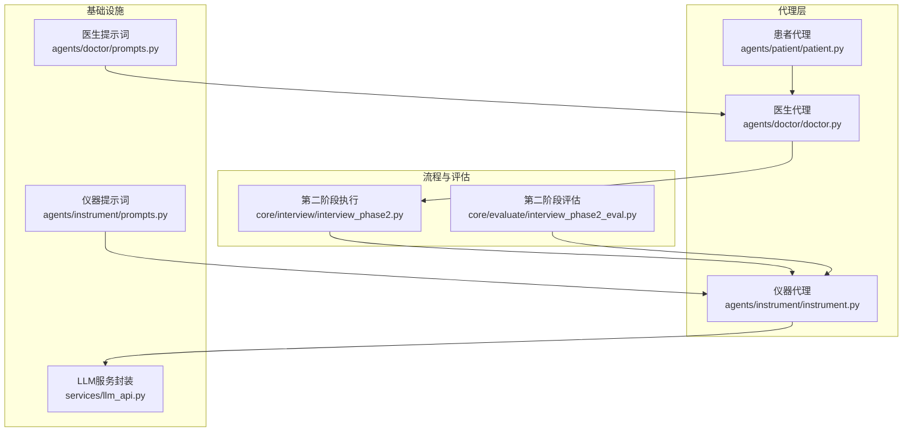
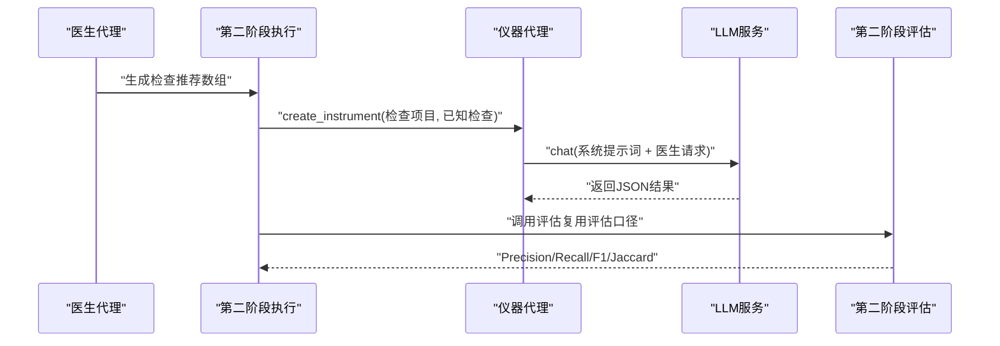
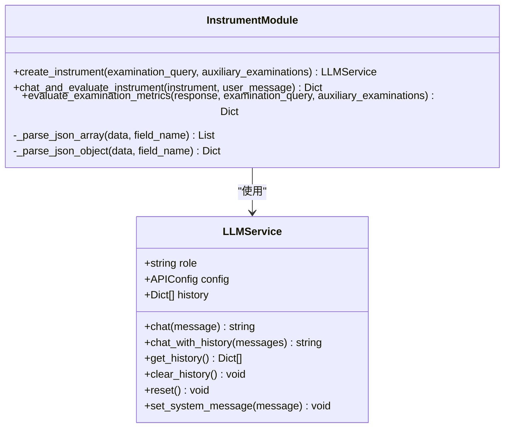
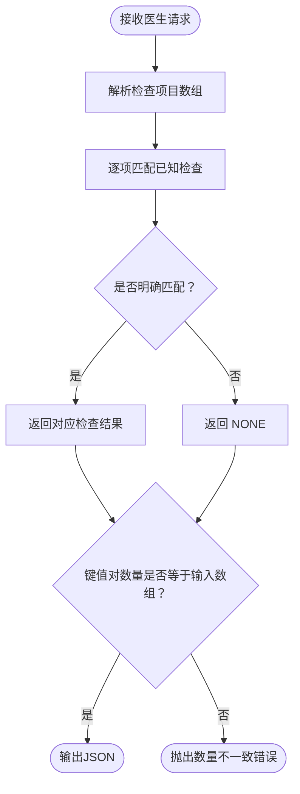
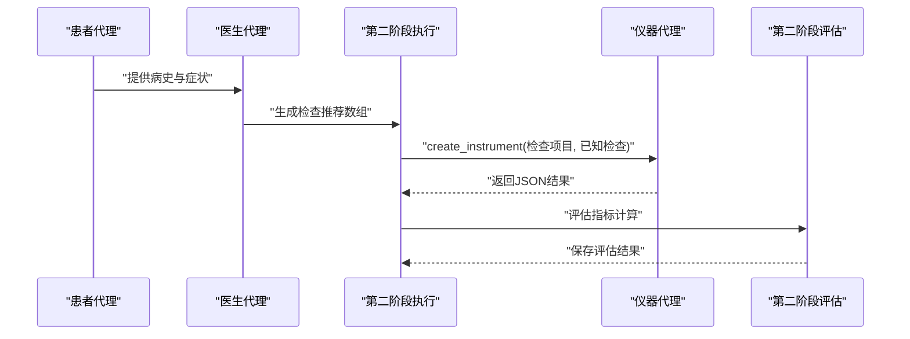
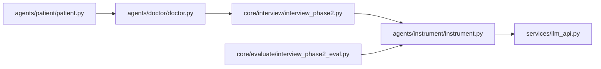

# 仪器代理

<cite>
**本文引用的文件**
- [agents/instrument/instrument.py](file://agents/instrument/instrument.py)
- [agents/instrument/prompts.py](file://agents/instrument/prompts.py)
- [agents/doctor/doctor.py](file://agents/doctor/doctor.py)
- [agents/doctor/prompts.py](file://agents/doctor/prompts.py)
- [agents/patient/patient.py](file://agents/patient/patient.py)
- [core/interview/interview_phase2.py](file://core/interview/interview_phase2.py)
- [core/evaluate/interview_phase2_eval.py](file://core/evaluate/interview_phase2_eval.py)
- [services/llm_api.py](file://services/llm_api.py)
- [run_interview.py](file://run_interview.py)
</cite>

## 目录
1. [简介](#简介)
2. [项目结构](#项目结构)
3. [核心组件](#核心组件)
4. [架构总览](#架构总览)
5. [详细组件分析](#详细组件分析)
6. [依赖分析](#依赖分析)
7. [性能考虑](#性能考虑)
8. [故障排查指南](#故障排查指南)
9. [结论](#结论)
10. [附录](#附录)

## 简介
本文件面向“仪器代理”模块，系统阐述其在精神科问诊中的作用与实现原理。仪器代理负责模拟各类医学检查设备的行为，依据医生请求的检查项目，从已知的辅助检查结果中返回对应检查结果，并提供可复用的评估指标计算能力。文档还说明仪器代理如何与医生代理、患者代理协作，如何在完整问诊流程中被调用，以及如何进行配置管理与扩展开发。

## 项目结构
仪器代理位于 agents/instrument 目录下，核心文件包括：
- instrument.py：仪器代理的创建、对话调用、评估指标计算等逻辑
- prompts.py：仪器代理专用的系统提示词模板
- 与之协作的模块：
  - agents/doctor：医生代理，负责生成检查推荐
  - agents/patient：患者代理，负责提供病史与症状
  - core/interview/interview_phase2.py：第二阶段“检查推荐”的执行模块，负责调度仪器代理
  - core/evaluate/interview_phase2_eval.py：第二阶段评估模块，复用相同的评估口径
  - services/llm_api.py：统一的LLM服务封装，提供对话上下文管理与API调用

图表来源
- [agents/instrument/instrument.py:13-45](file://agents/instrument/instrument.py#L13-L45)
- [agents/doctor/doctor.py:32-55](file://agents/doctor/doctor.py#L32-L55)
- [agents/patient/patient.py:40-92](file://agents/patient/patient.py#L40-L92)
- [core/interview/interview_phase2.py:75-244](file://core/interview/interview_phase2.py#L75-L244)
- [core/evaluate/interview_phase2_eval.py:153-255](file://core/evaluate/interview_phase2_eval.py#L153-L255)
- [services/llm_api.py:79-191](file://services/llm_api.py#L79-L191)
- [agents/instrument/prompts.py:3-58](file://agents/instrument/prompts.py#L3-L58)
- [agents/doctor/prompts.py:5-20](file://agents/doctor/prompts.py#L5-L20)

章节来源
- [agents/instrument/instrument.py:1-243](file://agents/instrument/instrument.py#L1-L243)
- [agents/instrument/prompts.py:1-58](file://agents/instrument/prompts.py#L1-L58)
- [agents/doctor/doctor.py:1-95](file://agents/doctor/doctor.py#L1-L95)
- [agents/doctor/prompts.py:1-21](file://agents/doctor/prompts.py#L1-L21)
- [agents/patient/patient.py:1-171](file://agents/patient/patient.py#L1-L171)
- [core/interview/interview_phase2.py:1-265](file://core/interview/interview_phase2.py#L1-L265)
- [core/evaluate/interview_phase2_eval.py:1-301](file://core/evaluate/interview_phase2_eval.py#L1-L301)
- [services/llm_api.py:1-250](file://services/llm_api.py#L1-L250)

## 核心组件
- 仪器代理创建与初始化
  - create_instrument：根据医生请求的检查项目与已知辅助检查结果，构造具备系统提示词的LLM服务实例，注入exam_info以便后续评估
  - 别名：init_instrument、start_instrument
- 对话与评估
  - chat_and_evaluate_instrument：调用仪器代理获取检查结果，并基于相同评估口径计算Precision/Recall/F1/Jaccard等指标
  - evaluate_examination_metrics：通用指标计算函数，支持JSON字符串与对象两种输入形式
- 提示词设计
  - PROMPTS["Instrument Rule"]：定义严格的输出规范、匹配策略、键值对数量约束与示例，确保结果可评估、可复现
- 与流程集成
  - core/interview/interview_phase2.py：在第二阶段由医生生成检查推荐后，调用仪器代理获取真实检查结果，并更新输出文件
  - core/evaluate/interview_phase2_eval.py：复用相同的评估口径，计算阶段指标并保存评估结果

章节来源
- [agents/instrument/instrument.py:13-45](file://agents/instrument/instrument.py#L13-L45)
- [agents/instrument/instrument.py:78-182](file://agents/instrument/instrument.py#L78-L182)
- [agents/instrument/prompts.py:3-58](file://agents/instrument/prompts.py#L3-L58)
- [core/interview/interview_phase2.py:75-244](file://core/interview/interview_phase2.py#L75-L244)
- [core/evaluate/interview_phase2_eval.py:153-255](file://core/evaluate/interview_phase2_eval.py#L153-L255)

## 架构总览
仪器代理在完整问诊流程中的位置如下：
- 医生代理生成检查推荐（数组）
- 第二阶段执行模块将推荐项目与已知辅助检查结果交给仪器代理
- 仪器代理返回与输入数组一一对应的JSON结果
- 评估模块对结果进行指标计算，形成可比较的客观度量

图表来源
- [core/interview/interview_phase2.py:147-215](file://core/interview/interview_phase2.py#L147-L215)
- [agents/instrument/instrument.py:166-182](file://agents/instrument/instrument.py#L166-L182)
- [core/evaluate/interview_phase2_eval.py:153-255](file://core/evaluate/interview_phase2_eval.py#L153-L255)

## 详细组件分析

### 仪器代理类与接口
仪器代理基于统一的LLM服务封装，对外暴露简洁的创建与评估接口，内部通过系统提示词控制行为。

图表来源
- [services/llm_api.py:79-191](file://services/llm_api.py#L79-L191)
- [agents/instrument/instrument.py:13-182](file://agents/instrument/instrument.py#L13-L182)

章节来源
- [services/llm_api.py:79-191](file://services/llm_api.py#L79-L191)
- [agents/instrument/instrument.py:13-182](file://agents/instrument/instrument.py#L13-L182)

### 提示词设计与专业性保障
仪器代理的系统提示词严格定义了以下规则：
- 任务背景：仅基于已知辅助检查返回结果，不编造信息
- 匹配策略：允许语义匹配，但需严格、谨慎，仅当明确对应才返回
- 输出规范：仅输出合法JSON对象，键为医生输入的原始项目名，键值对数量与输入数组一致
- 错误处理：无法匹配时返回“NONE”，禁止额外解释或建议

图表来源
- [agents/instrument/prompts.py:3-58](file://agents/instrument/prompts.py#L3-L58)
- [agents/instrument/instrument.py:78-163](file://agents/instrument/instrument.py#L78-L163)

章节来源
- [agents/instrument/prompts.py:3-58](file://agents/instrument/prompts.py#L3-L58)
- [agents/instrument/instrument.py:78-163](file://agents/instrument/instrument.py#L78-L163)

### 与医生代理、患者代理的协作
- 医生代理：负责生成检查推荐（数组），并维持对话上下文
- 患者代理：提供基本信息、主诉、精神状态等，支撑医生判断
- 仪器代理：接收医生请求与已知检查，返回标准化结果
- 第二阶段执行：在医生生成推荐后，调用仪器代理并更新输出文件
- 评估模块：复用相同的评估口径，计算Precision/Recall/F1/Jaccard

图表来源
- [agents/patient/patient.py:40-92](file://agents/patient/patient.py#L40-L92)
- [agents/doctor/doctor.py:32-55](file://agents/doctor/doctor.py#L32-L55)
- [core/interview/interview_phase2.py:147-215](file://core/interview/interview_phase2.py#L147-L215)
- [core/evaluate/interview_phase2_eval.py:153-255](file://core/evaluate/interview_phase2_eval.py#L153-L255)

章节来源
- [agents/patient/patient.py:40-92](file://agents/patient/patient.py#L40-L92)
- [agents/doctor/doctor.py:32-55](file://agents/doctor/doctor.py#L32-L55)
- [core/interview/interview_phase2.py:75-244](file://core/interview/interview_phase2.py#L75-L244)
- [core/evaluate/interview_phase2_eval.py:153-255](file://core/evaluate/interview_phase2_eval.py#L153-L255)

### 使用示例与最佳实践
- 初始化仪器代理
  - 输入：医生请求的检查项目（JSON数组字符串）、已知辅助检查（JSON对象字符串）
  - 输出：具备系统提示词与exam_info的LLM服务实例
- 触发检查流程
  - 调用 chat_and_evaluate_instrument，传入用户消息（默认提示）
  - 返回包含原始响应、解析后的结果、统计信息与评估指标的字典
- 获取检查结果
  - 从返回字典的 response 字段读取键值对
  - 若某键值为“NONE”，表示未匹配到已知检查

章节来源
- [agents/instrument/instrument.py:13-45](file://agents/instrument/instrument.py#L13-L45)
- [agents/instrument/instrument.py:166-182](file://agents/instrument/instrument.py#L166-L182)

### 配置管理与扩展开发指南
- 配置来源
  - 通过 .env 文件中的角色级变量（如 INSTRUMENT_API_BASE、INSTRUMENT_API_KEY、INSTRUMENT_MODEL 等）加载
  - LLMConfigManager 会按角色缓存配置，避免重复读取
- 扩展开发
  - 新增评估指标：可在 evaluate_examination_metrics 中扩展统计维度与公式
  - 新增提示词：在 agents/instrument/prompts.py 中新增模板键值，再在 create_instrument 中引用
  - 新增匹配策略：可在 evaluate_examination_metrics 前增加预处理逻辑，如模糊匹配、正则匹配等
  - 新增输出格式：调整 chat_and_evaluate_instrument 的返回结构，或在调用方处理

章节来源
- [services/llm_api.py:58-77](file://services/llm_api.py#L58-L77)
- [agents/instrument/prompts.py:3-58](file://agents/instrument/prompts.py#L3-L58)
- [agents/instrument/instrument.py:78-182](file://agents/instrument/instrument.py#L78-L182)

## 依赖分析
- 组件耦合
  - 仪器代理依赖 LLMService（统一对话上下文与API调用）
  - 第二阶段执行模块依赖仪器代理与输出管理
  - 评估模块复用仪器代理的评估口径，保证一致性
- 外部依赖
  - OpenAI兼容的Chat Completions API
  - .env 配置文件
- 潜在循环依赖
  - 未发现循环依赖；各模块职责清晰，单向依赖

图表来源
- [agents/instrument/instrument.py:9-10](file://agents/instrument/instrument.py#L9-L10)
- [core/interview/interview_phase2.py:40](file://core/interview/interview_phase2.py#L40)
- [core/evaluate/interview_phase2_eval.py:29-33](file://core/evaluate/interview_phase2_eval.py#L29-L33)
- [agents/doctor/doctor.py:28-29](file://agents/doctor/doctor.py#L28-L29)
- [agents/patient/patient.py:36-37](file://agents/patient/patient.py#L36-L37)

章节来源
- [agents/instrument/instrument.py:1-243](file://agents/instrument/instrument.py#L1-L243)
- [core/interview/interview_phase2.py:1-265](file://core/interview/interview_phase2.py#L1-L265)
- [core/evaluate/interview_phase2_eval.py:1-301](file://core/evaluate/interview_phase2_eval.py#L1-L301)
- [services/llm_api.py:1-250](file://services/llm_api.py#L1-L250)

## 性能考虑
- API调用重试与退避：LLMService内置指数退避重试，降低网络抖动影响
- 上下文长度控制：通过 max_tokens 控制单次输出长度，避免超长响应
- 配置缓存：LLMConfigManager 缓存角色配置，减少环境变量读取开销
- 评估口径稳定：指标计算逻辑固定，便于横向对比与回归测试

## 故障排查指南
- 常见问题
  - exam_info 缺失：chat_and_evaluate_instrument 会在缺少 exam_info 时抛出异常，检查是否正确传入 examination_query 与 auxiliary_examinations
  - JSON解析错误：_parse_json_array/_parse_json_object 会对非法JSON抛出异常，检查输入字符串格式
  - 键值对数量不一致：评估时若 response 键值对数量与医生请求数量不一致，会记录警告
- 建议
  - 在调用前打印输入参数，确认格式与长度
  - 使用 run_interview.py 的完整流程进行端到端验证
  - 在 .env 中核对角色API配置是否正确

章节来源
- [agents/instrument/instrument.py:173-182](file://agents/instrument/instrument.py#L173-L182)
- [agents/instrument/instrument.py:48-75](file://agents/instrument/instrument.py#L48-L75)
- [agents/instrument/instrument.py:136-141](file://agents/instrument/instrument.py#L136-L141)

## 结论
仪器代理通过严格的系统提示词与稳健的评估口径，在精神科问诊中实现了可复现、可评估的检查结果返回能力。它与医生代理、患者代理协同工作，支撑第二阶段“检查推荐”的完整闭环，并为后续的临床病历、诊断识别与鉴别诊断提供高质量输入。通过统一的LLM服务封装与清晰的模块边界，仪器代理易于扩展与维护，适合在复杂医疗问答场景中持续演进。

## 附录
- 完整流程入口：run_interview.py 提供六阶段完整流程，第二阶段即为仪器代理参与的关键环节
- 提示词模板：在 agents/instrument/prompts.py 中集中管理，便于统一修订与版本控制

章节来源
- [run_interview.py:46-396](file://run_interview.py#L46-L396)
- [agents/instrument/prompts.py:3-58](file://agents/instrument/prompts.py#L3-L58)