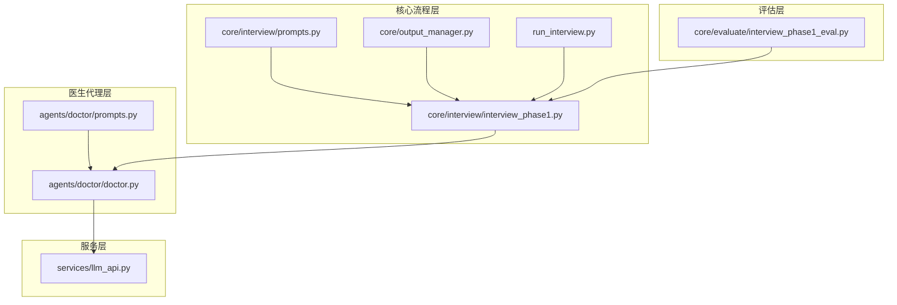
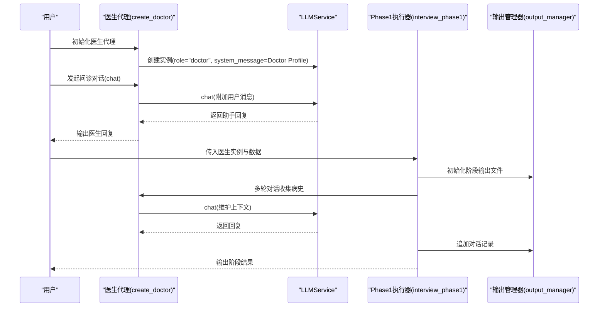
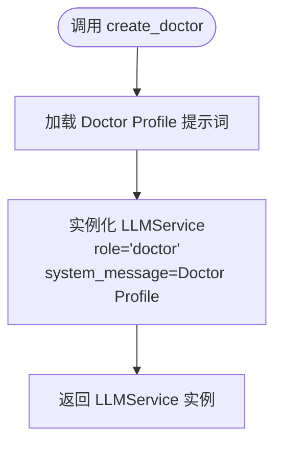
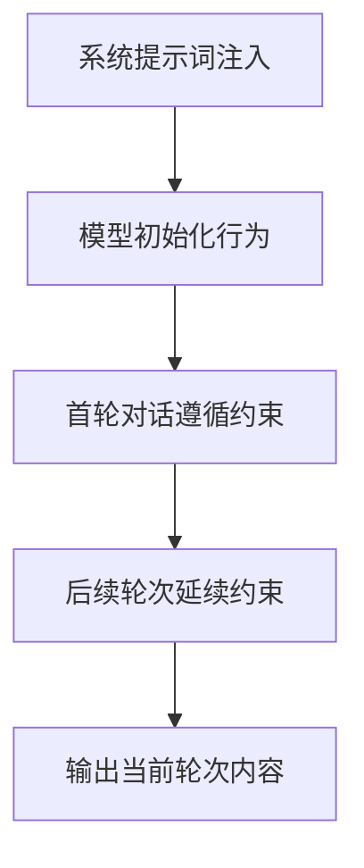
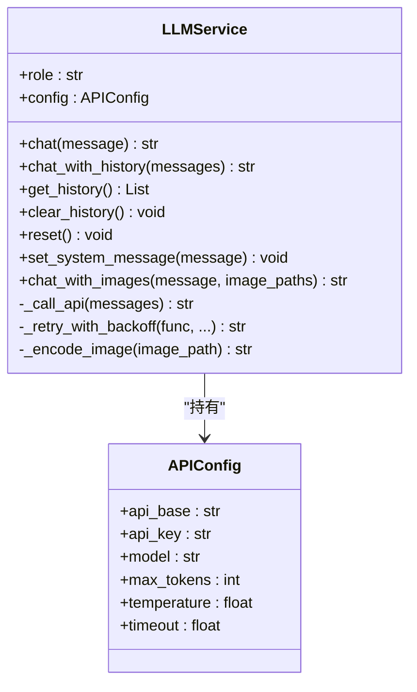
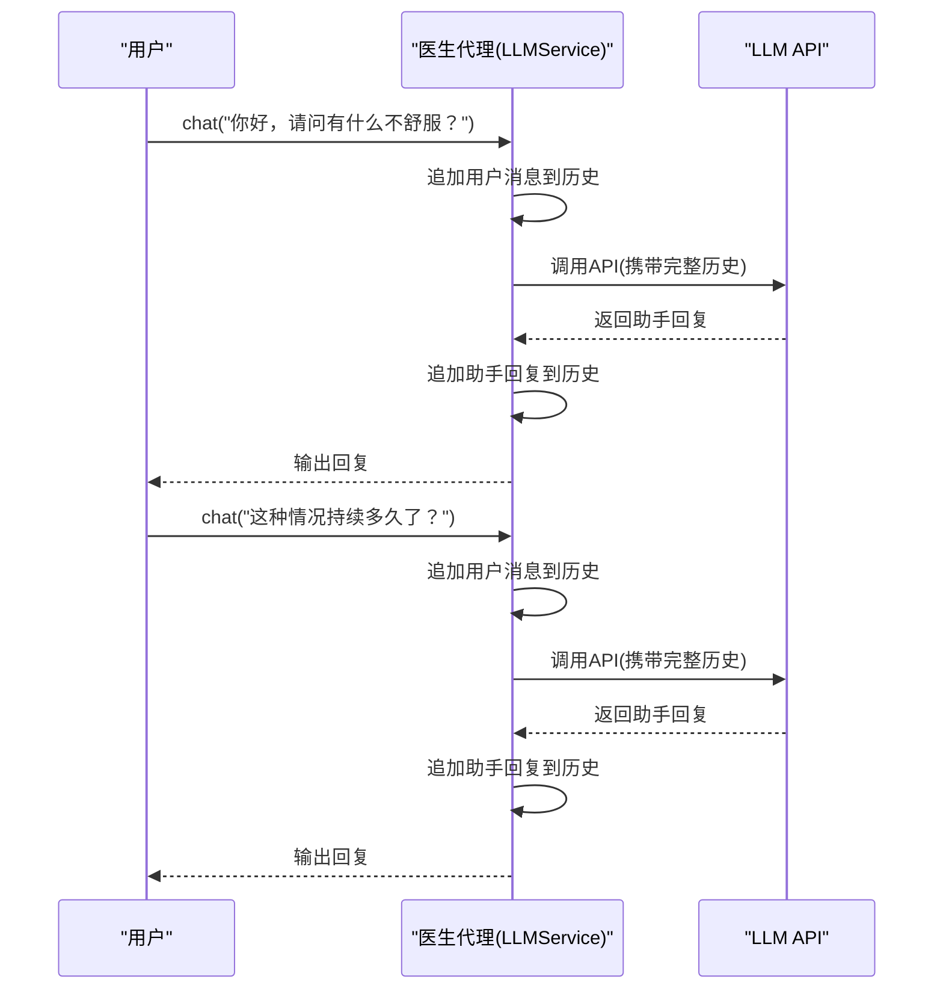
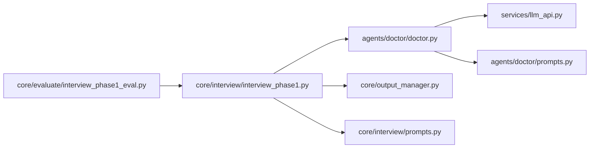

# 医生代理

<cite>
**本文引用的文件**
- [agents/doctor/doctor.py](file://agents/doctor/doctor.py)
- [agents/doctor/prompts.py](file://agents/doctor/prompts.py)
- [services/llm_api.py](file://services/llm_api.py)
- [agents/patient/patient.py](file://agents/patient/patient.py)
- [core/interview/interview_phase1.py](file://core/interview/interview_phase1.py)
- [core/interview/prompts.py](file://core/interview/prompts.py)
- [core/evaluate/interview_phase1_eval.py](file://core/evaluate/interview_phase1_eval.py)
- [core/output_manager.py](file://core/output_manager.py)
- [run_interview.py](file://run_interview.py)
</cite>

## 目录
1. [简介](#简介)
2. [项目结构](#项目结构)
3. [核心组件](#核心组件)
4. [架构总览](#架构总览)
5. [详细组件分析](#详细组件分析)
6. [依赖关系分析](#依赖关系分析)
7. [性能考量](#性能考量)
8. [故障排查指南](#故障排查指南)
9. [结论](#结论)
10. [附录](#附录)

## 简介
本技术文档聚焦“医生代理”模块，系统阐述其设计原理、实现机制与使用方式。重点包括：
- create_doctor 工厂函数的工作流程与角色配置
- 医生代理的系统提示词设计思路与约束
- 如何继承与扩展 LLMService 的能力（上下文管理、多轮对话、历史维护）
- 使用示例：初始化医生代理、发起问诊对话、获取对话历史
- 错误处理机制与最佳实践

## 项目结构
医生代理位于 agents/doctor 子模块，依赖统一的 LLMService 能力与提示词模板。整体交互链路贯穿至核心访谈与评估模块，形成完整的六阶段精神科问诊流程。

图表来源
- [agents/doctor/doctor.py:1-95](file://agents/doctor/doctor.py#L1-L95)
- [agents/doctor/prompts.py:1-21](file://agents/doctor/prompts.py#L1-L21)
- [services/llm_api.py:1-250](file://services/llm_api.py#L1-L250)
- [core/interview/interview_phase1.py:1-200](file://core/interview/interview_phase1.py#L1-L200)
- [core/interview/prompts.py:1-233](file://core/interview/prompts.py#L1-L233)
- [core/output_manager.py:1-189](file://core/output_manager.py#L1-L189)
- [run_interview.py:1-408](file://run_interview.py#L1-L408)

章节来源
- [agents/doctor/doctor.py:1-95](file://agents/doctor/doctor.py#L1-L95)
- [services/llm_api.py:1-250](file://services/llm_api.py#L1-L250)
- [core/interview/interview_phase1.py:1-200](file://core/interview/interview_phase1.py#L1-L200)

## 核心组件
- 医生代理工厂：create_doctor 返回一个已注入系统提示词的 LLMService 实例，角色为 doctor，确保对话以医生身份进行。
- 系统提示词：Doctor Profile 定义医生的行为边界与输出规范，强调“以医生身份发言、每次围绕一个问题、不编造信息、不提前进入后续阶段、仅输出当前轮次内容”等约束。
- LLMService：统一的 LLM 调用封装，负责上下文维护、历史记录、重试机制、系统提示词设置与更新等。

章节来源
- [agents/doctor/doctor.py:32-55](file://agents/doctor/doctor.py#L32-L55)
- [agents/doctor/prompts.py:5-20](file://agents/doctor/prompts.py#L5-L20)
- [services/llm_api.py:79-233](file://services/llm_api.py#L79-L233)

## 架构总览
医生代理通过工厂函数创建 LLMService 实例，并将 Doctor Profile 作为系统提示词注入。随后，医生代理参与完整的六阶段问诊流程，每阶段由核心模块驱动，输出管理器负责持久化对话与中间结果，评估模块对各阶段产出进行质量评估。

图表来源
- [agents/doctor/doctor.py:32-55](file://agents/doctor/doctor.py#L32-L55)
- [services/llm_api.py:113-131](file://services/llm_api.py#L113-L131)
- [core/interview/interview_phase1.py:1-200](file://core/interview/interview_phase1.py#L1-L200)
- [core/output_manager.py:50-169](file://core/output_manager.py#L50-L169)

## 详细组件分析

### 医生代理工厂与角色配置
- 工厂函数 create_doctor
  - 作用：加载 Doctor Profile 作为系统提示词，实例化 LLMService，角色设为 doctor，返回可直接用于对话的实例。
  - 关键点：仅使用 Doctor Profile，不附加额外信息；实例化时传入 role="doctor" 与 system_message。
- 角色别名：init_doctor、start_doctor 作为 create_doctor 的便捷别名，便于快速启动。
- 测试入口：模块内含 __main__，可直接运行进行端到端测试（打印模型与API配置、发起两轮对话、展示上下文维护）。

图表来源
- [agents/doctor/doctor.py:32-55](file://agents/doctor/doctor.py#L32-L55)

章节来源
- [agents/doctor/doctor.py:32-61](file://agents/doctor/doctor.py#L32-L61)
- [agents/doctor/doctor.py:63-95](file://agents/doctor/doctor.py#L63-L95)

### 系统提示词设计与行为约束
- 设计目标：定义医生在问诊场景下的行为模式与输出规范，确保回复聚焦、合规、可评估。
- 关键约束：
  - 必须以医生身份发言
  - 每次仅围绕一个问题展开
  - 基于已知信息与患者回答推进，不编造信息
  - 不提前进入后续阶段任务
  - 仅输出当前轮次应给出的内容
- 作用机制：通过 LLMService 的系统消息注入，影响模型的初始行为与输出风格。

图表来源
- [agents/doctor/prompts.py:5-20](file://agents/doctor/prompts.py#L5-L20)
- [services/llm_api.py:109-111](file://services/llm_api.py#L109-L111)

章节来源
- [agents/doctor/prompts.py:5-20](file://agents/doctor/prompts.py#L5-L20)
- [services/llm_api.py:88-111](file://services/llm_api.py#L88-L111)

### 继承与扩展 LLMService 的能力
- 上下文管理
  - LLMService 在实例生命周期内维护对话历史，chat 调用会自动将用户消息与助手回复加入历史，保证多轮对话连贯性。
  - 支持 chat_with_history 使用指定历史进行推理而不修改当前实例历史。
- 历史维护
  - get_history 返回当前历史副本；clear_history 保留 system 消息并清空其余历史；reset 清空全部历史。
  - set_system_message 支持动态更新系统提示词。
- 错误处理与重试
  - _retry_with_backoff 提供指数退避重试，记录警告日志并在最大重试次数后抛出最后一次异常。
- 多模态支持（扩展能力）
  - chat_with_images 支持图文对话，将图片编码为 base64 并拼接到消息内容中。

图表来源
- [services/llm_api.py:79-233](file://services/llm_api.py#L79-L233)

章节来源
- [services/llm_api.py:113-191](file://services/llm_api.py#L113-L191)
- [services/llm_api.py:144-169](file://services/llm_api.py#L144-L169)
- [services/llm_api.py:192-232](file://services/llm_api.py#L192-L232)

### 多轮对话与历史记录维护
- 对话流程
  - 用户输入消息 → LLMService 将用户消息加入历史 → 调用底层 API → 将助手回复加入历史 → 返回结果。
- 历史操作
  - get_history 返回副本，避免外部修改内部状态
  - clear_history 保留 system 消息，适合在阶段切换时清理上下文
  - reset 完全清空历史，适用于全新对话

图表来源
- [services/llm_api.py:113-131](file://services/llm_api.py#L113-L131)

章节来源
- [services/llm_api.py:113-131](file://services/llm_api.py#L113-L131)

### 使用示例与最佳实践
- 初始化医生代理
  - 通过 create_doctor 获取 LLMService 实例，角色为 doctor，系统提示词为 Doctor Profile。
- 发起问诊对话
  - 使用 doctor.chat 发起单轮或多轮对话，LLMService 自动维护上下文。
- 获取对话历史
  - 使用 doctor.get_history() 获取当前历史副本，便于调试与复盘。
- 最佳实践
  - 保持系统提示词稳定，避免频繁变更导致行为漂移
  - 在阶段切换时使用 clear_history 保留 system 消息，确保上下文可控
  - 对于需要固定历史的推理，使用 chat_with_history 以避免污染当前实例历史

章节来源
- [agents/doctor/doctor.py:32-55](file://agents/doctor/doctor.py#L32-L55)
- [services/llm_api.py:171-183](file://services/llm_api.py#L171-L183)

### 与其他模块的集成
- 与核心流程集成
  - interview_phase1 通过 create_doctor 获取医生实例，驱动 Phase1 的多轮对话收集病史，并通过 output_manager 写入阶段性输出。
  - core/interview/prompts.py 提供各阶段系统提示词模板，医生代理在不同阶段可配合使用。
- 与评估模块集成
  - interview_phase1_eval 对 Phase1 的输出进行评估，涵盖覆盖率、对话统计等指标，医生代理的回复质量直接影响评估结果。

章节来源
- [core/interview/interview_phase1.py:37-46](file://core/interview/interview_phase1.py#L37-L46)
- [core/interview/prompts.py:1-233](file://core/interview/prompts.py#L1-L233)
- [core/evaluate/interview_phase1_eval.py:174-200](file://core/evaluate/interview_phase1_eval.py#L174-L200)

## 依赖关系分析
- 医生代理依赖
  - LLMService：提供统一的聊天接口、上下文管理与系统提示词注入
  - Doctor Profile：定义医生行为边界与输出规范
- 核心流程依赖
  - interview_phase1 依赖医生代理与输出管理器，驱动阶段执行与结果持久化
  - 评估模块依赖阶段输出文件，进行质量评估

图表来源
- [agents/doctor/doctor.py:28-29](file://agents/doctor/doctor.py#L28-L29)
- [services/llm_api.py:79-111](file://services/llm_api.py#L79-L111)
- [core/interview/interview_phase1.py:37-46](file://core/interview/interview_phase1.py#L37-L46)
- [core/output_manager.py:50-83](file://core/output_manager.py#L50-L83)
- [core/interview/prompts.py:1-233](file://core/interview/prompts.py#L1-L233)
- [core/evaluate/interview_phase1_eval.py:174-200](file://core/evaluate/interview_phase1_eval.py#L174-L200)

章节来源
- [agents/doctor/doctor.py:28-29](file://agents/doctor/doctor.py#L28-L29)
- [services/llm_api.py:79-111](file://services/llm_api.py#L79-L111)
- [core/interview/interview_phase1.py:37-46](file://core/interview/interview_phase1.py#L37-L46)

## 性能考量
- 上下文长度控制
  - LLMService 默认使用配置中的 max_tokens，过长的历史会增加 token 消耗与延迟。建议在阶段切换时清理历史或采用摘要策略。
- 重试与超时
  - _retry_with_backoff 提供指数退避，避免瞬时网络波动导致失败；合理设置 timeout 以平衡稳定性与响应速度。
- 多模态开销
  - chat_with_images 会对图片进行 base64 编码并随消息发送，会显著增加 token 与请求体积，需谨慎使用。

章节来源
- [services/llm_api.py:144-169](file://services/llm_api.py#L144-L169)
- [services/llm_api.py:58-76](file://services/llm_api.py#L58-L76)
- [services/llm_api.py:192-232](file://services/llm_api.py#L192-L232)

## 故障排查指南
- API 调用失败
  - 现象：调用底层 API 抛出异常
  - 处理：查看日志中的警告信息；确认 .env 中 DOCTOR_API_* 配置正确；观察重试机制是否生效
- 回复不符合医生行为约束
  - 现象：医生回复包含解释、备注或越权信息
  - 处理：检查 Doctor Profile 是否正确注入；必要时使用 set_system_message 更新系统提示词
- 历史丢失或污染
  - 现象：多轮对话上下文异常
  - 处理：确认未误用 chat_with_history 导致当前历史被覆盖；在阶段切换时使用 clear_history 保留 system 消息
- 输出文件未生成或为空
  - 现象：阶段输出文件缺失或内容为空
  - 处理：确认 output_manager 的输出目录权限与路径；检查 init_phase_output 与 update_phase_output 的调用顺序

章节来源
- [services/llm_api.py:158-169](file://services/llm_api.py#L158-L169)
- [services/llm_api.py:185-190](file://services/llm_api.py#L185-L190)
- [core/output_manager.py:50-114](file://core/output_manager.py#L50-L114)

## 结论
医生代理通过 create_doctor 工厂函数与 Doctor Profile 系统提示词，将 LLMService 的通用能力定制为符合精神科问诊场景的医生角色。其继承的上下文管理、历史维护与错误处理机制，使得多轮对话与阶段化流程得以稳定运行。结合核心流程与评估模块，医生代理构成了完整问诊闭环的关键节点。

## 附录
- 环境变量与配置
  - .env 中应包含 DOCTOR_API_BASE、DOCTOR_API_KEY、DOCTOR_MODEL 等配置项，LLMConfigManager 会据此加载 API 配置。
- 运行完整流程
  - 可通过 run_interview.py 启动六阶段完整流程，医生代理在各阶段间传递上下文，输出管理器负责持久化结果，评估模块对各阶段进行质量评估。

章节来源
- [services/llm_api.py:58-76](file://services/llm_api.py#L58-L76)
- [run_interview.py:46-396](file://run_interview.py#L46-L396)