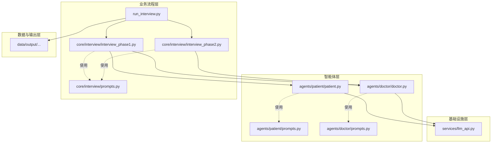
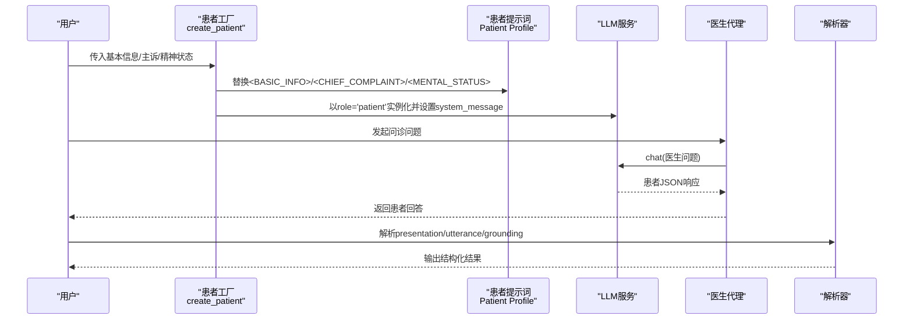
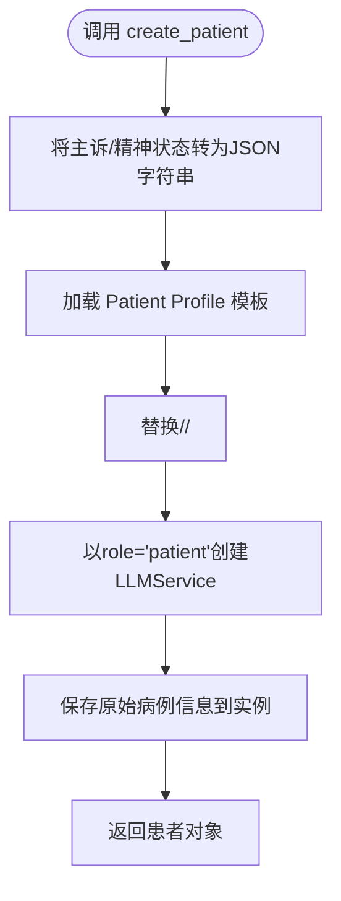
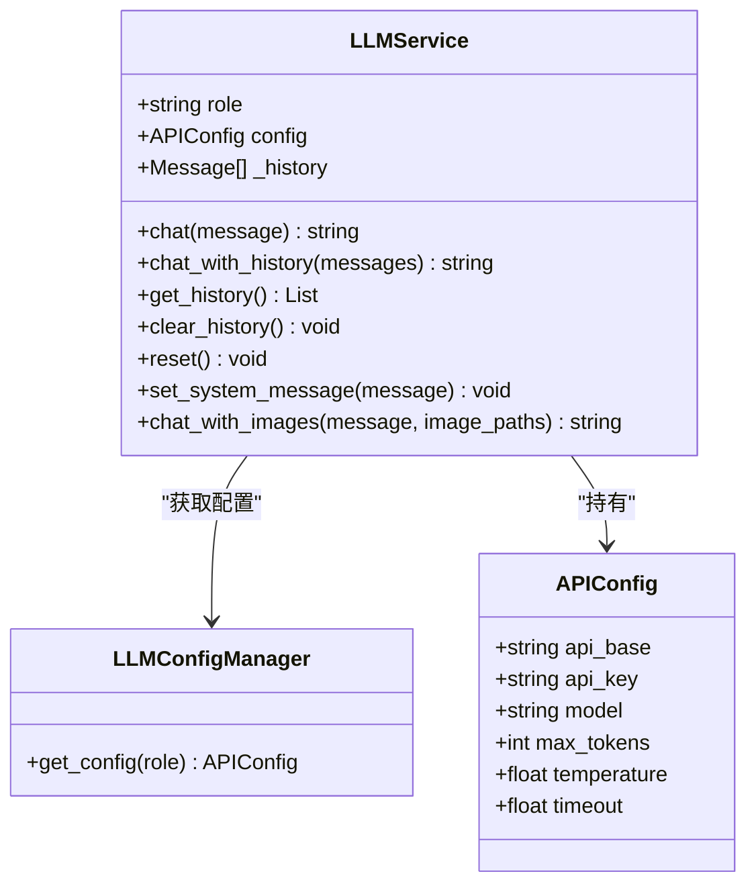
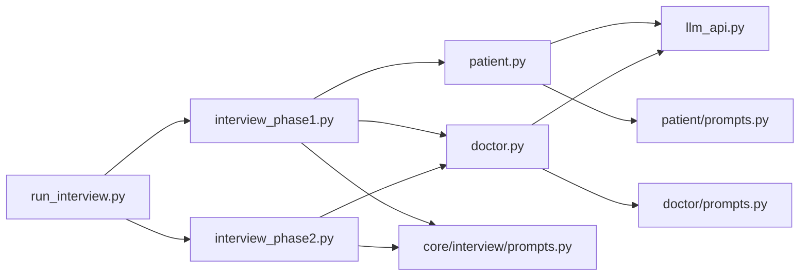

# 患者代理

<cite>
**本文档引用的文件**
- [agents/patient/patient.py](file://agents/patient/patient.py)
- [agents/patient/prompts.py](file://agents/patient/prompts.py)
- [agents/doctor/doctor.py](file://agents/doctor/doctor.py)
- [agents/doctor/prompts.py](file://agents/doctor/prompts.py)
- [services/llm_api.py](file://services/llm_api.py)
- [core/interview/prompts.py](file://core/interview/prompts.py)
- [core/interview/interview_phase1.py](file://core/interview/interview_phase1.py)
- [core/interview/interview_phase2.py](file://core/interview/interview_phase2.py)
- [run_interview.py](file://run_interview.py)
</cite>

## 目录
1. [简介](#简介)
2. [项目结构](#项目结构)
3. [核心组件](#核心组件)
4. [架构总览](#架构总览)
5. [详细组件分析](#详细组件分析)
6. [依赖关系分析](#依赖关系分析)
7. [性能考量](#性能考量)
8. [故障排查指南](#故障排查指南)
9. [结论](#结论)
10. [附录](#附录)

## 简介
本文件面向“患者代理模块”的技术文档，系统阐述其设计理念、实现方式与扩展路径。患者代理基于标准化的病例数据（基本信息、主诉、精神状态），通过大语言模型生成符合情境的患者响应，确保回答严格遵循输入信息与对话上下文，同时具备自然口语化的表达风格与适度的情感渲染能力。文档还涵盖提示词工程策略、不同症状与心理状态的表达处理、情感色彩与语调变化的控制方法，并提供可操作的使用示例与扩展指南，帮助开发者快速创建与定制各类患者角色。

## 项目结构
本项目采用“按职责分层 + 按角色划分”的组织方式：
- agents：智能体层，包含医生、患者、仪器等角色的启动与提示词
- services：基础设施层，封装LLM调用与配置管理
- core：业务流程层，定义六阶段精神科访谈流程与各阶段提示词
- data：数据与输出层，存放病例数据与阶段性输出
- run_interview.py：完整流程入口，串联各阶段并产出汇总结果

图表来源
- [agents/patient/patient.py:1-171](file://agents/patient/patient.py#L1-L171)
- [agents/doctor/doctor.py:1-95](file://agents/doctor/doctor.py#L1-L95)
- [services/llm_api.py:1-250](file://services/llm_api.py#L1-L250)
- [core/interview/prompts.py:1-233](file://core/interview/prompts.py#L1-L233)
- [core/interview/interview_phase1.py:1-462](file://core/interview/interview_phase1.py#L1-L462)
- [core/interview/interview_phase2.py:1-265](file://core/interview/interview_phase2.py#L1-L265)
- [run_interview.py:1-408](file://run_interview.py#L1-L408)

章节来源
- [agents/patient/patient.py:1-171](file://agents/patient/patient.py#L1-L171)
- [agents/doctor/doctor.py:1-95](file://agents/doctor/doctor.py#L1-L95)
- [services/llm_api.py:1-250](file://services/llm_api.py#L1-L250)
- [core/interview/prompts.py:1-233](file://core/interview/prompts.py#L1-L233)
- [core/interview/interview_phase1.py:1-462](file://core/interview/interview_phase1.py#L1-L462)
- [core/interview/interview_phase2.py:1-265](file://core/interview/interview_phase2.py#L1-L265)
- [run_interview.py:1-408](file://run_interview.py#L1-L408)

## 核心组件
- 患者代理工厂：负责接收病例信息，构造系统提示词并实例化LLM服务，返回可对话的患者对象
- 医生代理工厂：负责加载医生系统提示词并实例化LLM服务，支持多轮对话上下文
- LLM服务：统一的LLM调用封装，支持自动维护对话历史、重试与退避、多模态图文对话等
- 提示词库：包含患者角色提示词与各阶段流程提示词，支撑标准化的对话与评估
- 流程编排：将患者与医生组合，驱动六阶段访谈流程，产出阶段性结果与评估

章节来源
- [agents/patient/patient.py:40-92](file://agents/patient/patient.py#L40-L92)
- [agents/doctor/doctor.py:32-55](file://agents/doctor/doctor.py#L32-L55)
- [services/llm_api.py:79-191](file://services/llm_api.py#L79-L191)
- [agents/patient/prompts.py:3-48](file://agents/patient/prompts.py#L3-L48)
- [core/interview/prompts.py:1-233](file://core/interview/prompts.py#L1-L233)

## 架构总览
患者代理的运行链路如下：
- 输入：基本信息、主诉、精神状态
- 构造：将三类信息注入患者提示词模板，形成系统提示
- 实例化：以“patient”角色创建LLM服务，携带系统提示
- 对话：医生发起问题，患者根据系统提示与上下文生成JSON响应
- 解析：解析器抽取presentation、utterance与grounding，用于覆盖率统计与后续阶段

图表来源
- [agents/patient/patient.py:74-83](file://agents/patient/patient.py#L74-L83)
- [agents/patient/prompts.py:5-48](file://agents/patient/prompts.py#L5-L48)
- [services/llm_api.py:113-131](file://services/llm_api.py#L113-L131)
- [core/interview/interview_phase1.py:356-381](file://core/interview/interview_phase1.py#L356-L381)

## 详细组件分析

### 患者代理工厂（create_patient）
- 职责：接收三类病例信息，拼装系统提示词，实例化LLM服务，返回可对话的患者对象
- 关键点：
  - 将列表参数转为JSON字符串，便于模板替换
  - 使用“Patient Profile”模板，替换占位符
  - 以role="patient"创建LLMService，自动维护上下文
  - 将原始病例信息保存在实例属性中，便于调试与复用

图表来源
- [agents/patient/patient.py:69-92](file://agents/patient/patient.py#L69-L92)
- [agents/patient/prompts.py:5-48](file://agents/patient/prompts.py#L5-L48)

章节来源
- [agents/patient/patient.py:40-92](file://agents/patient/patient.py#L40-L92)
- [agents/patient/prompts.py:3-48](file://agents/patient/prompts.py#L3-L48)

### 医生代理工厂（create_doctor）
- 职责：加载医生系统提示词，实例化LLM服务，支持多轮对话上下文
- 关键点：
  - 仅使用“Doctor Profile”，不附加额外信息
  - 以role="doctor"创建LLMService
  - 支持连续对话，上下文自动维护

章节来源
- [agents/doctor/doctor.py:32-55](file://agents/doctor/doctor.py#L32-L55)
- [agents/doctor/prompts.py:5-21](file://agents/doctor/prompts.py#L5-L21)

### LLM服务（LLMService）
- 职责：统一LLM调用接口，维护对话历史，支持重试与退避、多模态图文对话
- 关键点：
  - 从.env读取各角色API配置（BASE/KEY/MODEL/温度/超时等）
  - chat()自动追加用户消息与助手回复，保持上下文
  - 支持chat_with_history()与chat_with_images()等扩展能力
  - 提供get_history()/clear_history()/reset()等工具方法

图表来源
- [services/llm_api.py:58-191](file://services/llm_api.py#L58-L191)

章节来源
- [services/llm_api.py:79-191](file://services/llm_api.py#L79-L191)

### 提示词工程（患者与流程）
- 患者提示词（Patient Profile）：
  - 明确角色边界：仅以患者身份作答，不得编造事实
  - 强制依据：主诉为主要事实依据，精神状态用于外显表现与语气控制
  - 输出格式：JSON对象，包含presentation、utterance与grounding
  - 严格约束：grounding仅在本轮确实使用时填充，不得为凑数而引用无关条目
- 流程提示词（六阶段）：
  - Phase 1：临床历史采集，支持检测“结束访谈”标记
  - Phase 2：检查推荐，要求输出固定标记包裹的JSON数组
  - Phase 3-6：分别进行病历整理、诊断类别识别、诊断假设、鉴别诊断

章节来源
- [agents/patient/prompts.py:5-48](file://agents/patient/prompts.py#L5-L48)
- [core/interview/prompts.py:1-233](file://core/interview/prompts.py#L1-L233)

### 对话解析与覆盖率统计（Phase 1）
- 解析策略：
  - 优先尝试直接JSON解析
  - 若失败且具备修复能力，尝试修复后再解析
  - 最后使用正则提取关键字段，兜底返回原文
- Grounding标注：
  - presentation：本轮可观察到的简短外显表现
  - utterance：患者实际说的话
  - grounding.chief_complaint/mental_status：本轮确实引用的条目

章节来源
- [core/interview/interview_phase1.py:90-191](file://core/interview/interview_phase1.py#L90-L191)

### 六阶段流程编排（run_interview.py）
- 串联六个阶段：历史采集、检查推荐、病历整理、诊断类别识别、诊断假设、鉴别诊断
- 每阶段输出文件与评估指标，最终汇总到summary文件
- 支持从指定病例或随机加载病例开始

章节来源
- [run_interview.py:46-396](file://run_interview.py#L46-L396)

## 依赖关系分析
- 患者代理依赖：
  - LLM服务：提供统一的对话接口与上下文维护
  - 患者提示词：定义角色边界与输出格式
- 医生代理依赖：
  - LLM服务：提供统一的对话接口
  - 医生提示词：定义医生角色与任务
- 流程阶段依赖：
  - Phase 1/2依赖患者与医生代理，以及流程提示词
  - Phase 2还依赖仪器模块（Instrument）进行检查结果评估

图表来源
- [agents/patient/patient.py:36-37](file://agents/patient/patient.py#L36-L37)
- [agents/doctor/doctor.py:28-29](file://agents/doctor/doctor.py#L28-L29)
- [core/interview/interview_phase1.py:38-40](file://core/interview/interview_phase1.py#L38-L40)
- [core/interview/interview_phase2.py:38-40](file://core/interview/interview_phase2.py#L38-L40)
- [run_interview.py:32-43](file://run_interview.py#L32-L43)

章节来源
- [agents/patient/patient.py:36-37](file://agents/patient/patient.py#L36-L37)
- [agents/doctor/doctor.py:28-29](file://agents/doctor/doctor.py#L28-L29)
- [core/interview/interview_phase1.py:38-40](file://core/interview/interview_phase1.py#L38-L40)
- [core/interview/interview_phase2.py:38-40](file://core/interview/interview_phase2.py#L38-L40)
- [run_interview.py:32-43](file://run_interview.py#L32-L43)

## 性能考量
- 上下文管理：LLMService自动维护完整历史，对话轮次越多，上下文越长，可能影响响应速度与成本。建议在阶段间清理不必要的历史或分阶段重置。
- 重试与退避：底层API调用具备指数退避机制，提升稳定性但会增加等待时间。可根据网络环境调整超时与重试次数。
- JSON解析容错：解析器具备多级容错策略，避免因模型输出格式偏差导致流程中断，但修复过程会带来额外开销。
- 并发与批量：当前实现为串行对话，若需并发生成多个患者角色，建议在外部层面对实例进行池化管理。

## 故障排查指南
- 患者响应非标准JSON：
  - 现象：解析失败或grounding为空
  - 处理：启用JSON修复逻辑；若仍失败，检查提示词约束与模型输出格式
- 未正确使用grounding：
  - 现象：grounding中出现未被问及的条目
  - 处理：检查提示词约束，确保仅在本轮确实引用时才填充
- 医生未结束访谈：
  - 现象：超过最大轮次仍未输出结束标记
  - 处理：检查流程提示词与结束标记匹配逻辑，必要时人工干预
- API调用失败：
  - 现象：网络波动导致超时或异常
  - 处理：查看日志与重试记录，确认API配置与网络连通性

章节来源
- [core/interview/interview_phase1.py:102-143](file://core/interview/interview_phase1.py#L102-L143)
- [services/llm_api.py:158-169](file://services/llm_api.py#L158-L169)

## 结论
患者代理模块通过“角色化提示词 + LLM服务 + 流程编排”的方式，实现了对标准化病例数据的高保真模拟。其提示词工程强调“严格依据、自然口语、适度情感”，并通过grounding标注实现对回答内容的可追溯与可评估。在实际应用中，建议结合具体场景优化提示词约束与解析策略，以进一步提升稳定性与一致性。

## 附录

### 使用示例：创建与对话
- 创建患者代理：
  - 传入基本信息、主诉列表、精神状态列表
  - 调用工厂函数，得到可对话的患者对象
- 开始对话：
  - 医生发起问题，患者返回JSON响应
  - 解析JSON，获取presentation、utterance与grounding
- 查看历史：
  - 通过get_history()查看完整对话历史

章节来源
- [agents/patient/patient.py:100-171](file://agents/patient/patient.py#L100-L171)
- [agents/doctor/doctor.py:63-95](file://agents/doctor/doctor.py#L63-L95)

### 扩展性设计与自定义指南
- 新增患者角色：
  - 在提示词库中新增角色模板，定义角色边界与输出格式
  - 在工厂函数中注册新角色，支持不同配置与系统提示
- 自定义症状与心理状态：
  - 在主诉与精神状态中加入更多条目，丰富grounding覆盖
  - 调整提示词约束，平衡“真实感”与“可控性”
- 多模态支持：
  - 使用chat_with_images()扩展图像输入，适用于影像学检查等场景
- 评估与监控：
  - 在流程中集成评估模块，对覆盖率、一致性与情感渲染进行量化评估

章节来源
- [agents/patient/prompts.py:5-48](file://agents/patient/prompts.py#L5-L48)
- [services/llm_api.py:192-232](file://services/llm_api.py#L192-L232)
- [core/interview/interview_phase1.py:241-428](file://core/interview/interview_phase1.py#L241-L428)