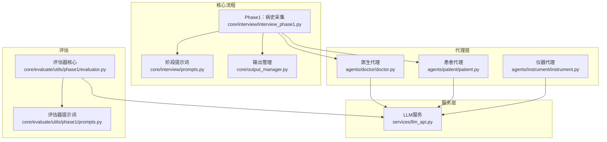
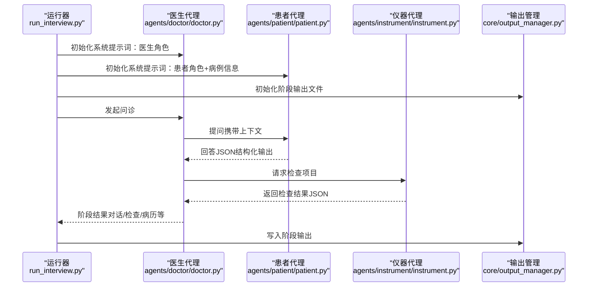
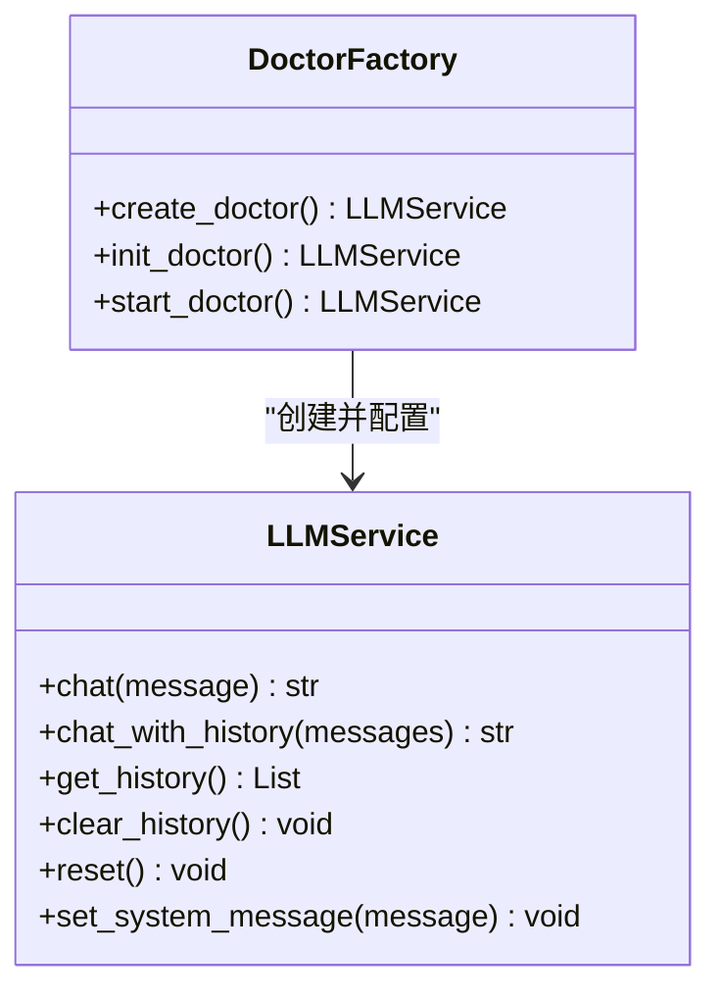
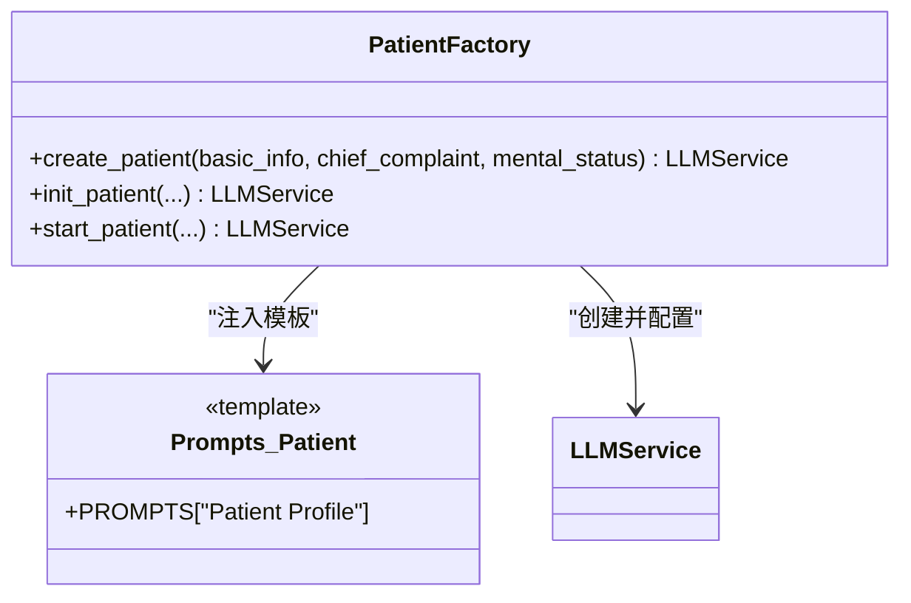
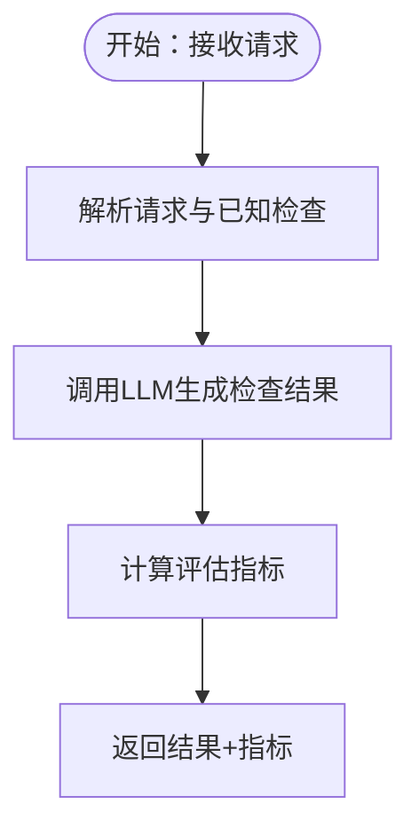
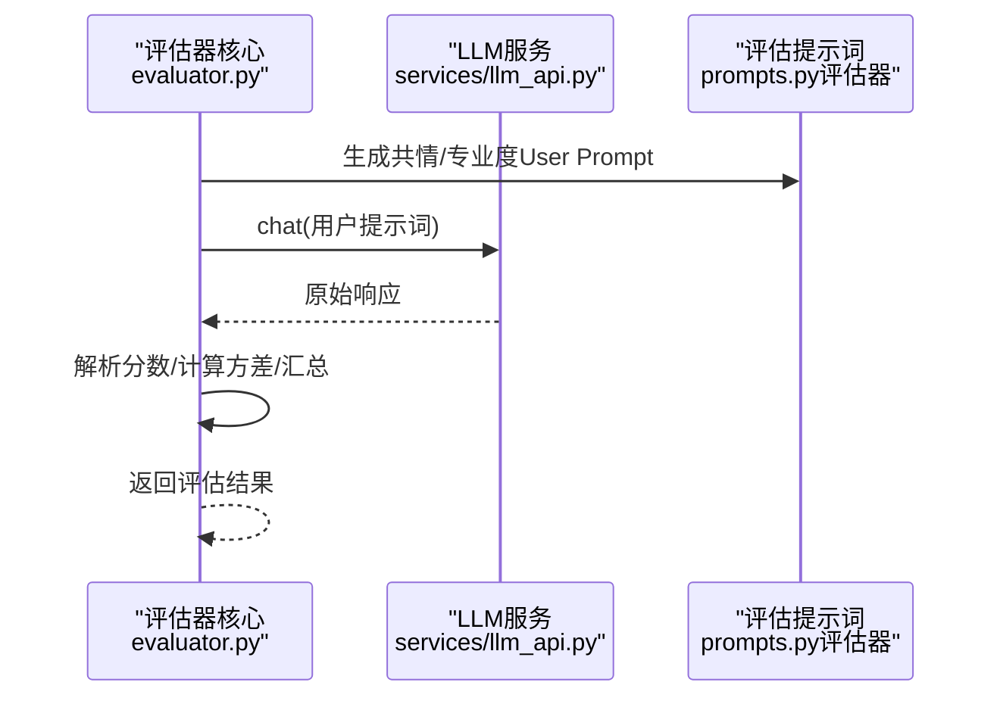
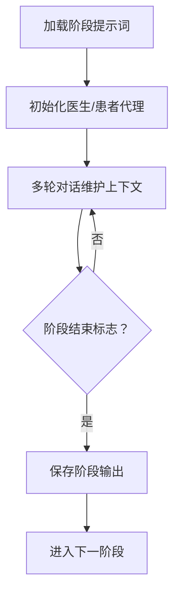
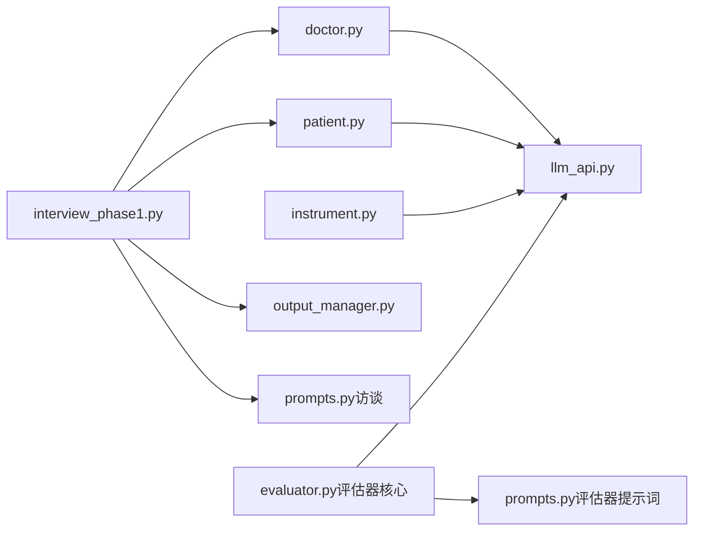

# 智能代理架构

<cite>
**本文档引用的文件**
- [run_interview.py](file://run_interview.py)
- [llm_api.py](file://services/llm_api.py)
- [doctor.py](file://agents/doctor/doctor.py)
- [prompts.py（医生）](file://agents/doctor/prompts.py)
- [patient.py](file://agents/patient/patient.py)
- [prompts.py（患者）](file://agents/patient/prompts.py)
- [instrument.py](file://agents/instrument/instrument.py)
- [prompts.py（仪器）](file://agents/instrument/prompts.py)
- [prompts.py（访谈）](file://core/interview/prompts.py)
- [interview_phase1.py](file://core/interview/interview_phase1.py)
- [output_manager.py](file://core/output_manager.py)
- [evaluator.py（评估器核心）](file://core/evaluate/utils/phase1/evaluator.py)
- [prompts.py（评估器提示词）](file://core/evaluate/utils/phase1/prompts.py)
</cite>

## 目录
1. [简介](#简介)
2. [项目结构](#项目结构)
3. [核心组件](#核心组件)
4. [架构总览](#架构总览)
5. [详细组件分析](#详细组件分析)
6. [依赖分析](#依赖分析)
7. [性能考虑](#性能考虑)
8. [故障排查指南](#故障排查指南)
9. [结论](#结论)
10. [附录](#附录)

## 简介
本项目构建了一个面向精神科问诊的智能代理系统，围绕四种角色代理（医生、患者、仪器、评估器）展开，采用统一的LLM服务层与提示词工程，实现从“病史采集—检查推荐—临床病历—诊断类别识别—诊断假设—鉴别诊断”的完整六阶段流程。系统通过工厂化的代理创建函数与阶段化执行模块，确保代理间协作有序、上下文连贯、输出可评估。

## 项目结构
项目采用按功能域划分的层次化组织：
- agents：代理层，封装不同角色的提示词与创建逻辑
- core：核心业务流程与评估模块
- services：通用LLM服务与配置管理
- data：输出目录结构与评估结果落盘
- scripts/test：测试脚本
- run_interview.py：端到端流程入口

图表来源
- [run_interview.py:1-408](file://run_interview.py#L1-L408)
- [llm_api.py:1-250](file://services/llm_api.py#L1-L250)
- [doctor.py:1-95](file://agents/doctor/doctor.py#L1-L95)
- [patient.py:1-171](file://agents/patient/patient.py#L1-L171)
- [instrument.py:1-243](file://agents/instrument/instrument.py#L1-L243)
- [prompts.py（访谈）:1-233](file://core/interview/prompts.py#L1-L233)
- [interview_phase1.py:1-200](file://core/interview/interview_phase1.py#L1-L200)
- [output_manager.py:1-189](file://core/output_manager.py#L1-L189)
- [evaluator.py（评估器核心）:1-160](file://core/evaluate/utils/phase1/evaluator.py#L1-L160)
- [prompts.py（评估器提示词）:1-280](file://core/evaluate/utils/phase1/prompts.py#L1-L280)

章节来源
- [run_interview.py:1-408](file://run_interview.py#L1-L408)
- [llm_api.py:1-250](file://services/llm_api.py#L1-L250)
- [prompts.py（访谈）:1-233](file://core/interview/prompts.py#L1-L233)

## 核心组件
- LLM服务层（LLMService）：统一管理API配置、对话历史、重试与多模态能力，为各代理提供一致的对话接口。
- 代理工厂函数：分别为医生、患者、仪器代理提供创建入口，注入角色专属系统提示词与上下文。
- 阶段化流程：以阶段提示词为驱动，串联各代理完成问诊与产出。
- 输出管理：统一管理各阶段输出文件路径与增量写入，便于评估与复盘。
- 评估器：基于专业度与共情度量表，对医生表现进行自动化评估。

章节来源
- [llm_api.py:79-233](file://services/llm_api.py#L79-L233)
- [doctor.py:32-55](file://agents/doctor/doctor.py#L32-L55)
- [patient.py:40-92](file://agents/patient/patient.py#L40-L92)
- [instrument.py:13-45](file://agents/instrument/instrument.py#L13-L45)
- [output_manager.py:20-115](file://core/output_manager.py#L20-L115)
- [evaluator.py（评估器核心）:50-160](file://core/evaluate/utils/phase1/evaluator.py#L50-L160)

## 架构总览
系统采用“代理+流程+评估”的三层架构：
- 代理层：负责角色扮演与对话生成，通过系统提示词约束行为边界。
- 流程层：以阶段提示词为契约，驱动代理协作完成任务。
- 评估层：对流程产物进行指标化评估，支撑迭代优化。

图表来源
- [run_interview.py:46-396](file://run_interview.py#L46-L396)
- [doctor.py:32-55](file://agents/doctor/doctor.py#L32-L55)
- [patient.py:40-92](file://agents/patient/patient.py#L40-L92)
- [instrument.py:13-45](file://agents/instrument/instrument.py#L13-L45)
- [output_manager.py:50-115](file://core/output_manager.py#L50-L115)

## 详细组件分析

### 医生代理（Doctor Agent）
- 设计模式：工厂函数 + 系统提示词注入
- 职责：以医生身份发起问诊、推进流程、协调患者与仪器代理
- 上下文管理：通过LLMService维护全局对话历史，保证多轮连贯
- 提示词工程：强调角色定位、问题聚焦、事实依据与阶段边界

图表来源
- [llm_api.py:79-233](file://services/llm_api.py#L79-L233)
- [doctor.py:32-61](file://agents/doctor/doctor.py#L32-L61)

章节来源
- [doctor.py:1-95](file://agents/doctor/doctor.py#L1-L95)
- [prompts.py（医生）:5-20](file://agents/doctor/prompts.py#L5-L20)
- [llm_api.py:79-191](file://services/llm_api.py#L79-L191)

### 患者代理（Patient Agent）
- 设计模式：工厂函数 + 系统提示词模板 + 占位符替换
- 职责：基于病例信息与对话上下文，结构化输出“外显表现+话语+grounding”
- 数据结构：JSON对象，包含presentation、utterance、grounding（主诉与精神状态引用）
- 提示词工程：严格限定grounding来源，避免编造信息

图表来源
- [patient.py:40-97](file://agents/patient/patient.py#L40-L97)
- [prompts.py（患者）:3-47](file://agents/patient/prompts.py#L3-L47)
- [llm_api.py:79-191](file://services/llm_api.py#L79-L191)

章节来源
- [patient.py:1-171](file://agents/patient/patient.py#L1-L171)
- [prompts.py（患者）:1-48](file://agents/patient/prompts.py#L1-L48)

### 仪器代理（Instrument Agent）
- 设计模式：工厂函数 + 系统提示词 + 评估指标计算
- 职责：根据医生请求的检查项目，从已知辅助检查中匹配并返回结果
- 数据传递：通过exam_info携带请求与已知检查，供后续评估使用
- 指标计算：提供标准化评估指标（精确率、召回率、F1、Jaccard）

图表来源
- [instrument.py:166-182](file://agents/instrument/instrument.py#L166-L182)
- [instrument.py:78-163](file://agents/instrument/instrument.py#L78-L163)

章节来源
- [instrument.py:1-243](file://agents/instrument/instrument.py#L1-L243)
- [prompts.py（仪器）:3-57](file://agents/instrument/prompts.py#L3-L57)

### 评估器代理（Evaluator Agent）
- 设计模式：提示词驱动 + 量表评分 + 并行评估
- 职责：对医生表现进行专业度与共情度评分，支持并行计算提升效率
- 提示词工程：严格的评分规则、证据导向与独立判题原则

图表来源
- [evaluator.py（评估器核心）:50-160](file://core/evaluate/utils/phase1/evaluator.py#L50-L160)
- [prompts.py（评估器提示词）:111-279](file://core/evaluate/utils/phase1/prompts.py#L111-L279)
- [llm_api.py:237-249](file://services/llm_api.py#L237-L249)

章节来源
- [evaluator.py（评估器核心）:1-160](file://core/evaluate/utils/phase1/evaluator.py#L1-L160)
- [prompts.py（评估器提示词）:1-280](file://core/evaluate/utils/phase1/prompts.py#L1-L280)

### 阶段化流程与上下文管理
- 阶段提示词：以固定格式约束各阶段任务边界与输出结构
- 上下文管理：LLMService在实例生命周期内维护历史，确保跨轮次连贯
- 输出管理：统一输出目录与文件命名，支持增量写入与状态更新

图表来源
- [prompts.py（访谈）:1-233](file://core/interview/prompts.py#L1-L233)
- [interview_phase1.py:194-200](file://core/interview/interview_phase1.py#L194-L200)
- [llm_api.py:113-131](file://services/llm_api.py#L113-L131)
- [output_manager.py:50-115](file://core/output_manager.py#L50-L115)

章节来源
- [interview_phase1.py:1-200](file://core/interview/interview_phase1.py#L1-L200)
- [prompts.py（访谈）:1-233](file://core/interview/prompts.py#L1-L233)
- [output_manager.py:1-189](file://core/output_manager.py#L1-L189)

## 依赖分析
- 代理到服务层：医生、患者、仪器代理均依赖LLMService提供统一对话能力
- 流程到代理：阶段化流程通过工厂函数创建代理，传递上下文与数据
- 评估到流程：评估器读取阶段输出，基于提示词进行评分
- 输出到流程：输出管理贯穿各阶段，保障数据一致性与可追溯性

图表来源
- [doctor.py:28-29](file://agents/doctor/doctor.py#L28-L29)
- [patient.py:36-37](file://agents/patient/patient.py#L36-L37)
- [instrument.py:9-10](file://agents/instrument/instrument.py#L9-L10)
- [interview_phase1.py:38-46](file://core/interview/interview_phase1.py#L38-L46)
- [evaluator.py（评估器核心）:11-18](file://core/evaluate/utils/phase1/evaluator.py#L11-L18)

章节来源
- [run_interview.py:32-43](file://run_interview.py#L32-L43)
- [llm_api.py:58-77](file://services/llm_api.py#L58-L77)

## 性能考虑
- API重试与指数退避：降低网络波动对流程稳定性的影响
- 并行评估：评估器对共情与专业度采用线程池并行，缩短总耗时
- 增量写入：输出管理采用即时写入策略，减少内存占用并提升可观测性
- 上下文长度控制：通过最大token与温度参数平衡创造性与稳定性

章节来源
- [llm_api.py:158-169](file://services/llm_api.py#L158-L169)
- [evaluator.py（评估器核心）:145-154](file://core/evaluate/utils/phase1/evaluator.py#L145-L154)
- [output_manager.py:86-115](file://core/output_manager.py#L86-L115)

## 故障排查指南
- API调用失败：检查.env中对应角色的API配置，确认网络与鉴权；查看重试日志
- JSON解析异常：患者代理支持JSON修复与正则提取兜底；评估器对空对话抛出明确异常
- 输出文件缺失：确认输出目录权限与路径拼接逻辑
- 指标计算异常：核对请求与已知检查的JSON格式与键值数量一致性

章节来源
- [llm_api.py:158-169](file://services/llm_api.py#L158-L169)
- [interview_phase1.py:90-144](file://core/interview/interview_phase1.py#L90-L144)
- [output_manager.py:171-189](file://core/output_manager.py#L171-L189)
- [instrument.py:166-182](file://agents/instrument/instrument.py#L166-L182)

## 结论
本系统通过“工厂化代理+阶段化流程+评估驱动”的设计，实现了可控、可观测、可评估的智能问诊流程。提示词工程在角色约束、输出结构与评估标准方面发挥关键作用；LLM服务层提供统一能力抽象；输出管理与评估模块保障流程闭环与持续改进。该架构具备良好的扩展性，便于新增代理与评估维度。

## 附录
- 扩展性设计建议
  - 新增代理：遵循工厂函数与系统提示词注入模式，复用LLMService与输出管理
  - 新增阶段：在阶段提示词中定义输出结构，接入现有流程编排
  - 新增评估：基于量表提示词与评分规则，复用评估器核心逻辑
- 自定义代理开发指南
  - 明确角色边界与系统提示词
  - 设计稳定的输出结构（如JSON字段）
  - 通过.env配置API参数，确保可移植性
  - 使用输出管理模块进行数据落盘与状态更新