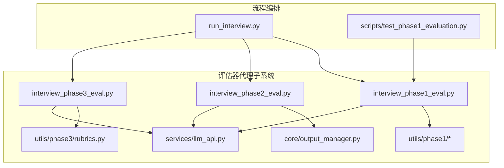
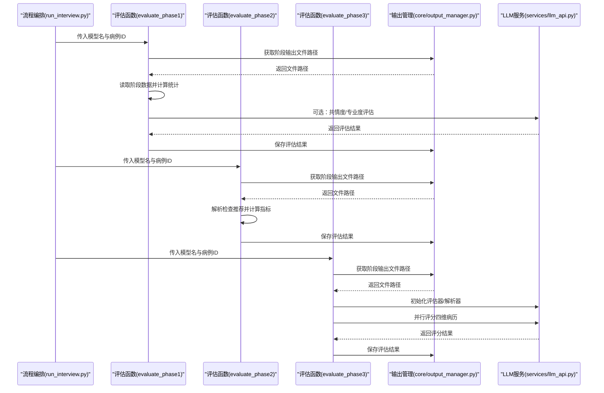
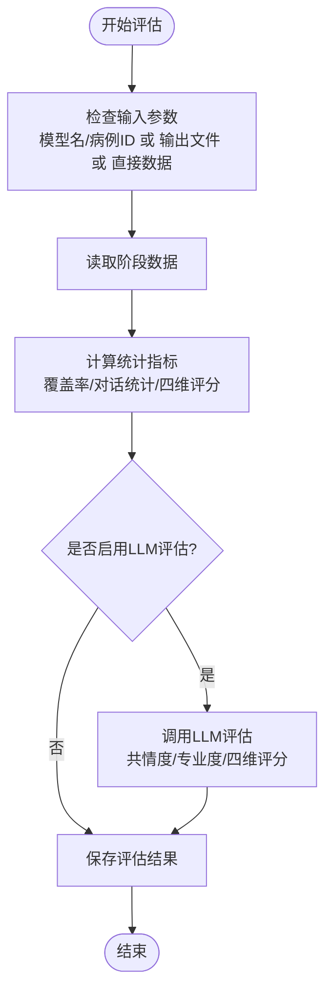
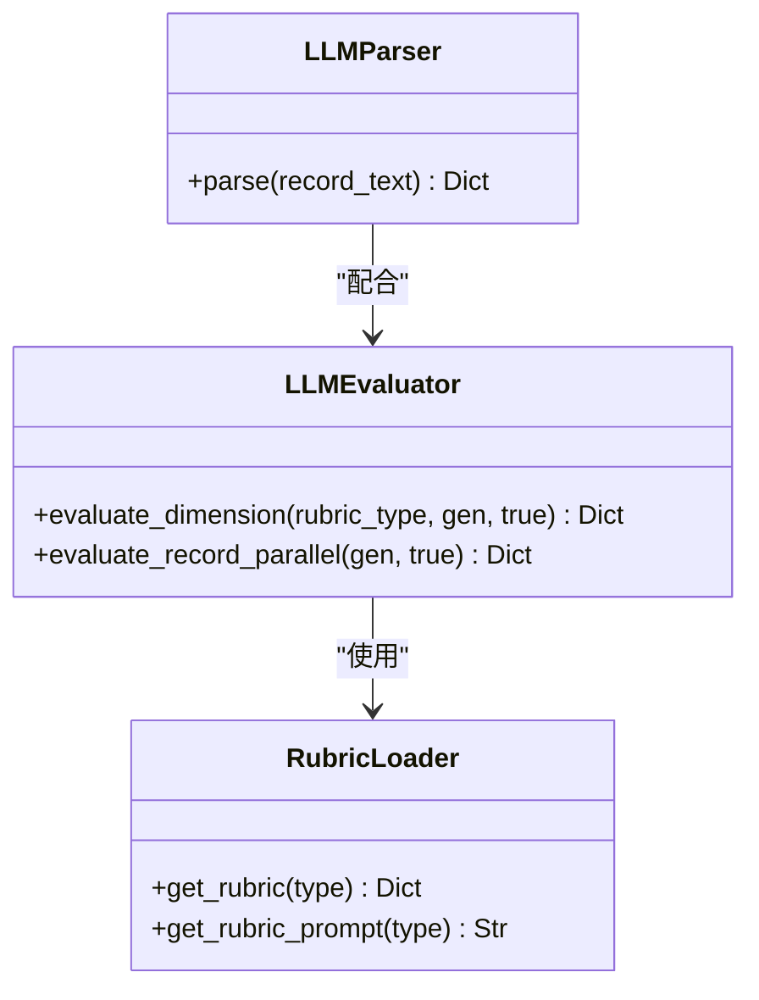
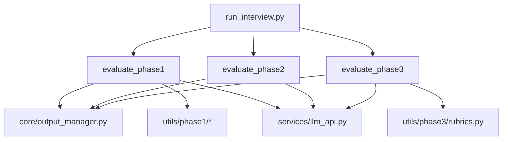

# 评估器代理

<cite>
**本文引用的文件**
- [run_interview.py](file://run_interview.py)
- [core/evaluate/__init__.py](file://core/evaluate/__init__.py)
- [core/evaluate/interview_phase1_eval.py](file://core/evaluate/interview_phase1_eval.py)
- [core/evaluate/interview_phase2_eval.py](file://core/evaluate/interview_phase2_eval.py)
- [core/evaluate/interview_phase3_eval.py](file://core/evaluate/interview_phase3_eval.py)
- [core/evaluate/utils/phase1/__init__.py](file://core/evaluate/utils/phase1/__init__.py)
- [core/evaluate/utils/phase1/evaluator.py](file://core/evaluate/utils/phase1/evaluator.py)
- [core/evaluate/utils/phase3/rubrics.py](file://core/evaluate/utils/phase3/rubrics.py)
- [core/output_manager.py](file://core/output_manager.py)
- [services/llm_api.py](file://services/llm_api.py)
- [scripts/test_phase1_evaluation.py](file://scripts/test_phase1_evaluation.py)
- [eval_interview/scale.json](file://eval_interview/scale.json)
- [eval_interview/profession_scale.json](file://eval_interview/profession_scale.json)
</cite>

## 目录
1. [简介](#简介)
2. [项目结构](#项目结构)
3. [核心组件](#核心组件)
4. [架构总览](#架构总览)
5. [详细组件分析](#详细组件分析)
6. [依赖分析](#依赖分析)
7. [性能考量](#性能考量)
8. [故障排查指南](#故障排查指南)
9. [结论](#结论)
10. [附录](#附录)

## 简介
本文件面向“评估器代理”模块，系统性阐述其在精神科问诊流程中的设计与实现，重点包括：
- 评估器代理在问诊流程中的嵌入方式与自动化评估机制
- 评估器代理的工厂式接口设计与不同评估阶段的实例化策略
- 评估器代理与评估模块的协作流程：数据采集、处理与分析
- 初始化、执行与结果获取的使用示例
- 配置选项、性能优化与扩展开发指南

评估器代理并非一个独立的“类”，而是由一组可复用的评估函数与工具模块构成的“评估子系统”。它通过统一的评估入口与阶段化评估函数，将评估逻辑与问诊流程解耦，便于在完整问诊链路中按阶段自动触发。

## 项目结构
评估器代理位于 core/evaluate 目录，按阶段拆分评估逻辑，并通过工具模块提供评分标准与提示词。核心文件如下：
- 阶段评估入口：interview_phase1_eval.py、interview_phase2_eval.py、interview_phase3_eval.py
- 评估模块聚合：core/evaluate/__init__.py
- 输出管理：core/output_manager.py
- LLM服务：services/llm_api.py
- 工具模块：core/evaluate/utils/phase1 与 core/evaluate/utils/phase3
- 完整流程编排：run_interview.py
- 测试脚本：scripts/test_phase1_evaluation.py
- 评估尺度：eval_interview/scale.json、eval_interview/profession_scale.json

**图表来源**
- [run_interview.py](file://run_interview.py)
- [core/evaluate/interview_phase1_eval.py](file://core/evaluate/interview_phase1_eval.py)
- [core/evaluate/interview_phase2_eval.py](file://core/evaluate/interview_phase2_eval.py)
- [core/evaluate/interview_phase3_eval.py](file://core/evaluate/interview_phase3_eval.py)
- [core/evaluate/utils/phase1/__init__.py](file://core/evaluate/utils/phase1/__init__.py)
- [core/evaluate/utils/phase3/rubrics.py](file://core/evaluate/utils/phase3/rubrics.py)
- [core/output_manager.py](file://core/output_manager.py)
- [services/llm_api.py](file://services/llm_api.py)
- [scripts/test_phase1_evaluation.py](file://scripts/test_phase1_evaluation.py)

**章节来源**
- [core/evaluate/__init__.py](file://core/evaluate/__init__.py)
- [run_interview.py](file://run_interview.py)
- [core/output_manager.py](file://core/output_manager.py)

## 核心组件
- 阶段化评估函数族
  - evaluate_phase1：覆盖度统计、对话统计、可选共情度与专业度LLM评估
  - evaluate_phase2：基于检查推荐的指标计算（Precision/Recall/F1/Jaccard）
  - evaluate_phase3：四维病历评分（主诉、体格、精神、既往史），支持并行评估
- 评估工具模块
  - Phase 1：共情度/专业度评估器与评分尺度
  - Phase 3：评分标准（rubrics）与病历结构化解析器
- 输出管理
  - 统一输出目录与文件命名规范，支持初始化、追加与读取
- LLM服务
  - 通用LLM服务封装，按角色提供实例，内置重试与上下文管理

**章节来源**
- [core/evaluate/interview_phase1_eval.py](file://core/evaluate/interview_phase1_eval.py)
- [core/evaluate/interview_phase2_eval.py](file://core/evaluate/interview_phase2_eval.py)
- [core/evaluate/interview_phase3_eval.py](file://core/evaluate/interview_phase3_eval.py)
- [core/evaluate/utils/phase1/evaluator.py](file://core/evaluate/utils/phase1/evaluator.py)
- [core/evaluate/utils/phase3/rubrics.py](file://core/evaluate/utils/phase3/rubrics.py)
- [core/output_manager.py](file://core/output_manager.py)
- [services/llm_api.py](file://services/llm_api.py)

## 架构总览
评估器代理采用“阶段化评估 + 工具模块 + LLM服务”的分层架构：
- 上层：流程编排（run_interview.py）在各阶段完成后调用对应评估函数
- 中层：评估函数负责数据读取、统计计算、可选LLM评估与结果持久化
- 下层：工具模块提供评分尺度、提示词与结构化解析；LLM服务提供统一推理能力

**图表来源**
- [run_interview.py](file://run_interview.py)
- [core/evaluate/interview_phase1_eval.py](file://core/evaluate/interview_phase1_eval.py)
- [core/evaluate/interview_phase2_eval.py](file://core/evaluate/interview_phase2_eval.py)
- [core/evaluate/interview_phase3_eval.py](file://core/evaluate/interview_phase3_eval.py)
- [core/output_manager.py](file://core/output_manager.py)
- [services/llm_api.py](file://services/llm_api.py)

## 详细组件分析

### 组件A：阶段化评估函数族
- evaluate_phase1
  - 输入：模型名/病例ID 或 输出文件路径 或 直接数据
  - 功能：覆盖率统计、对话统计、可选共情度/专业度LLM评估（支持并行）
  - 输出：评估结果字典与持久化文件路径
- evaluate_phase2
  - 输入：模型名/病例ID 或 输出文件路径 或 直接数据
  - 功能：解析检查推荐结果，与金标准对比，计算Precision/Recall/F1/Jaccard
  - 输出：评估指标与统计信息
- evaluate_phase3
  - 输入：模型名/病例ID 或 输出文件路径 或 直接数据
  - 功能：病历四维结构化解析，基于rubrics评分，支持多线程并行
  - 输出：总分百分比、维度详情与持久化文件路径

**图表来源**
- [core/evaluate/interview_phase1_eval.py](file://core/evaluate/interview_phase1_eval.py)
- [core/evaluate/interview_phase2_eval.py](file://core/evaluate/interview_phase2_eval.py)
- [core/evaluate/interview_phase3_eval.py](file://core/evaluate/interview_phase3_eval.py)

**章节来源**
- [core/evaluate/interview_phase1_eval.py](file://core/evaluate/interview_phase1_eval.py)
- [core/evaluate/interview_phase2_eval.py](file://core/evaluate/interview_phase2_eval.py)
- [core/evaluate/interview_phase3_eval.py](file://core/evaluate/interview_phase3_eval.py)

### 组件B：评估工具模块
- Phase 1 评估器
  - 共情度/专业度评估器：解析模型响应中的分数，计算平均分与方差
  - 提示词与尺度：来自评估尺度JSON文件
- Phase 3 评分标准与解析器
  - rubrics：四维评分标准（权重、评分项、覆盖度/准确度定义）
  - LLMParser：将病历文本结构化为四段
  - LLMEvaluator：基于rubrics对生成病历与真值病历逐项对比评分，支持并行

**图表来源**
- [core/evaluate/utils/phase3/rubrics.py](file://core/evaluate/utils/phase3/rubrics.py)
- [core/evaluate/interview_phase3_eval.py](file://core/evaluate/interview_phase3_eval.py)

**章节来源**
- [core/evaluate/utils/phase1/evaluator.py](file://core/evaluate/utils/phase1/evaluator.py)
- [core/evaluate/utils/phase3/rubrics.py](file://core/evaluate/utils/phase3/rubrics.py)
- [eval_interview/scale.json](file://eval_interview/scale.json)
- [eval_interview/profession_scale.json](file://eval_interview/profession_scale.json)

### 组件C：输出管理与持久化
- 统一输出目录结构：data/output/interview/{model_name}/{case_id}/ 与 data/output/evaluation/{model_name}/{case_id}/
- 提供获取阶段输出文件路径、初始化阶段输出、追加对话、读取阶段输出等能力
- 评估函数在计算完成后将结果写入evaluation_*_output.json

**章节来源**
- [core/output_manager.py](file://core/output_manager.py)
- [core/evaluate/interview_phase1_eval.py](file://core/evaluate/interview_phase1_eval.py)
- [core/evaluate/interview_phase2_eval.py](file://core/evaluate/interview_phase2_eval.py)
- [core/evaluate/interview_phase3_eval.py](file://core/evaluate/interview_phase3_eval.py)

### 组件D：LLM服务与评估器实例化
- LLMService：按角色（patient/doctor/evaluator）提供实例，维护对话历史，支持重试与系统提示词
- 评估器代理通过LLMService在需要时创建评估所需的推理实例，确保评估逻辑与问诊解耦

**章节来源**
- [services/llm_api.py](file://services/llm_api.py)
- [core/evaluate/interview_phase1_eval.py](file://core/evaluate/interview_phase1_eval.py)
- [core/evaluate/interview_phase3_eval.py](file://core/evaluate/interview_phase3_eval.py)

## 依赖分析
- 评估函数依赖输出管理模块获取阶段输出文件路径
- Phase 1 评估依赖工具模块中的评估器与尺度
- Phase 3 评估依赖rubrics与LLM服务进行结构化解析与评分
- 流程编排文件在各阶段结束后调用对应评估函数，形成闭环

**图表来源**
- [run_interview.py](file://run_interview.py)
- [core/evaluate/interview_phase1_eval.py](file://core/evaluate/interview_phase1_eval.py)
- [core/evaluate/interview_phase2_eval.py](file://core/evaluate/interview_phase2_eval.py)
- [core/evaluate/interview_phase3_eval.py](file://core/evaluate/interview_phase3_eval.py)
- [core/output_manager.py](file://core/output_manager.py)
- [services/llm_api.py](file://services/llm_api.py)

**章节来源**
- [core/evaluate/__init__.py](file://core/evaluate/__init__.py)
- [run_interview.py](file://run_interview.py)

## 性能考量
- 并行评估
  - Phase 1：可并行执行共情度与专业度评估，减少等待时间
  - Phase 3：四维评分使用线程池并行，显著提升大样本或多病历场景下的吞吐
- I/O与持久化
  - 评估结果写入独立evaluation_*_output.json，避免与问诊输出相互阻塞
- LLM调用
  - LLMService内置指数退避重试，降低外部API抖动对评估流程的影响
- 数据读取
  - 评估函数支持三种数据来源（模型名+病例ID、输出文件、直接数据），减少重复I/O

**章节来源**
- [core/evaluate/interview_phase1_eval.py](file://core/evaluate/interview_phase1_eval.py)
- [core/evaluate/interview_phase3_eval.py](file://core/evaluate/interview_phase3_eval.py)
- [services/llm_api.py](file://services/llm_api.py)

## 故障排查指南
- 常见错误
  - 缺少必要参数：当未提供模型名/病例ID、输出文件或直接数据时，评估函数会抛出参数错误
  - LLM评估失败：评估函数捕获异常并打印错误栈，便于定位提示词或模型响应格式问题
  - 文件不存在：输出目录或阶段输出文件缺失时，需先运行对应问诊阶段
- 排查步骤
  - 确认输出目录存在且包含对应阶段输出文件
  - 检查评估函数调用参数是否正确
  - 查看评估函数返回的输出文件路径，打开JSON确认字段完整性
  - 若启用LLM评估，检查环境变量与LLM服务可用性
- 相关文件
  - 评估函数内部的异常捕获与日志打印
  - LLM服务的重试与超时配置

**章节来源**
- [core/evaluate/interview_phase1_eval.py](file://core/evaluate/interview_phase1_eval.py)
- [core/evaluate/interview_phase2_eval.py](file://core/evaluate/interview_phase2_eval.py)
- [core/evaluate/interview_phase3_eval.py](file://core/evaluate/interview_phase3_eval.py)
- [services/llm_api.py](file://services/llm_api.py)

## 结论
评估器代理通过“阶段化评估 + 工具模块 + LLM服务”的架构，在不侵入问诊流程的前提下实现了自动化、可扩展的评估能力。其工厂式接口（各阶段评估函数）与统一输出管理，使得在完整问诊流程中嵌入评估成为标准化操作。借助并行评估与稳健的LLM服务，评估器代理在性能与可靠性方面具备良好表现，适合在大规模、多模型、多病例场景中部署与迭代。

## 附录

### 使用示例
- 初始化与执行
  - 在完整流程中，流程编排文件会在各阶段结束后自动调用评估函数
  - 单独测试Phase 1评估：参考测试脚本，传入模型名与病例ID，启用共情度与专业度评估并并行执行
- 获取评估结果
  - 评估函数返回包含统计指标与输出文件路径的结果字典
  - 评估结果同时持久化至evaluation_*_output.json，便于后续分析与报告生成

**章节来源**
- [run_interview.py](file://run_interview.py)
- [scripts/test_phase1_evaluation.py](file://scripts/test_phase1_evaluation.py)
- [core/evaluate/interview_phase1_eval.py](file://core/evaluate/interview_phase1_eval.py)

### 配置选项与扩展开发
- 配置选项
  - Phase 1：enable_empathy_eval、enable_profession_eval、parallel_eval
  - Phase 2：直接传入阶段数据或输出文件路径
  - Phase 3：可传入真值病历或从ground truth文件加载
- 扩展开发
  - 新增评估阶段：仿照现有阶段评估函数，实现数据读取、统计与可选LLM评估，并接入输出管理
  - 新增评分标准：在utils/phase3/rubrics.py中新增rubric条目，更新权重与评分项
  - 新增评估尺度：在评估尺度JSON中添加条目，更新评估器解析逻辑
  - 优化LLM服务：根据评估需求调整系统提示词、温度与最大token数

**章节来源**
- [core/evaluate/interview_phase1_eval.py](file://core/evaluate/interview_phase1_eval.py)
- [core/evaluate/interview_phase2_eval.py](file://core/evaluate/interview_phase2_eval.py)
- [core/evaluate/interview_phase3_eval.py](file://core/evaluate/interview_phase3_eval.py)
- [core/evaluate/utils/phase3/rubrics.py](file://core/evaluate/utils/phase3/rubrics.py)
- [eval_interview/scale.json](file://eval_interview/scale.json)
- [eval_interview/profession_scale.json](file://eval_interview/profession_scale.json)
- [services/llm_api.py](file://services/llm_api.py)