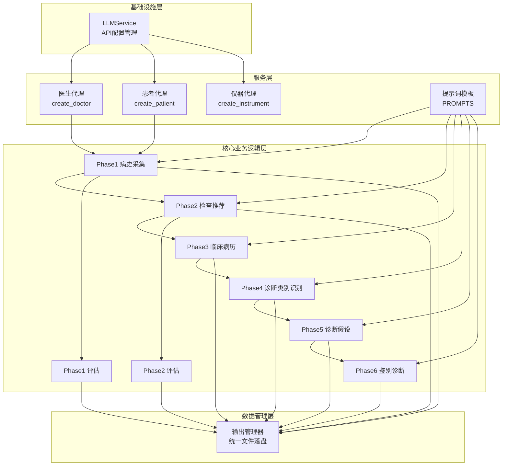
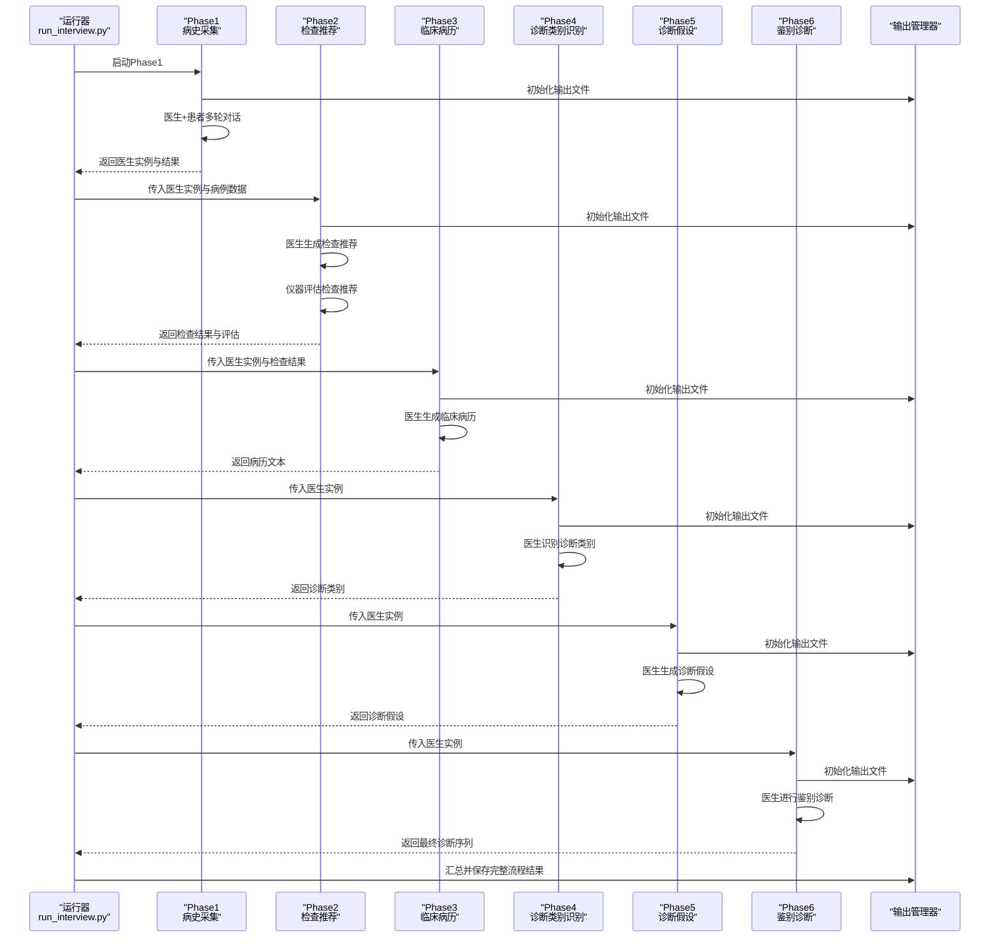
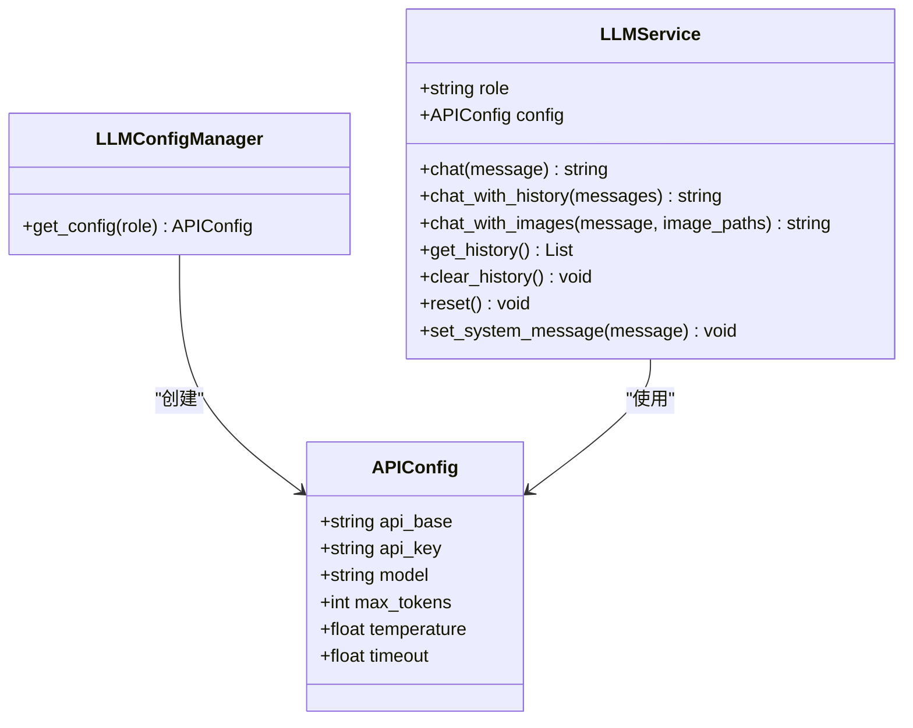
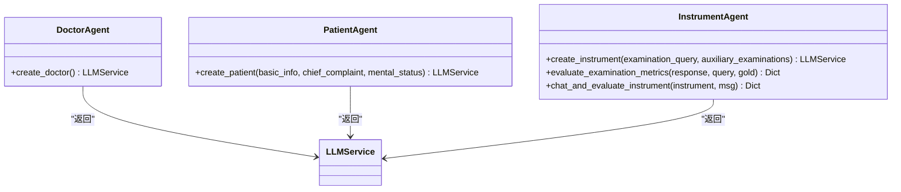
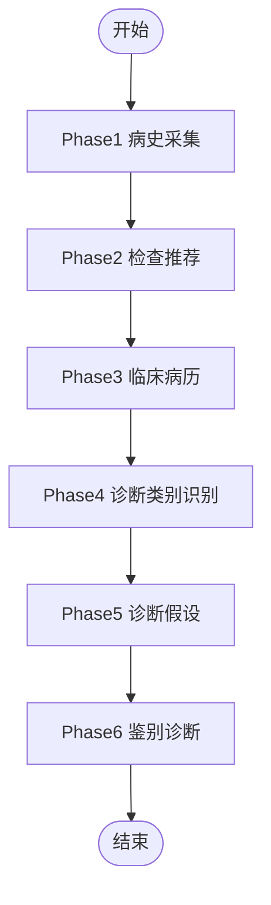
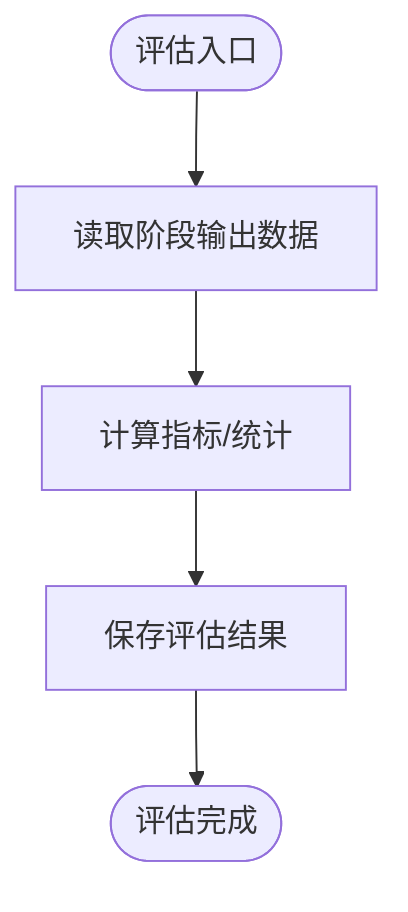
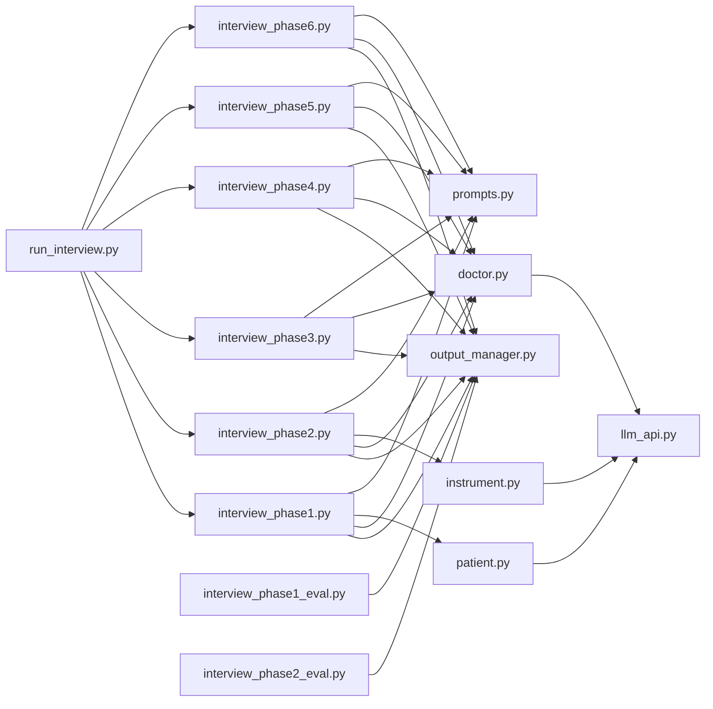

# 系统架构

<cite>
**本文引用的文件**
- [run_interview.py](file://run_interview.py)
- [llm_api.py](file://services/llm_api.py)
- [patient.py](file://agents/patient/patient.py)
- [doctor.py](file://agents/doctor/doctor.py)
- [instrument.py](file://agents/instrument/instrument.py)
- [prompts.py](file://core/interview/prompts.py)
- [interview_phase1.py](file://core/interview/interview_phase1.py)
- [interview_phase2.py](file://core/interview/interview_phase2.py)
- [interview_phase3.py](file://core/interview/interview_phase3.py)
- [interview_phase4.py](file://core/interview/interview_phase4.py)
- [interview_phase5.py](file://core/interview/interview_phase5.py)
- [interview_phase6.py](file://core/interview/interview_phase6.py)
- [output_manager.py](file://core/output_manager.py)
- [interview_phase1_eval.py](file://core/evaluate/interview_phase1_eval.py)
- [interview_phase2_eval.py](file://core/evaluate/interview_phase2_eval.py)
</cite>

## 目录
1. [简介](#简介)
2. [项目结构](#项目结构)
3. [核心组件](#核心组件)
4. [架构总览](#架构总览)
5. [详细组件分析](#详细组件分析)
6. [依赖关系分析](#依赖关系分析)
7. [性能考量](#性能考量)
8. [故障排查指南](#故障排查指南)
9. [结论](#结论)
10. [附录](#附录)

## 简介
本系统为“精神卫生智能问诊系统”，采用分层架构设计，围绕“LLM API服务 + 智能代理系统”的核心能力，构建从“输入病例”到“最终诊断输出”的完整流程。系统通过多阶段问诊流程（Phases 1–6）逐步推进，结合医生、患者、仪器等智能代理，实现病史采集、检查推荐、病历整理、诊断类别识别、诊断假设生成与鉴别诊断，并配套评估模块对各阶段输出进行客观评估。

## 项目结构
系统采用按“职责与层次”组织的模块化结构：
- 基础设施层：LLM API服务封装与配置管理
- 服务层：智能代理（医生、患者、仪器）与提示词模板
- 核心业务逻辑层：六阶段问诊流程与评估流程
- 数据管理层：统一输出文件管理与评估结果落盘

图表来源
- [llm_api.py:79-250](file://services/llm_api.py#L79-L250)
- [doctor.py:32-55](file://agents/doctor/doctor.py#L32-L55)
- [patient.py:40-92](file://agents/patient/patient.py#L40-L92)
- [instrument.py:13-45](file://agents/instrument/instrument.py#L13-L45)
- [prompts.py:1-233](file://core/interview/prompts.py#L1-L233)
- [interview_phase1.py:241-428](file://core/interview/interview_phase1.py#L241-L428)
- [interview_phase2.py:75-244](file://core/interview/interview_phase2.py#L75-L244)
- [interview_phase3.py:83-181](file://core/interview/interview_phase3.py#L83-L181)
- [interview_phase4.py:67-158](file://core/interview/interview_phase4.py#L67-L158)
- [interview_phase5.py:67-158](file://core/interview/interview_phase5.py#L67-L158)
- [interview_phase6.py:66-158](file://core/interview/interview_phase6.py#L66-L158)
- [output_manager.py:20-189](file://core/output_manager.py#L20-L189)
- [interview_phase1_eval.py:174-330](file://core/evaluate/interview_phase1_eval.py#L174-L330)
- [interview_phase2_eval.py:153-255](file://core/evaluate/interview_phase2_eval.py#L153-L255)

章节来源
- [run_interview.py:46-396](file://run_interview.py#L46-L396)
- [output_manager.py:20-189](file://core/output_manager.py#L20-L189)

## 核心组件
- LLM API服务（LLMService）
  - 负责统一接入第三方LLM API，维护每实例的对话上下文，提供基础聊天、带历史聊天、带图片多模态聊天等能力，并内置指数退避重试机制。
  - 支持按角色（patient/doctor/instrument/evaluator）加载不同API配置，便于隔离与扩展。
- 智能代理
  - 医生代理：基于系统提示词驱动，维持与患者的多轮对话上下文，贯穿各阶段。
  - 患者代理：根据真实病例信息构造系统提示词，模拟真实患者回答，支持JSON结构化输出解析与“语义着陆点”追踪。
  - 仪器代理：根据检查请求与金标准检查结果，计算推荐检查的Precision/Recall/F1/Jaccard等指标。
- 提示词模板（PROMPTS）
  - 为各阶段定义明确的系统提示词，确保LLM在特定任务下的行为收敛与可评估。
- 六阶段问诊流程
  - Phase1~6分别承担病史采集、检查推荐、病历整理、诊断类别识别、诊断假设、鉴别诊断，阶段间通过医生实例的历史上下文串联。
- 输出管理器（Output Manager）
  - 统一管理各阶段输出文件的创建、增量更新与读取，保证中间结果可追溯与可复现。
- 评估模块
  - Phase1覆盖度与对话统计评估；Phase2检查推荐指标评估；支持并行评估与结果落盘。

章节来源
- [llm_api.py:79-250](file://services/llm_api.py#L79-L250)
- [doctor.py:32-55](file://agents/doctor/doctor.py#L32-L55)
- [patient.py:40-92](file://agents/patient/patient.py#L40-L92)
- [instrument.py:13-183](file://agents/instrument/instrument.py#L13-L183)
- [prompts.py:1-233](file://core/interview/prompts.py#L1-L233)
- [interview_phase1.py:241-428](file://core/interview/interview_phase1.py#L241-L428)
- [interview_phase2.py:75-244](file://core/interview/interview_phase2.py#L75-L244)
- [interview_phase3.py:83-181](file://core/interview/interview_phase3.py#L83-L181)
- [interview_phase4.py:67-158](file://core/interview/interview_phase4.py#L67-L158)
- [interview_phase5.py:67-158](file://core/interview/interview_phase5.py#L67-L158)
- [interview_phase6.py:66-158](file://core/interview/interview_phase6.py#L66-L158)
- [output_manager.py:20-189](file://core/output_manager.py#L20-L189)
- [interview_phase1_eval.py:174-330](file://core/evaluate/interview_phase1_eval.py#L174-L330)
- [interview_phase2_eval.py:153-255](file://core/evaluate/interview_phase2_eval.py#L153-L255)

## 架构总览
系统采用“阶段化流水线 + 代理协作”的架构模式：
- 输入层：病例数据（可来自随机加载或外部传入）
- 执行层：各阶段流程模块负责编排医生/患者/仪器代理，产出阶段性结果
- 评估层：对阶段性结果进行指标评估，形成可对比的评估报告
- 输出层：统一落盘到约定目录，支持后续分析与可视化

图表来源
- [run_interview.py:46-396](file://run_interview.py#L46-L396)
- [interview_phase1.py:241-428](file://core/interview/interview_phase1.py#L241-L428)
- [interview_phase2.py:75-244](file://core/interview/interview_phase2.py#L75-L244)
- [interview_phase3.py:83-181](file://core/interview/interview_phase3.py#L83-L181)
- [interview_phase4.py:67-158](file://core/interview/interview_phase4.py#L67-L158)
- [interview_phase5.py:67-158](file://core/interview/interview_phase5.py#L67-L158)
- [interview_phase6.py:66-158](file://core/interview/interview_phase6.py#L66-L158)
- [output_manager.py:20-189](file://core/output_manager.py#L20-L189)

## 详细组件分析

### LLM API服务与配置管理
- 设计要点
  - APIConfig与LLMConfigManager：集中管理不同角色的API配置，支持从环境变量动态加载。
  - LLMService：面向实例的对话上下文管理，提供chat/chat_with_history/chat_with_images等接口，并内置重试与退避。
  - 角色隔离：通过role参数区分patient/doctor/instrument/evaluator，分别加载对应配置。
- 关键流程
  - 初始化：加载.env配置，创建OpenAI客户端，准备系统提示词与历史。
  - 聊天：追加用户消息，调用API，追加助手回复，返回结果。
  - 多模态：支持图片编码与多模态消息结构。
  - 重试：指数退避，最多重试若干次，失败抛出异常。

图表来源
- [llm_api.py:47-250](file://services/llm_api.py#L47-L250)

章节来源
- [llm_api.py:47-250](file://services/llm_api.py#L47-L250)

### 智能代理系统
- 医生代理（create_doctor）
  - 通过Doctor Profile系统提示词初始化，维持全局对话上下文，贯穿所有阶段。
- 患者代理（create_patient）
  - 将病例信息注入系统提示词，模拟真实患者回答；支持JSON解析与“语义着陆点”（chief_complaint/mental_status）追踪。
- 仪器代理（create_instrument）
  - 将检查请求与金标准检查结果注入系统提示词，评估推荐质量并计算Precision/Recall/F1/Jaccard等指标。

图表来源
- [doctor.py:32-55](file://agents/doctor/doctor.py#L32-L55)
- [patient.py:40-92](file://agents/patient/patient.py#L40-L92)
- [instrument.py:13-183](file://agents/instrument/instrument.py#L13-L183)

章节来源
- [doctor.py:32-55](file://agents/doctor/doctor.py#L32-L55)
- [patient.py:40-92](file://agents/patient/patient.py#L40-L92)
- [instrument.py:13-183](file://agents/instrument/instrument.py#L13-L183)

### 六阶段问诊流程
- Phase1：病史采集
  - 医生+患者多轮对话，检测结束标记，统计覆盖率与对话轮次，保存对话历史与使用过的主诉/精神状态条目。
- Phase2：检查推荐
  - 医生生成检查项目列表，仪器评估推荐质量，计算指标并保存结果。
- Phase3：临床病历
  - 基于检查结果生成结构化病历文本，去除格式标记后保存。
- Phase4：诊断类别识别
  - 在预定义类别集合中识别最可能的诊断类别，支持多类别输出。
- Phase5：诊断假设
  - 基于候选诊断列表生成诊断假设，按可信度排序。
- Phase6：鉴别诊断
  - 在假设基础上进行鉴别诊断，输出最终诊断序列。

图表来源
- [interview_phase1.py:241-428](file://core/interview/interview_phase1.py#L241-L428)
- [interview_phase2.py:75-244](file://core/interview/interview_phase2.py#L75-L244)
- [interview_phase3.py:83-181](file://core/interview/interview_phase3.py#L83-L181)
- [interview_phase4.py:67-158](file://core/interview/interview_phase4.py#L67-L158)
- [interview_phase5.py:67-158](file://core/interview/interview_phase5.py#L67-L158)
- [interview_phase6.py:66-158](file://core/interview/interview_phase6.py#L66-L158)

章节来源
- [interview_phase1.py:241-428](file://core/interview/interview_phase1.py#L241-L428)
- [interview_phase2.py:75-244](file://core/interview/interview_phase2.py#L75-L244)
- [interview_phase3.py:83-181](file://core/interview/interview_phase3.py#L83-L181)
- [interview_phase4.py:67-158](file://core/interview/interview_phase4.py#L67-L158)
- [interview_phase5.py:67-158](file://core/interview/interview_phase5.py#L67-L158)
- [interview_phase6.py:66-158](file://core/interview/interview_phase6.py#L66-L158)

### 评估模块与指标
- Phase1评估
  - 覆盖率统计：主诉覆盖率、精神状态覆盖率、整体覆盖率。
  - 对话统计：患者/医生轮次、总轮次。
  - 可选共情度与专业度评估（可并行）。
- Phase2评估
  - 基于仪器返回与金标准检查，计算Precision/Recall/F1/Jaccard等指标，统计TP/FP/FN等。

图表来源
- [interview_phase1_eval.py:174-330](file://core/evaluate/interview_phase1_eval.py#L174-L330)
- [interview_phase2_eval.py:153-255](file://core/evaluate/interview_phase2_eval.py#L153-L255)

章节来源
- [interview_phase1_eval.py:174-330](file://core/evaluate/interview_phase1_eval.py#L174-L330)
- [interview_phase2_eval.py:153-255](file://core/evaluate/interview_phase2_eval.py#L153-L255)

### 提示词模板与策略模式
- PROMPTS
  - 为各阶段提供明确的系统提示词，约束LLM输出格式与范围，便于后续解析与评估。
- 策略模式应用
  - 不同阶段采用不同的提示词策略，确保任务目标清晰、输出可解析、可评估。
  - 通过“提示词模板 + 格式标记 + 解析器”实现“策略即代码”的解耦。

章节来源
- [prompts.py:1-233](file://core/interview/prompts.py#L1-L233)

### 工厂模式与代理创建
- 医生/患者/仪器代理均通过工厂函数创建，内部统一调用LLMService并注入角色与系统提示词，实现“创建即可用”的代理实例。
- 优势
  - 降低调用复杂度，统一配置加载与系统提示词注入。
  - 易于扩展新角色或新提示词策略。

章节来源
- [doctor.py:32-55](file://agents/doctor/doctor.py#L32-L55)
- [patient.py:40-92](file://agents/patient/patient.py#L40-L92)
- [instrument.py:13-45](file://agents/instrument/instrument.py#L13-L45)

## 依赖关系分析
- 组件耦合
  - 阶段流程模块依赖代理工厂与提示词模板，代理工厂依赖LLMService与配置管理。
  - 输出管理器为所有阶段与评估模块提供统一文件落盘接口，降低I/O耦合。
- 外部依赖
  - LLM API（OpenAI兼容）与HTTP客户端（httpx），通过.env配置隔离。
  - 可选JSON修复工具（json_repair）提升患者响应解析鲁棒性。
- 循环依赖
  - 未发现循环依赖；模块间为单向依赖（流程→代理→LLMService→配置）。

图表来源
- [run_interview.py:32-43](file://run_interview.py#L32-L43)
- [interview_phase1.py:37-46](file://core/interview/interview_phase1.py#L37-L46)
- [interview_phase2.py:38-40](file://core/interview/interview_phase2.py#L38-L40)
- [interview_phase3.py:34-35](file://core/interview/interview_phase3.py#L34-L35)
- [interview_phase4.py:33-34](file://core/interview/interview_phase4.py#L33-L34)
- [interview_phase5.py:33-34](file://core/interview/interview_phase5.py#L33-L34)
- [interview_phase6.py:32-33](file://core/interview/interview_phase6.py#L32-L33)
- [output_manager.py:20-189](file://core/output_manager.py#L20-L189)
- [doctor.py:28-29](file://agents/doctor/doctor.py#L28-L29)
- [patient.py:36-37](file://agents/patient/patient.py#L36-L37)
- [instrument.py:9-10](file://agents/instrument/instrument.py#L9-L10)
- [llm_api.py:36-42](file://services/llm_api.py#L36-L42)
- [prompts.py:1-233](file://core/interview/prompts.py#L1-L233)
- [interview_phase1_eval.py:212-217](file://core/evaluate/interview_phase1_eval.py#L212-L217)
- [interview_phase2_eval.py:184-189](file://core/evaluate/interview_phase2_eval.py#L184-L189)

章节来源
- [run_interview.py:32-43](file://run_interview.py#L32-L43)
- [output_manager.py:20-189](file://core/output_manager.py#L20-L189)

## 性能考量
- 并发与吞吐
  - 当前流程为顺序执行，适合稳定可控的批处理场景；若需提升吞吐，可在阶段内引入异步与并发（如多病例并行、评估并行）。
- API调用与重试
  - LLMService内置指数退避重试，减少瞬时错误对流程的影响；建议结合限流与熔断策略进一步优化。
- I/O与落盘
  - 输出管理器采用增量更新与即时写入，保证中间结果可恢复；建议在高并发下增加文件锁或队列化写入。
- 内存与上下文
  - 每阶段医生实例维护完整对话历史，建议在长流程中定期清理历史或分阶段持久化，避免内存膨胀。
- 模型选择与成本
  - 通过.env配置切换模型与温度等超参，建议在评估阶段使用更低成本模型以降低成本。

[本节为通用指导，无需列出具体文件来源]

## 故障排查指南
- 常见问题
  - LLM API调用失败：检查.env中API密钥、Base URL与超时配置；查看日志中的重试次数与错误原因。
  - 患者响应非标准JSON：系统具备JSON修复与正则提取能力，若仍失败，检查提示词是否强制输出格式。
  - 评估模块缺失依赖：确保安装json_repair与评估所需依赖包。
  - 输出文件未生成：确认输出目录权限与路径拼接逻辑。
- 定位方法
  - 分阶段运行：先运行Phase1，再依次运行后续阶段，定位失败点。
  - 查看输出文件：检查各阶段输出JSON中的status与last_update字段。
  - 日志与异常栈：关注重试日志与traceback信息。

章节来源
- [llm_api.py:158-169](file://services/llm_api.py#L158-L169)
- [interview_phase1.py:102-143](file://core/interview/interview_phase1.py#L102-L143)
- [interview_phase1_eval.py:294-297](file://core/evaluate/interview_phase1_eval.py#L294-L297)
- [output_manager.py:86-114](file://core/output_manager.py#L86-L114)

## 结论
本系统通过“LLM API服务 + 智能代理 + 分阶段流程 + 统一输出管理”的架构，实现了从输入病例到最终诊断输出的闭环。其设计强调：
- 清晰的分层与职责分离
- 可扩展的角色工厂与策略提示词
- 可评估的阶段化输出与指标体系
- 统一的文件落盘与可追溯性

未来扩展方向包括：引入异步与并发、多模型对比评估、可视化仪表盘、自动化回归测试与A/B评估框架等。

[本节为总结性内容，无需列出具体文件来源]

## 附录
- 环境变量与配置
  - 通过.env加载各角色API配置（API Base、API Key、Model、Max Tokens、Temperature、Timeout等）。
- 数据文件
  - 病例数据来源于cases.jsonl；各阶段输出与评估结果分别落盘至约定目录。

章节来源
- [llm_api.py:40-76](file://services/llm_api.py#L40-L76)
- [interview_phase1.py:63-87](file://core/interview/interview_phase1.py#L63-L87)
- [output_manager.py:20-47](file://core/output_manager.py#L20-L47)