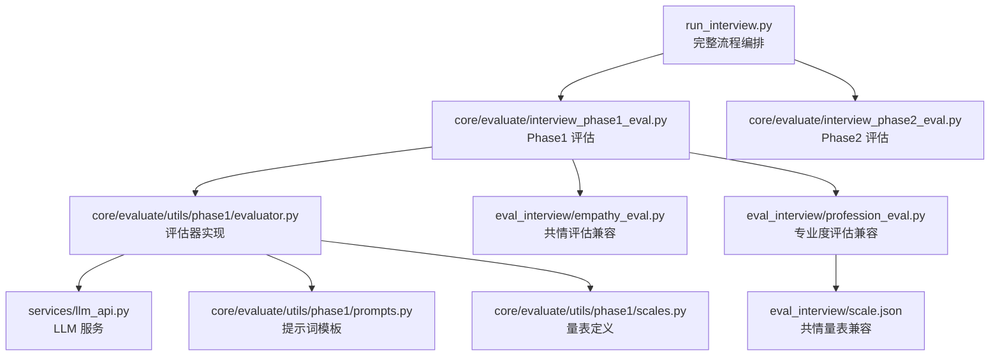
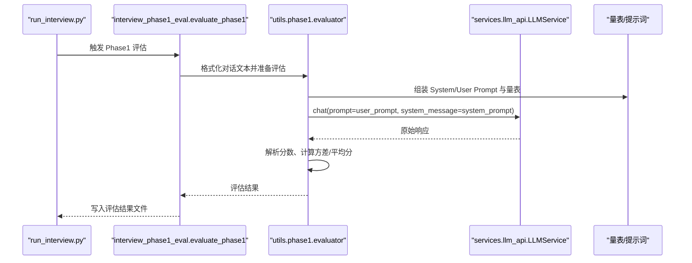
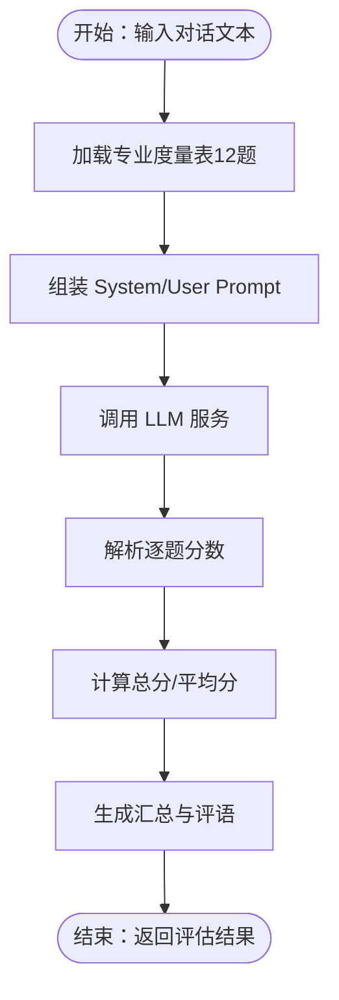
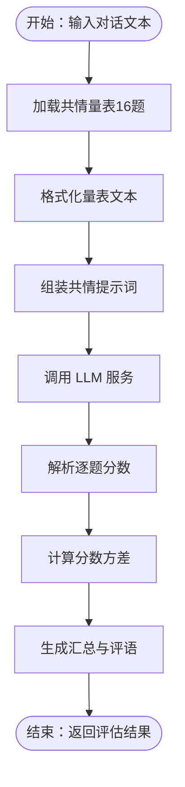
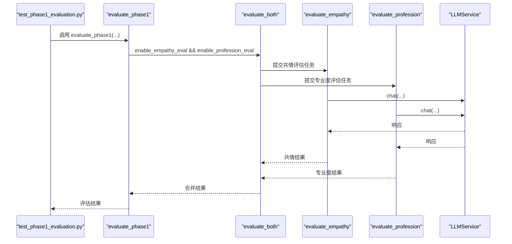
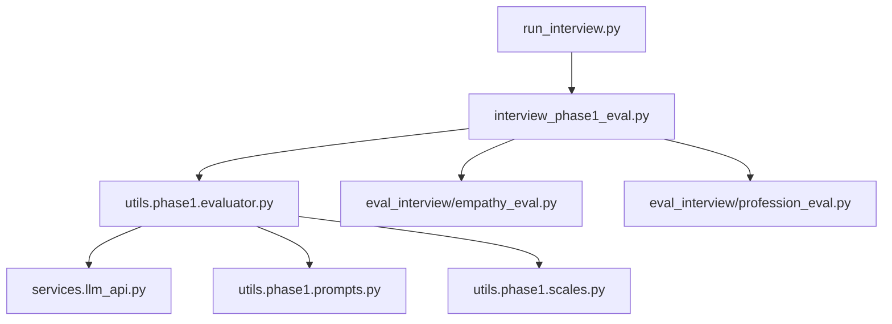

# 专业度评估

<cite>
**本文档引用的文件**
- [run_interview.py](file://run_interview.py)
- [scripts/test_phase1_evaluation.py](file://scripts/test_phase1_evaluation.py)
- [services/llm_api.py](file://services/llm_api.py)
- [core/evaluate/interview_phase1_eval.py](file://core/evaluate/interview_phase1_eval.py)
- [core/evaluate/interview_phase2_eval.py](file://core/evaluate/interview_phase2_eval.py)
- [core/evaluate/utils/phase1/__init__.py](file://core/evaluate/utils/phase1/__init__.py)
- [core/evaluate/utils/phase1/evaluator.py](file://core/evaluate/utils/phase1/evaluator.py)
- [core/evaluate/utils/phase1/prompts.py](file://core/evaluate/utils/phase1/prompts.py)
- [core/evaluate/utils/phase1/scales.py](file://core/evaluate/utils/phase1/scales.py)
- [eval_interview/empathy_eval.py](file://eval_interview/empathy_eval.py)
- [eval_interview/profession_eval.py](file://eval_interview/profession_eval.py)
- [eval_interview/scale.json](file://eval_interview/scale.json)
- [data/output/evaluation/qwen-flash/1009904/evaluation_phase1_output.json](file://data/output/evaluation/qwen-flash/1009904/evaluation_phase1_output.json)
</cite>

## 目录
1. [简介](#简介)
2. [项目结构](#项目结构)
3. [核心组件](#核心组件)
4. [架构总览](#架构总览)
5. [详细组件分析](#详细组件分析)
6. [依赖关系分析](#依赖关系分析)
7. [性能考量](#性能考量)
8. [故障排查指南](#故障排查指南)
9. [结论](#结论)
10. [附录](#附录)

## 简介
本模块面向精神科医生在与患者多轮对话中的“专业度”进行量化评估，覆盖问诊技巧、医学知识运用、沟通能力与诊断思维等维度。系统通过标准化提示词与评分量表，基于大模型对完整对话进行逐题评分与汇总，输出总分、平均分、单项明细与综合评语，帮助识别优势与改进点，支撑医疗培训与质量控制。

## 项目结构
- 评估入口与流程编排位于顶层运行脚本与测试脚本，负责串联各阶段并触发评估。
- 评估核心位于 core/evaluate 子模块，提供阶段化评估能力与通用工具。
- 量表与提示词集中于 core/evaluate/utils/phase1 与 eval_interview 目录，便于统一维护与扩展。
- LLM 服务封装于 services/llm_api.py，提供统一的模型调用接口与重试机制。

**图表来源**
- [run_interview.py:1-408](file://run_interview.py#L1-L408)
- [core/evaluate/interview_phase1_eval.py:174-330](file://core/evaluate/interview_phase1_eval.py#L174-L330)
- [core/evaluate/interview_phase2_eval.py:153-255](file://core/evaluate/interview_phase2_eval.py#L153-L255)
- [core/evaluate/utils/phase1/evaluator.py:50-160](file://core/evaluate/utils/phase1/evaluator.py#L50-L160)
- [services/llm_api.py:79-250](file://services/llm_api.py#L79-L250)
- [core/evaluate/utils/phase1/prompts.py:111-280](file://core/evaluate/utils/phase1/prompts.py#L111-L280)
- [core/evaluate/utils/phase1/scales.py:10-464](file://core/evaluate/utils/phase1/scales.py#L10-L464)
- [eval_interview/empathy_eval.py:9-248](file://eval_interview/empathy_eval.py#L9-L248)
- [eval_interview/profession_eval.py:9-204](file://eval_interview/profession_eval.py#L9-L204)
- [eval_interview/scale.json:1-258](file://eval_interview/scale.json#L1-L258)

**章节来源**
- [run_interview.py:1-408](file://run_interview.py#L1-L408)
- [core/evaluate/interview_phase1_eval.py:174-330](file://core/evaluate/interview_phase1_eval.py#L174-L330)
- [core/evaluate/interview_phase2_eval.py:153-255](file://core/evaluate/interview_phase2_eval.py#L153-L255)
- [core/evaluate/utils/phase1/evaluator.py:50-160](file://core/evaluate/utils/phase1/evaluator.py#L50-L160)
- [services/llm_api.py:79-250](file://services/llm_api.py#L79-L250)
- [core/evaluate/utils/phase1/prompts.py:111-280](file://core/evaluate/utils/phase1/prompts.py#L111-L280)
- [core/evaluate/utils/phase1/scales.py:10-464](file://core/evaluate/utils/phase1/scales.py#L10-L464)
- [eval_interview/empathy_eval.py:9-248](file://eval_interview/empathy_eval.py#L9-L248)
- [eval_interview/profession_eval.py:9-204](file://eval_interview/profession_eval.py#L9-L204)
- [eval_interview/scale.json:1-258](file://eval_interview/scale.json#L1-L258)

## 核心组件
- 评估入口与流程编排
  - run_interview.py：提供完整六阶段流程，其中 Phase1 与 Phase2 后分别进行评估，输出阶段性评估结果。
  - scripts/test_phase1_evaluation.py：提供 Phase1 评估的独立测试入口，验证共情度与专业度评估功能。
- 评估核心
  - core/evaluate/interview_phase1_eval.py：Phase1 评估主流程，负责覆盖率、对话统计与共情/专业度评估的触发与结果聚合。
  - core/evaluate/interview_phase2_eval.py：Phase2 评估，基于检查推荐的指标计算（Precision/Recall/F1/Jaccard），与专业度评估并行时可复用该模块的通用保存与打印逻辑。
- 评估器与提示词
  - core/evaluate/utils/phase1/evaluator.py：封装共情度与专业度评估的核心逻辑，包括分数解析、方差计算与并行评估。
  - core/evaluate/utils/phase1/prompts.py：定义共情与专业度的 System Prompt 与 User Prompt 模板，确保评分的独立性与证据导向。
  - core/evaluate/utils/phase1/scales.py：内置共情量表（16题）与专业度量表（12题），统一格式化为文本注入提示词。
- 量表与兼容实现
  - eval_interview/empathy_eval.py 与 eval_interview/profession_eval.py：提供独立的共情与专业度评估函数，兼容多种量表文件结构，支持从 data 目录自动发现量表。
  - eval_interview/scale.json：共情量表示例文件，与内置量表结构一致，便于迁移与扩展。
- LLM 服务
  - services/llm_api.py：统一的 LLM 调用封装，支持重试、上下文维护与角色化配置，为评估器提供稳定的推理能力。

**章节来源**
- [run_interview.py:46-396](file://run_interview.py#L46-L396)
- [scripts/test_phase1_evaluation.py:16-58](file://scripts/test_phase1_evaluation.py#L16-L58)
- [core/evaluate/interview_phase1_eval.py:174-330](file://core/evaluate/interview_phase1_eval.py#L174-L330)
- [core/evaluate/interview_phase2_eval.py:153-255](file://core/evaluate/interview_phase2_eval.py#L153-L255)
- [core/evaluate/utils/phase1/evaluator.py:50-160](file://core/evaluate/utils/phase1/evaluator.py#L50-L160)
- [core/evaluate/utils/phase1/prompts.py:111-280](file://core/evaluate/utils/phase1/prompts.py#L111-L280)
- [core/evaluate/utils/phase1/scales.py:10-464](file://core/evaluate/utils/phase1/scales.py#L10-L464)
- [eval_interview/empathy_eval.py:9-248](file://eval_interview/empathy_eval.py#L9-L248)
- [eval_interview/profession_eval.py:9-204](file://eval_interview/profession_eval.py#L9-L204)
- [eval_interview/scale.json:1-258](file://eval_interview/scale.json#L1-L258)
- [services/llm_api.py:79-250](file://services/llm_api.py#L79-L250)

## 架构总览
系统采用“流程编排 + 评估器 + LLM 服务”的分层设计。顶层脚本驱动完整流程并在关键节点触发评估；评估器负责构造提示词、调用 LLM 并解析结果；LLM 服务提供统一的推理通道与稳定性保障。

**图表来源**
- [run_interview.py:75-78](file://run_interview.py#L75-L78)
- [core/evaluate/interview_phase1_eval.py:254-298](file://core/evaluate/interview_phase1_eval.py#L254-L298)
- [core/evaluate/utils/phase1/evaluator.py:50-160](file://core/evaluate/utils/phase1/evaluator.py#L50-L160)
- [services/llm_api.py:113-174](file://services/llm_api.py#L113-L174)
- [core/evaluate/utils/phase1/prompts.py:111-280](file://core/evaluate/utils/phase1/prompts.py#L111-L280)
- [core/evaluate/utils/phase1/scales.py:10-464](file://core/evaluate/utils/phase1/scales.py#L10-L464)

## 详细组件分析

### 专业度评估（Phase1）
- 评估维度与量表
  - 专业度量表（12题）覆盖：信息提炼、临床推理框架、鉴别诊断意识、自知力/病识感评估、风险敏感性与分层、功能损害评估、专业边界与处理精神病性症状、共情与中立、去污名化、控场能力、动态调节与节奏管理等。
- 评分标准
  - 每题独立评分，0/1/2 三级制；证据不足不给高分；强调“清晰证据支持”“避免先入为主”“不得互相借分”。
- 评估流程
  - 读取对话文本 → 组装提示词与量表 → 调用 LLM → 解析分数 → 计算总分与平均分 → 生成汇总与评语。
- 输出结构
  - 包含 question_count、parsed_scores、total_score、average_score 等字段，便于后续解读与可视化。

**图表来源**
- [core/evaluate/utils/phase1/prompts.py:177-280](file://core/evaluate/utils/phase1/prompts.py#L177-L280)
- [core/evaluate/utils/phase1/evaluator.py:93-131](file://core/evaluate/utils/phase1/evaluator.py#L93-L131)
- [core/evaluate/utils/phase1/scales.py:270-464](file://core/evaluate/utils/phase1/scales.py#L270-L464)

**章节来源**
- [core/evaluate/utils/phase1/scales.py:270-464](file://core/evaluate/utils/phase1/scales.py#L270-L464)
- [core/evaluate/utils/phase1/prompts.py:177-280](file://core/evaluate/utils/phase1/prompts.py#L177-L280)
- [core/evaluate/utils/phase1/evaluator.py:93-131](file://core/evaluate/utils/phase1/evaluator.py#L93-L131)

### 共情度评估（Phase1）
- 评估维度与量表
  - 共情量表（16题）覆盖：情绪识别、潜在情绪推断、情绪原因理解、判断准确性、理解与接纳、设身处地、回应顺序、关心与支持、引导表达、保留表达空间、语言自然度、语气匹配、建议时机、反向风险（模板化/夸张/评判/压迫）等。
- 评分标准
  - 0/1/2 三级制；强调证据导向、逐题独立判断、高分谨慎；禁止“先总评再回填”。
- 评估流程
  - 读取对话文本 → 兼容多量表结构 → 组装提示词 → 调用 LLM → 解析分数 → 计算方差与平均分 → 生成汇总与评语。

**图表来源**
- [core/evaluate/utils/phase1/prompts.py:111-175](file://core/evaluate/utils/phase1/prompts.py#L111-L175)
- [core/evaluate/utils/phase1/evaluator.py:50-91](file://core/evaluate/utils/phase1/evaluator.py#L50-L91)
- [core/evaluate/utils/phase1/scales.py:10-267](file://core/evaluate/utils/phase1/scales.py#L10-L267)

**章节来源**
- [core/evaluate/utils/phase1/scales.py:10-267](file://core/evaluate/utils/phase1/scales.py#L10-L267)
- [core/evaluate/utils/phase1/prompts.py:111-175](file://core/evaluate/utils/phase1/prompts.py#L111-L175)
- [core/evaluate/utils/phase1/evaluator.py:50-91](file://core/evaluate/utils/phase1/evaluator.py#L50-L91)

### 评估入口与并行评估
- 入口函数
  - interview_phase1_eval.evaluate_phase1：支持从文件或数据直接评估，可选择启用共情度、专业度评估，并支持并行评估以提升吞吐。
  - scripts/test_phase1_evaluation：提供一键测试入口，验证评估流程与输出。
- 并行策略
  - evaluate_both：通过线程池并发调用共情与专业度评估，缩短总耗时。

**图表来源**
- [scripts/test_phase1_evaluation.py:23-29](file://scripts/test_phase1_evaluation.py#L23-L29)
- [core/evaluate/interview_phase1_eval.py:254-298](file://core/evaluate/interview_phase1_eval.py#L254-L298)
- [core/evaluate/utils/phase1/evaluator.py:133-160](file://core/evaluate/utils/phase1/evaluator.py#L133-L160)

**章节来源**
- [scripts/test_phase1_evaluation.py:16-58](file://scripts/test_phase1_evaluation.py#L16-L58)
- [core/evaluate/interview_phase1_eval.py:254-298](file://core/evaluate/interview_phase1_eval.py#L254-L298)
- [core/evaluate/utils/phase1/evaluator.py:133-160](file://core/evaluate/utils/phase1/evaluator.py#L133-L160)

### 量表与提示词管理
- 量表来源
  - 内置量表：core/evaluate/utils/phase1/scales.py（16题共情、12题专业）。
  - 兼容文件：eval_interview/scale.json（共情量表）、eval_interview/profession_eval.py（专业度评估兼容逻辑）。
- 提示词模板
  - 共情与专业度的 System Prompt 与 User Prompt 由 core/evaluate/utils/phase1/prompts.py 统一管理，确保评分一致性与可解释性。

**章节来源**
- [core/evaluate/utils/phase1/scales.py:10-464](file://core/evaluate/utils/phase1/scales.py#L10-L464)
- [core/evaluate/utils/phase1/prompts.py:10-280](file://core/evaluate/utils/phase1/prompts.py#L10-L280)
- [eval_interview/profession_eval.py:23-90](file://eval_interview/profession_eval.py#L23-L90)
- [eval_interview/scale.json:1-258](file://eval_interview/scale.json#L1-L258)

### LLM 服务与稳定性
- 角色化配置：patient/doctor/evaluator 三类角色，分别加载对应的 API Base/Key/Model。
- 重试与退避：指数退避重试，降低网络抖动对评估的影响。
- 上下文管理：实例生命周期内维护对话历史，支持多轮对话与调试。

**章节来源**
- [services/llm_api.py:58-250](file://services/llm_api.py#L58-L250)

## 依赖关系分析
- 组件耦合
  - 评估入口与评估器解耦，评估器依赖提示词与量表，通过 LLM 服务进行推理，便于替换模型与优化提示词。
  - 顶层流程编排仅负责调度，不直接参与评分逻辑，降低复杂度。
- 外部依赖
  - OpenAI 兼容的 Chat Completions API，配置来源于 .env 文件。
- 潜在循环依赖
  - 未发现循环导入；模块职责清晰，分层明确。

**图表来源**
- [run_interview.py:46-396](file://run_interview.py#L46-L396)
- [core/evaluate/interview_phase1_eval.py:254-298](file://core/evaluate/interview_phase1_eval.py#L254-L298)
- [core/evaluate/utils/phase1/evaluator.py:50-160](file://core/evaluate/utils/phase1/evaluator.py#L50-L160)
- [services/llm_api.py:79-250](file://services/llm_api.py#L79-L250)
- [core/evaluate/utils/phase1/prompts.py:111-280](file://core/evaluate/utils/phase1/prompts.py#L111-L280)
- [core/evaluate/utils/phase1/scales.py:10-464](file://core/evaluate/utils/phase1/scales.py#L10-L464)
- [eval_interview/empathy_eval.py:9-248](file://eval_interview/empathy_eval.py#L9-L248)
- [eval_interview/profession_eval.py:9-204](file://eval_interview/profession_eval.py#L9-L204)

**章节来源**
- [run_interview.py:46-396](file://run_interview.py#L46-L396)
- [core/evaluate/interview_phase1_eval.py:254-298](file://core/evaluate/interview_phase1_eval.py#L254-L298)
- [core/evaluate/utils/phase1/evaluator.py:50-160](file://core/evaluate/utils/phase1/evaluator.py#L50-L160)
- [services/llm_api.py:79-250](file://services/llm_api.py#L79-L250)
- [core/evaluate/utils/phase1/prompts.py:111-280](file://core/evaluate/utils/phase1/prompts.py#L111-L280)
- [core/evaluate/utils/phase1/scales.py:10-464](file://core/evaluate/utils/phase1/scales.py#L10-L464)
- [eval_interview/empathy_eval.py:9-248](file://eval_interview/empathy_eval.py#L9-L248)
- [eval_interview/profession_eval.py:9-204](file://eval_interview/profession_eval.py#L9-L204)

## 性能考量
- 并行评估：在启用共情与专业度评估时，通过线程池并发调用，显著降低总等待时间。
- LLM 调用优化：统一的重试与退避机制减少失败重试成本；上下文管理避免重复传输历史。
- 输出聚合：评估结果统一序列化保存，便于后续批处理与可视化。

**章节来源**
- [core/evaluate/utils/phase1/evaluator.py:133-160](file://core/evaluate/utils/phase1/evaluator.py#L133-L160)
- [services/llm_api.py:158-170](file://services/llm_api.py#L158-L170)
- [core/evaluate/interview_phase1_eval.py:294-298](file://core/evaluate/interview_phase1_eval.py#L294-L298)

## 故障排查指南
- 常见问题
  - 量表文件未找到：profession_eval 与 empathy_eval 支持多候选路径与兼容格式，若仍报错，检查 data 目录与文件命名。
  - 对话文本为空：评估函数对空输入抛出异常，需确保对话文本有效。
  - LLM 调用失败：查看日志与重试次数；检查 .env 中对应角色的 API 配置。
- 定位步骤
  - 使用 scripts/test_phase1_evaluation.py 快速复现问题。
  - 检查 data/output/evaluation 下的评估输出文件，确认保存与解析是否正常。
  - 若出现解析分数异常，检查提示词格式与模型输出稳定性。

**章节来源**
- [eval_interview/profession_eval.py:20-42](file://eval_interview/profession_eval.py#L20-L42)
- [eval_interview/empathy_eval.py:20-44](file://eval_interview/empathy_eval.py#L20-L44)
- [services/llm_api.py:158-170](file://services/llm_api.py#L158-L170)
- [scripts/test_phase1_evaluation.py:16-58](file://scripts/test_phase1_evaluation.py#L16-L58)
- [data/output/evaluation/qwen-flash/1009904/evaluation_phase1_output.json:1-122](file://data/output/evaluation/qwen-flash/1009904/evaluation_phase1_output.json#L1-L122)

## 结论
本模块通过标准化的提示词与量表，实现了对医生专业度的系统化、可解释性评估。其设计强调证据导向、独立评分与可并行扩展，适用于医疗培训与质量控制场景。建议在实际应用中：
- 明确评分标准与权重（当前模块输出总分与平均分，可结合业务需求引入加权）。
- 结合对话统计与覆盖率指标，形成多维评估报告。
- 持续迭代量表与提示词，提升评估稳定性与可解释性。

## 附录

### 评估指标与计算方法
- 专业度评估
  - 输入：对话文本
  - 输出：question_count、parsed_scores、total_score、average_score
  - 计算：total_score = Σscores；average_score = total_score / question_count
- 共情度评估
  - 输入：对话文本
  - 输出：question_count、parsed_scores、total_score、average_score、score_variance
  - 计算：score_variance = Σ(scores - mean)^2 / N

**章节来源**
- [core/evaluate/utils/phase1/evaluator.py:34-91](file://core/evaluate/utils/phase1/evaluator.py#L34-L91)
- [core/evaluate/utils/phase1/evaluator.py:93-131](file://core/evaluate/utils/phase1/evaluator.py#L93-L131)

### 评估结果解读与应用
- 结果字段
  - total_score：总分（满分 2×题数）
  - average_score：平均分（0~2）
  - score_variance（共情）：分数离散程度，越低越稳定
  - parsed_scores：逐题分数列表
- 应用建议
  - 培训：针对低分题制定专项训练与反馈清单。
  - 质控：将平均分与方差纳入定期质控指标，追踪团队表现趋势。
  - 质量改进：结合对话统计（轮数、覆盖率）与专家评审，形成闭环改进。

**章节来源**
- [data/output/evaluation/qwen-flash/1009904/evaluation_phase1_output.json:79-122](file://data/output/evaluation/qwen-flash/1009904/evaluation_phase1_output.json#L79-L122)