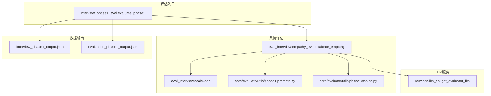
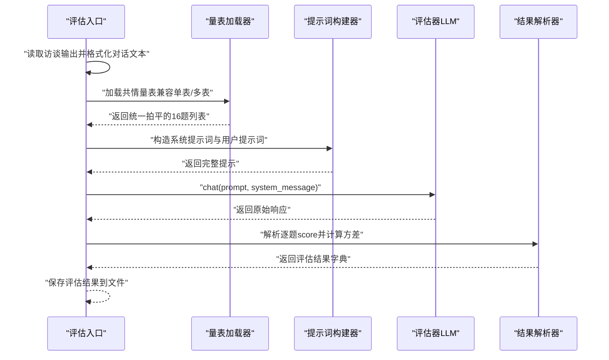
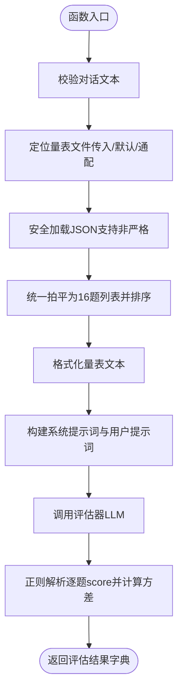
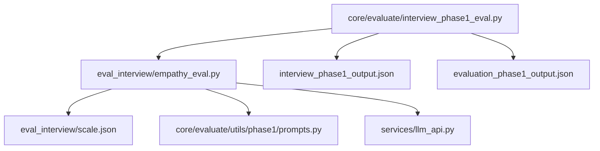

# 共情度评估

<cite>
**本文引用的文件**
- [eval_interview/empathy_eval.py](file://eval_interview/empathy_eval.py)
- [eval_interview/scale.json](file://eval_interview/scale.json)
- [core/evaluate/utils/phase1/scales.py](file://core/evaluate/utils/phase1/scales.py)
- [core/evaluate/utils/phase1/prompts.py](file://core/evaluate/utils/phase1/prompts.py)
- [core/evaluate/interview_phase1_eval.py](file://core/evaluate/interview_phase1_eval.py)
- [services/llm_api.py](file://services/llm_api.py)
- [run_interview.py](file://run_interview.py)
- [scripts/test_phase1_evaluation.py](file://scripts/test_phase1_evaluation.py)
- [data/output/interview/qwen-flash/1009904/interview_phase1_output.json](file://data/output/interview/qwen-flash/1009904/interview_phase1_output.json)
- [data/output/evaluation/qwen-flash/1009904/evaluation_phase1_output.json](file://data/output/evaluation/qwen-flash/1009904/evaluation_phase1_output.json)
</cite>

## 目录
1. [引言](#引言)
2. [项目结构](#项目结构)
3. [核心组件](#核心组件)
4. [架构总览](#架构总览)
5. [详细组件分析](#详细组件分析)
6. [依赖分析](#依赖分析)
7. [性能考量](#性能考量)
8. [故障排查指南](#故障排查指南)
9. [结论](#结论)
10. [附录](#附录)

## 引言
本文件面向精神科问诊场景，系统化阐述共情度评估模块的设计原理、实现方法与应用价值。模块以16项共情量表为核心，采用严格、克制、证据导向的评估原则，通过系统提示词与用户提示词构建，结合大语言模型（LLM）完成对医生在多轮对话中共情表现的独立评分与综合汇总。评估结果包含逐题评分、总分、平均分与方差，辅以优势、不足与总体评论，用于指导医生提升共情能力与专业素养。

## 项目结构
该模块位于评估子系统中，与访谈流程、输出管理、LLM服务协同工作。关键文件分布如下：
- 评估入口与流程：core/evaluate/interview_phase1_eval.py
- 共情评估函数：eval_interview/empathy_eval.py
- 量表定义：eval_interview/scale.json 与 core/evaluate/utils/phase1/scales.py
- 提示词定义：core/evaluate/utils/phase1/prompts.py
- LLM服务封装：services/llm_api.py
- 运行与测试：run_interview.py、scripts/test_phase1_evaluation.py
- 示例输出：data/output/interview/.../interview_phase1_output.json、evaluation_phase1_output.json

**图表来源**
- [core/evaluate/interview_phase1_eval.py:174-330](file://core/evaluate/interview_phase1_eval.py#L174-L330)
- [eval_interview/empathy_eval.py:9-248](file://eval_interview/empathy_eval.py#L9-L248)
- [eval_interview/scale.json:1-258](file://eval_interview/scale.json#L1-L258)
- [core/evaluate/utils/phase1/prompts.py:111-174](file://core/evaluate/utils/phase1/prompts.py#L111-L174)
- [core/evaluate/utils/phase1/scales.py:10-267](file://core/evaluate/utils/phase1/scales.py#L10-L267)
- [services/llm_api.py:247-250](file://services/llm_api.py#L247-L250)

**章节来源**
- [core/evaluate/interview_phase1_eval.py:174-330](file://core/evaluate/interview_phase1_eval.py#L174-L330)
- [eval_interview/empathy_eval.py:9-248](file://eval_interview/empathy_eval.py#L9-L248)
- [eval_interview/scale.json:1-258](file://eval_interview/scale.json#L1-L258)
- [core/evaluate/utils/phase1/prompts.py:111-174](file://core/evaluate/utils/phase1/prompts.py#L111-L174)
- [core/evaluate/utils/phase1/scales.py:10-267](file://core/evaluate/utils/phase1/scales.py#L10-L267)
- [services/llm_api.py:247-250](file://services/llm_api.py#L247-L250)

## 核心组件
- 共情评估函数：负责量表加载、提示词构建、LLM调用与结果解析，返回逐题评分、总分、平均分、方差与元信息。
- 量表定义：提供16项共情量表的题目、定义、评分标准与关注点，支持单表16题或多表结构统一拍平。
- 提示词模块：提供严格版系统提示词与用户提示词模板，确保独立评分、证据导向与格式约束。
- LLM服务：封装OpenAI风格的聊天接口，支持上下文维护、重试与系统提示词注入。
- 评估入口：整合访谈输出，格式化对话文本，调用共情评估并保存结果。

**章节来源**
- [eval_interview/empathy_eval.py:9-248](file://eval_interview/empathy_eval.py#L9-L248)
- [eval_interview/scale.json:1-258](file://eval_interview/scale.json#L1-L258)
- [core/evaluate/utils/phase1/prompts.py:35-108](file://core/evaluate/utils/phase1/prompts.py#L35-L108)
- [services/llm_api.py:79-191](file://services/llm_api.py#L79-L191)
- [core/evaluate/interview_phase1_eval.py:174-330](file://core/evaluate/interview_phase1_eval.py#L174-L330)

## 架构总览
共情评估采用“数据预处理—量表加载—提示词构建—LLM调用—结果解析—结果保存”的流水线式设计。评估入口负责读取访谈输出，格式化为“医生：/患者：”文本；共情评估函数负责加载量表、构造严格系统提示词与用户提示词，调用评估器LLM，解析模型输出并计算方差；最终将结果写入评估输出文件。

**图表来源**
- [core/evaluate/interview_phase1_eval.py:254-298](file://core/evaluate/interview_phase1_eval.py#L254-L298)
- [eval_interview/empathy_eval.py:46-98](file://eval_interview/empathy_eval.py#L46-L98)
- [eval_interview/empathy_eval.py:174-231](file://eval_interview/empathy_eval.py#L174-L231)
- [eval_interview/empathy_eval.py:232-247](file://eval_interview/empathy_eval.py#L232-L247)
- [services/llm_api.py:113-131](file://services/llm_api.py#L113-L131)

## 详细组件分析

### 共情评估函数（evaluate_empathy）
职责与流程：
- 输入校验：确保对话文本非空。
- 量表定位：优先使用传入路径，否则在data目录下搜索常见量表文件名与通配匹配。
- 安全解析：支持非严格JSON（外层包裹数组），自动截取方括号范围。
- 结构兼容：支持“单表16题”与“多表结构”，统一拍平为题目列表并按id排序。
- 文本格式化：将量表条目格式化为“题号、question、definition、scores、focus”结构文本。
- 提示词构建：严格系统提示词强调独立评分、证据导向与输出格式；用户提示词包含对话与量表文本。
- LLM调用：通过评估器LLM执行聊天，返回原始响应。
- 结果解析：正则抽取每题score，计算总体方差；返回scale路径、题数、提示词、原始响应与解析结果。

**图表来源**
- [eval_interview/empathy_eval.py:20-247](file://eval_interview/empathy_eval.py#L20-L247)

**章节来源**
- [eval_interview/empathy_eval.py:9-248](file://eval_interview/empathy_eval.py#L9-L248)

### 量表结构与评分标准
- 16项共情量表涵盖：情绪识别、潜在情绪推断、情绪原因理解、判断准确性、理解与接纳、设身处地、回应顺序、关心支持、引导表达、保留表达空间、语言自然度、语气匹配、建议时机、反向风险（模板化）、反向风险（夸张/越界）、反向风险（说教/评判）。
- 每题包含：题号、问题、定义、评分标准（0/1/2）、关注点（Focus）。
- 设计原则：严格区分16个独立任务，不得互相借分；评分必须基于对话证据；高分需有直接、贴合题意的证据；反向风险识别题仍使用同方向评分（0=问题明显，2=控制较好）。

**章节来源**
- [eval_interview/scale.json:1-258](file://eval_interview/scale.json#L1-L258)
- [core/evaluate/utils/phase1/scales.py:10-267](file://core/evaluate/utils/phase1/scales.py#L10-L267)

### 提示词与评估原则
- 系统提示词强调：
  - 独立评分原则：16题互不借分，先逐题判断再汇总。
  - 证据导向原则：严格依据对话证据，不得臆测意图。
  - 输出格式约束：逐题输出id/score/reason/evidence，最后统一汇总。
  - 反向风险识别：对模板化、夸张、说教、评判、压迫等行为降分。
- 用户提示词包含：
  - 任务要求：对N个题目分别独立评分。
  - 医患对话与评分量表文本。
  - 严格的输出格式模板。

**章节来源**
- [core/evaluate/utils/phase1/prompts.py:35-108](file://core/evaluate/utils/phase1/prompts.py#L35-L108)
- [core/evaluate/utils/phase1/prompts.py:111-174](file://core/evaluate/utils/phase1/prompts.py#L111-L174)

### LLM服务与调用
- LLM服务封装OpenAI风格API，支持：
  - 实例级上下文维护（历史消息自动附加）。
  - 系统提示词注入与更新。
  - 带指数退避的重试机制。
  - 获取评估器LLM的便捷函数。
- 评估流程中，评估函数通过评估器LLM执行聊天，传入系统提示词与用户提示词，获得原始响应。

**章节来源**
- [services/llm_api.py:79-191](file://services/llm_api.py#L79-L191)
- [services/llm_api.py:247-250](file://services/llm_api.py#L247-L250)
- [eval_interview/empathy_eval.py:229-231](file://eval_interview/empathy_eval.py#L229-L231)

### 评估入口与结果保存
- 评估入口负责：
  - 读取/定位访谈输出文件，格式化为“医生：/患者：”文本。
  - 调用共情评估函数，解析并汇总结果。
  - 保存评估结果到evaluation目录，包含覆盖率、对话统计与共情/专业评估结果。
- 示例输出展示：逐题score、总分、平均分、方差、strengths、weaknesses、overall_comment等字段。

**章节来源**
- [core/evaluate/interview_phase1_eval.py:174-330](file://core/evaluate/interview_phase1_eval.py#L174-L330)
- [data/output/evaluation/qwen-flash/1009904/evaluation_phase1_output.json:79-121](file://data/output/evaluation/qwen-flash/1009904/evaluation_phase1_output.json#L79-L121)

## 依赖分析
- 模块耦合关系：
  - 评估入口依赖格式化对话文本与保存结果。
  - 共情评估函数依赖量表加载、提示词构建与LLM服务。
  - 提示词模块与量表模块解耦，便于独立维护。
- 外部依赖：
  - LLM服务依赖OpenAI风格API与环境变量配置。
  - 量表文件支持UTF-8编码与非严格JSON容错。

**图表来源**
- [eval_interview/empathy_eval.py:6-247](file://eval_interview/empathy_eval.py#L6-L247)
- [core/evaluate/interview_phase1_eval.py:254-298](file://core/evaluate/interview_phase1_eval.py#L254-L298)
- [services/llm_api.py:247-250](file://services/llm_api.py#L247-L250)

**章节来源**
- [eval_interview/empathy_eval.py:6-247](file://eval_interview/empathy_eval.py#L6-L247)
- [core/evaluate/interview_phase1_eval.py:254-298](file://core/evaluate/interview_phase1_eval.py#L254-L298)
- [services/llm_api.py:247-250](file://services/llm_api.py#L247-L250)

## 性能考量
- 量表加载与提示词构建为纯内存操作，开销极低。
- LLM调用为IO密集型，受网络延迟与模型响应时间影响。
- 建议：
  - 合理设置超时与重试参数，避免长时间阻塞。
  - 对长对话进行分段评估或采样，以降低上下文长度带来的成本。
  - 并行评估多个案例时，注意并发上限与资源配额。

## 故障排查指南
- 量表文件未找到：
  - 现象：抛出未找到文件异常。
  - 排查：确认传入路径或data目录下存在scale.json、共情量表.json或通配匹配文件。
- 量表格式不支持：
  - 现象：抛出不支持的格式错误。
  - 排查：确保量表为列表或字典结构，且包含有效题目条目。
- 对话文本为空：
  - 现象：抛出输入为空错误。
  - 排查：确认已正确格式化对话文本。
- LLM调用失败：
  - 现象：打印失败日志并抛出异常。
  - 排查：检查API配置、网络连通性与重试机制是否生效。
- 结果解析异常：
  - 现象：正则未匹配到score或方差计算异常。
  - 排查：核对输出格式是否满足严格模板，必要时放宽格式容忍度。

**章节来源**
- [eval_interview/empathy_eval.py:20-44](file://eval_interview/empathy_eval.py#L20-L44)
- [eval_interview/empathy_eval.py:46-71](file://eval_interview/empathy_eval.py#L46-L71)
- [eval_interview/empathy_eval.py:229-231](file://eval_interview/empathy_eval.py#L229-L231)
- [services/llm_api.py:158-169](file://services/llm_api.py#L158-L169)

## 结论
该共情度评估模块以16项标准化量表为核心，通过严格系统提示词与证据导向原则，实现了对医生共情表现的独立、可解释与可量化的评估。模块具备良好的扩展性与容错能力，适用于精神科问诊的日常训练与质量监控，有助于提升医生在情绪识别、共情表达与沟通姿态方面的专业能力。

## 附录

### 评估流程与解读指南
- 评估流程步骤：
  1) 读取并格式化对话文本（医生/患者轮次）。
  2) 加载共情量表（支持单表/多表统一拍平）。
  3) 构建严格系统提示词与用户提示词。
  4) 调用评估器LLM，获取原始响应。
  5) 解析逐题score并计算总体方差。
  6) 生成strengths、weaknesses与overall_comment。
  7) 保存评估结果到evaluation目录。
- 结果解读要点：
  - 逐题评分：每题仅依据该题定义与focus判断，不得互相借分。
  - 总分与平均分：总分为各题score之和，平均分为总分除以16。
  - 方差分析：反映各题评分的一致性，值越小表示共情表现越稳定。
  - 证据要求：每题reason必须紧扣题意，evidence必须引用医生原话或忠实概括。

**章节来源**
- [eval_interview/empathy_eval.py:99-247](file://eval_interview/empathy_eval.py#L99-L247)
- [core/evaluate/utils/phase1/prompts.py:66-108](file://core/evaluate/utils/phase1/prompts.py#L66-L108)
- [data/output/evaluation/qwen-flash/1009904/evaluation_phase1_output.json:79-121](file://data/output/evaluation/qwen-flash/1009904/evaluation_phase1_output.json#L79-L121)

### 应用场景与价值
- 精神科问诊：
  - 作为培训与反馈工具，帮助医生识别自身在情绪回应、共情表达与沟通姿态上的优势与不足。
  - 支持阶段性评估与长期跟踪，量化共情能力改善趋势。
- 临床质量改进：
  - 通过方差与逐题分析，识别易忽视的共情盲点（如回应顺序、语气匹配、反向风险）。
  - 辅助制定个性化提升计划，强化证据导向的共情实践。

**章节来源**
- [core/evaluate/interview_phase1_eval.py:254-298](file://core/evaluate/interview_phase1_eval.py#L254-L298)
- [run_interview.py:46-226](file://run_interview.py#L46-L226)