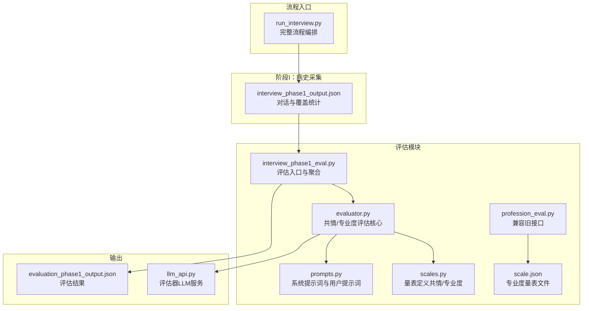
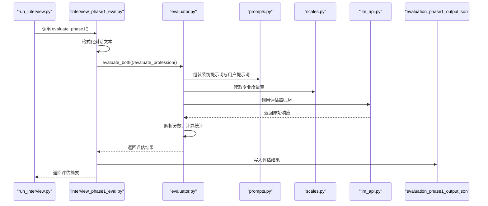
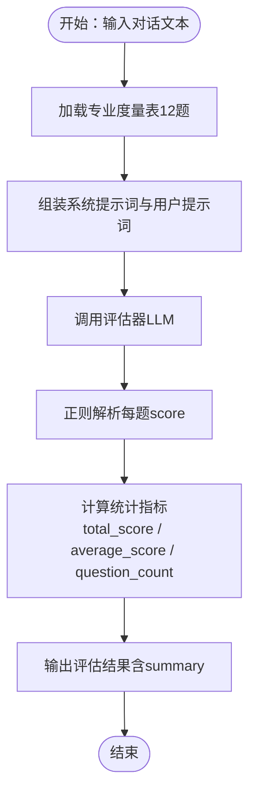
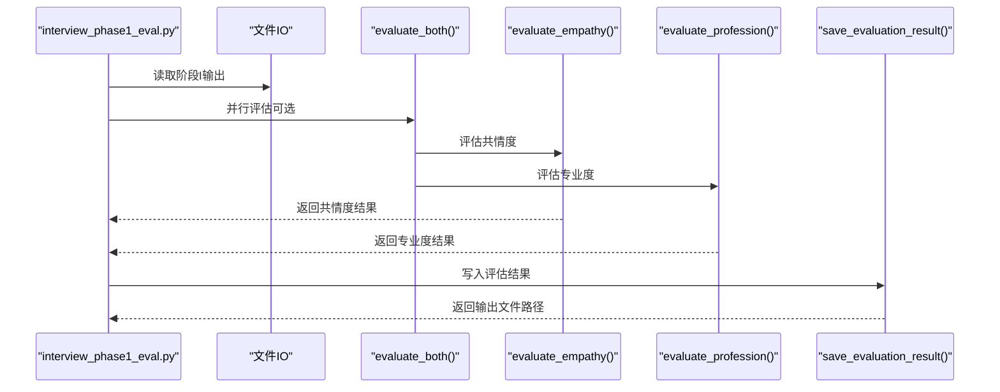
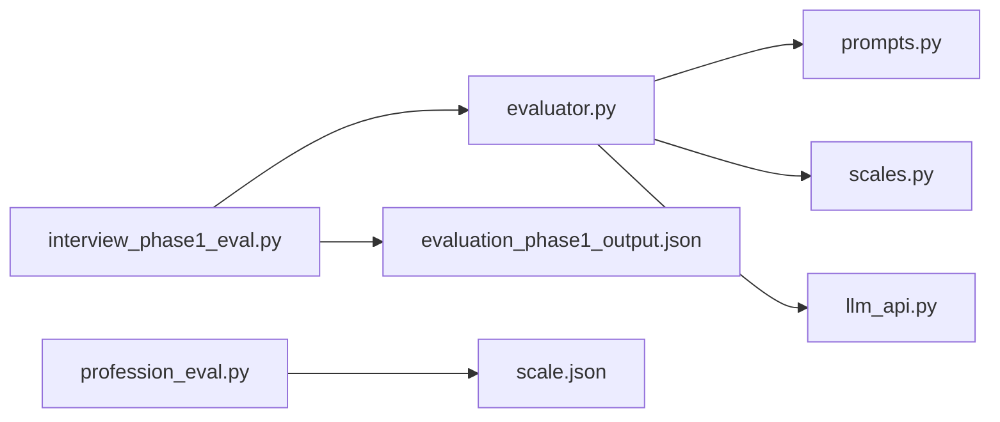

# 专业度评估指标

<cite>
**本文引用的文件**
- [run_interview.py](file://run_interview.py)
- [interview_phase1_eval.py](file://core/evaluate/interview_phase1_eval.py)
- [evaluator.py](file://core/evaluate/utils/phase1/evaluator.py)
- [prompts.py](file://core/evaluate/utils/phase1/prompts.py)
- [scales.py](file://core/evaluate/utils/phase1/scales.py)
- [profession_eval.py](file://eval_interview/profession_eval.py)
- [scale.json](file://eval_interview/scale.json)
- [llm_api.py](file://services/llm_api.py)
- [evaluation_phase1_output.json](file://data/output/evaluation/qwen-flash/1009904/evaluation_phase1_output.json)
- [interview_phase1_output.json](file://data/output/interview/qwen-flash/1009904/interview_phase1_output.json)
</cite>

## 目录
1. [引言](#引言)
2. [项目结构](#项目结构)
3. [核心组件](#核心组件)
4. [架构总览](#架构总览)
5. [详细组件分析](#详细组件分析)
6. [依赖关系分析](#依赖关系分析)
7. [性能考量](#性能考量)
8. [故障排查指南](#故障排查指南)
9. [结论](#结论)
10. [附录](#附录)

## 引言
本文件面向“专业度评估指标”的技术实现与应用，系统阐述专业度评估的理论框架、评分体系与统计逻辑，解释 total_score、average_score、question_count 等指标的计算方式与业务含义，并结合医疗问诊质量控制场景说明其价值。文档同时提供评估结果的解析方法、质量等级划分建议、与问诊效果的关系说明，以及基于案例的改进建议。

## 项目结构
本项目采用“阶段化访谈 + 多维评估”的流水线设计，专业度评估作为第一阶段（病史采集）的可选评估项，与共情度评估并行执行。评估结果以结构化 JSON 形式保存，便于后续统计分析与可视化。

**图表来源**
- [run_interview.py:70-78](file://run_interview.py#L70-L78)
- [interview_phase1_eval.py:254-292](file://core/evaluate/interview_phase1_eval.py#L254-L292)
- [evaluator.py:133-160](file://core/evaluate/utils/phase1/evaluator.py#L133-L160)
- [prompts.py:177-280](file://core/evaluate/utils/phase1/prompts.py#L177-L280)
- [scales.py:270-464](file://core/evaluate/utils/phase1/scales.py#L270-L464)
- [profession_eval.py:9-195](file://eval_interview/profession_eval.py#L9-L195)
- [scale.json:1-258](file://eval_interview/scale.json#L1-L258)
- [llm_api.py:247-250](file://services/llm_api.py#L247-L250)
- [evaluation_phase1_output.json:103-121](file://data/output/evaluation/qwen-flash/1009904/evaluation_phase1_output.json#L103-L121)

**章节来源**
- [run_interview.py:70-78](file://run_interview.py#L70-L78)
- [interview_phase1_eval.py:174-330](file://core/evaluate/interview_phase1_eval.py#L174-L330)

## 核心组件
- 评估入口与聚合：负责读取阶段I输出、格式化对话文本、调用评估器、聚合共情度与专业度结果并持久化。
- 评估器核心：封装专业度/共情度评估的提示词构造、LLM调用、分数解析与统计。
- 提示词模块：定义严格、证据导向的系统提示词与用户提示词，确保评分过程标准化。
- 量表定义：包含专业度量表（12题）与共情量表（16题），每题提供 question、definition、scores、focus。
- LLM服务：统一的评估器LLM服务，支持系统提示词注入与历史上下文管理。
- 输出与兼容：评估结果以 JSON 结构保存，兼容旧版接口与量表文件。

**章节来源**
- [interview_phase1_eval.py:254-292](file://core/evaluate/interview_phase1_eval.py#L254-L292)
- [evaluator.py:50-160](file://core/evaluate/utils/phase1/evaluator.py#L50-L160)
- [prompts.py:177-280](file://core/evaluate/utils/phase1/prompts.py#L177-L280)
- [scales.py:270-464](file://core/evaluate/utils/phase1/scales.py#L270-L464)
- [llm_api.py:247-250](file://services/llm_api.py#L247-L250)

## 架构总览
专业度评估在完整流程中的位置如下：

**图表来源**
- [run_interview.py:75-78](file://run_interview.py#L75-L78)
- [interview_phase1_eval.py:254-292](file://core/evaluate/interview_phase1_eval.py#L254-L292)
- [evaluator.py:133-160](file://core/evaluate/utils/phase1/evaluator.py#L133-L160)
- [prompts.py:217-280](file://core/evaluate/utils/phase1/prompts.py#L217-L280)
- [scales.py:270-464](file://core/evaluate/utils/phase1/scales.py#L270-L464)
- [llm_api.py:247-250](file://services/llm_api.py#L247-L250)
- [evaluation_phase1_output.json:103-121](file://data/output/evaluation/qwen-flash/1009904/evaluation_phase1_output.json#L103-L121)

## 详细组件分析

### 专业度评估实现与评分体系
- 量表构成：专业度量表包含12题，覆盖信息提炼、临床推理、鉴别诊断、自知力与病识感、风险评估与分层、功能损害、边界与共情平衡、去污名化、控场与动态调节等维度。
- 评分标准：每题采用0/1/2三级评分，0表示明显缺失或不当，1表示部分体现但不充分，2表示明确体现且有清晰证据支持。
- 评分流程：系统提示词强调“逐题独立评分、严格依据证据、不得互相借分、禁止先总评后回填”。用户提示词要求输出逐题 id、score、reason、evidence，并在最后统一输出 summary（total_score、average_score、strengths、weaknesses、overall_comment）。
- 分数解析：通过正则从模型输出中抽取每题 score，形成 parsed_scores 列表，用于计算统计指标。

**图表来源**
- [profession_eval.py:9-195](file://eval_interview/profession_eval.py#L9-L195)
- [prompts.py:177-280](file://core/evaluate/utils/phase1/prompts.py#L177-L280)
- [scales.py:270-464](file://core/evaluate/utils/phase1/scales.py#L270-L464)
- [evaluator.py:93-130](file://core/evaluate/utils/phase1/evaluator.py#L93-L130)

**章节来源**
- [profession_eval.py:9-195](file://eval_interview/profession_eval.py#L9-L195)
- [prompts.py:177-280](file://core/evaluate/utils/phase1/prompts.py#L177-L280)
- [scales.py:270-464](file://core/evaluate/utils/phase1/scales.py#L270-L464)
- [evaluator.py:93-130](file://core/evaluate/utils/phase1/evaluator.py#L93-L130)

### 评估入口与结果聚合
- 输入来源：支持从 interview_phase1 输出文件、直接传入数据字典、或通过 model_name+case_id 自动定位文件。
- 并行评估：可并行执行共情度与专业度评估，提升吞吐。
- 结果字段：profession_evaluation 包含 total_score、average_score、question_count、parsed_scores；empathy_evaluation 同理并包含 score_variance。
- 输出文件：评估结果以 evaluation_phaseX_output.json 保存，包含阶段标识、时间戳、统计数据与评估结果。

**图表来源**
- [interview_phase1_eval.py:174-330](file://core/evaluate/interview_phase1_eval.py#L174-L330)
- [evaluator.py:133-160](file://core/evaluate/utils/phase1/evaluator.py#L133-L160)

**章节来源**
- [interview_phase1_eval.py:174-330](file://core/evaluate/interview_phase1_eval.py#L174-L330)

### 专业度评估指标统计逻辑与业务意义
- total_score（总分）：所有题目的得分之和。用于衡量整体专业能力水平，数值越高代表在各维度体现越充分。
- average_score（平均分）：total_score 除以 question_count。用于消除题目数量差异的影响，便于跨案例比较。
- question_count（题目数量）：专业度评估包含12题，用于标准化平均分与总分的解释口径。
- 业务意义：
  - 诊断与鉴别：高分通常反映医生具备良好的信息提炼、推理与鉴别能力，有助于准确识别核心症状与风险。
  - 风险管理：高分体现对自知力、病识感与风险评估的关注，有助于早期识别与干预。
  - 沟通质量：高分常伴随对共情边界、去污名化与动态调节的良好把控，有利于建立治疗联盟。
  - 培训与改进：低分项可作为针对性训练目标，如加强鉴别诊断、风险评估或边界管理。

**章节来源**
- [evaluation_phase1_output.json:103-121](file://data/output/evaluation/qwen-flash/1009904/evaluation_phase1_output.json#L103-L121)
- [scales.py:270-464](file://core/evaluate/utils/phase1/scales.py#L270-L464)

### 专业度评估结果解析与质量等级划分
- 评分分布：通过 parsed_scores 观察各题得分分布，识别“高分稳定区”与“薄弱环节”。
- 统计特征：结合 total_score 与 average_score，评估整体水平；question_count 用于解释口径一致性。
- 质量等级（示例建议）：
  - 优秀：average_score ≥ 1.8，total_score ≥ 0.9×满分
  - 良好：1.5 ≤ average_score < 1.8
  - 一般：1.2 ≤ average_score < 1.5
  - 待改进：average_score < 1.2
- 指标解读：
  - 若多题得0，需关注是否存在系统性问题（如忽略风险、缺乏鉴别、边界模糊）。
  - 若平均分较高但个别题得0，提示该题对应的专项能力薄弱，建议专项强化训练。

**章节来源**
- [evaluation_phase1_output.json:103-121](file://data/output/evaluation/qwen-flash/1009904/evaluation_phase1_output.json#L103-L121)
- [scales.py:270-464](file://core/evaluate/utils/phase1/scales.py#L270-L464)

### 专业度评估与问诊效果的关系
- 问诊质量：专业度高通常意味着医生能快速抓住核心症状、进行系统性推理与鉴别，减少误诊与漏诊。
- 风险控制：专业度评估中的风险评估与分层能力直接影响患者安全与治疗依从性。
- 治疗联盟：良好的边界管理与去污名化能力有助于提升患者信任与配合度。
- 评估驱动改进：将专业度评估结果纳入医生绩效与培训计划，可形成“评估—反馈—改进”的闭环。

**章节来源**
- [scales.py:270-464](file://core/evaluate/utils/phase1/scales.py#L270-L464)
- [evaluation_phase1_output.json:103-121](file://data/output/evaluation/qwen-flash/1009904/evaluation_phase1_output.json#L103-L121)

### 实际评估案例与改进建议
- 案例背景：来自 interview_phase1_output.json 的对话样本，涵盖敏感多疑、被害妄想、幻觉与功能受损等典型精神症状。
- 评估结果：profession_evaluation 显示 total_score 与 average_score 均为2.0（满分24），表明在12题中均体现了较高水平的专业能力。
- 改进建议：
  - 针对“信息提炼”与“鉴别诊断”：可引入更多结构化提问模板与鉴别要点清单，减少遗漏。
  - 针对“风险评估与分层”：在出现高危线索时，建议使用标准化评估工具与追问清单，确保系统性。
  - 针对“边界与共情平衡”：通过情景模拟训练，提升在面对病理性内容时的稳定性与边界感。
  - 针对“动态调节”：根据患者状态（焦虑、激越、思维散漫）调整沟通节奏与复杂度，提升访谈适配能力。

**章节来源**
- [interview_phase1_output.json:40-166](file://data/output/interview/qwen-flash/1009904/interview_phase1_output.json#L40-L166)
- [evaluation_phase1_output.json:103-121](file://data/output/evaluation/qwen-flash/1009904/evaluation_phase1_output.json#L103-L121)

## 依赖关系分析
- 组件耦合：
  - 评估入口与评估器：通过 evaluate_both/evaluate_profession 解耦，支持并行与独立调用。
  - 提示词与量表：通过 format_scale_text 与 get_*_user_prompt 统一注入，确保评分一致性。
  - LLM服务：统一由 get_evaluator_llm 提供，便于配置与扩展。
- 外部依赖：
  - OpenAI Chat Completions API：通过 llm_api 提供统一调用与重试机制。
  - 数据文件：专业度量表可来自内置定义或外部文件（profession_eval），兼容多量表结构。

**图表来源**
- [interview_phase1_eval.py:254-292](file://core/evaluate/interview_phase1_eval.py#L254-L292)
- [evaluator.py:133-160](file://core/evaluate/utils/phase1/evaluator.py#L133-L160)
- [prompts.py:177-280](file://core/evaluate/utils/phase1/prompts.py#L177-L280)
- [scales.py:270-464](file://core/evaluate/utils/phase1/scales.py#L270-L464)
- [profession_eval.py:9-195](file://eval_interview/profession_eval.py#L9-L195)
- [scale.json:1-258](file://eval_interview/scale.json#L1-L258)
- [llm_api.py:247-250](file://services/llm_api.py#L247-L250)
- [evaluation_phase1_output.json:103-121](file://data/output/evaluation/qwen-flash/1009904/evaluation_phase1_output.json#L103-L121)

**章节来源**
- [interview_phase1_eval.py:254-292](file://core/evaluate/interview_phase1_eval.py#L254-L292)
- [evaluator.py:133-160](file://core/evaluate/utils/phase1/evaluator.py#L133-L160)
- [llm_api.py:247-250](file://services/llm_api.py#L247-L250)

## 性能考量
- 并行评估：evaluate_both 支持并行调用评估器LLM，显著缩短评估耗时。
- 正则解析：通过正则抽取每题 score，避免复杂的结构化解析，提升稳定性与速度。
- 输出缓存：评估结果以JSON持久化，便于二次分析与批量处理。
- LLM调用优化：统一的LLM服务提供重试与超时控制，减少失败重试成本。

**章节来源**
- [evaluator.py:133-160](file://core/evaluate/utils/phase1/evaluator.py#L133-L160)
- [llm_api.py:158-169](file://services/llm_api.py#L158-L169)

## 故障排查指南
- 量表文件问题：
  - 现象：找不到专业度量表或格式不支持。
  - 处理：确认 scale.json 或内置量表存在；若使用外部文件，确保路径正确且为合法JSON。
- 对话文本为空：
  - 现象：评估报错提示 conversation_text 不能为空。
  - 处理：检查输入数据来源，确保对话文本非空。
- LLM调用失败：
  - 现象：评估器LLM调用异常或超时。
  - 处理：检查 .env 中评估器配置、网络连通性与API密钥；必要时增加超时或重试次数。
- 输出解析异常：
  - 现象：正则无法提取每题 score。
  - 处理：核对模型输出格式是否符合要求；必要时调整提示词以确保输出结构稳定。

**章节来源**
- [profession_eval.py:20-42](file://eval_interview/profession_eval.py#L20-L42)
- [evaluator.py:21-31](file://core/evaluate/utils/phase1/evaluator.py#L21-L31)
- [llm_api.py:158-169](file://services/llm_api.py#L158-L169)

## 结论
专业度评估通过标准化的12题量表与严格的评分流程，为精神科问诊质量提供了可量化的观测维度。total_score、average_score、question_count 等指标不仅可用于个体医生能力画像，还可支撑团队质量监控与培训改进。结合实际案例与质量等级划分，可形成从评估到反馈再到能力提升的闭环，助力医疗问诊质量的持续优化。

## 附录
- 专业度量表（12题）关键维度举例：
  - 信息提炼与优先级：从松散叙述中识别核心症状与当前最优先的访谈目标。
  - 临床推理与鉴别：围绕症状特征、病程、严重度与功能损害建立逻辑框架。
  - 自知力与病识感：在出现线索时自然、深入地评估患者对异常体验的认知与求治态度。
  - 风险评估与分层：在已启动评估后完成深度分层，关注计划、手段、既往行为与保护因素。
  - 功能损害：评估症状对学习、工作、社交、自理与家庭角色的影响。
  - 边界与共情平衡：在支持患者的同时保持专业中立，避免过度认同或边界模糊。
  - 去污名化与非道德化：以尊重与客观的方式理解症状与行为，帮助患者重构理解框架。
  - 控场与动态调节：在复杂情境下保持主线与效率，同时维持患者被尊重与被倾听的感受。
  - 动态适配：根据患者当下的精神状态、认知负荷与情绪承受能力调整沟通节奏与复杂度。

**章节来源**
- [scales.py:270-464](file://core/evaluate/utils/phase1/scales.py#L270-L464)
- [scale.json:1-258](file://eval_interview/scale.json#L1-L258)