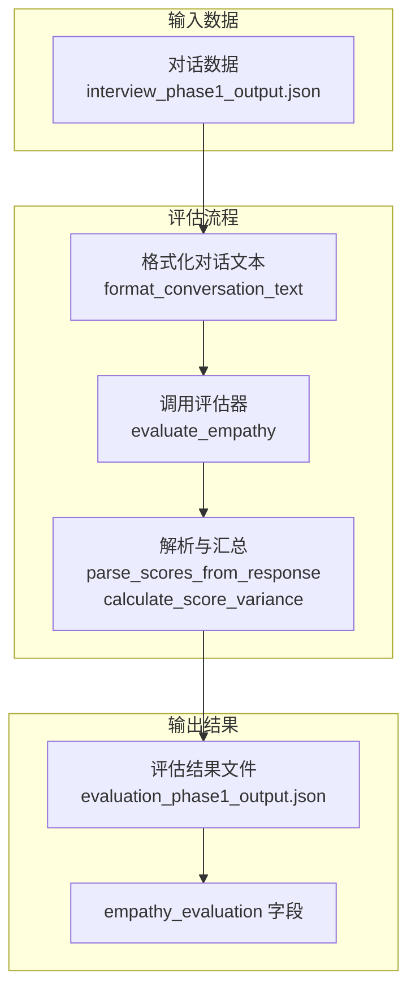
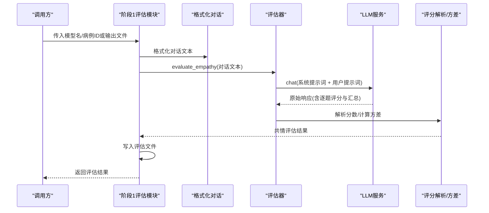
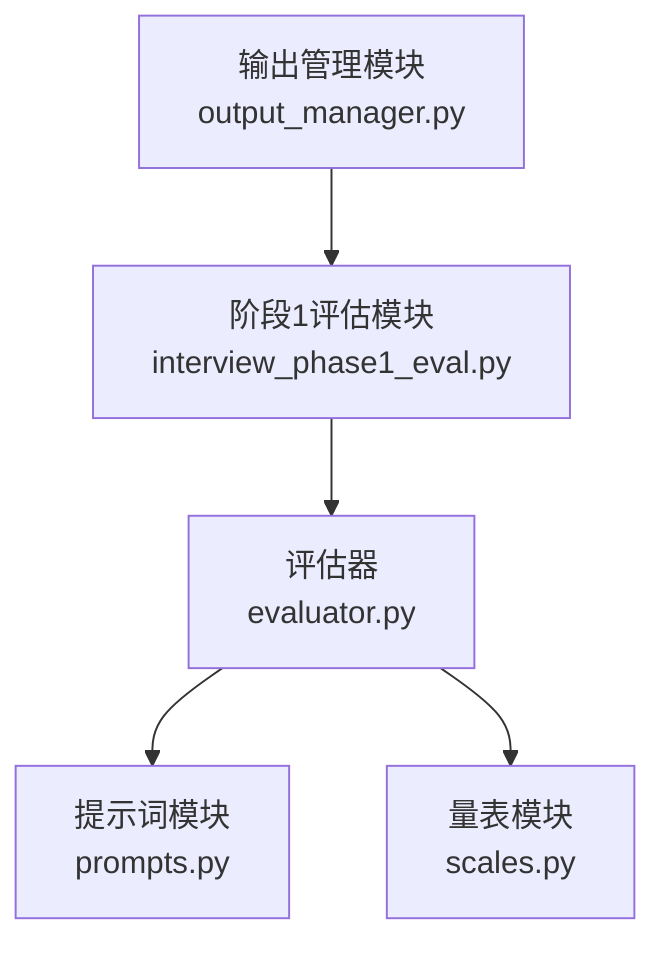

# 共情度评估指标

<cite>
**本文档引用的文件**
- [eval_interview/empathy_eval.py](file://eval_interview/empathy_eval.py)
- [eval_interview/scale.json](file://eval_interview/scale.json)
- [core/evaluate/interview_phase1_eval.py](file://core/evaluate/interview_phase1_eval.py)
- [core/evaluate/utils/phase1/__init__.py](file://core/evaluate/utils/phase1/__init__.py)
- [core/evaluate/utils/phase1/evaluator.py](file://core/evaluate/utils/phase1/evaluator.py)
- [core/evaluate/utils/phase1/prompts.py](file://core/evaluate/utils/phase1/prompts.py)
- [core/evaluate/utils/phase1/scales.py](file://core/evaluate/utils/phase1/scales.py)
- [core/output_manager.py](file://core/output_manager.py)
- [data/output/evaluation/qwen-flash/1009904/evaluation_phase1_output.json](file://data/output/evaluation/qwen-flash/1009904/evaluation_phase1_output.json)
- [data/output/interview/qwen-flash/1009904/interview_phase1_output.json](file://data/output/interview/qwen-flash/1009904/interview_phase1_output.json)
</cite>

## 目录
1. [简介](#简介)
2. [项目结构](#项目结构)
3. [核心组件](#核心组件)
4. [架构总览](#架构总览)
5. [详细组件分析](#详细组件分析)
6. [依赖关系分析](#依赖关系分析)
7. [性能考量](#性能考量)
8. [故障排查指南](#故障排查指南)
9. [结论](#结论)
10. [附录](#附录)

## 简介
本文件面向精神科问诊场景，系统化阐述共情度评估指标的理论基础、实现机制与实践应用。重点围绕以下目标展开：
- 解释共情度评估的理论基础与评分体系，包括16项独立评分维度与反向风险识别项的设计意图。
- 详解共情度评估的计算逻辑，包括 total_score、average_score、score_variance、question_count 等关键指标的含义与计算方法。
- 说明共情度评估在精神科问诊中的作用：如何通过量化指标评估医生的共情能力与沟通技巧，辅助培训与改进。
- 解析评估结果的数据结构，特别是 empathy_evaluation 字段与 parsed_scores 的格式与含义。
- 提供实际评估示例与结果分析指南，帮助使用者正确解读与应用评估结果。

## 项目结构
本项目采用“阶段化访谈 + 多维评估”的流水线设计，共情度评估位于第一阶段评估流程中，由统一的评估模块调用 LLM 完成评分与汇总。

图表来源
- [core/evaluate/interview_phase1_eval.py:174-330](file://core/evaluate/interview_phase1_eval.py#L174-L330)
- [core/evaluate/utils/phase1/evaluator.py:50-90](file://core/evaluate/utils/phase1/evaluator.py#L50-L90)

章节来源
- [core/evaluate/interview_phase1_eval.py:174-330](file://core/evaluate/interview_phase1_eval.py#L174-L330)
- [core/output_manager.py:20-47](file://core/output_manager.py#L20-L47)

## 核心组件
- 共情评估入口与流程编排：负责读取对话、格式化文本、调用评估器、解析结果并写入评估文件。
- 量表与提示词：提供16项共情维度的题目、定义、评分标准与关注点，以及严格的系统提示词与用户提示词。
- LLM 评估器：封装评分解析、方差计算与汇总输出。
- 输出管理：统一管理各阶段输出文件路径与写入。

章节来源
- [core/evaluate/interview_phase1_eval.py:174-330](file://core/evaluate/interview_phase1_eval.py#L174-L330)
- [core/evaluate/utils/phase1/evaluator.py:50-160](file://core/evaluate/utils/phase1/evaluator.py#L50-L160)
- [core/evaluate/utils/phase1/prompts.py:111-174](file://core/evaluate/utils/phase1/prompts.py#L111-L174)
- [core/evaluate/utils/phase1/scales.py:10-267](file://core/evaluate/utils/phase1/scales.py#L10-L267)

## 架构总览
共情度评估在第一阶段评估模块中执行，整体流程如下：

图表来源
- [core/evaluate/interview_phase1_eval.py:254-298](file://core/evaluate/interview_phase1_eval.py#L254-L298)
- [core/evaluate/utils/phase1/evaluator.py:50-90](file://core/evaluate/utils/phase1/evaluator.py#L50-L90)

## 详细组件分析

### 共情评估入口与流程
- 输入：对话记录（医生-患者多轮对话）。
- 处理：
  - 格式化为统一文本，便于 LLM 一次性读取。
  - 调用评估器，传入系统提示词与用户提示词。
  - 从 LLM 响应中解析逐题分数，并计算方差。
- 输出：包含 total_score、average_score、score_variance、question_count、parsed_scores 等字段的评估结果，写入评估文件。

章节来源
- [core/evaluate/interview_phase1_eval.py:254-298](file://core/evaluate/interview_phase1_eval.py#L254-L298)
- [core/evaluate/interview_phase1_eval.py:275-291](file://core/evaluate/interview_phase1_eval.py#L275-L291)

### 量表与评分维度
- 量表来源：支持两种形态：
  - 单表16题（列表形式）。
  - 多表结构（字典内含多个列表）。
- 维度构成：16项独立评分维度，涵盖情绪识别、共情理解、回应顺序、语言自然度、语气匹配、建议时机、反向风险识别（模板化、夸张、权威姿态）等。
- 评分标准：每题仅依据自身 question、definition、scores、focus 判断，互不借分；证据导向，高分谨慎。

章节来源
- [eval_interview/empathy_eval.py:62-77](file://eval_interview/empathy_eval.py#L62-L77)
- [eval_interview/scale.json:1-258](file://eval_interview/scale.json#L1-L258)
- [core/evaluate/utils/phase1/scales.py:10-267](file://core/evaluate/utils/phase1/scales.py#L10-L267)

### 提示词与输出约束
- 系统提示词强调：
  - 16题独立评估、证据导向、高分谨慎、禁止先总评后回填。
  - 输出必须包含逐题 id、score、reason、evidence，以及汇总 total_score、average_score、score_variance、strengths、weaknesses、overall_comment。
- 用户提示词包含：
  - 医患对话文本与评分量表文本。
  - 明确的输出格式要求与示例。

章节来源
- [eval_interview/empathy_eval.py:99-227](file://eval_interview/empathy_eval.py#L99-L227)
- [core/evaluate/utils/phase1/prompts.py:35-108](file://core/evaluate/utils/phase1/prompts.py#L35-L108)
- [core/evaluate/utils/phase1/prompts.py:111-174](file://core/evaluate/utils/phase1/prompts.py#L111-L174)

### 评分解析与汇总逻辑
- 解析规则：从 LLM 响应中提取每题的 score（仅0、1、2），并计算方差。
- 汇总指标：
  - total_score：所有题得分之和。
  - average_score：total_score 除以题数。
  - score_variance：基于总体方差的计算（每个分数减去平均值的平方和再除以样本数）。
  - question_count：题数（16）。
  - parsed_scores：逐题解析得到的分数序列。

章节来源
- [eval_interview/empathy_eval.py:233-237](file://eval_interview/empathy_eval.py#L233-L237)
- [eval_interview/empathy_eval.py:239-247](file://eval_interview/empathy_eval.py#L239-L247)
- [core/evaluate/utils/phase1/evaluator.py:21-47](file://core/evaluate/utils/phase1/evaluator.py#L21-L47)
- [core/evaluate/utils/phase1/evaluator.py:78-89](file://core/evaluate/utils/phase1/evaluator.py#L78-L89)

### 数据结构解析：empathy_evaluation 字段
- 字段组成：
  - total_score：总分。
  - average_score：平均分。
  - score_variance：分数方差。
  - question_count：题数。
  - parsed_scores：逐题分数列表（长度为16）。
- 存储位置：评估文件 evaluation_phaseX_output.json 的 empathy_evaluation 字段中。

章节来源
- [core/evaluate/interview_phase1_eval.py:275-282](file://core/evaluate/interview_phase1_eval.py#L275-L282)
- [data/output/evaluation/qwen-flash/1009904/evaluation_phase1_output.json:79-101](file://data/output/evaluation/qwen-flash/1009904/evaluation_phase1_output.json#L79-L101)

### 实际评估示例与结果分析
- 示例数据：evaluation_phase1_output.json 展示了完整的共情评估结果，包含 parsed_scores、total_score、average_score、score_variance 等。
- 分析要点：
  - 若 average_score 接近满分，表明医生在多数维度上均体现出良好的共情能力。
  - 若 score_variance 较小，表明医生在各维度上的表现较为均衡；若较大，可能存在某些维度明显偏高或偏低。
  - parsed_scores 可用于定位具体薄弱环节，如第1题或第16题得分较低，提示在情绪识别或避免权威姿态方面有待提升。

章节来源
- [data/output/evaluation/qwen-flash/1009904/evaluation_phase1_output.json:79-101](file://data/output/evaluation/qwen-flash/1009904/evaluation_phase1_output.json#L79-L101)
- [data/output/interview/qwen-flash/1009904/interview_phase1_output.json:40-166](file://data/output/interview/qwen-flash/1009904/interview_phase1_output.json#L40-L166)

## 依赖关系分析
- 模块耦合：
  - 阶段1评估模块依赖输出管理模块获取文件路径。
  - 评估器依赖提示词模块与量表模块。
  - 共情评估入口依赖评估器与输出管理。
- 外部依赖：
  - LLM 服务：用于执行评估与生成评分。
  - 文件系统：读取对话输出与写入评估结果。

图表来源
- [core/output_manager.py:20-47](file://core/output_manager.py#L20-L47)
- [core/evaluate/interview_phase1_eval.py:254-298](file://core/evaluate/interview_phase1_eval.py#L254-L298)
- [core/evaluate/utils/phase1/evaluator.py:50-160](file://core/evaluate/utils/phase1/evaluator.py#L50-L160)
- [core/evaluate/utils/phase1/prompts.py:111-174](file://core/evaluate/utils/phase1/prompts.py#L111-L174)
- [core/evaluate/utils/phase1/scales.py:10-267](file://core/evaluate/utils/phase1/scales.py#L10-L267)

章节来源
- [core/evaluate/interview_phase1_eval.py:254-298](file://core/evaluate/interview_phase1_eval.py#L254-L298)
- [core/evaluate/utils/phase1/__init__.py:7-18](file://core/evaluate/utils/phase1/__init__.py#L7-L18)

## 性能考量
- 评估并发：阶段1评估模块支持并行评估共情度与专业度，可缩短总耗时。
- 解析效率：评分解析采用正则匹配，复杂度与题数线性相关；方差计算同样线性。
- I/O 开销：评估结果写入文件为顺序写入，建议批量写入以减少磁盘压力。
- LLM 成本：评估过程依赖外部 LLM 服务，建议在批量评估时合并请求或使用缓存策略。

## 故障排查指南
- 常见问题与处理：
  - 未找到共情量表：检查 data 目录下是否存在 scale.json 或兼容文件名；若不存在，需传入 scale_path。
  - 对话文本为空：确保传入的对话文本非空且包含有效轮次。
  - LLM 评估失败：检查网络连接与服务可用性；查看异常栈信息定位具体环节。
  - 解析不到分数：确认 LLM 输出严格遵循提示词格式，逐题包含 id、score、reason、evidence。
- 关键日志与输出：
  - 阶段1评估模块打印覆盖率、对话统计与共情度结果，便于快速核验。
  - 评估文件包含 timestamps 与状态字段，便于追踪流程进度。

章节来源
- [eval_interview/empathy_eval.py:43-44](file://eval_interview/empathy_eval.py#L43-L44)
- [eval_interview/empathy_eval.py:20-21](file://eval_interview/empathy_eval.py#L20-L21)
- [core/evaluate/interview_phase1_eval.py:294-297](file://core/evaluate/interview_phase1_eval.py#L294-L297)
- [core/evaluate/interview_phase1_eval.py:308-318](file://core/evaluate/interview_phase1_eval.py#L308-L318)

## 结论
本项目通过标准化的16项共情维度与严格的评分约束，实现了对精神科医生共情能力的量化评估。评估指标（total_score、average_score、score_variance、question_count）与解析结果（parsed_scores）共同构成全面的反馈体系，既可用于个体培训改进，也可用于团队质量监控与持续优化。建议在日常实践中结合 parsed_scores 的细粒度反馈与 average_score 的整体概览，制定针对性的训练计划与改进措施。

## 附录

### 指标定义与计算方法
- total_score：所有题得分之和。范围 [0, 2×题数]。
- average_score：total_score ÷ 题数。范围 [0, 2]。
- score_variance：总体方差，衡量各题得分离散程度。范围 [0, 1]，越小越均衡。
- question_count：题数（16）。
- parsed_scores：长度为16的整数序列，元素取值为0、1、2。

章节来源
- [eval_interview/empathy_eval.py:233-237](file://eval_interview/empathy_eval.py#L233-L237)
- [eval_interview/empathy_eval.py:239-247](file://eval_interview/empathy_eval.py#L239-L247)
- [core/evaluate/utils/phase1/evaluator.py:78-89](file://core/evaluate/utils/phase1/evaluator.py#L78-L89)

### 评估结果字段说明
- empathy_evaluation：
  - total_score：总分。
  - average_score：平均分。
  - score_variance：方差。
  - question_count：题数。
  - parsed_scores：逐题分数列表。

章节来源
- [core/evaluate/interview_phase1_eval.py:275-282](file://core/evaluate/interview_phase1_eval.py#L275-L282)
- [data/output/evaluation/qwen-flash/1009904/evaluation_phase1_output.json:79-101](file://data/output/evaluation/qwen-flash/1009904/evaluation_phase1_output.json#L79-L101)