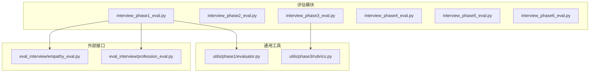
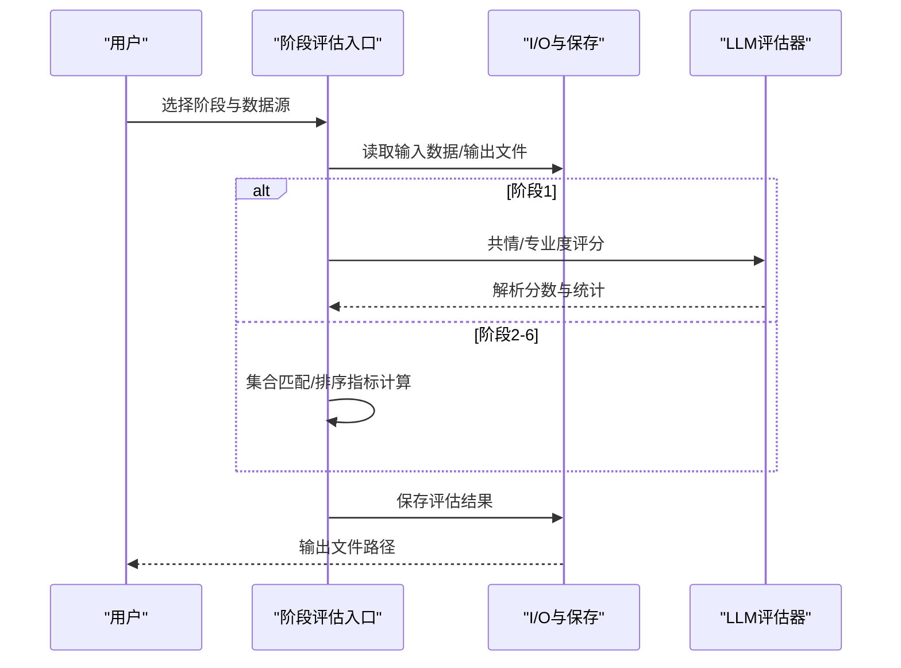
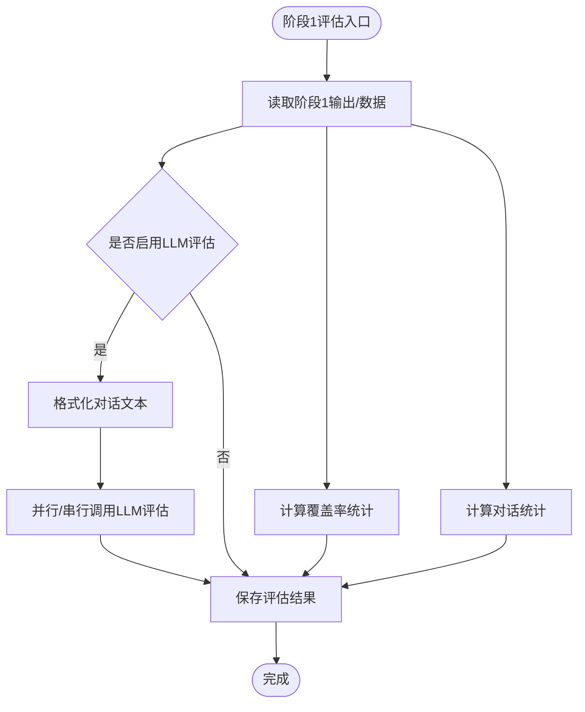
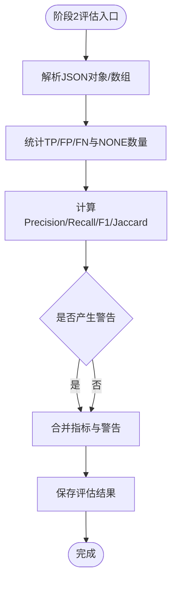
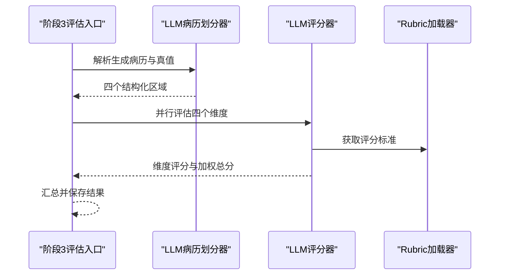
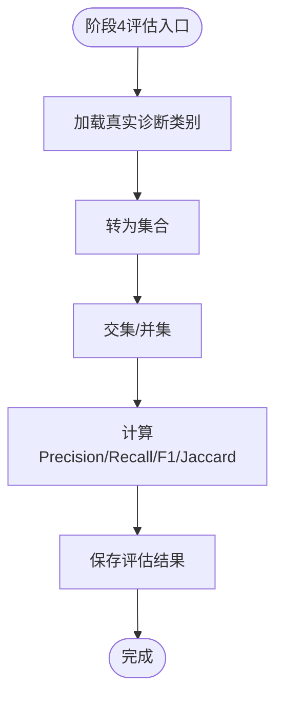
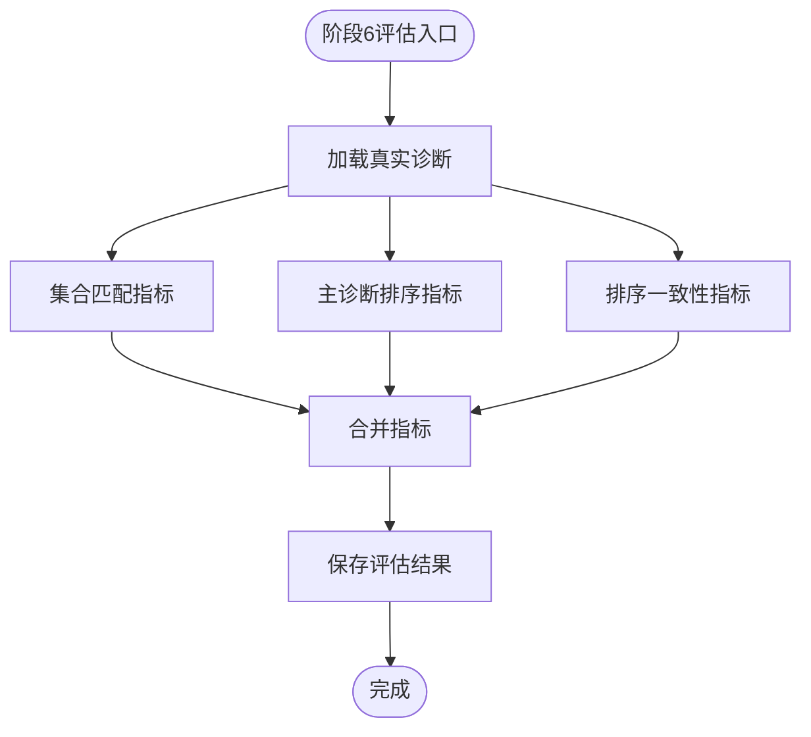
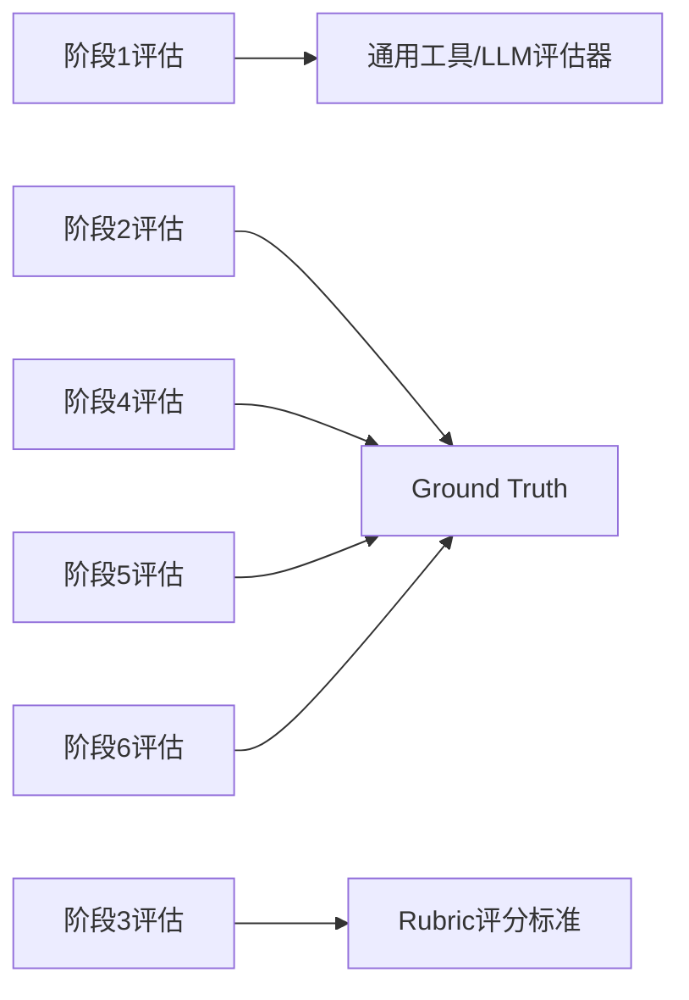

# 多维度评估指标

<cite>
**本文档引用的文件**
- [core/evaluate/interview_phase1_eval.py](file://core/evaluate/interview_phase1_eval.py)
- [core/evaluate/interview_phase2_eval.py](file://core/evaluate/interview_phase2_eval.py)
- [core/evaluate/interview_phase3_eval.py](file://core/evaluate/interview_phase3_eval.py)
- [core/evaluate/interview_phase4_eval.py](file://core/evaluate/interview_phase4_eval.py)
- [core/evaluate/interview_phase5_eval.py](file://core/evaluate/interview_phase5_eval.py)
- [core/evaluate/interview_phase6_eval.py](file://core/evaluate/interview_phase6_eval.py)
- [core/evaluate/utils/phase1/evaluator.py](file://core/evaluate/utils/phase1/evaluator.py)
- [core/evaluate/utils/phase3/rubrics.py](file://core/evaluate/utils/phase3/rubrics.py)
- [eval_interview/empathy_eval.py](file://eval_interview/empathy_eval.py)
- [eval_interview/profession_eval.py](file://eval_interview/profession_eval.py)
- [scripts/test_phase1_evaluation.py](file://scripts/test_phase1_evaluation.py)
</cite>

## 目录
1. [引言](#引言)
2. [项目结构](#项目结构)
3. [核心组件](#核心组件)
4. [架构总览](#架构总览)
5. [详细组件分析](#详细组件分析)
6. [依赖分析](#依赖分析)
7. [性能考虑](#性能考虑)
8. [故障排查指南](#故障排查指南)
9. [结论](#结论)
10. [附录](#附录)

## 引言
本技术文档围绕精神科问诊流程的多维度评估指标体系，系统梳理并解释各阶段评估指标的计算方法、应用场景与实现细节。文档聚焦以下统计指标：
- 精确率（Precision）
- 召回率（Recall）
- F1 分数（F1）
- Jaccard 相似度（Jaccard）

并补充：
- 覆盖率（Coverage）：用于第一阶段主诉与精神状态条目的覆盖统计
- 对话统计（Turns/Length）：用于第一阶段对话轮次与长度统计
- 临床病历评分（百分比与维度加权）：用于第三阶段病历结构化评分
- 诊断类别集合匹配与排序指标：用于第四至第六阶段的诊断准确性与排序一致性评估

文档还提供阈值设定建议、结果解释方法与系统优化、性能监控中的应用思路，帮助读者全面理解问诊质量评估与持续改进。

## 项目结构
评估模块按问诊阶段拆分，每个阶段提供独立的评估入口与指标计算逻辑，统一通过评估输出目录保存结果。核心文件分布如下：
- 阶段评估入口：phase1 至 phase6 的评估脚本
- 通用工具：覆盖率与对话统计、LLM 评估器、评分量表与提示词
- 测试脚本：用于快速验证阶段1评估流程

**图表来源**
- [core/evaluate/interview_phase1_eval.py:174-330](file://core/evaluate/interview_phase1_eval.py#L174-L330)
- [core/evaluate/interview_phase2_eval.py:153-255](file://core/evaluate/interview_phase2_eval.py#L153-L255)
- [core/evaluate/interview_phase3_eval.py:422-552](file://core/evaluate/interview_phase3_eval.py#L422-L552)
- [core/evaluate/interview_phase4_eval.py:126-210](file://core/evaluate/interview_phase4_eval.py#L126-L210)
- [core/evaluate/interview_phase5_eval.py:126-210](file://core/evaluate/interview_phase5_eval.py#L126-L210)
- [core/evaluate/interview_phase6_eval.py:267-370](file://core/evaluate/interview_phase6_eval.py#L267-L370)
- [core/evaluate/utils/phase1/evaluator.py:50-160](file://core/evaluate/utils/phase1/evaluator.py#L50-L160)
- [core/evaluate/utils/phase3/rubrics.py:15-423](file://core/evaluate/utils/phase3/rubrics.py#L15-L423)
- [eval_interview/empathy_eval.py:9-248](file://eval_interview/empathy_eval.py#L9-L248)
- [eval_interview/profession_eval.py:9-204](file://eval_interview/profession_eval.py#L9-L204)

**章节来源**
- [core/evaluate/interview_phase1_eval.py:174-330](file://core/evaluate/interview_phase1_eval.py#L174-L330)
- [core/evaluate/interview_phase2_eval.py:153-255](file://core/evaluate/interview_phase2_eval.py#L153-L255)
- [core/evaluate/interview_phase3_eval.py:422-552](file://core/evaluate/interview_phase3_eval.py#L422-L552)
- [core/evaluate/interview_phase4_eval.py:126-210](file://core/evaluate/interview_phase4_eval.py#L126-L210)
- [core/evaluate/interview_phase5_eval.py:126-210](file://core/evaluate/interview_phase5_eval.py#L126-L210)
- [core/evaluate/interview_phase6_eval.py:267-370](file://core/evaluate/interview_phase6_eval.py#L267-L370)

## 核心组件
- 阶段1评估（历史采集）：覆盖率统计、对话统计、共情度与专业度LLM评估
- 阶段2评估（检查推荐）：基于Instrument返回的检查项目，计算Precision/Recall/F1/Jaccard
- 阶段3评估（临床病历）：基于Rubric评分标准，按维度（主诉、体格、精神、既往史家族史）评分并加权
- 阶段4评估（诊断类别识别）：集合匹配Precision/Recall/F1/Jaccard
- 阶段5评估（诊断假设）：集合匹配Precision/Recall/F1/Jaccard
- 阶段6评估（鉴别诊断）：集合匹配指标 + 主诊断排序指标（Exact Match、Hit@K、Reciprocal Rank）+ 排序一致性指标（POA、nDCG）

**章节来源**
- [core/evaluate/interview_phase1_eval.py:62-114](file://core/evaluate/interview_phase1_eval.py#L62-L114)
- [core/evaluate/interview_phase2_eval.py:66-150](file://core/evaluate/interview_phase2_eval.py#L66-L150)
- [core/evaluate/interview_phase3_eval.py:422-552](file://core/evaluate/interview_phase3_eval.py#L422-L552)
- [core/evaluate/interview_phase4_eval.py:66-123](file://core/evaluate/interview_phase4_eval.py#L66-L123)
- [core/evaluate/interview_phase5_eval.py:66-123](file://core/evaluate/interview_phase5_eval.py#L66-L123)
- [core/evaluate/interview_phase6_eval.py:69-264](file://core/evaluate/interview_phase6_eval.py#L69-L264)

## 架构总览
评估流程由“数据读取 → 指标计算 → 结果保存 → 可视化/报告”构成。阶段1采用LLM对共情与专业度进行评分；阶段2-6采用集合匹配与排序指标进行自动化评估。所有阶段均支持从输出文件或直接传入数据两种方式启动，并统一保存评估结果。

**图表来源**
- [core/evaluate/interview_phase1_eval.py:174-330](file://core/evaluate/interview_phase1_eval.py#L174-L330)
- [core/evaluate/interview_phase2_eval.py:153-255](file://core/evaluate/interview_phase2_eval.py#L153-L255)
- [core/evaluate/interview_phase3_eval.py:422-552](file://core/evaluate/interview_phase3_eval.py#L422-L552)
- [core/evaluate/interview_phase4_eval.py:126-210](file://core/evaluate/interview_phase4_eval.py#L126-L210)
- [core/evaluate/interview_phase5_eval.py:126-210](file://core/evaluate/interview_phase5_eval.py#L126-L210)
- [core/evaluate/interview_phase6_eval.py:267-370](file://core/evaluate/interview_phase6_eval.py#L267-L370)

## 详细组件分析

### 阶段1：历史采集（覆盖率与对话统计、共情/专业度）
- 覆盖率统计
  - 主诉覆盖率 = 已使用主诉条目数 / 所有主诉条目数 × 100%
  - 精神状态覆盖率 = 已使用精神状态条目数 / 所有精神状态条目数 × 100%
  - 整体覆盖率 = (已使用条目总数 / 所有条目总数) × 100%
- 对话统计
  - 患者轮次、医生轮次、总轮次、对话长度
- 共情/专业度评估
  - 通过LLM评分，解析每题分数，计算平均分与方差（阶段1）
  - 支持并行评估两个维度

**图表来源**
- [core/evaluate/interview_phase1_eval.py:174-330](file://core/evaluate/interview_phase1_eval.py#L174-L330)
- [core/evaluate/utils/phase1/evaluator.py:50-160](file://core/evaluate/utils/phase1/evaluator.py#L50-L160)

**章节来源**
- [core/evaluate/interview_phase1_eval.py:62-114](file://core/evaluate/interview_phase1_eval.py#L62-L114)
- [core/evaluate/interview_phase1_eval.py:174-330](file://core/evaluate/interview_phase1_eval.py#L174-L330)
- [core/evaluate/utils/phase1/evaluator.py:50-160](file://core/evaluate/utils/phase1/evaluator.py#L50-L160)

### 阶段2：检查推荐（Precision/Recall/F1/Jaccard）
- 输入
  - Instrument返回的检查项目映射（键为请求项，值为检查结果）
  - 医生请求的检查项目数组
  - 真值（gold）辅助检查对象
- 计算
  - 将返回值中“NONE”计为冗余（FP），其余为TP
  - FN = 真值数量 - TP
  - Precision = TP / (TP + FP)，Recall = TP / (TP + FN)
  - F1 = 2PR/(P + R)，Jaccard = TP / (TP + FP + FN)
- 输出
  - 指标字典与警告信息（如返回键值对数量与请求数不一致）

**图表来源**
- [core/evaluate/interview_phase2_eval.py:66-150](file://core/evaluate/interview_phase2_eval.py#L66-L150)

**章节来源**
- [core/evaluate/interview_phase2_eval.py:66-150](file://core/evaluate/interview_phase2_eval.py#L66-L150)

### 阶段3：临床病历（百分比与维度加权）
- 数据准备
  - 从Ground Truth加载标准病历
  - 生成病历的四个结构化区域（主诉、体格、精神、既往史家族史）
- 评分
  - 基于Rubric定义的覆盖度与准确度（0/1或skip）
  - 计算各维度百分比与加权得分
  - 总分 = Σ(维度百分比 × 权重)
- 输出
  - 总百分比、维度详情、加权得分、实际得分/满分

**图表来源**
- [core/evaluate/interview_phase3_eval.py:422-552](file://core/evaluate/interview_phase3_eval.py#L422-L552)
- [core/evaluate/utils/phase3/rubrics.py:15-423](file://core/evaluate/utils/phase3/rubrics.py#L15-L423)

**章节来源**
- [core/evaluate/interview_phase3_eval.py:422-552](file://core/evaluate/interview_phase3_eval.py#L422-L552)
- [core/evaluate/utils/phase3/rubrics.py:15-423](file://core/evaluate/utils/phase3/rubrics.py#L15-L423)

### 阶段4：诊断类别识别（Precision/Recall/F1/Jaccard）
- 输入
  - 预测诊断类别列表
  - 真实诊断类别列表（从Ground Truth加载）
- 计算
  - 预测集合与真实集合求交并
  - Precision/Recall/F1/Jaccard按集合匹配口径计算

**图表来源**
- [core/evaluate/interview_phase4_eval.py:126-210](file://core/evaluate/interview_phase4_eval.py#L126-L210)

**章节来源**
- [core/evaluate/interview_phase4_eval.py:65-123](file://core/evaluate/interview_phase4_eval.py#L65-L123)

### 阶段5：诊断假设（Precision/Recall/F1/Jaccard）
- 输入
  - 预测诊断假设列表
  - 真实诊断列表（从Ground Truth加载）
- 计算
  - 同阶段4集合匹配口径

**章节来源**
- [core/evaluate/interview_phase5_eval.py:66-123](file://core/evaluate/interview_phase5_eval.py#L66-L123)

### 阶段6：鉴别诊断（集合匹配 + 排序一致性）
- 集合匹配指标
  - Precision/Recall/F1/Jaccard（忽略顺序）
- 主诊断排序指标
  - Primary_Exact_Match：预测首项是否等于真实首项
  - Primary_Hit@K：真实首项是否出现在预测前K项
  - Primary_Reciprocal_Rank：真实首项在预测中的倒数排名
- 排序一致性指标
  - POA（Pairwise Order Accuracy）：共同命中诊断的相对顺序一致性
  - nDCG（Normalized Discounted Cumulative Gain）：考虑重要性排序的归一化指标

**图表来源**
- [core/evaluate/interview_phase6_eval.py:267-370](file://core/evaluate/interview_phase6_eval.py#L267-L370)

**章节来源**
- [core/evaluate/interview_phase6_eval.py:69-264](file://core/evaluate/interview_phase6_eval.py#L69-L264)

## 依赖分析
- 阶段1
  - 依赖通用工具：覆盖率与对话统计函数
  - 依赖LLM评估器：共情/专业度评分
- 阶段2-6
  - 依赖Ground Truth文件加载真实标签
  - 依赖集合运算与排序指标计算
- 通用依赖
  - 文件I/O：统一评估输出目录与文件命名
  - LLM服务：评估器角色与提示词

**图表来源**
- [core/evaluate/interview_phase1_eval.py:174-330](file://core/evaluate/interview_phase1_eval.py#L174-L330)
- [core/evaluate/interview_phase2_eval.py:153-255](file://core/evaluate/interview_phase2_eval.py#L153-L255)
- [core/evaluate/interview_phase3_eval.py:422-552](file://core/evaluate/interview_phase3_eval.py#L422-L552)
- [core/evaluate/interview_phase4_eval.py:126-210](file://core/evaluate/interview_phase4_eval.py#L126-L210)
- [core/evaluate/interview_phase5_eval.py:126-210](file://core/evaluate/interview_phase5_eval.py#L126-L210)
- [core/evaluate/interview_phase6_eval.py:267-370](file://core/evaluate/interview_phase6_eval.py#L267-L370)

**章节来源**
- [core/evaluate/interview_phase1_eval.py:174-330](file://core/evaluate/interview_phase1_eval.py#L174-L330)
- [core/evaluate/interview_phase2_eval.py:153-255](file://core/evaluate/interview_phase2_eval.py#L153-L255)
- [core/evaluate/interview_phase3_eval.py:422-552](file://core/evaluate/interview_phase3_eval.py#L422-L552)
- [core/evaluate/interview_phase4_eval.py:126-210](file://core/evaluate/interview_phase4_eval.py#L126-L210)
- [core/evaluate/interview_phase5_eval.py:126-210](file://core/evaluate/interview_phase5_eval.py#L126-L210)
- [core/evaluate/interview_phase6_eval.py:267-370](file://core/evaluate/interview_phase6_eval.py#L267-L370)

## 性能考虑
- 并行评估
  - 阶段1：共情与专业度可并行调用LLM，减少总耗时
  - 阶段3：四个维度评分并行执行，提升吞吐
- I/O与缓存
  - Ground Truth一次性加载，避免重复磁盘访问
  - 评估结果统一序列化保存，便于后续聚合分析
- 指标计算复杂度
  - 集合匹配与排序指标均为线性或近似线性，适合大规模批处理
- LLM成本控制
  - 通过提示词精简与评分项数量控制，平衡精度与成本

[本节为通用性能讨论，无需列出具体文件来源]

## 故障排查指南
- 评估结果为空或指标异常
  - 检查Ground Truth文件是否存在与格式正确
  - 确认阶段输入数据字段完整（如诊断列表、病历文本）
- LLM评估报错
  - 核对提示词与系统消息是否正确注入
  - 检查解析正则是否匹配模型输出格式
- 文件路径与权限
  - 确保评估输出目录存在且具备写权限
- 并行执行异常
  - 关闭并行模式，逐步定位具体维度或阶段

**章节来源**
- [core/evaluate/interview_phase1_eval.py:294-298](file://core/evaluate/interview_phase1_eval.py#L294-L298)
- [core/evaluate/interview_phase3_eval.py:276-319](file://core/evaluate/interview_phase3_eval.py#L276-L319)
- [eval_interview/empathy_eval.py:232-247](file://eval_interview/empathy_eval.py#L232-L247)
- [eval_interview/profession_eval.py:186-195](file://eval_interview/profession_eval.py#L186-L195)

## 结论
本评估体系以阶段化设计贯穿问诊全流程，结合集合匹配与排序指标、覆盖率与对话统计、以及基于Rubric的结构化评分，形成多维度、可解释、可量化的质量评估方案。通过阈值设定与持续监控，可有效支撑系统优化与性能提升。

[本节为总结性内容，无需列出具体文件来源]

## 附录

### 各阶段评估指标与阈值建议
- 阶段1：覆盖率 ≥ 80%；平均共情/专业度 ≥ 1.5/2.0（满分2分）
- 阶段2：Precision/Recall/F1/Jaccard ≥ 0.7；NONE比例 ≤ 0.3
- 阶段3：总百分比 ≥ 85%；任一维度百分比 ≥ 80%
- 阶段4/5：Precision/Recall/F1/Jaccard ≥ 0.7
- 阶段6：Primary_Exact_Match/Hit@K ≥ 0.7；POA ≥ 0.7；nDCG ≥ 0.7

[本节为通用阈值建议，无需列出具体文件来源]

### 使用示例与测试
- 阶段1评估测试脚本展示了如何启用共情与专业度评估并并行执行。

**章节来源**
- [scripts/test_phase1_evaluation.py:16-58](file://scripts/test_phase1_evaluation.py#L16-L58)