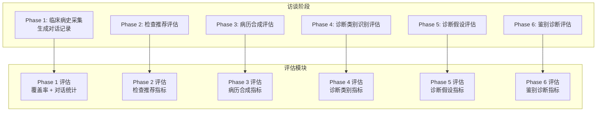
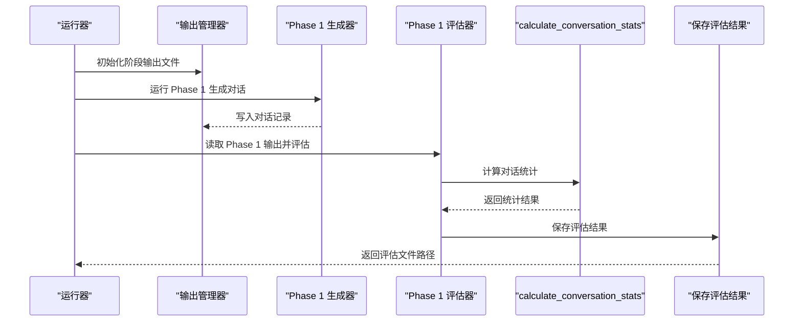
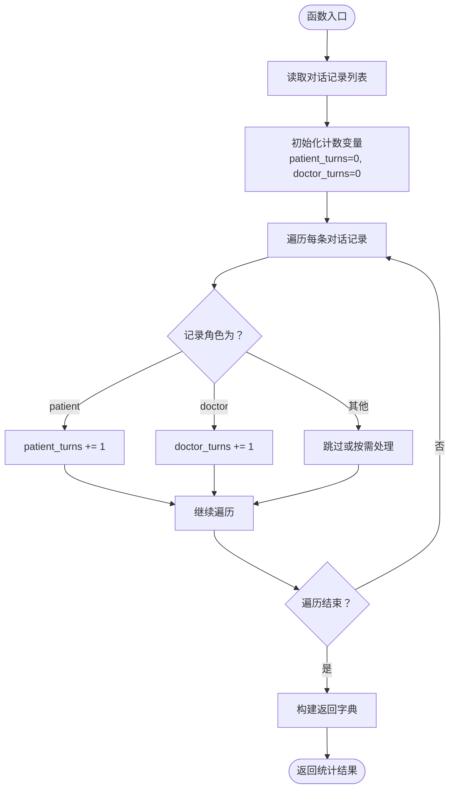
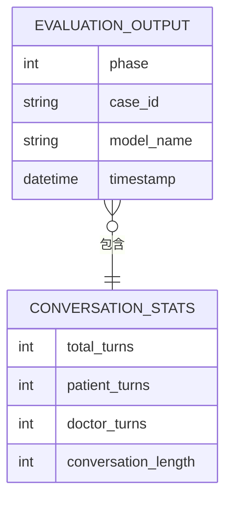
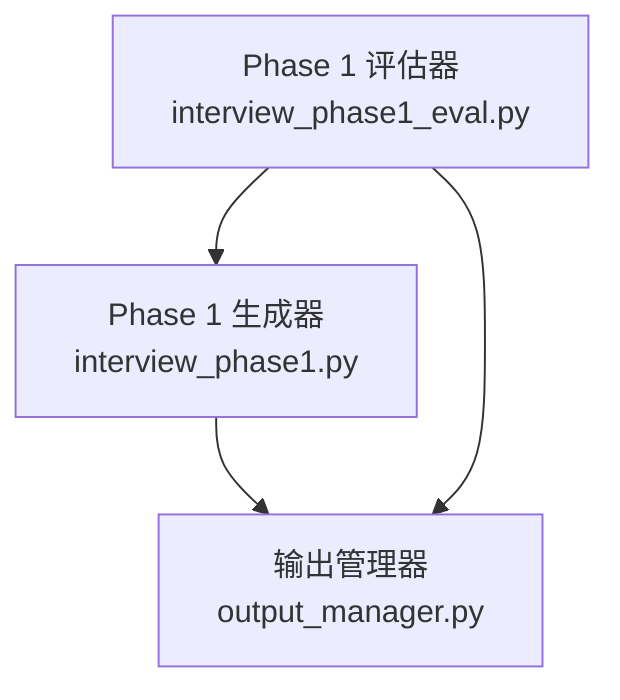

# 对话统计指标

<cite>
**本文档引用的文件**
- [interview_phase1_eval.py](file://core/evaluate/interview_phase1_eval.py)
- [interview_phase2_eval.py](file://core/evaluate/interview_phase2_eval.py)
- [interview_phase3_eval.py](file://core/evaluate/interview_phase3_eval.py)
- [interview_phase4_eval.py](file://core/evaluate/interview_phase4_eval.py)
- [interview_phase5_eval.py](file://core/evaluate/interview_phase5_eval.py)
- [interview_phase6_eval.py](file://core/evaluate/interview_phase6_eval.py)
- [output_manager.py](file://core/output_manager.py)
- [interview_phase1.py](file://core/interview/interview_phase1.py)
- [interview_phase1_output.json](file://data/output/interview/qwen-flash/1009904/interview_phase1_output.json)
- [evaluation_phase1_output.json](file://data/output/evaluation/qwen-flash/1009904/evaluation_phase1_output.json)
</cite>

## 目录
1. [简介](#简介)
2. [项目结构](#项目结构)
3. [核心组件](#核心组件)
4. [架构总览](#架构总览)
5. [详细组件分析](#详细组件分析)
6. [依赖关系分析](#依赖关系分析)
7. [性能考虑](#性能考虑)
8. [故障排除指南](#故障排除指南)
9. [结论](#结论)
10. [附录](#附录)

## 简介
本文件围绕“对话统计指标”展开，重点解析 calculate_conversation_stats 函数的实现机制与业务价值，涵盖对话轮次统计、角色分布分析与对话长度测量。文档将详细说明 patient_turns、doctor_turns、total_turns 等关键指标的计算逻辑与业务含义，并结合项目中的实际数据文件展示统计结果的结构与解读方法。同时，文档阐述对话统计在评估问诊平衡性与沟通效率方面的应用，以及如何通过统计指标识别问诊过程中的问题模式，帮助读者理解对话统计指标对问诊质量评估的价值。

## 项目结构
该项目采用分阶段的访谈评估体系，第一阶段负责收集临床病史并生成对话记录，后续阶段基于该对话记录进行各类评估。对话统计指标主要在第一阶段评估模块中产出，作为整体评估的一部分。

图表来源
- [interview_phase1.py:1-200](file://core/interview/interview_phase1.py#L1-L200)
- [interview_phase1_eval.py:174-330](file://core/evaluate/interview_phase1_eval.py#L174-L330)

章节来源
- [interview_phase1.py:1-200](file://core/interview/interview_phase1.py#L1-L200)
- [output_manager.py:1-189](file://core/output_manager.py#L1-L189)

## 核心组件
本节聚焦 calculate_conversation_stats 函数及其周边组件，说明其在评估流程中的作用与输出结构。

- calculate_conversation_stats：对对话记录进行统计，返回轮次与长度等基础指标。
- format_conversation_text：将对话记录格式化为可读文本，用于后续的共情度与专业度评估。
- evaluate_phase1：整合覆盖率统计与对话统计，并可选地进行共情度与专业度评估，最终保存评估结果。

章节来源
- [interview_phase1_eval.py:97-138](file://core/evaluate/interview_phase1_eval.py#L97-L138)
- [interview_phase1_eval.py:174-330](file://core/evaluate/interview_phase1_eval.py#L174-L330)

## 架构总览
对话统计指标在整个评估流程中的位置如下：

图表来源
- [output_manager.py:50-115](file://core/output_manager.py#L50-L115)
- [interview_phase1.py:1-200](file://core/interview/interview_phase1.py#L1-L200)
- [interview_phase1_eval.py:174-330](file://core/evaluate/interview_phase1_eval.py#L174-L330)

## 详细组件分析

### calculate_conversation_stats 函数详解
该函数接收对话记录列表，按角色进行轮次统计，并返回包含轮次数与对话长度的字典。

- 输入：对话记录列表，每条记录包含角色与内容等字段。
- 输出：字典，包含以下键：
  - total_turns：患者轮次数（当前实现中返回患者轮次数）
  - patient_turns：患者轮次数
  - doctor_turns：医生轮次数
  - conversation_length：对话总轮次数（即对话记录列表长度）

图表来源
- [interview_phase1_eval.py:97-114](file://core/evaluate/interview_phase1_eval.py#L97-L114)

章节来源
- [interview_phase1_eval.py:97-114](file://core/evaluate/interview_phase1_eval.py#L97-L114)

### 关键指标定义与业务含义
- total_turns：当前实现返回患者轮次数。在问诊平衡性评估中，可作为“患者主导程度”的粗略指标。若 total_turns 远大于 doctor_turns，可能提示医生引导不足或患者表达过度。
- patient_turns：患者发言轮次数。用于衡量患者在对话中的参与度与表达频率。
- doctor_turns：医生发言轮次数。用于衡量医生的提问与引导频率。
- conversation_length：对话总轮次数。反映整个问诊过程的对话规模与交互强度。

章节来源
- [interview_phase1_eval.py:97-114](file://core/evaluate/interview_phase1_eval.py#L97-L114)

### 数据结构说明与示例
以实际输出文件为例，展示对话统计结果的数据结构与字段含义。

- evaluation_phase1_output.json 中的 conversation_stats 字段包含：
  - total_turns：12
  - patient_turns：12
  - doctor_turns：13
  - conversation_length：25

图表来源
- [evaluation_phase1_output.json:15-20](file://data/output/evaluation/qwen-flash/1009904/evaluation_phase1_output.json#L15-L20)

章节来源
- [evaluation_phase1_output.json:1-122](file://data/output/evaluation/qwen-flash/1009904/evaluation_phase1_output.json#L1-L122)

### 实际使用示例与结果解读
- 示例场景：某次问诊生成了 25 条对话记录，其中医生发言 13 次，患者发言 12 次。
- 结果解读：
  - total_turns=12：患者主导的轮次为 12 次（当前实现返回患者轮次数）。
  - doctor_turns=13：医生引导轮次为 13 次，略高于患者轮次，表明医生在本次问诊中保持了适度的引导。
  - conversation_length=25：对话总轮次为 25，属于中等规模的问诊对话。
- 业务建议：
  - 若 doctor_turns 明显低于 patient_turns，可能需要加强医生的提问与引导策略。
  - 若 conversation_length 过小，可能需要延长问诊时间或增加关键问题的追问。
  - 若 total_turns 与 doctor_turns 差距过大，可能需要调整问诊节奏，避免患者主导导致信息碎片化。

章节来源
- [evaluation_phase1_output.json:15-20](file://data/output/evaluation/qwen-flash/1009904/evaluation_phase1_output.json#L15-L20)

### 与其他评估模块的关系
- 覆盖率统计（Phase 1）：与对话统计共同构成第一阶段的整体评估，用于衡量主诉与精神状态条目的覆盖程度。
- 共情度与专业度评估：基于格式化的对话文本进行，对话统计可用于辅助分析医生与患者的互动模式。

章节来源
- [interview_phase1_eval.py:232-249](file://core/evaluate/interview_phase1_eval.py#L232-L249)
- [interview_phase1_eval.py:254-298](file://core/evaluate/interview_phase1_eval.py#L254-L298)

## 依赖关系分析
对话统计指标的计算依赖于对话记录的正确组织与角色标注。下图展示了评估模块与输出管理器、对话生成器之间的依赖关系。

图表来源
- [output_manager.py:1-189](file://core/output_manager.py#L1-L189)
- [interview_phase1.py:1-200](file://core/interview/interview_phase1.py#L1-L200)
- [interview_phase1_eval.py:174-330](file://core/evaluate/interview_phase1_eval.py#L174-L330)

章节来源
- [output_manager.py:1-189](file://core/output_manager.py#L1-L189)
- [interview_phase1.py:1-200](file://core/interview/interview_phase1.py#L1-L200)
- [interview_phase1_eval.py:174-330](file://core/evaluate/interview_phase1_eval.py#L174-L330)

## 性能考虑
- 时间复杂度：calculate_conversation_stats 对对话列表进行一次线性扫描，时间复杂度为 O(n)，空间复杂度为 O(1)。
- I/O 开销：评估流程涉及多次文件读写，建议在批量评估时合并写入操作，减少磁盘 I/O。
- 扩展性：若未来需要引入对话时长测量，可在对话记录中加入时间戳字段，并在统计函数中计算相邻轮次的时间差。

## 故障排除指南
- 对话统计为空：检查对话记录是否包含有效的角色字段，确保角色值为 doctor 或 patient。
- 统计结果异常：确认对话记录列表是否完整，是否存在截断或重复写入的情况。
- 文件路径问题：确保输出管理器的路径与评估模块一致，避免找不到输出文件。

章节来源
- [output_manager.py:171-189](file://core/output_manager.py#L171-L189)
- [interview_phase1_eval.py:174-330](file://core/evaluate/interview_phase1_eval.py#L174-L330)

## 结论
对话统计指标为问诊质量评估提供了基础的量化视角。通过对 patient_turns、doctor_turns、total_turns 与 conversation_length 的分析，可以快速识别问诊过程中的平衡性与沟通效率问题。结合覆盖率统计与共情度、专业度评估，能够形成更全面的问诊质量画像，为改进问诊策略与提升医疗服务质量提供数据支持。

## 附录
- 实际数据参考：
  - Phase 1 输出示例：[interview_phase1_output.json:40-166](file://data/output/interview/qwen-flash/1009904/interview_phase1_output.json#L40-L166)
  - Phase 1 评估输出示例：[evaluation_phase1_output.json:15-20](file://data/output/evaluation/qwen-flash/1009904/evaluation_phase1_output.json#L15-L20)