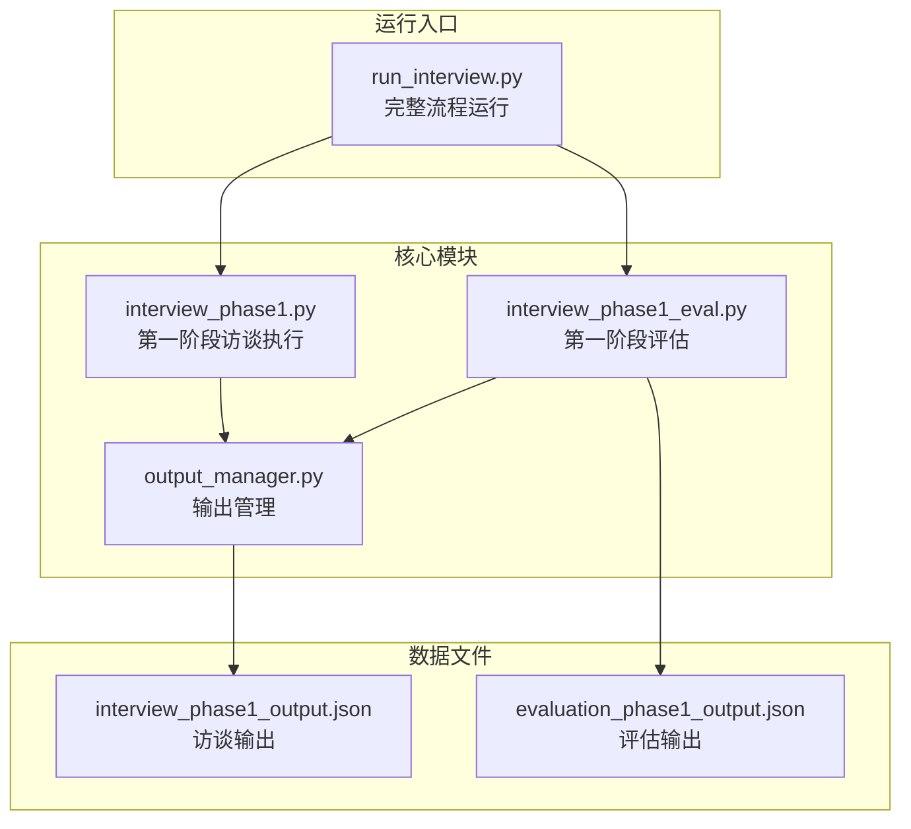
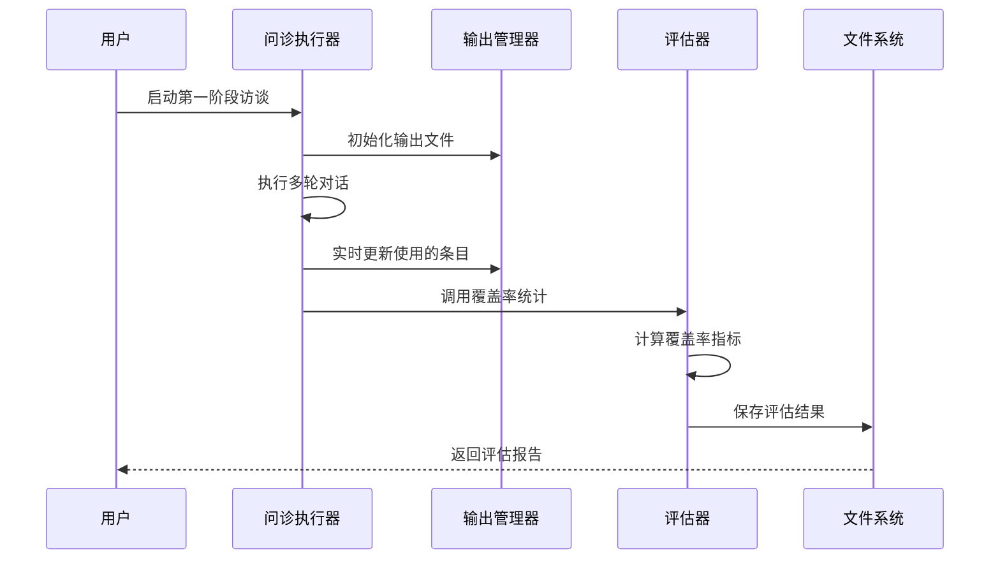
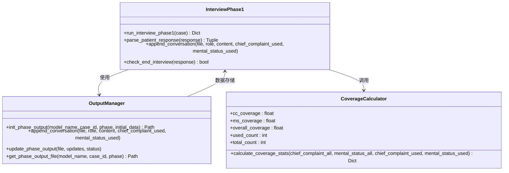
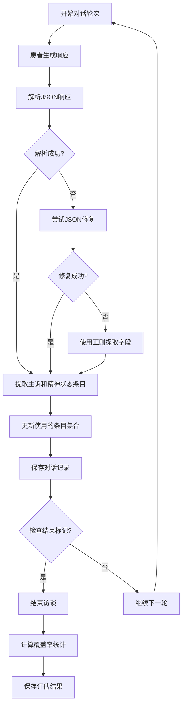
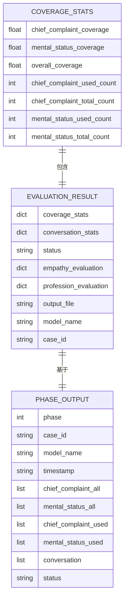

# 覆盖率统计指标

<cite>
**本文档引用的文件**
- [interview_phase1_eval.py](file://core/evaluate/interview_phase1_eval.py)
- [interview_phase1.py](file://core/interview/interview_phase1.py)
- [output_manager.py](file://core/output_manager.py)
- [evaluation_phase1_output.json](file://data/output/evaluation/qwen-flash/1009904/evaluation_phase1_output.json)
- [interview_phase1_output.json](file://data/output/interview/qwen-flash/1009904/interview_phase1_output.json)
- [run_interview.py](file://run_interview.py)
</cite>

## 目录
1. [简介](#简介)
2. [项目结构](#项目结构)
3. [核心组件](#核心组件)
4. [架构概览](#架构概览)
5. [详细组件分析](#详细组件分析)
6. [覆盖率指标详解](#覆盖率指标详解)
7. [数据结构说明](#数据结构说明)
8. [使用示例](#使用示例)
9. [解读指南](#解读指南)
10. [性能考虑](#性能考虑)
11. [故障排除指南](#故障排除指南)
12. [结论](#结论)

## 简介

本文件详细阐述了精神科问诊质量评估系统中的覆盖率统计指标体系。覆盖率统计是衡量医生在问诊过程中是否充分采集必要病史信息的重要量化指标，包括主诉覆盖率、精神状态覆盖率和整体覆盖率三个维度。这些指标通过客观的数学计算，为问诊质量评估提供了科学、可量化的依据。

本系统采用标准化的覆盖率计算方法，确保评估结果的准确性和可比性。覆盖率统计不仅反映了医生的问诊完整性，也为后续的问诊改进和培训提供了明确的方向。

## 项目结构

精神科问诊评估系统采用模块化设计，主要包含以下核心模块：



**图表来源**
- [interview_phase1.py:1-50](file://core/interview/interview_phase1.py#L1-L50)
- [interview_phase1_eval.py:1-30](file://core/evaluate/interview_phase1_eval.py#L1-L30)
- [output_manager.py:1-30](file://core/output_manager.py#L1-L30)

**章节来源**
- [interview_phase1.py:1-50](file://core/interview/interview_phase1.py#L1-L50)
- [interview_phase1_eval.py:1-30](file://core/evaluate/interview_phase1_eval.py#L1-L30)
- [output_manager.py:1-30](file://core/output_manager.py#L1-L30)

## 核心组件

系统的核心组件围绕覆盖率统计展开，主要包括：

### 1. 覆盖率统计计算引擎
- **calculate_coverage_stats函数**：核心计算逻辑，负责主诉覆盖率、精神状态覆盖率和整体覆盖率的计算
- **输入参数**：所有主诉条目、所有精神状态条目、使用的主诉条目、使用的心理状态条目
- **输出结果**：包含三个覆盖率指标和相关统计数据的字典

### 2. 问诊执行模块
- **run_interview_phase1函数**：负责执行第一阶段的临床病史采集访谈
- **对话记录管理**：实时记录医生和患者的对话内容
- **覆盖率数据收集**：自动收集使用的主诉和精神状态条目

### 3. 输出管理模块
- **文件结构管理**：统一管理各阶段的输出文件路径
- **数据持久化**：负责将评估结果保存到JSON文件中
- **数据读取支持**：提供便捷的数据读取接口

**章节来源**
- [interview_phase1_eval.py:62-94](file://core/evaluate/interview_phase1_eval.py#L62-L94)
- [interview_phase1.py:241-428](file://core/interview/interview_phase1.py#L241-L428)
- [output_manager.py:50-115](file://core/output_manager.py#L50-L115)

## 架构概览

系统采用分层架构设计，确保覆盖率统计的准确性和可扩展性：



**图表来源**
- [interview_phase1.py:332-398](file://core/interview/interview_phase1.py#L332-L398)
- [interview_phase1_eval.py:232-237](file://core/evaluate/interview_phase1_eval.py#L232-L237)
- [output_manager.py:133-168](file://core/output_manager.py#L133-L168)

系统架构特点：
- **模块分离**：问诊执行、评估计算、文件管理职责清晰分离
- **数据流清晰**：从对话记录到覆盖率计算再到结果保存的完整流程
- **可扩展性**：支持新增评估维度和新的覆盖率指标
- **容错机制**：包含空集合处理和异常捕获机制

## 详细组件分析

### 覆盖率统计计算组件



**图表来源**
- [interview_phase1_eval.py:62-94](file://core/evaluate/interview_phase1_eval.py#L62-L94)
- [interview_phase1.py:241-428](file://core/interview/interview_phase1.py#L241-L428)
- [output_manager.py:50-115](file://core/output_manager.py#L50-L115)

**章节来源**
- [interview_phase1_eval.py:62-94](file://core/evaluate/interview_phase1_eval.py#L62-L94)
- [interview_phase1.py:241-428](file://core/interview/interview_phase1.py#L241-L428)
- [output_manager.py:50-115](file://core/output_manager.py#L50-L115)

### 对话处理组件



**图表来源**
- [interview_phase1.py:90-144](file://core/interview/interview_phase1.py#L90-L144)
- [interview_phase1.py:350-398](file://core/interview/interview_phase1.py#L350-L398)

**章节来源**
- [interview_phase1.py:90-144](file://core/interview/interview_phase1.py#L90-L144)
- [interview_phase1.py:350-398](file://core/interview/interview_phase1.py#L350-L398)

## 覆盖率指标详解

### 主诉覆盖率 (Chief Complaint Coverage)

主诉覆盖率衡量医生在问诊过程中对患者主要症状和病史信息的采集完整性：

**计算公式：**
```
主诉覆盖率 = (使用的主诉条目数量 / 总主诉条目数量) × 100%
```

**分子构成：**
- 使用的主诉条目：医生在问诊过程中实际询问和确认的主诉项目
- 去重处理：同一主诉条目的重复使用只计数一次

**分母构成：**
- 总主诉条目：预设的标准主诉清单，包含所有可能的主诉项目

**应用场景：**
- 评估医生对患者核心症状的关注程度
- 监控问诊的完整性，确保不遗漏重要的主诉信息
- 识别问诊模式中的偏移和不足

### 精神状态覆盖率 (Mental Status Coverage)

精神状态覆盖率反映医生对患者精神状态评估的全面性：

**计算公式：**
```
精神状态覆盖率 = (使用的心理状态条目数量 / 总心理状态条目数量) × 100%
```

**分子构成：**
- 使用的心理状态条目：医生在问诊中涉及的精神状态评估项目
- 包括认知功能、情感状态、思维内容等多个维度

**分母构成：**
- 总心理状态条目：标准的心理状态评估清单
- 涵盖面广，包括外观、行为、情感、思维、感知等多个方面

**应用场景：**
- 监督医生的精神状态评估完整性
- 确保对患者认知功能的全面了解
- 评估问诊的专业性和系统性

### 整体覆盖率 (Overall Coverage)

整体覆盖率提供问诊质量的综合评估指标：

**计算公式：**
```
整体覆盖率 = ((使用的主诉条目数量 + 使用的心理状态条目数量) / (总主诉条目数量 + 总心理状态条目数量)) × 100%
```

**计算逻辑：**
- 分子：主诉和心理状态使用条目的总和
- 分母：主诉和心理状态总条目的总和
- 等同于两个覆盖率的加权平均

**应用场景：**
- 提供问诊质量的整体视图
- 支持跨医生、跨模型的横向比较
- 作为问诊质量改进的综合指标

## 数据结构说明

### 覆盖率统计结果数据结构



**图表来源**
- [interview_phase1_eval.py:86-94](file://core/evaluate/interview_phase1_eval.py#L86-L94)
- [evaluation_phase1_output.json:6-14](file://data/output/evaluation/qwen-flash/1009904/evaluation_phase1_output.json#L6-L14)

### 关键指标含义

| 指标名称 | 数据类型 | 含义 | 计算方式 |
|---------|---------|------|----------|
| chief_complaint_coverage | float | 主诉覆盖率 | used_count/total_count×100% |
| mental_status_coverage | float | 精神状态覆盖率 | used_count/total_count×100% |
| overall_coverage | float | 整体覆盖率 | (cc_used+ms_used)/(cc_total+ms_total)×100% |
| chief_complaint_used_count | int | 使用的主诉条目数 | 实际使用数量 |
| chief_complaint_total_count | int | 总主诉条目数 | 标准清单总数 |
| mental_status_used_count | int | 使用的心理状态条目数 | 实际使用数量 |
| mental_status_total_count | int | 总心理状态条目数 | 标准清单总数 |

**章节来源**
- [interview_phase1_eval.py:86-94](file://core/evaluate/interview_phase1_eval.py#L86-L94)
- [evaluation_phase1_output.json:6-14](file://data/output/evaluation/qwen-flash/1009904/evaluation_phase1_output.json#L6-L14)

## 使用示例

### 基础使用方法

```python
# 方法1：从文件路径读取数据
from core.evaluate.interview_phase1_eval import evaluate_phase1

result = evaluate_phase1(
    model_name="qwen-flash",
    case_id="1009904"
)

# 方法2：直接传入数据
result = evaluate_phase1(
    output_file="/path/to/interview_phase1_output.json"
)

# 方法3：使用预定义数据
result = evaluate_phase1(
    phase1_data=your_phase1_data
)
```

### 高级配置选项

```python
# 启用特定评估功能
result = evaluate_phase1(
    model_name="qwen-flash",
    case_id="1009904",
    enable_empathy_eval=True,  # 启用共情度评估
    enable_profession_eval=True,  # 启用专业度评估
    parallel_eval=True  # 并行评估
)
```

### 结果访问示例

```python
# 访问覆盖率统计
coverage_stats = result['coverage_stats']
print(f"主诉覆盖率: {coverage_stats['chief_complaint_coverage']:.2f}%")
print(f"精神状态覆盖率: {coverage_stats['mental_status_coverage']:.2f}%")
print(f"整体覆盖率: {coverage_stats['overall_coverage']:.2f}%")

# 访问详细统计信息
print(f"使用的主诉条目: {coverage_stats['chief_complaint_used_count']}/{coverage_stats['chief_complaint_total_count']}")
print(f"使用的心理状态条目: {coverage_stats['mental_status_used_count']}/{coverage_stats['mental_status_total_count']}")
```

**章节来源**
- [interview_phase1_eval.py:174-330](file://core/evaluate/interview_phase1_eval.py#L174-L330)
- [interview_phase1_eval.py:333-376](file://core/evaluate/interview_phase1_eval.py#L333-L376)

## 解读指南

### 覆盖率指标解读标准

| 覆盖率范围 | 质量等级 | 评估要点 |
|-----------|---------|----------|
| 90%-100% | 优秀 | 问诊完整，几乎涵盖所有重要信息 |
| 80%-89% | 良好 | 问诊较为完整，有少量遗漏 |
| 70%-79% | 一般 | 基本满足要求，需要改进 |
| 60%-69% | 较差 | 存在明显遗漏，需要重点关注 |
| <60% | 很差 | 问诊不完整，需要重新评估 |

### 优化建议

#### 提升主诉覆盖率
1. **系统性询问**：按照标准主诉清单逐一确认
2. **深入追问**：对每个主诉条目进行深度探索
3. **时间线梳理**：帮助患者整理症状的发展过程
4. **关联性分析**：引导患者发现症状间的联系

#### 提升精神状态覆盖率
1. **多维度评估**：确保涵盖认知、情感、思维等各个方面
2. **行为观察**：注意患者的非言语表现
3. **功能评估**：关注社会功能和日常生活能力
4. **自知力评估**：了解患者对自身状况的认知程度

#### 整体优化策略
1. **标准化流程**：建立固定的问诊流程和检查清单
2. **培训强化**：定期进行问诊技巧和知识培训
3. **反馈机制**：建立持续的质量反馈和改进机制
4. **案例分析**：定期分析高分和低分案例，总结经验

### 质量改进建议

#### 短期改进措施
- 建立每日问诊清单检查制度
- 实施同伴互评机制
- 设置关键节点的覆盖率检查点
- 提供实时的覆盖率反馈

#### 长期发展策略
- 建立覆盖率数据库，追踪趋势变化
- 开发个性化培训方案
- 实施分级评估和认证制度
- 建立质量改进的激励机制

## 性能考虑

### 计算复杂度分析

覆盖率统计的计算复杂度为O(n)，其中n为主诉和心理状态条目的总数：

- **时间复杂度**：O(n) - 线性扫描所有条目
- **空间复杂度**：O(1) - 仅使用常量额外空间
- **内存占用**：极小，适合大规模批量处理

### 性能优化策略

1. **数据预处理**：在问诊过程中实时维护去重集合
2. **增量更新**：仅在必要时重新计算覆盖率
3. **缓存机制**：对频繁访问的统计数据进行缓存
4. **批量处理**：支持多个病例的并发评估

### 扩展性考虑

系统设计支持以下扩展：
- 新增评估维度和指标
- 支持多模型、多病例的批量处理
- 集成机器学习算法进行智能评估
- 提供API接口支持外部系统集成

## 故障排除指南

### 常见问题及解决方案

#### 1. 覆盖率计算异常
**问题现象**：覆盖率显示为NaN或无穷大
**可能原因**：
- 分母为空集合（total_count为0）
- 数据格式不正确
- 编码问题导致的字符异常

**解决方法**：
```python
# 确保数据完整性
if chief_complaint_all and len(chief_complaint_all) > 0:
    cc_coverage = (len(chief_complaint_used) / len(chief_complaint_all)) * 100
else:
    cc_coverage = 0.0
```

#### 2. 文件读取失败
**问题现象**：无法读取评估或输出文件
**解决方法**：
- 检查文件路径是否正确
- 验证文件权限设置
- 确认文件编码格式（UTF-8）

#### 3. 数据格式错误
**问题现象**：JSON解析失败或数据结构异常
**解决方法**：
- 使用json_repair库自动修复JSON格式
- 实施数据验证和清理机制
- 提供默认值和容错处理

### 调试工具和技巧

#### 调试输出示例
```python
# 在关键节点添加调试信息
print(f"主诉条目总数: {len(chief_complaint_all)}")
print(f"使用的主诉条目: {len(chief_complaint_used)}")
print(f"精神状态条目总数: {len(mental_status_all)}")
print(f"使用的心理状态条目: {len(mental_status_used)}")
```

#### 错误处理最佳实践
```python
try:
    coverage_stats = calculate_coverage_stats(
        chief_complaint_all,
        mental_status_all,
        chief_complaint_used,
        mental_status_used
    )
except Exception as e:
    print(f"覆盖率计算失败: {e}")
    # 返回默认值或错误状态
    return {
        'chief_complaint_coverage': 0.0,
        'mental_status_coverage': 0.0,
        'overall_coverage': 0.0,
        'error': str(e)
    }
```

**章节来源**
- [interview_phase1_eval.py:294-298](file://core/evaluate/interview_phase1_eval.py#L294-L298)
- [interview_phase1.py:102-144](file://core/interview/interview_phase1.py#L102-L144)

## 结论

覆盖率统计指标为精神科问诊质量评估提供了科学、客观的量化工具。通过主诉覆盖率、精神状态覆盖率和整体覆盖率的综合分析，系统能够：

1. **客观评估问诊完整性**：提供可量化的质量指标，避免主观判断的偏差
2. **指导问诊改进**：识别问诊过程中的薄弱环节，制定针对性的改进措施
3. **支持质量监控**：建立持续的质量监控和改进机制
4. **促进标准化发展**：推动问诊流程的标准化和规范化

覆盖率统计系统的成功实施需要：
- 完善的指标体系设计
- 准确的数据收集和处理机制
- 有效的质量改进和反馈机制
- 持续的培训和监督

通过不断优化覆盖率统计指标和相关的评估流程，可以显著提升精神科问诊的质量和效率，为患者提供更好的医疗服务。