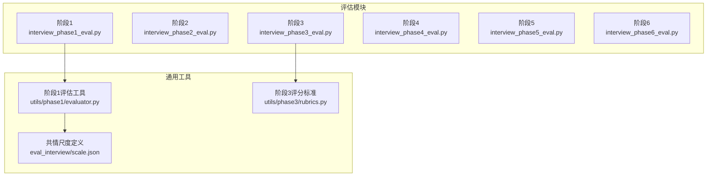
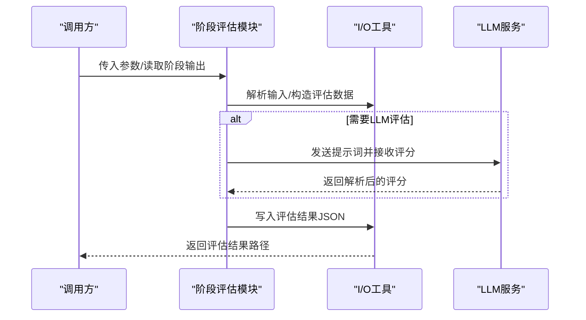
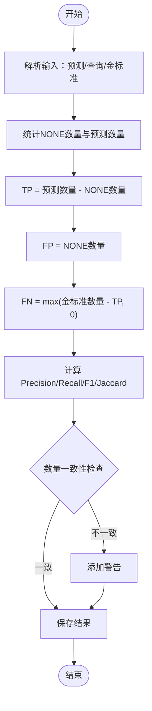
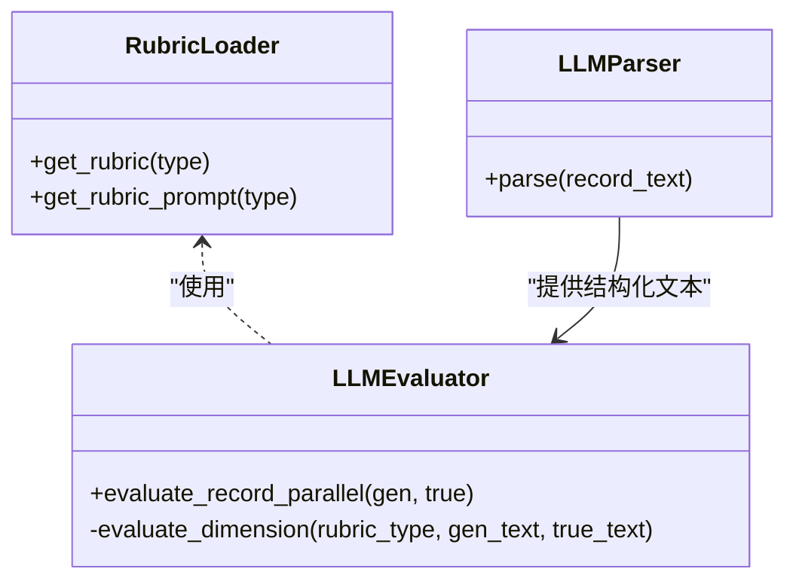
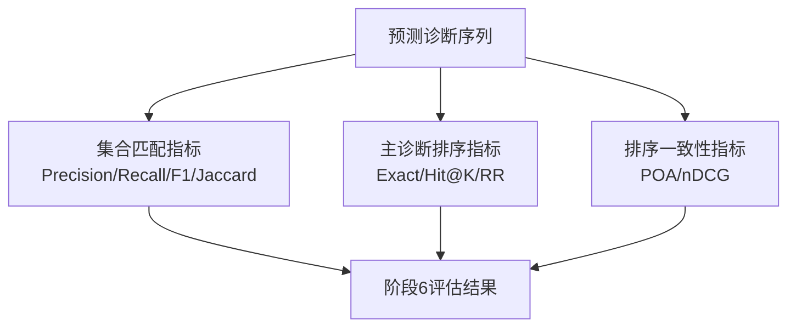
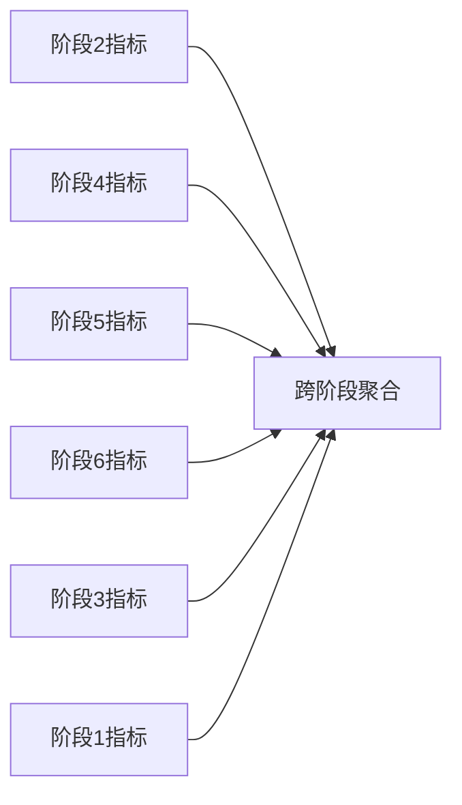

# 阶段特定评估指标

<cite>
**本文引用的文件**   
- [interview_phase1_eval.py](file://core/evaluate/interview_phase1_eval.py)
- [interview_phase2_eval.py](file://core/evaluate/interview_phase2_eval.py)
- [interview_phase3_eval.py](file://core/evaluate/interview_phase3_eval.py)
- [interview_phase4_eval.py](file://core/evaluate/interview_phase4_eval.py)
- [interview_phase5_eval.py](file://core/evaluate/interview_phase5_eval.py)
- [interview_phase6_eval.py](file://core/evaluate/interview_phase6_eval.py)
- [evaluator.py](file://core/evaluate/utils/phase1/evaluator.py)
- [rubrics.py](file://core/evaluate/utils/phase3/rubrics.py)
- [scale.json](file://eval_interview/scale.json)
- [evaluation_phase1_output.json](file://data/output/evaluation/qwen-flash/1009904/evaluation_phase1_output.json)
</cite>

## 目录
1. [引言](#引言)
2. [项目结构](#项目结构)
3. [核心组件](#核心组件)
4. [架构总览](#架构总览)
5. [详细组件分析](#详细组件分析)
6. [依赖分析](#依赖分析)
7. [性能考虑](#性能考虑)
8. [故障排查指南](#故障排查指南)
9. [结论](#结论)
10. [附录](#附录)

## 引言
本技术文档聚焦于精神科问诊流程中第二至第六阶段的“阶段特定评估指标”。目标是：
- 明确各阶段的评估重点与指标体系；
- 解释指标设计原理与业务逻辑；
- 描述评估结果的数据结构与解读方法；
- 说明阶段间指标的关联性与累积效应；
- 提供实际应用示例与质量改进建议。

## 项目结构
本项目围绕“阶段评估模块”组织，每个阶段对应独立的评估脚本，负责：
- 读取对应阶段的输出数据；
- 计算阶段特有指标；
- 生成标准化评估结果并落盘。

图表来源
- [interview_phase1_eval.py:1-376](file://core/evaluate/interview_phase1_eval.py#L1-L376)
- [interview_phase2_eval.py:1-301](file://core/evaluate/interview_phase2_eval.py#L1-L301)
- [interview_phase3_eval.py:1-598](file://core/evaluate/interview_phase3_eval.py#L1-L598)
- [interview_phase4_eval.py:1-256](file://core/evaluate/interview_phase4_eval.py#L1-L256)
- [interview_phase5_eval.py:1-256](file://core/evaluate/interview_phase5_eval.py#L1-L256)
- [interview_phase6_eval.py:1-416](file://core/evaluate/interview_phase6_eval.py#L1-L416)
- [evaluator.py:1-160](file://core/evaluate/utils/phase1/evaluator.py#L1-L160)
- [rubrics.py:1-423](file://core/evaluate/utils/phase3/rubrics.py#L1-L423)
- [scale.json:1-258](file://eval_interview/scale.json#L1-L258)

章节来源
- [interview_phase1_eval.py:1-376](file://core/evaluate/interview_phase1_eval.py#L1-L376)
- [interview_phase2_eval.py:1-301](file://core/evaluate/interview_phase2_eval.py#L1-L301)
- [interview_phase3_eval.py:1-598](file://core/evaluate/interview_phase3_eval.py#L1-L598)
- [interview_phase4_eval.py:1-256](file://core/evaluate/interview_phase4_eval.py#L1-L256)
- [interview_phase5_eval.py:1-256](file://core/evaluate/interview_phase5_eval.py#L1-L256)
- [interview_phase6_eval.py:1-416](file://core/evaluate/interview_phase6_eval.py#L1-L416)

## 核心组件
- 阶段1：历史采集与对话统计、覆盖率统计、可选共情度/专业度LLM评估。
- 阶段2：检查推荐合理性评估（集合匹配指标）。
- 阶段3：临床病历完整性与准确性评估（维度加权百分比）。
- 阶段4：诊断类别识别准确性评估（集合匹配指标）。
- 阶段5：诊断假设评估（集合匹配指标）。
- 阶段6：鉴别诊断综合评估（集合匹配+主诊断排序+排序一致性）。

章节来源
- [interview_phase1_eval.py:174-330](file://core/evaluate/interview_phase1_eval.py#L174-L330)
- [interview_phase2_eval.py:153-255](file://core/evaluate/interview_phase2_eval.py#L153-L255)
- [interview_phase3_eval.py:422-552](file://core/evaluate/interview_phase3_eval.py#L422-L552)
- [interview_phase4_eval.py:126-210](file://core/evaluate/interview_phase4_eval.py#L126-L210)
- [interview_phase5_eval.py:126-210](file://core/evaluate/interview_phase5_eval.py#L126-L210)
- [interview_phase6_eval.py:267-370](file://core/evaluate/interview_phase6_eval.py#L267-L370)

## 架构总览
各阶段评估模块遵循统一的“输入-计算-输出”模式：
- 输入：阶段输出JSON或直接传入数据；
- 计算：调用阶段特有指标函数；
- 输出：标准化评估结果JSON（包含阶段号、时间戳、状态、指标、警告/错误等）。

图表来源
- [interview_phase1_eval.py:174-330](file://core/evaluate/interview_phase1_eval.py#L174-L330)
- [interview_phase2_eval.py:153-255](file://core/evaluate/interview_phase2_eval.py#L153-L255)
- [interview_phase3_eval.py:422-552](file://core/evaluate/interview_phase3_eval.py#L422-L552)
- [interview_phase4_eval.py:126-210](file://core/evaluate/interview_phase4_eval.py#L126-L210)
- [interview_phase5_eval.py:126-210](file://core/evaluate/interview_phase5_eval.py#L126-L210)
- [interview_phase6_eval.py:267-370](file://core/evaluate/interview_phase6_eval.py#L267-L370)

## 详细组件分析

### 阶段2：检查推荐合理性评估
- 评估重点：基于“检查请求”与“金标准辅助检查”的集合匹配，衡量推荐的覆盖面与冗余度。
- 关键指标：
  - 精度（Precision）= TP / (TP + FP)
  - 召回（Recall）= TP / (TP + FN)
  - F1 = 2PR / (P + R)
  - 杰卡德（Jaccard）= TP / (TP + FP + FN)
- 计算方法：
  - 将模型返回的检查项目映射视为预测集合；
  - 将“NONE”视为冗余预测；
  - 与金标准集合计算交并集。
- 数据结构要点：
  - counts：包含 TP、FP、FN、NONE计数与冗余/遗漏统计；
  - metrics：包含上述四类指标；
  - warnings：当返回键值对数量与请求数量不一致时给出提示。
- 业务逻辑：
  - 若预测为空且金标准为空，指标取1；
  - 若仅有预测为空或仅有金标准为空，召回/精度按0处理；
  - 通过NONE计数识别冗余推荐，避免过度检查。

图表来源
- [interview_phase2_eval.py:66-150](file://core/evaluate/interview_phase2_eval.py#L66-L150)

章节来源
- [interview_phase2_eval.py:66-150](file://core/evaluate/interview_phase2_eval.py#L66-L150)
- [interview_phase2_eval.py:153-255](file://core/evaluate/interview_phase2_eval.py#L153-L255)

### 阶段3：临床病历完整性与准确性评估
- 评估重点：将生成病历与真值病历按四大结构域（主诉、体格检查、精神检查、既往/家族史）进行对比评分。
- 关键指标：
  - 维度内：覆盖度得分、准确度得分、百分比；
  - 维度间：按权重加权的总百分比；
  - 总体：维度加权总分、总实际得分/最大分。
- 计算方法：
  - 使用LLM将病历文本划分为四大区域；
  - 基于rubric标准逐项对比，覆盖度与准确度均为0/1，支持“跳过”；
  - 按rubric权重计算加权百分比并汇总。
- 数据结构要点：
  - dimensions：每个维度的评分明细与百分比；
  - total_percentage：加权总百分比；
  - generated_record / true_record：划分后的结构化文本；
  - 错误处理：解析失败时返回默认结构与错误信息。

图表来源
- [interview_phase3_eval.py:41-76](file://core/evaluate/interview_phase3_eval.py#L41-L76)
- [interview_phase3_eval.py:95-187](file://core/evaluate/interview_phase3_eval.py#L95-L187)
- [interview_phase3_eval.py:189-391](file://core/evaluate/interview_phase3_eval.py#L189-L391)
- [rubrics.py:15-423](file://core/evaluate/utils/phase3/rubrics.py#L15-L423)

章节来源
- [interview_phase3_eval.py:422-552](file://core/evaluate/interview_phase3_eval.py#L422-L552)
- [rubrics.py:15-423](file://core/evaluate/utils/phase3/rubrics.py#L15-L423)

### 阶段4：诊断类别识别准确性评估
- 评估重点：对模型输出的诊断类别集合与真实类别集合进行集合匹配。
- 关键指标：Precision/Recall/F1/Jaccard，基于集合交并集计算。
- 数据结构要点：
  - predicted_categories / true_categories；
  - metrics：四类指标；
  - 从全局真值文件加载真实类别。

章节来源
- [interview_phase4_eval.py:66-124](file://core/evaluate/interview_phase4_eval.py#L66-L124)
- [interview_phase4_eval.py:126-210](file://core/evaluate/interview_phase4_eval.py#L126-L210)

### 阶段5：诊断假设评估
- 评估重点：对模型输出的诊断假设集合与真实诊断集合进行集合匹配。
- 关键指标：Precision/Recall/F1/Jaccard。
- 数据结构要点：
  - predicted_hypotheses / true_disorders；
  - metrics：四类指标；
  - 从全局真值文件加载真实诊断。

章节来源
- [interview_phase5_eval.py:66-124](file://core/evaluate/interview_phase5_eval.py#L66-L124)
- [interview_phase5_eval.py:126-210](file://core/evaluate/interview_phase5_eval.py#L126-L210)

### 阶段6：鉴别诊断综合评估
- 评估重点：对最终诊断列表进行三类评估。
- 集合匹配指标（第一部分）：Precision/Recall/F1/Jaccard（忽略顺序）。
- 主诊断排序指标（第二部分2.1）：主诊断精确命中、Top-K命中、倒数排名。
- 排序一致性指标（第二部分2.2）：成对顺序准确率（POA）、归一化折损累积增益（nDCG）。
- 数据结构要点：
  - set_metrics / primary_metrics / ranking_metrics；
  - predicted_diagnoses / true_disorders；
  - 从全局真值文件加载真实诊断。

图表来源
- [interview_phase6_eval.py:69-125](file://core/evaluate/interview_phase6_eval.py#L69-L125)
- [interview_phase6_eval.py:127-168](file://core/evaluate/interview_phase6_eval.py#L127-L168)
- [interview_phase6_eval.py:170-265](file://core/evaluate/interview_phase6_eval.py#L170-L265)
- [interview_phase6_eval.py:267-370](file://core/evaluate/interview_phase6_eval.py#L267-L370)

章节来源
- [interview_phase6_eval.py:267-370](file://core/evaluate/interview_phase6_eval.py#L267-L370)

### 阶段1：对话统计与共情/专业度评估（补充）
- 评估重点：覆盖率统计、对话统计、可选共情度/专业度LLM评估。
- 关键指标：
  - 覆盖率统计：主诉覆盖率、精神状态覆盖率、整体覆盖率；
  - 对话统计：轮次、患者/医生发言次数、对话长度；
  - 共情度/专业度：总分、平均分、方差（仅共情度）、题数。
- 数据结构要点：
  - coverage_stats / conversation_stats；
  - empathy_evaluation / profession_evaluation（可选）；
  - 保存统一格式的评估结果JSON。

章节来源
- [interview_phase1_eval.py:62-114](file://core/evaluate/interview_phase1_eval.py#L62-L114)
- [interview_phase1_eval.py:174-330](file://core/evaluate/interview_phase1_eval.py#L174-L330)
- [evaluator.py:50-131](file://core/evaluate/utils/phase1/evaluator.py#L50-L131)
- [scale.json:1-258](file://eval_interview/scale.json#L1-258)

## 依赖分析
- 阶段2与阶段4/5/6共享“集合匹配”计算逻辑（交并集与四类指标），确保跨阶段一致性。
- 阶段3的rubric标准与权重在维度间累加，形成阶段内加权总分。
- 阶段1的共情度/专业度评估作为“软指标”，与硬指标（集合匹配/百分比）互补。
- 评估结果统一保存为JSON，便于后续聚合分析。

图表来源
- [interview_phase2_eval.py:66-150](file://core/evaluate/interview_phase2_eval.py#L66-L150)
- [interview_phase4_eval.py:66-124](file://core/evaluate/interview_phase4_eval.py#L66-L124)
- [interview_phase5_eval.py:66-124](file://core/evaluate/interview_phase5_eval.py#L66-L124)
- [interview_phase6_eval.py:69-125](file://core/evaluate/interview_phase6_eval.py#L69-L125)
- [interview_phase3_eval.py:344-391](file://core/evaluate/interview_phase3_eval.py#L344-L391)
- [interview_phase1_eval.py:174-330](file://core/evaluate/interview_phase1_eval.py#L174-L330)

## 性能考虑
- 阶段3采用多线程并行评估四个维度，提升吞吐；
- 阶段1可选择并行评估共情度与专业度；
- LLM调用成本较高，建议缓存提示词与中间结果；
- 评估结果统一落盘，便于批量处理与二次分析。

## 故障排查指南
- 输入解析错误：检查阶段输出JSON结构与字段是否存在；
- LLM解析失败：确认返回JSON格式是否规范，必要时增加重试与降级策略；
- 缺失真值：阶段4/5/6需从全局真值文件加载真实标签，若未找到则指标为0；
- 数量一致性警告：阶段2返回键值对数量与请求数量不一致时会记录警告，需检查模型输出格式。

章节来源
- [interview_phase2_eval.py:123-150](file://core/evaluate/interview_phase2_eval.py#L123-L150)
- [interview_phase3_eval.py:276-319](file://core/evaluate/interview_phase3_eval.py#L276-L319)
- [interview_phase4_eval.py:37-64](file://core/evaluate/interview_phase4_eval.py#L37-L64)
- [interview_phase5_eval.py:37-64](file://core/evaluate/interview_phase5_eval.py#L37-L64)
- [interview_phase6_eval.py:40-67](file://core/evaluate/interview_phase6_eval.py#L40-L67)

## 结论
通过为第二至第六阶段分别设计针对性指标，结合阶段内与阶段间的评估结果，可构建从“检查推荐合理性”“病历完整性与准确性”“诊断类别识别”“诊断假设”到“鉴别诊断排序”的完整质量评价体系。建议在实际应用中：
- 固化阶段2/4/5/6的集合匹配口径，确保跨模型、跨批次一致性；
- 在阶段3引入更多维度与更细粒度rubric，持续优化加权策略；
- 将阶段1的共情度/专业度作为软指标纳入综合评分，提升人性化评估权重；
- 建立评估结果的可视化看板与趋势分析，支撑持续改进。

## 附录

### 评估结果数据结构与解读方法
- 通用字段
  - phase：阶段号
  - case_id：病例ID
  - model_name：模型名
  - timestamp：评估时间
  - status：阶段状态
  - output_file：评估结果保存路径
- 阶段1
  - coverage_stats：覆盖率统计
  - conversation_stats：对话统计
  - empathy_evaluation / profession_evaluation：可选LLM评估结果
- 阶段2
  - metrics：Precision/Recall/F1/Jaccard
  - counts：TP/FP/FN/NONE等统计
  - warnings：数量一致性等提示
- 阶段3
  - total_percentage：加权总百分比
  - dimensions：各维度评分详情
  - generated_record / true_record：结构化文本
- 阶段4/5/6
  - metrics / set_metrics / primary_metrics / ranking_metrics：集合匹配/主诊断排序/排序一致性指标
  - predicted_categories / predicted_hypotheses / predicted_diagnoses：预测结果
  - true_categories / true_disorders：真实标签

示例参考
- 阶段1评估结果样例：[evaluation_phase1_output.json](file://data/output/evaluation/qwen-flash/1009904/evaluation_phase1_output.json)

章节来源
- [interview_phase1_eval.py:141-172](file://core/evaluate/interview_phase1_eval.py#L141-L172)
- [interview_phase2_eval.py:222-232](file://core/evaluate/interview_phase2_eval.py#L222-L232)
- [interview_phase3_eval.py:515-529](file://core/evaluate/interview_phase3_eval.py#L515-L529)
- [interview_phase4_eval.py:182-189](file://core/evaluate/interview_phase4_eval.py#L182-L189)
- [interview_phase5_eval.py:182-189](file://core/evaluate/interview_phase5_eval.py#L182-L189)
- [interview_phase6_eval.py:327-336](file://core/evaluate/interview_phase6_eval.py#L327-L336)
- [evaluation_phase1_output.json:1-122](file://data/output/evaluation/qwen-flash/1009904/evaluation_phase1_output.json#L1-L122)