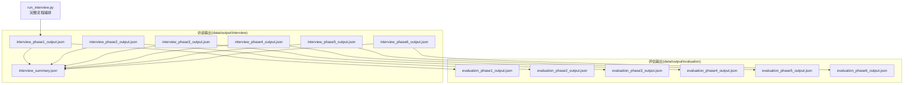
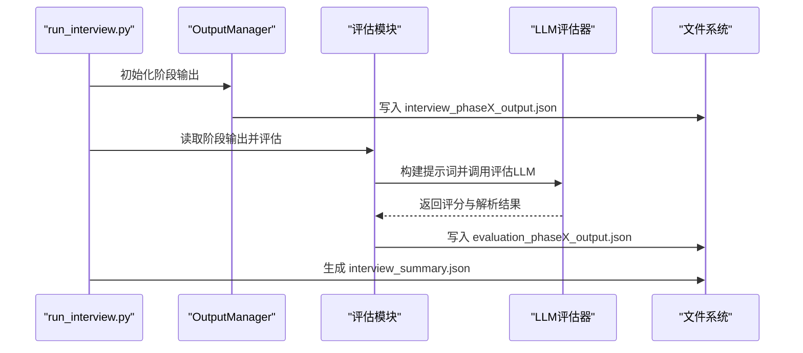
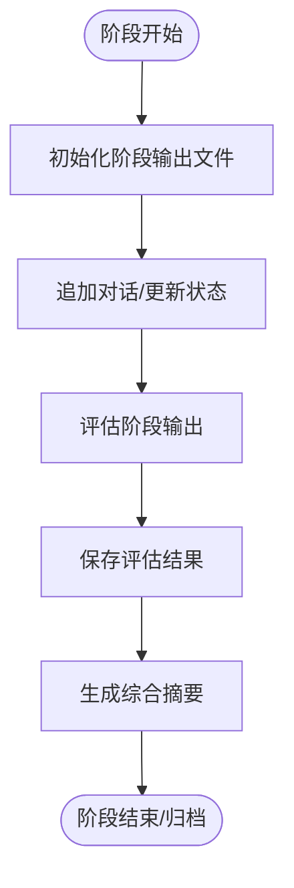
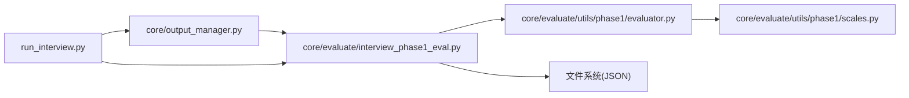

# 评估数据管理

<cite>
**本文引用的文件**
- [run_interview.py](file://run_interview.py)
- [core/output_manager.py](file://core/output_manager.py)
- [core/evaluate/interview_phase1_eval.py](file://core/evaluate/interview_phase1_eval.py)
- [core/evaluate/interview_phase2_eval.py](file://core/evaluate/interview_phase2_eval.py)
- [core/evaluate/interview_phase3_eval.py](file://core/evaluate/interview_phase3_eval.py)
- [core/evaluate/utils/phase1/evaluator.py](file://core/evaluate/utils/phase1/evaluator.py)
- [core/evaluate/utils/phase1/scales.py](file://core/evaluate/utils/phase1/scales.py)
- [eval_interview/scale.json](file://eval_interview/scale.json)
- [data/output/evaluation/qwen-flash/1009904/evaluation_phase1_output.json](file://data/output/evaluation/qwen-flash/1009904/evaluation_phase1_output.json)
- [data/output/interview/qwen-flash/1009904/interview_phase1_output.json](file://data/output/interview/qwen-flash/1009904/interview_phase1_output.json)
</cite>

## 目录
1. [简介](#简介)
2. [项目结构](#项目结构)
3. [核心组件](#核心组件)
4. [架构总览](#架构总览)
5. [详细组件分析](#详细组件分析)
6. [依赖分析](#依赖分析)
7. [性能考量](#性能考量)
8. [故障排查指南](#故障排查指南)
9. [结论](#结论)
10. [附录](#附录)

## 简介
本技术文档聚焦于评估数据管理，系统阐述评估结果的数据结构设计、存储策略、文件命名规范、生命周期管理、查询与分析方法、数据导出与报告生成、版本与备份策略，以及在质量改进与研究分析中的应用实践。通过对仓库中“访谈—评估—汇总”的完整流程进行代码级剖析，帮助读者快速理解并高效使用该系统。

## 项目结构
评估数据贯穿“访谈输出”与“评估输出”两条路径，采用统一的目录层级与文件命名规范，确保可追溯性与可扩展性。

图表来源
- [run_interview.py:367-396](file://run_interview.py#L367-L396)
- [core/output_manager.py:20-47](file://core/output_manager.py#L20-L47)
- [core/evaluate/interview_phase1_eval.py:32-59](file://core/evaluate/interview_phase1_eval.py#L32-L59)

章节来源
- [run_interview.py:367-396](file://run_interview.py#L367-L396)
- [core/output_manager.py:1-189](file://core/output_manager.py#L1-L189)

## 核心组件
- 输出管理器：负责统一生成与维护各阶段的“访谈输出”文件，提供初始化、追加对话、更新状态与加载数据的能力。
- 评估模块：针对各阶段访谈输出进行评估，产出标准化的“评估输出”文件，包含覆盖率、对话统计、专业度/共情度评分等。
- 评估工具链：封装LLM评估器、评分量表与提示词，支持并行评估与结果解析。
- 完整流程编排：串联六个阶段的访谈与评估，并生成“综合摘要”。

章节来源
- [core/output_manager.py:20-189](file://core/output_manager.py#L20-L189)
- [core/evaluate/interview_phase1_eval.py:174-330](file://core/evaluate/interview_phase1_eval.py#L174-L330)
- [core/evaluate/utils/phase1/evaluator.py:50-160](file://core/evaluate/utils/phase1/evaluator.py#L50-L160)
- [run_interview.py:46-396](file://run_interview.py#L46-L396)

## 架构总览
评估数据管理遵循“输入—处理—输出—汇总”的闭环架构。输入为各阶段的访谈输出；处理由评估模块完成；输出为标准化的评估结果；汇总由完整流程编排器生成综合摘要。

图表来源
- [run_interview.py:46-396](file://run_interview.py#L46-L396)
- [core/output_manager.py:50-115](file://core/output_manager.py#L50-L115)
- [core/evaluate/interview_phase1_eval.py:174-330](file://core/evaluate/interview_phase1_eval.py#L174-L330)
- [core/evaluate/utils/phase1/evaluator.py:50-160](file://core/evaluate/utils/phase1/evaluator.py#L50-L160)

## 详细组件分析

### 数据结构设计与存储策略
- 通用字段
  - phase：阶段编号（1-6）
  - case_id：病例唯一标识
  - model_name：模型名称
  - timestamp：生成时间（ISO 8601）
  - status：阶段状态（如 running/completed）
- 访谈输出（interview_phaseX_output.json）
  - 包含 basic_info、chief_complaint_all/used、mental_status_all/used、conversation、last_update 等字段
  - 对话记录包含 role、content、timestamp
- 评估输出（evaluation_phaseX_output.json）
  - 包含 coverage_stats、conversation_stats、empathy_evaluation、profession_evaluation 等
  - 评估结果包含 total_score、average_score、score_variance、parsed_scores 等

章节来源
- [data/output/interview/qwen-flash/1009904/interview_phase1_output.json:1-193](file://data/output/interview/qwen-flash/1009904/interview_phase1_output.json#L1-L193)
- [data/output/evaluation/qwen-flash/1009904/evaluation_phase1_output.json:1-122](file://data/output/evaluation/qwen-flash/1009904/evaluation_phase1_output.json#L1-L122)

### 文件命名规范与目录组织
- 目录结构
  - data/output/interview/{model_name}/{case_id}/ 下存放各阶段的 interview_phaseX_output.json
  - data/output/evaluation/{model_name}/{case_id}/ 下存放各阶段的 evaluation_phaseX_output.json
- 文件命名
  - interview_phase{phase}_output.json
  - evaluation_phase{phase}_output.json
  - interview_summary.json（完整流程汇总）

章节来源
- [core/output_manager.py:20-47](file://core/output_manager.py#L20-L47)
- [core/evaluate/interview_phase1_eval.py:32-59](file://core/evaluate/interview_phase1_eval.py#L32-L59)
- [run_interview.py:367-396](file://run_interview.py#L367-L396)

### 生命周期管理
- 生成：输出管理器在阶段开始时初始化文件，后续追加对话与更新状态
- 存储：评估模块在评估完成后写入评估输出文件
- 归档：完整流程结束后生成 interview_summary.json，便于统一检索与分析

图表来源
- [core/output_manager.py:50-115](file://core/output_manager.py#L50-L115)
- [core/evaluate/interview_phase1_eval.py:141-171](file://core/evaluate/interview_phase1_eval.py#L141-L171)
- [run_interview.py:367-396](file://run_interview.py#L367-L396)

### 查询与分析方法
- 基于字段的筛选
  - 按阶段：通过 phase 字段过滤
  - 按模型：通过 model_name 字段过滤
  - 按病例：通过 case_id 字段过滤
- 统计指标
  - 覆盖率：chief_complaint_coverage、mental_status_coverage、overall_coverage
  - 对话统计：total_turns、patient_turns、doctor_turns、conversation_length
  - 评估指标：empathy_evaluation.profession_evaluation 中的平均分、方差等
- 综合分析
  - 使用 interview_summary.json 聚合多阶段指标，进行对比与趋势分析

章节来源
- [data/output/evaluation/qwen-flash/1009904/evaluation_phase1_output.json:6-21](file://data/output/evaluation/qwen-flash/1009904/evaluation_phase1_output.json#L6-L21)
- [data/output/interview/qwen-flash/1009904/interview_phase1_output.json:15-20](file://data/output/interview/qwen-flash/1009904/interview_phase1_output.json#L15-L20)
- [run_interview.py:229-366](file://run_interview.py#L229-L366)

### 数据导出与报告生成
- 导出格式
  - JSON：评估输出与访谈输出均为JSON，便于程序化读取与二次加工
  - CSV/Excel：可通过将评估指标映射为表格行进行导出（建议步骤：读取评估输出→抽取指标→写入CSV/Excel）
- 报告生成
  - 基于 interview_summary.json 生成多阶段对比报告
  - 可扩展：在评估模块中增加导出函数，将 parsed_scores、指标等转为报表格式

章节来源
- [run_interview.py:367-396](file://run_interview.py#L367-L396)
- [core/evaluate/interview_phase1_eval.py:141-171](file://core/evaluate/interview_phase1_eval.py#L141-L171)

### 版本管理与备份策略
- 版本管理
  - 通过 timestamp 字段记录生成时间，结合 model_name 与 case_id 实现版本标识
  - 建议在外部引入版本控制（如Git）或元数据表，记录每次评估的参数与环境
- 备份策略
  - 周期性归档 data/output 目录
  - 重要评估结果可复制到独立备份目录，标注“已归档”
  - 建议对 interview_summary.json 进行哈希校验，确保完整性

章节来源
- [core/evaluate/interview_phase1_eval.py:160-166](file://core/evaluate/interview_phase1_eval.py#L160-L166)
- [run_interview.py:367-396](file://run_interview.py#L367-L396)

### 应用实例：质量改进与研究分析
- 质量改进
  - 通过 empathy_evaluation.average_score 与 score_variance 识别共情表现波动，优化医生培训
  - 通过 coverage_stats 分析主诉/精神状态覆盖情况，完善引导策略
- 研究分析
  - 使用 interview_summary.json 汇总多病例指标，进行统计分析与模型对比
  - 将 parsed_scores 导出为结构化数据，支持回归分析或聚类研究

章节来源
- [data/output/evaluation/qwen-flash/1009904/evaluation_phase1_output.json:79-121](file://data/output/evaluation/qwen-flash/1009904/evaluation_phase1_output.json#L79-L121)
- [run_interview.py:229-366](file://run_interview.py#L229-L366)

## 依赖分析
评估模块与输出管理器之间存在直接依赖关系，评估模块通过输出管理器提供的路径函数定位阶段输出文件；评估工具链依赖 LLM 服务与评分量表。

图表来源
- [core/output_manager.py:20-47](file://core/output_manager.py#L20-L47)
- [core/evaluate/interview_phase1_eval.py:212-217](file://core/evaluate/interview_phase1_eval.py#L212-L217)
- [core/evaluate/utils/phase1/evaluator.py:11-18](file://core/evaluate/utils/phase1/evaluator.py#L11-L18)
- [core/evaluate/utils/phase1/scales.py:10-267](file://core/evaluate/utils/phase1/scales.py#L10-L267)
- [run_interview.py:32-43](file://run_interview.py#L32-L43)

章节来源
- [core/output_manager.py:20-189](file://core/output_manager.py#L20-L189)
- [core/evaluate/interview_phase1_eval.py:174-330](file://core/evaluate/interview_phase1_eval.py#L174-L330)
- [core/evaluate/utils/phase1/evaluator.py:50-160](file://core/evaluate/utils/phase1/evaluator.py#L50-L160)
- [run_interview.py:46-396](file://run_interview.py#L46-L396)

## 性能考量
- 并行评估：评估模块支持并行评估共情度与专业度，提升吞吐
- 即时写入：输出管理器在追加对话与更新状态时即时写盘，保障中断恢复能力
- I/O 优化：建议批量读取与写入，避免频繁小文件操作

章节来源
- [core/evaluate/utils/phase1/evaluator.py:133-160](file://core/evaluate/utils/phase1/evaluator.py#L133-L160)
- [core/output_manager.py:117-168](file://core/output_manager.py#L117-L168)

## 故障排查指南
- 评估失败
  - 现象：评估过程中抛出异常
  - 排查：检查 conversation_text 是否为空；确认 LLM 服务可用；查看异常堆栈
- 文件读取失败
  - 现象：无法读取阶段输出文件
  - 排查：确认 model_name 与 case_id 正确；检查文件是否存在；确认编码为 UTF-8
- 评分量表缺失
  - 现象：评估结果缺少 parsed_scores
  - 排查：确认 scales.py 中量表定义完整；检查提示词构造逻辑

章节来源
- [core/evaluate/interview_phase1_eval.py:294-298](file://core/evaluate/interview_phase1_eval.py#L294-L298)
- [core/evaluate/utils/phase1/evaluator.py:67-68](file://core/evaluate/utils/phase1/evaluator.py#L67-L68)

## 结论
该评估数据管理体系以统一的目录与文件命名规范为基础，结合输出管理器与评估模块，实现了从数据生成、存储到归档的全生命周期管理。通过标准化的JSON结构与丰富的统计指标，系统为质量改进与研究分析提供了坚实的数据支撑。建议在生产环境中配合版本控制与备份策略，确保数据安全与可追溯性。

## 附录
- 评分量表参考：共情与专业度量表定义与评分维度
- 示例文件：评估输出与访谈输出示例，便于对照理解字段含义

章节来源
- [eval_interview/scale.json:1-258](file://eval_interview/scale.json#L1-L258)
- [core/evaluate/utils/phase1/scales.py:10-463](file://core/evaluate/utils/phase1/scales.py#L10-L463)
- [data/output/evaluation/qwen-flash/1009904/evaluation_phase1_output.json:1-122](file://data/output/evaluation/qwen-flash/1009904/evaluation_phase1_output.json#L1-L122)
- [data/output/interview/qwen-flash/1009904/interview_phase1_output.json:1-193](file://data/output/interview/qwen-flash/1009904/interview_phase1_output.json#L1-L193)