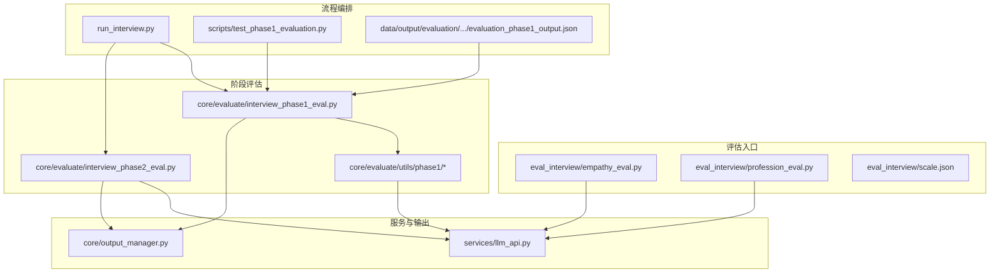
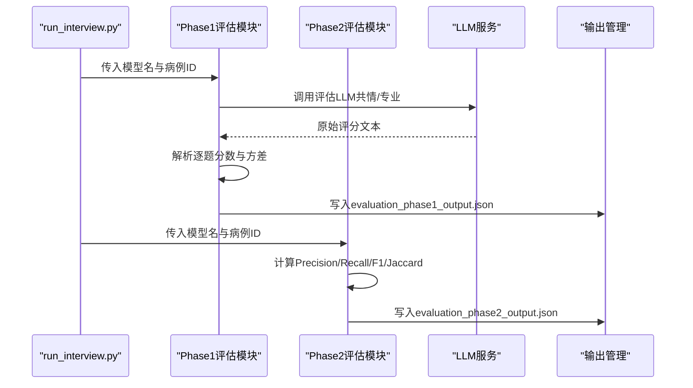
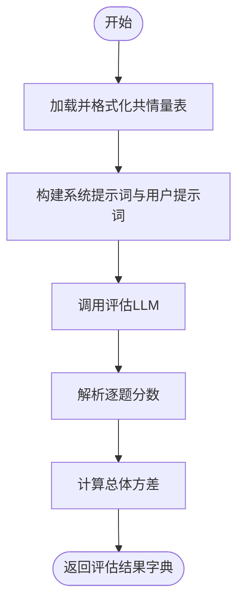
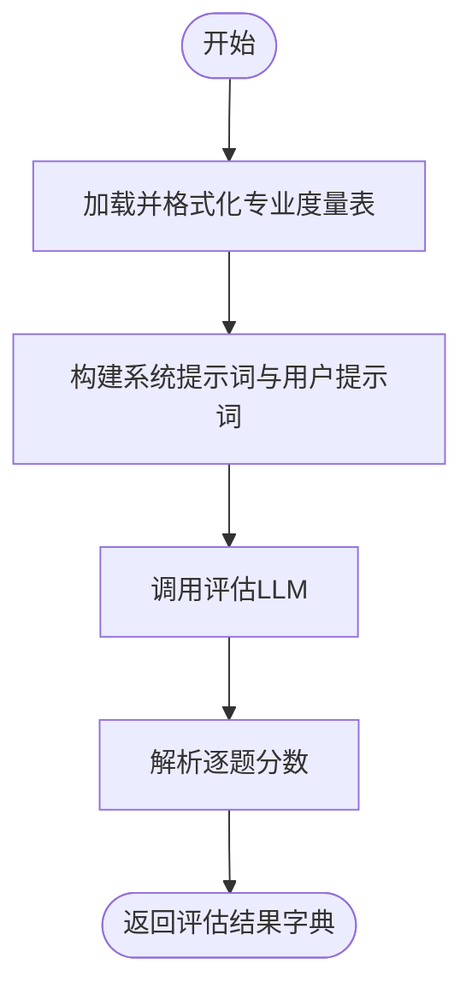
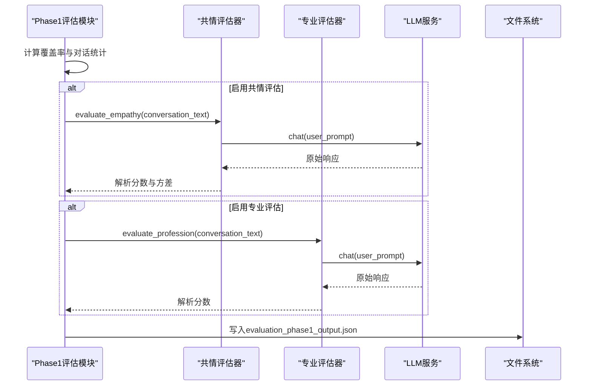
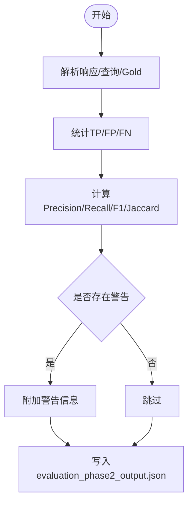
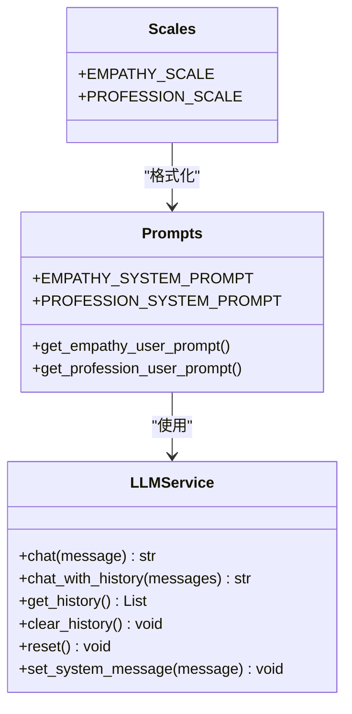
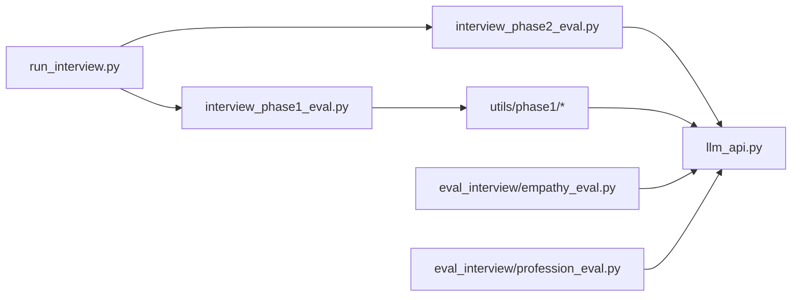

# 评估系统

<cite>
**本文档引用的文件**
- [eval_interview/empathy_eval.py](file://eval_interview/empathy_eval.py)
- [eval_interview/profession_eval.py](file://eval_interview/profession_eval.py)
- [eval_interview/scale.json](file://eval_interview/scale.json)
- [core/evaluate/interview_phase1_eval.py](file://core/evaluate/interview_phase1_eval.py)
- [core/evaluate/interview_phase2_eval.py](file://core/evaluate/interview_phase2_eval.py)
- [core/evaluate/utils/phase1/__init__.py](file://core/evaluate/utils/phase1/__init__.py)
- [core/evaluate/utils/phase1/evaluator.py](file://core/evaluate/utils/phase1/evaluator.py)
- [core/evaluate/utils/phase1/prompts.py](file://core/evaluate/utils/phase1/prompts.py)
- [core/evaluate/utils/phase1/scales.py](file://core/evaluate/utils/phase1/scales.py)
- [services/llm_api.py](file://services/llm_api.py)
- [run_interview.py](file://run_interview.py)
- [scripts/test_phase1_evaluation.py](file://scripts/test_phase1_evaluation.py)
- [core/output_manager.py](file://core/output_manager.py)
- [data/output/evaluation/qwen-flash/1009904/evaluation_phase1_output.json](file://data/output/evaluation/qwen-flash/1009904/evaluation_phase1_output.json)
</cite>

## 目录
1. [简介](#简介)
2. [项目结构](#项目结构)
3. [核心组件](#核心组件)
4. [架构总览](#架构总览)
5. [详细组件分析](#详细组件分析)
6. [依赖分析](#依赖分析)
7. [性能考量](#性能考量)
8. [故障排查指南](#故障排查指南)
9. [结论](#结论)
10. [附录](#附录)

## 简介
本评估系统面向精神科医生与模拟患者的多轮对话，提供两类核心评估能力：
- 共情度评估：基于16维共情量表，对医生在情绪识别、共情表达、回应顺序、语气匹配等方面进行细粒度评分，并输出总分、平均分与方差。
- 专业度评估：基于12维专业度量表，对医生在症状提炼、推理框架、鉴别诊断、风险评估、功能评估、边界感与控场能力等方面进行评分。

系统同时支持多维度指标评估（如检查推荐阶段的精确率、召回率、F1分数与Jaccard相似度），并提供统一的评估结果保存与可视化报告生成入口，便于后续解读与改进。

## 项目结构
系统采用“阶段化访谈 + 阶段化评估”的模块化设计，核心目录与职责如下：
- eval_interview：顶层评估入口与量表资源
- core/evaluate：各阶段评估模块与通用工具
- core/output_manager：统一输出路径管理
- services：LLM服务封装
- data/output：评估与访谈结果持久化
- scripts：评估功能测试脚本
- run_interview：完整流程编排

**图表来源**
- [eval_interview/empathy_eval.py:1-248](file://eval_interview/empathy_eval.py#L1-L248)
- [eval_interview/profession_eval.py:1-204](file://eval_interview/profession_eval.py#L1-L204)
- [eval_interview/scale.json:1-258](file://eval_interview/scale.json#L1-L258)
- [core/evaluate/interview_phase1_eval.py:1-376](file://core/evaluate/interview_phase1_eval.py#L1-L376)
- [core/evaluate/interview_phase2_eval.py:1-301](file://core/evaluate/interview_phase2_eval.py#L1-L301)
- [core/evaluate/utils/phase1/__init__.py:1-31](file://core/evaluate/utils/phase1/__init__.py#L1-L31)
- [services/llm_api.py:1-250](file://services/llm_api.py#L1-L250)
- [run_interview.py:1-408](file://run_interview.py#L1-L408)
- [scripts/test_phase1_evaluation.py:1-63](file://scripts/test_phase1_evaluation.py#L1-L63)
- [core/output_manager.py:1-189](file://core/output_manager.py#L1-L189)
- [data/output/evaluation/qwen-flash/1009904/evaluation_phase1_output.json:1-122](file://data/output/evaluation/qwen-flash/1009904/evaluation_phase1_output.json#L1-L122)

**章节来源**
- [run_interview.py:1-408](file://run_interview.py#L1-L408)
- [core/output_manager.py:1-189](file://core/output_manager.py#L1-L189)

## 核心组件
- 共情度评估器：读取共情量表，组装严格系统提示词与用户提示词，调用评估LLM，解析逐题分数与方差，输出汇总信息。
- 专业度评估器：读取专业度量表，组装系统与用户提示词，调用评估LLM，解析逐题分数，输出汇总信息。
- 阶段评估模块：
  - Phase 1：覆盖率统计、对话统计、共情度与专业度评估（可并行）。
  - Phase 2：检查推荐指标计算（精确率、召回率、F1、Jaccard）。
- LLM服务：统一管理API配置、重试与上下文，按角色提供评估器专用实例。
- 输出管理：统一输出目录与文件命名，支持增量更新与阶段化保存。

**章节来源**
- [eval_interview/empathy_eval.py:9-248](file://eval_interview/empathy_eval.py#L9-L248)
- [eval_interview/profession_eval.py:9-204](file://eval_interview/profession_eval.py#L9-L204)
- [core/evaluate/interview_phase1_eval.py:174-330](file://core/evaluate/interview_phase1_eval.py#L174-L330)
- [core/evaluate/interview_phase2_eval.py:66-150](file://core/evaluate/interview_phase2_eval.py#L66-L150)
- [services/llm_api.py:79-250](file://services/llm_api.py#L79-L250)
- [core/output_manager.py:20-189](file://core/output_manager.py#L20-L189)

## 架构总览
系统以“流程编排 → 阶段化访谈 → 阶段化评估 → 结果持久化”的流水线方式运行。Phase 1/2评估模块分别对接不同的评估任务与指标体系，统一通过LLM服务完成评分抽取与解析。

**图表来源**
- [run_interview.py:75-110](file://run_interview.py#L75-L110)
- [core/evaluate/interview_phase1_eval.py:254-298](file://core/evaluate/interview_phase1_eval.py#L254-L298)
- [core/evaluate/interview_phase2_eval.py:205-231](file://core/evaluate/interview_phase2_eval.py#L205-L231)
- [services/llm_api.py:113-156](file://services/llm_api.py#L113-L156)
- [core/output_manager.py:50-83](file://core/output_manager.py#L50-L83)

## 详细组件分析

### 共情度评估器（empathy_eval）
- 设计要点
  - 量表加载与兼容：支持单表16题与多表结构，统一拍平并按id排序。
  - 提示词工程：严格限定“逐题独立评分”“证据导向”“禁止先总评后回填”等约束，确保评分可解释性。
  - 结果解析：从模型输出中抽取逐题分数，计算总体方差，输出总分、均值与方差。
- 数据流
  - 输入：对话文本
  - 处理：格式化量表、构造提示词、调用LLM、解析分数、计算方差
  - 输出：包含系统提示词、用户提示词、原始响应、解析分数、方差等字段的字典

**图表来源**
- [eval_interview/empathy_eval.py:46-247](file://eval_interview/empathy_eval.py#L46-L247)

**章节来源**
- [eval_interview/empathy_eval.py:9-248](file://eval_interview/empathy_eval.py#L9-L248)
- [eval_interview/scale.json:1-258](file://eval_interview/scale.json#L1-L258)

### 专业度评估器（profession_eval）
- 设计要点
  - 量表加载与兼容：支持list与dict（多表）结构，统一拍平并按id排序。
  - 提示词工程：强调“逐题独立评分”“证据导向”“避免模板化”“保持专业边界”等原则。
  - 结果解析：从模型输出中抽取逐题分数，输出总分与均值。
- 数据流
  - 输入：对话文本
  - 处理：格式化量表、构造提示词、调用LLM、解析分数
  - 输出：包含系统提示词、用户提示词、原始响应、解析分数等字段的字典

**图表来源**
- [eval_interview/profession_eval.py:44-195](file://eval_interview/profession_eval.py#L44-L195)

**章节来源**
- [eval_interview/profession_eval.py:9-204](file://eval_interview/profession_eval.py#L9-L204)

### Phase 1 评估模块（覆盖率与共情/专业评估）
- 覆盖率统计：计算主诉覆盖率、精神状态覆盖率与整体覆盖率。
- 对话统计：统计患者/医生轮次、总轮次与对话长度。
- 共情/专业评估：可选择启用，支持并行评估，解析分数并输出总分、均值与方差（共情）。
- 结果持久化：统一写入evaluation_phase1_output.json，包含覆盖率、对话统计与评估结果。

**图表来源**
- [core/evaluate/interview_phase1_eval.py:232-299](file://core/evaluate/interview_phase1_eval.py#L232-L299)
- [core/evaluate/utils/phase1/evaluator.py:50-160](file://core/evaluate/utils/phase1/evaluator.py#L50-L160)
- [services/llm_api.py:113-156](file://services/llm_api.py#L113-L156)

**章节来源**
- [core/evaluate/interview_phase1_eval.py:174-330](file://core/evaluate/interview_phase1_eval.py#L174-L330)
- [core/evaluate/utils/phase1/evaluator.py:133-160](file://core/evaluate/utils/phase1/evaluator.py#L133-L160)

### Phase 2 评估模块（检查推荐指标）
- 指标计算：基于响应与Gold标准，计算TP/FP/FN，进而得到Precision、Recall、F1与Jaccard。
- 数据解析：支持字符串或对象形式的JSON输入，自动解析并校验。
- 结果持久化：统一写入evaluation_phase2_output.json，包含指标、统计与警告信息。

**图表来源**
- [core/evaluate/interview_phase2_eval.py:92-150](file://core/evaluate/interview_phase2_eval.py#L92-L150)

**章节来源**
- [core/evaluate/interview_phase2_eval.py:66-150](file://core/evaluate/interview_phase2_eval.py#L66-L150)

### LLM服务与提示词工程
- LLM服务：按角色（patient/doctor/evaluator）加载配置，维护对话历史，提供重试与指数退避。
- 提示词工程：共情与专业评估分别提供系统提示词与用户提示词，确保评分一致性与可解释性。
- 量表定义：内置16维共情量表与12维专业度量表，支持格式化输出。

**图表来源**
- [services/llm_api.py:79-250](file://services/llm_api.py#L79-L250)
- [core/evaluate/utils/phase1/prompts.py:35-280](file://core/evaluate/utils/phase1/prompts.py#L35-L280)
- [core/evaluate/utils/phase1/scales.py:10-464](file://core/evaluate/utils/phase1/scales.py#L10-L464)

**章节来源**
- [services/llm_api.py:79-250](file://services/llm_api.py#L79-L250)
- [core/evaluate/utils/phase1/prompts.py:10-280](file://core/evaluate/utils/phase1/prompts.py#L10-L280)
- [core/evaluate/utils/phase1/scales.py:10-464](file://core/evaluate/utils/phase1/scales.py#L10-L464)

## 依赖分析
- 模块耦合
  - Phase 1评估模块依赖通用提示词与量表定义，通过LLM服务完成评分抽取。
  - Phase 2评估模块依赖数据解析与指标计算，不直接依赖量表。
  - LLM服务作为统一依赖，按角色提供实例。
- 外部依赖
  - OpenAI Chat Completions API，通过.env配置加载密钥与基础URL。
  - Python第三方库：httpx、openai、python-dotenv、json、pathlib等。

**图表来源**
- [core/evaluate/interview_phase1_eval.py:254-274](file://core/evaluate/interview_phase1_eval.py#L254-L274)
- [core/evaluate/interview_phase2_eval.py:205-217](file://core/evaluate/interview_phase2_eval.py#L205-L217)
- [services/llm_api.py:40-43](file://services/llm_api.py#L40-L43)

**章节来源**
- [run_interview.py:32-43](file://run_interview.py#L32-L43)
- [services/llm_api.py:40-43](file://services/llm_api.py#L40-L43)

## 性能考量
- 并行评估：Phase 1支持共情与专业评估并行，减少总耗时。
- LLM调用优化：统一配置最大token与温度，启用指数退避重试，提升稳定性。
- 数据解析：对JSON输入进行健壮性处理，避免格式错误导致的中断。
- 存储策略：阶段化输出，避免大文件一次性写入，便于增量更新与恢复。

[本节为通用性能建议，不直接分析具体文件]

## 故障排查指南
- 量表文件缺失
  - 现象：抛出未找到量表文件的异常。
  - 处理：确认data目录下存在共情或专业度量表文件，或显式传入scale_path。
- 对话文本为空
  - 现象：抛出对话文本为空的异常。
  - 处理：确保传入有效的对话文本。
- LLM调用失败
  - 现象：API调用异常，日志记录重试与错误信息。
  - 处理：检查.env中的API配置，确认网络连通性与密钥有效性。
- 输出文件未生成
  - 现象：评估结果未写入文件。
  - 处理：确认输出目录权限与路径正确，查看保存逻辑是否执行。

**章节来源**
- [eval_interview/empathy_eval.py:20-44](file://eval_interview/empathy_eval.py#L20-L44)
- [eval_interview/profession_eval.py:20-42](file://eval_interview/profession_eval.py#L20-L42)
- [services/llm_api.py:158-169](file://services/llm_api.py#L158-L169)
- [core/evaluate/interview_phase1_eval.py:141-171](file://core/evaluate/interview_phase1_eval.py#L141-L171)

## 结论
本评估系统通过严格的提示词工程与量表设计，实现了对医生共情与专业能力的多维度量化评估，并在检查推荐阶段引入了精确率、召回率、F1与Jaccard等客观指标。系统模块化设计便于扩展新的评估维度与量表，统一的输出管理与流程编排有助于规模化落地与持续改进。

[本节为总结性内容，不直接分析具体文件]

## 附录

### 评估指标计算说明
- 共情度
  - 逐题评分：0/1/2三分类，基于证据导向与独立判断。
  - 汇总指标：总分、平均分、方差（衡量一致性与稳定性）。
- 专业度
  - 逐题评分：0/1/2三分类，强调专业边界与临床推理。
  - 汇总指标：总分、平均分。
- 检查推荐（Phase 2）
  - Precision = TP / (TP + FP)
  - Recall = TP / (TP + FN)
  - F1 = 2PR / (P + R)
  - Jaccard = TP / (TP + FP + FN)

**章节来源**
- [core/evaluate/interview_phase2_eval.py:78-122](file://core/evaluate/interview_phase2_eval.py#L78-L122)

### 评估结果解读指南
- 共情度
  - 总分：16×2=32分制，越高代表整体共情表现越好。
  - 平均分：反映每题的平均水平。
  - 方差：越低表示各题评分越稳定，避免极端波动。
- 专业度
  - 总分：12×2=24分制，越高代表整体专业表现越好。
  - 平均分：反映每题的平均水平。
- 检查推荐
  - Precision：推荐中有多少是正确的，关注“推荐质量”。
  - Recall：真正需要的检查中有多少被正确推荐，关注“覆盖面”。
  - F1：综合Precision与Recall的平衡。
  - Jaccard：集合层面的相似度，兼顾遗漏与冗余。

**章节来源**
- [data/output/evaluation/qwen-flash/1009904/evaluation_phase1_output.json:79-121](file://data/output/evaluation/qwen-flash/1009904/evaluation_phase1_output.json#L79-L121)
- [core/evaluate/interview_phase2_eval.py:233-245](file://core/evaluate/interview_phase2_eval.py#L233-L245)

### 扩展方法
- 添加新的评估维度
  - 在相应阶段的评估模块中新增量表条目或指标计算逻辑。
  - 若为顶层评估入口，可在eval_interview目录下新增评估函数与量表文件。
- 调整评估权重
  - 在汇总阶段对不同维度的分数进行加权聚合（需在评估模块中扩展）。
- 新增评估阶段
  - 参照Phase 1/2的实现方式，新增评估模块与指标计算，并接入流程编排。

**章节来源**
- [eval_interview/empathy_eval.py:46-97](file://eval_interview/empathy_eval.py#L46-L97)
- [eval_interview/profession_eval.py:44-90](file://eval_interview/profession_eval.py#L44-L90)
- [core/evaluate/interview_phase1_eval.py:254-298](file://core/evaluate/interview_phase1_eval.py#L254-L298)
- [core/evaluate/interview_phase2_eval.py:205-231](file://core/evaluate/interview_phase2_eval.py#L205-L231)

### 可视化与报告生成
- 输出文件
  - Phase 1/2评估结果分别保存为evaluation_phase1_output.json与evaluation_phase2_output.json。
  - 完整流程汇总保存为interview_summary.json。
- 报告建议
  - 基于输出文件中的指标与统计数据，生成可视化图表（柱状图、折线图、雷达图）与摘要报告，便于教学与反馈。

**章节来源**
- [run_interview.py:371-393](file://run_interview.py#L371-L393)
- [data/output/evaluation/qwen-flash/1009904/evaluation_phase1_output.json:1-122](file://data/output/evaluation/qwen-flash/1009904/evaluation_phase1_output.json#L1-L122)