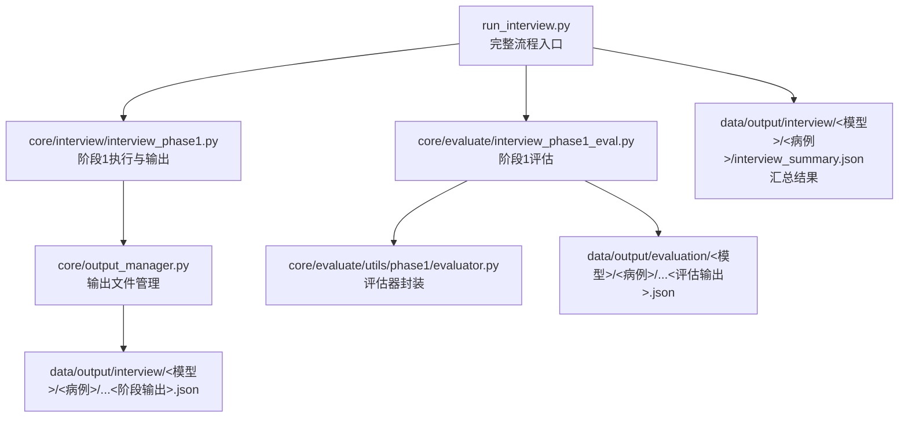
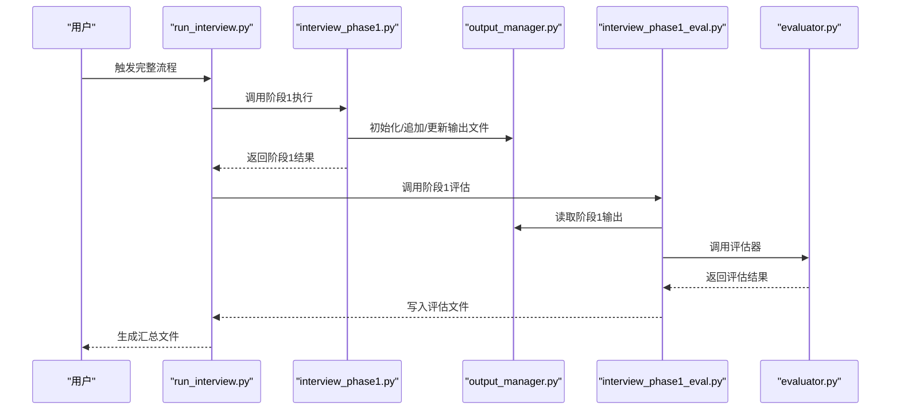
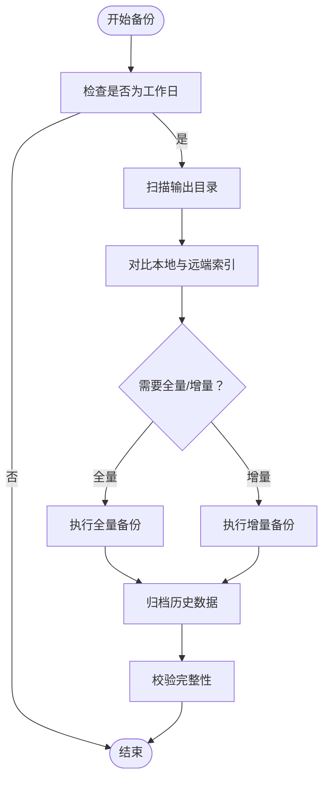
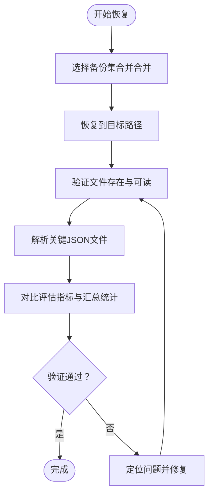
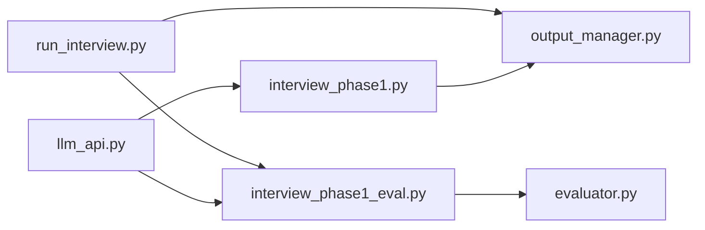

# 备份与灾难恢复

<cite>
**本文引用的文件**   
- [run_interview.py](file://run_interview.py)
- [output_manager.py](file://core/output_manager.py)
- [interview_phase1.py](file://core/interview/interview_phase1.py)
- [llm_api.py](file://services/llm_api.py)
- [interview_phase1_eval.py](file://core/evaluate/interview_phase1_eval.py)
- [evaluator.py](file://core/evaluate/utils/phase1/evaluator.py)
- [interview_summary.json](file://data/output/interview/qwen-flash/1009904/interview_summary.json)
- [evaluation_phase1_output.json](file://data/output/evaluation/qwen-flash/1009904/evaluation_phase1_output.json)
- [test_phase1_evaluation.py](file://scripts/test_phase1_evaluation.py)
</cite>

## 目录
1. [简介](#简介)
2. [项目结构](#项目结构)
3. [核心组件](#核心组件)
4. [架构总览](#架构总览)
5. [详细组件分析](#详细组件分析)
6. [依赖分析](#依赖分析)
7. [性能考量](#性能考量)
8. [故障排查指南](#故障排查指南)
9. [结论](#结论)
10. [附录](#附录)

## 简介
本方案面向精神卫生医疗系统，围绕“备份策略与灾难恢复”目标，基于仓库现有代码与数据落盘结构，制定可落地的备份与恢复实施方案。重点覆盖：
- 数据备份频率与策略（定期与增量）
- 输出数据（问诊结果与评估报告）的归档管理
- 数据恢复流程与验证方法
- 跨地域冗余与高可用部署思路
- 灾难恢复计划与演练方法
- 数据迁移与版本升级的备份策略
- 数据损坏与丢失的处理流程

## 项目结构
系统采用“流程编排 + 输出管理 + 评估闭环”的组织方式，数据以JSON文件形式落盘，便于统一备份与恢复。

图表来源
- [run_interview.py:46-396](file://run_interview.py#L46-L396)
- [interview_phase1.py:241-428](file://core/interview/interview_phase1.py#L241-L428)
- [output_manager.py:20-189](file://core/output_manager.py#L20-L189)
- [interview_phase1_eval.py:174-330](file://core/evaluate/interview_phase1_eval.py#L174-L330)
- [evaluator.py:50-160](file://core/evaluate/utils/phase1/evaluator.py#L50-L160)

章节来源
- [run_interview.py:46-396](file://run_interview.py#L46-L396)
- [output_manager.py:20-189](file://core/output_manager.py#L20-L189)

## 核心组件
- 流程编排与汇总
  - 完整流程入口负责串联各阶段并生成汇总文件，便于一次性备份与恢复。
- 输出管理
  - 统一管理各阶段输出文件路径、初始化、追加对话、更新状态与加载数据。
- 评估模块
  - 评估阶段输出并生成评估文件，与阶段输出形成“输入-输出-评估”的闭环。
- LLM服务
  - 提供对话能力与重试机制，保障流程稳定性。

章节来源
- [run_interview.py:46-396](file://run_interview.py#L46-L396)
- [output_manager.py:20-189](file://core/output_manager.py#L20-L189)
- [interview_phase1_eval.py:174-330](file://core/evaluate/interview_phase1_eval.py#L174-L330)
- [llm_api.py:79-250](file://services/llm_api.py#L79-L250)

## 架构总览
下图展示从流程入口到输出文件的端到端数据流，以及评估模块对输出文件的依赖关系。

图表来源
- [run_interview.py:46-396](file://run_interview.py#L46-L396)
- [interview_phase1.py:241-428](file://core/interview/interview_phase1.py#L241-L428)
- [output_manager.py:50-189](file://core/output_manager.py#L50-L189)
- [interview_phase1_eval.py:174-330](file://core/evaluate/interview_phase1_eval.py#L174-L330)
- [evaluator.py:50-160](file://core/evaluate/utils/phase1/evaluator.py#L50-L160)

## 详细组件分析

### 输出文件管理与备份策略
- 文件结构
  - 阶段输出：data/output/interview/{model}/{case_id}/interview_phase{N}_output.json
  - 评估输出：data/output/evaluation/{model}/{case_id}/evaluation_phase{N}_output.json
  - 汇总文件：data/output/interview/{model}/{case_id}/interview_summary.json
- 备份策略
  - 定期备份：每日全量备份上述目录，保留最近7天全量备份。
  - 增量备份：基于文件变更时间与大小，按日同步新增/更新文件；对汇总文件与评估文件进行差异对比后增量。
  - 归档管理：按月/季度归档历史数据，压缩加密后异地存储。
- 写入特性
  - 输出文件采用即时写入策略，适合增量备份；建议在备份窗口外触发写入，避免并发写入冲突。

图表来源
- [output_manager.py:50-115](file://core/output_manager.py#L50-L115)
- [interview_summary.json:1-443](file://data/output/interview/qwen-flash/1009904/interview_summary.json#L1-L443)
- [evaluation_phase1_output.json:1-122](file://data/output/evaluation/qwen-flash/1009904/evaluation_phase1_output.json#L1-L122)

章节来源
- [output_manager.py:20-189](file://core/output_manager.py#L20-L189)
- [interview_summary.json:1-443](file://data/output/interview/qwen-flash/1009904/interview_summary.json#L1-L443)
- [evaluation_phase1_output.json:1-122](file://data/output/evaluation/qwen-flash/1009904/evaluation_phase1_output.json#L1-L122)

### 评估模块与评估报告备份
- 评估流程
  - 评估模块读取阶段输出，调用评估器生成评估结果并写入评估文件。
- 备份要点
  - 评估文件与阶段输出一一对应，建议按阶段号统一打包备份。
  - 对评估指标与评分明细进行版本化管理，便于回溯。

章节来源
- [interview_phase1_eval.py:174-330](file://core/evaluate/interview_phase1_eval.py#L174-L330)
- [evaluator.py:50-160](file://core/evaluate/utils/phase1/evaluator.py#L50-L160)

### 恢复流程与验证
- 恢复步骤
  - 选择目标时间点的全量备份与后续增量备份进行合并恢复。
  - 恢复后优先验证汇总文件与关键阶段输出文件是否存在且可解析。
  - 执行一次轻量级评估流程，核对评估指标是否与历史一致。
- 验证清单
  - 文件存在性与可读性
  - JSON结构完整性与关键字段存在性
  - 评估指标与汇总统计一致性

图表来源
- [interview_summary.json:1-443](file://data/output/interview/qwen-flash/1009904/interview_summary.json#L1-L443)
- [evaluation_phase1_output.json:1-122](file://data/output/evaluation/qwen-flash/1009904/evaluation_phase1_output.json#L1-L122)

章节来源
- [interview_summary.json:1-443](file://data/output/interview/qwen-flash/1009904/interview_summary.json#L1-L443)
- [evaluation_phase1_output.json:1-122](file://data/output/evaluation/qwen-flash/1009904/evaluation_phase1_output.json#L1-L122)

### 跨地域冗余与高可用部署
- 存储层
  - 在不同可用区/区域部署对象存储或NAS，开启跨区域复制。
- 应用层
  - 通过负载均衡与多实例部署，结合健康检查与自动切换。
- 数据层
  - 对关键配置与密钥进行集中管理，确保灾备环境可一键切换。

（本节为概念性指导，不直接分析具体文件）

### 灾难恢复计划与演练
- DRP组成
  - 目标与范围、恢复时间目标（RTO/RPO）、职责分工、备份策略、恢复流程、沟通机制、演练计划。
- 演练类型
  - 桌面演练、功能演练、全系统演练；按季度开展，覆盖网络中断、存储故障、应用故障等场景。
- 文档化
  - 将演练结果与改进建议纳入DRP修订。

（本节为概念性指导，不直接分析具体文件）

### 数据迁移与版本升级的备份策略
- 迁移前
  - 全量备份当前生产数据与配置；冻结写入窗口。
- 迁移中
  - 采用双写或影子复制技术，确保数据一致性；增量同步收尾。
- 迁移后
  - 校验数据一致性与业务功能；回滚预案就绪。
- 版本升级
  - 升级前备份配置与数据；升级后验证评估指标与汇总统计一致性。

（本节为概念性指导，不直接分析具体文件）

### 数据损坏与丢失的处理
- 检测
  - 定期校验文件完整性与JSON结构；监控告警异常。
- 处理
  - 若单文件损坏，优先从备份恢复；若批量损坏，启用最近可用备份集。
- 预防
  - 引入校验和与版本控制；对关键文件进行只增不改的归档策略。

（本节为概念性指导，不直接分析具体文件）

## 依赖分析
- 组件耦合
  - run_interview.py 依赖 output_manager.py 与评估模块；评估模块依赖输出管理与评估器。
- 外部依赖
  - LLM服务提供对话能力与重试机制，保障流程稳定性。

图表来源
- [run_interview.py:46-396](file://run_interview.py#L46-L396)
- [output_manager.py:20-189](file://core/output_manager.py#L20-L189)
- [interview_phase1_eval.py:174-330](file://core/evaluate/interview_phase1_eval.py#L174-L330)
- [evaluator.py:50-160](file://core/evaluate/utils/phase1/evaluator.py#L50-L160)
- [interview_phase1.py:241-428](file://core/interview/interview_phase1.py#L241-L428)
- [llm_api.py:79-250](file://services/llm_api.py#L79-L250)

章节来源
- [run_interview.py:46-396](file://run_interview.py#L46-L396)
- [output_manager.py:20-189](file://core/output_manager.py#L20-L189)
- [interview_phase1_eval.py:174-330](file://core/evaluate/interview_phase1_eval.py#L174-L330)
- [evaluator.py:50-160](file://core/evaluate/utils/phase1/evaluator.py#L50-L160)
- [interview_phase1.py:241-428](file://core/interview/interview_phase1.py#L241-L428)
- [llm_api.py:79-250](file://services/llm_api.py#L79-L250)

## 性能考量
- 备份窗口
  - 将全量备份安排在业务低峰时段；增量备份采用异步同步，降低对在线服务的影响。
- IO与网络
  - 对大文件进行分块传输与断点续传；启用压缩与去重，减少带宽与存储占用。
- 评估开销
  - 评估流程可并行执行；在备份窗口外运行评估任务，避免与写入竞争。

（本节为通用指导，不直接分析具体文件）

## 故障排查指南
- 常见问题
  - 输出文件缺失：检查 output_manager 的初始化与写入逻辑；确认权限与磁盘空间。
  - 评估失败：检查评估器调用链与系统提示词；查看日志与重试机制。
  - 恢复不一致：核对备份索引与文件校验；比对评估指标与汇总统计。
- 工具与脚本
  - 使用脚本测试评估功能，验证评估器与输出文件的兼容性。

章节来源
- [output_manager.py:50-115](file://core/output_manager.py#L50-L115)
- [interview_phase1_eval.py:174-330](file://core/evaluate/interview_phase1_eval.py#L174-L330)
- [evaluator.py:50-160](file://core/evaluate/utils/phase1/evaluator.py#L50-L160)
- [test_phase1_evaluation.py:16-58](file://scripts/test_phase1_evaluation.py#L16-L58)

## 结论
本方案基于系统现有文件落盘结构与评估闭环，提出了可操作的备份与灾难恢复实施路径：以“定期全量+增量”为核心，配合归档与异地存储；以“汇总文件+阶段输出+评估文件”为恢复单元；以“校验与评估指标对比”为验证手段。建议结合实际运维环境，补充跨地域冗余与高可用部署策略，并将DRP纳入常态化演练体系。

## 附录
- 关键文件路径参考
  - 阶段输出：data/output/interview/{model}/{case_id}/interview_phase{N}_output.json
  - 评估输出：data/output/evaluation/{model}/{case_id}/evaluation_phase{N}_output.json
  - 汇总文件：data/output/interview/{model}/{case_id}/interview_summary.json

（本节为概览性说明，不直接分析具体文件）