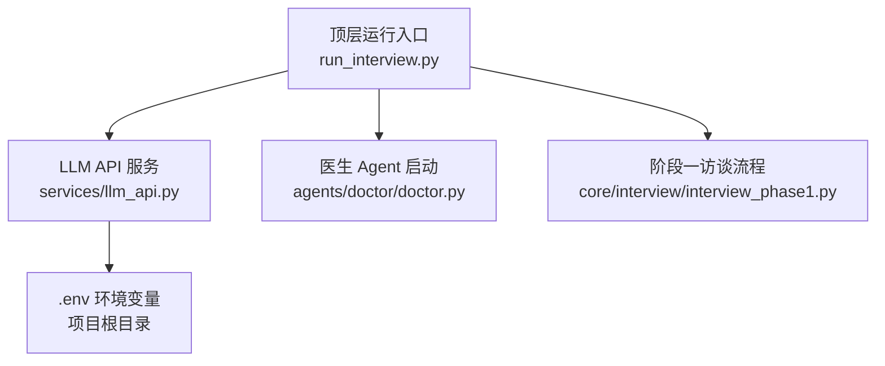
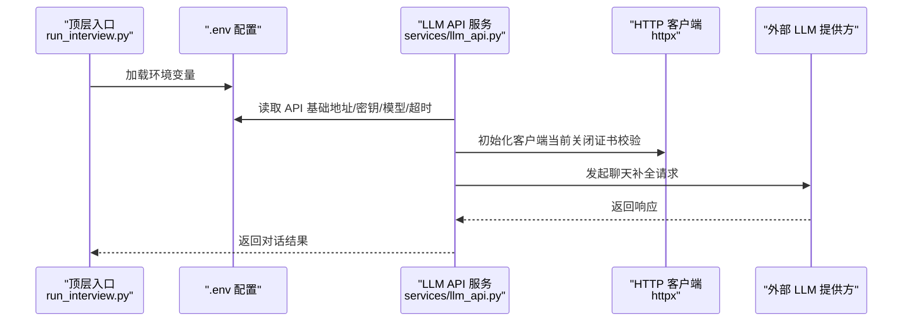
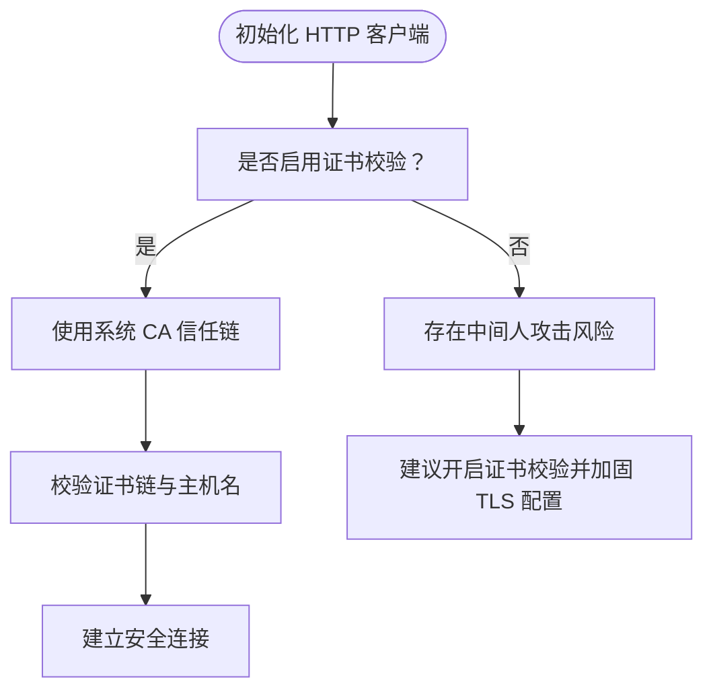
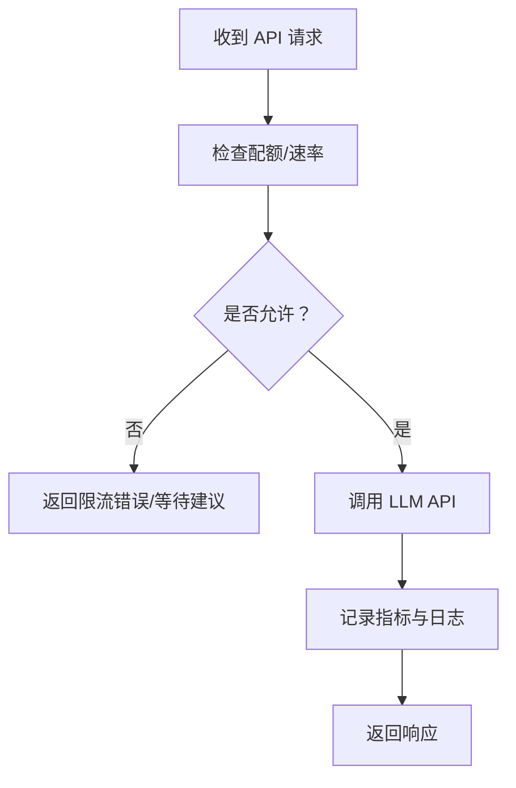
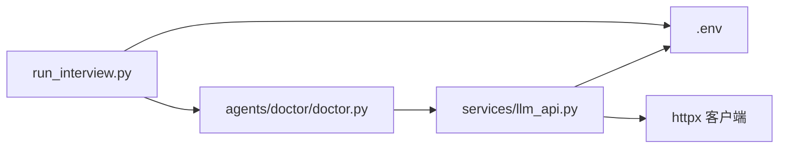

# 安全与访问控制

<cite>
**本文引用的文件**
- [services/llm_api.py](file://services/llm_api.py)
- [run_interview.py](file://run_interview.py)
- [test/test_api.py](file://test/test_api.py)
- [agents/doctor/doctor.py](file://agents/doctor/doctor.py)
- [core/interview/interview_phase1.py](file://core/interview/interview_phase1.py)
</cite>

## 目录
1. [简介](#简介)
2. [项目结构](#项目结构)
3. [核心组件](#核心组件)
4. [架构总览](#架构总览)
5. [详细组件分析](#详细组件分析)
6. [依赖分析](#依赖分析)
7. [性能考虑](#性能考虑)
8. [故障排查指南](#故障排查指南)
9. [结论](#结论)
10. [附录](#附录)

## 简介
本指南聚焦于 MentalHospital 项目的“安全配置与访问控制”实施要点，围绕以下主题展开：
- API 密钥与敏感配置的安全存储与管理（.env 文件权限、环境变量隔离）
- HTTPS 连接与 SSL 证书验证（当前实现与改进建议）
- 防火墙与网络访问控制（建议与最佳实践）
- API 调用频率限制与速率控制（建议与实现思路）
- 数据传输加密与存储加密（建议与最佳实践）
- 安全审计与合规性检查（建议与落地方法）
- 常见安全威胁防护（API 濫用、数据泄露等）

本指南在不展示具体代码的前提下，基于仓库现有实现进行分析，并提供可操作的改进方案。

## 项目结构
该项目采用按功能域划分的模块化组织方式，涉及 LLM API 服务、访谈流程编排、评估与输出管理等模块。与安全相关的关键点集中在：
- 配置加载：统一从项目根目录 .env 读取敏感参数
- 客户端初始化：通过 httpx 初始化 HTTP 客户端，用于 LLM API 调用
- 运行入口：顶层脚本负责加载 .env 并驱动完整流程

图表来源
- [run_interview.py:28-30](file://run_interview.py#L28-L30)
- [services/llm_api.py:40-42](file://services/llm_api.py#L40-L42)
- [agents/doctor/doctor.py:32-55](file://agents/doctor/doctor.py#L32-L55)
- [core/interview/interview_phase1.py:56-57](file://core/interview/interview_phase1.py#L56-L57)

章节来源
- [run_interview.py:28-30](file://run_interview.py#L28-L30)
- [services/llm_api.py:40-42](file://services/llm_api.py#L40-L42)
- [agents/doctor/doctor.py:32-55](file://agents/doctor/doctor.py#L32-L55)
- [core/interview/interview_phase1.py:56-57](file://core/interview/interview_phase1.py#L56-L57)

## 核心组件
- 配置加载与管理
  - 顶层入口与各模块均显式加载 .env，确保敏感配置集中管理
  - LLM API 服务通过环境变量读取 API 基础地址、密钥、模型、超时等参数
- LLM 客户端初始化
  - 使用 httpx 创建 HTTP 客户端，当前实现关闭了 SSL 证书校验
- 访谈流程与 Agent
  - 医生 Agent 通过 LLM API 服务进行多轮对话，上下文由服务内部维护

章节来源
- [services/llm_api.py:40-76](file://services/llm_api.py#L40-L76)
- [services/llm_api.py:99-104](file://services/llm_api.py#L99-L104)
- [agents/doctor/doctor.py:32-55](file://agents/doctor/doctor.py#L32-L55)
- [run_interview.py:28-30](file://run_interview.py#L28-L30)

## 架构总览
下图展示了安全相关的关键交互：顶层入口加载 .env，LLM API 服务读取配置并通过 HTTP 客户端发起 API 请求；医生 Agent 通过 LLM 服务进行对话。

图表来源
- [run_interview.py:28-30](file://run_interview.py#L28-L30)
- [services/llm_api.py:40-76](file://services/llm_api.py#L40-L76)
- [services/llm_api.py:99-104](file://services/llm_api.py#L99-L104)

## 详细组件分析

### 组件 A：API 密钥与敏感配置管理（.env）
- 配置来源与加载
  - 顶层入口与多个模块均显式加载 .env，确保配置集中、可追溯
  - LLM API 服务从 .env 中读取 API 基础地址、密钥、模型、最大令牌数、温度、超时等参数
- 敏感信息保护建议
  - 严格限制 .env 文件权限（仅限运行账户读取）
  - 将 .env 纳入版本控制忽略清单，避免误提交
  - 在 CI/CD 中使用受控的密钥注入机制，不在构建产物中携带明文
  - 对 .env 进行最小权限原则的访问控制（仅授予必要进程）
  - 定期轮换 API 密钥，建立密钥生命周期管理流程

章节来源
- [run_interview.py:28-30](file://run_interview.py#L28-L30)
- [services/llm_api.py:40-76](file://services/llm_api.py#L40-L76)
- [test/test_api.py:177-181](file://test/test_api.py#L177-L181)

### 组件 B：HTTPS 连接与 SSL 证书验证
- 现状分析
  - LLM API 服务在初始化 HTTP 客户端时关闭了 SSL 证书校验，存在中间人攻击风险
- 改进建议
  - 默认启用证书校验，确保与可信 CA 链路通信
  - 如需自签证书，应在受信 CA 管理体系下部署，并在运行环境中正确安装根证书
  - 对外部服务的 TLS 版本与加密套件进行白名单约束，避免降级到弱加密
  - 在代理/反向代理场景下，确保端到端 TLS 通道完整

图表来源
- [services/llm_api.py:102-104](file://services/llm_api.py#L102-L104)

章节来源
- [services/llm_api.py:102-104](file://services/llm_api.py#L102-L104)

### 组件 C：防火墙与网络访问控制
- 建议策略
  - 出站网络：仅允许访问已知的 LLM 提供商域名与必要的监控/日志出口
  - 入站网络：如项目对外暴露服务，仅开放必需端口并限制来源 IP
  - 内部网络：通过子网/安全组隔离开发、测试、生产环境
  - 代理与出站代理：在受限网络环境下，统一经由受控代理访问外网
- 配置落地
  - 使用系统防火墙（iptables/nftables）或云厂商安全组策略
  - 对 DNS 查询与 TLS 握手进行审计与告警

[本节为通用实践说明，不直接分析具体文件，故无章节来源]

### 组件 D：API 调用频率限制与速率控制
- 现状分析
  - 项目未内置速率限制逻辑，需在应用层或外部设施实现
- 实施建议
  - 应用层限流：在 LLM API 服务中引入令牌桶/滑动窗口算法，按角色/密钥维度进行配额控制
  - 外部限流：结合网关/反向代理（如 Nginx/Traefik）或云厂商 WAF/限流策略
  - 指标与告警：记录每分钟/每小时调用量、错误率与延迟，设置阈值告警
  - 退避与重试：结合指数退避策略，避免雪崩效应

图表来源
- [services/llm_api.py:144-156](file://services/llm_api.py#L144-L156)

章节来源
- [services/llm_api.py:144-156](file://services/llm_api.py#L144-L156)

### 组件 E：数据传输加密与存储加密
- 传输加密
  - 强制启用 TLS 1.2+，禁用弱加密套件与过时协议
  - 在客户端与服务端之间建立端到端加密通道
- 存储加密
  - 对 .env 与输出目录中的敏感文件进行静态加密
  - 使用受信密钥管理系统（KMS）进行密钥轮换与访问审计
  - 对日志与临时文件设置严格的文件系统权限

[本节为通用实践说明，不直接分析具体文件，故无章节来源]

### 组件 F：安全审计与合规性检查
- 审计范围
  - API 密钥使用轨迹、调用频次、错误与异常
  - .env 与配置文件的访问日志
  - 外出网络请求的目标、时间戳与响应状态
- 合规建议
  - 建立最小权限与职责分离原则
  - 定期进行渗透测试与配置基线核查
  - 对敏感数据处理建立数据生命周期管理规范

[本节为通用实践说明，不直接分析具体文件，故无章节来源]

### 组件 G：常见安全威胁防护
- API 滥用
  - 通过速率限制、配额控制与行为检测降低滥用风险
  - 对异常模式（短时间高 QPS、异常关键词）触发告警
- 数据泄露
  - 限制 .env 与输出文件的访问范围
  - 对日志中的敏感字段进行脱敏与过滤
- 中间人攻击
  - 强制启用证书校验，避免关闭 TLS 校验
  - 在代理/反向代理场景下确保端到端 TLS

章节来源
- [services/llm_api.py:102-104](file://services/llm_api.py#L102-L104)

## 依赖分析
- 配置依赖
  - 顶层入口与多个模块依赖 .env 提供的 API 基础地址、密钥与模型配置
- 运行时依赖
  - LLM API 服务依赖 httpx 初始化 HTTP 客户端，当前关闭证书校验
- 组件耦合
  - 医生 Agent 通过 LLM API 服务进行对话，上下文由服务内部维护

图表来源
- [run_interview.py:28-30](file://run_interview.py#L28-L30)
- [agents/doctor/doctor.py:32-55](file://agents/doctor/doctor.py#L32-L55)
- [services/llm_api.py:40-76](file://services/llm_api.py#L40-L76)
- [services/llm_api.py:99-104](file://services/llm_api.py#L99-L104)

章节来源
- [run_interview.py:28-30](file://run_interview.py#L28-L30)
- [agents/doctor/doctor.py:32-55](file://agents/doctor/doctor.py#L32-L55)
- [services/llm_api.py:40-76](file://services/llm_api.py#L40-L76)
- [services/llm_api.py:99-104](file://services/llm_api.py#L99-L104)

## 性能考虑
- 重试与退避
  - LLM API 服务实现了指数退避的重试机制，有助于提升在不稳定网络下的成功率
- 超时与并发
  - 建议为不同角色/接口设定合理的超时与并发上限，避免资源争抢
- 日志与监控
  - 降低 httpx 日志级别以减少噪声，同时保留关键错误日志以便审计

章节来源
- [services/llm_api.py:158-169](file://services/llm_api.py#L158-L169)
- [services/llm_api.py:44](file://services/llm_api.py#L44)

## 故障排查指南
- .env 配置问题
  - 确认 .env 文件路径与权限正确，确保各角色的 API 基础地址与密钥已设置
  - 使用测试脚本验证基本连通性与多轮对话上下文
- SSL 证书校验失败
  - 若因自签证书导致校验失败，应在受信 CA 体系下部署或调整运行环境证书链
- API 调用异常
  - 检查重试日志与错误码，确认网络连通性与外部服务状态
  - 结合速率限制策略，避免触发外部服务的配额限制

章节来源
- [test/test_api.py:19-110](file://test/test_api.py#L19-L110)
- [services/llm_api.py:158-169](file://services/llm_api.py#L158-L169)

## 结论
本项目在配置集中化与模块化方面具备良好基础，但在 HTTPS 证书校验、速率限制与密钥管理等方面仍有改进空间。建议优先落实：
- 启用并强化 TLS 证书校验
- 建立 .env 与密钥的最小权限与轮换机制
- 引入速率限制与审计日志
- 制定并执行安全基线与合规流程

[本节为总结性内容，不直接分析具体文件，故无章节来源]

## 附录
- 快速检查清单
  - .env 权限：仅运行账户可读
  - TLS 校验：默认启用，禁用降级
  - 速率限制：按角色/密钥维度配置配额
  - 审计日志：记录 API 调用、错误与异常
  - 密钥轮换：建立周期性轮换与撤销流程

[本节为通用实践说明，不直接分析具体文件，故无章节来源]