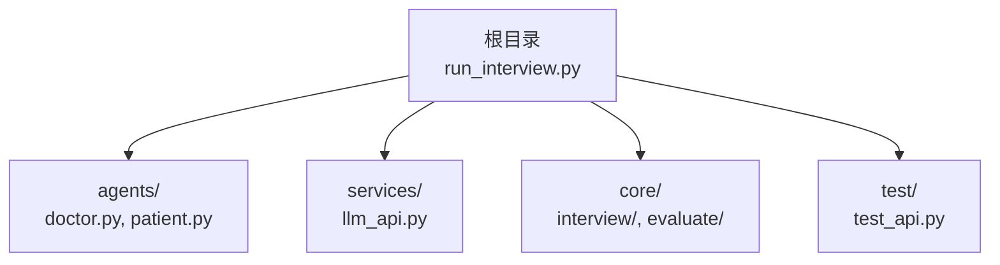
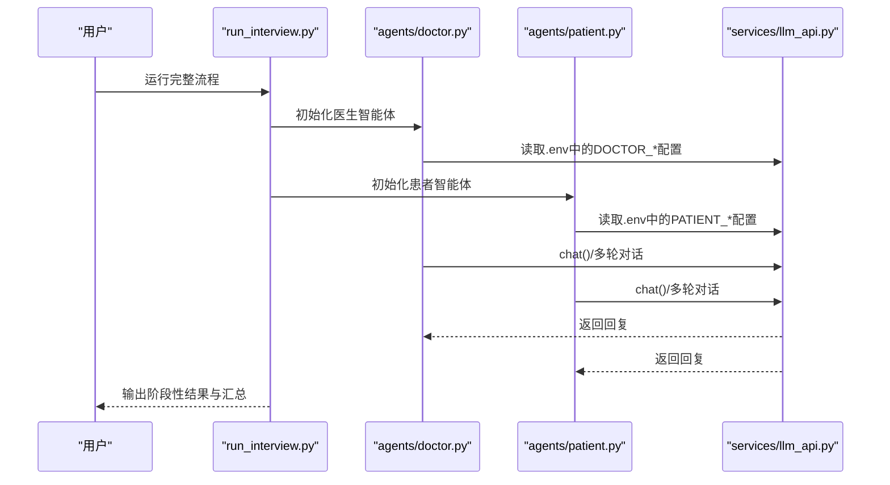
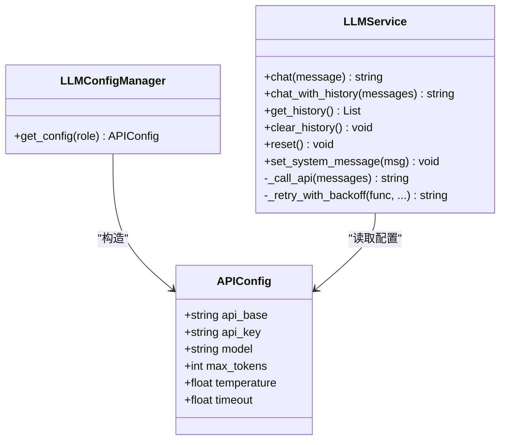
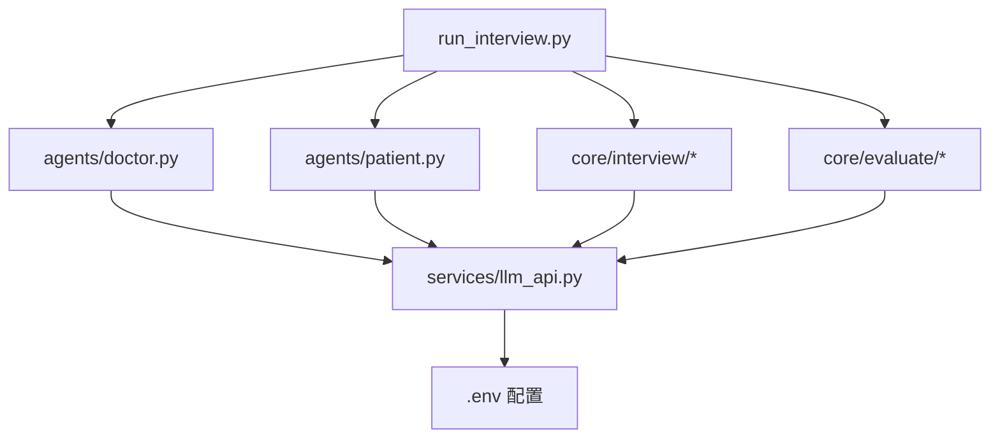

# 环境配置

<cite>
**本文引用的文件**
- [run_interview.py](file://run_interview.py)
- [llm_api.py](file://services/llm_api.py)
- [test_api.py](file://test/test_api.py)
- [patient.py](file://agents/patient/patient.py)
- [doctor.py](file://agents/doctor/doctor.py)
- [interview_phase1.py](file://core/interview/interview_phase1.py)
- [interview_phase2.py](file://core/interview/interview_phase2.py)
</cite>

## 目录
1. [简介](#简介)
2. [项目结构](#项目结构)
3. [核心组件](#核心组件)
4. [架构总览](#架构总览)
5. [详细组件分析](#详细组件分析)
6. [依赖分析](#依赖分析)
7. [性能考虑](#性能考虑)
8. [故障排查指南](#故障排查指南)
9. [结论](#结论)
10. [附录](#附录)

## 简介
本指南面向首次部署与运行本项目的用户，提供从 Python 环境准备、依赖安装、.env 配置参数详解，到跨平台安装示例、环境变量验证方法与常见问题排查的全流程说明。同时给出基于项目实际实现的参数调优建议，帮助您在不同硬件与网络条件下获得稳定、高效的运行体验。

## 项目结构
本项目采用“功能域+层次”混合组织方式：
- services：通用服务层（如 LLM API 服务）
- agents：智能体（医生、患者、仪器）
- core：业务流程与评估逻辑（访谈各阶段、评估模块）
- test：测试脚本（包含 LLM API 的使用与验证）
- 根目录入口：run_interview.py，负责串联完整流程

图表来源
- [run_interview.py](file://run_interview.py)
- [llm_api.py](file://services/llm_api.py)
- [doctor.py](file://agents/doctor/doctor.py)
- [patient.py](file://agents/patient/patient.py)
- [interview_phase1.py](file://core/interview/interview_phase1.py)
- [test_api.py](file://test/test_api.py)

章节来源
- [run_interview.py](file://run_interview.py)
- [llm_api.py](file://services/llm_api.py)

## 核心组件
- LLM API 服务：封装 OpenAI Chat Completions API，自动加载 .env 中的角色级配置，支持多轮对话上下文与重试机制。
- 角色智能体：医生、患者、评估器、仪器等，均通过 LLM API 服务按角色配置进行初始化。
- 访谈与评估：各阶段访谈模块读取 .env 中的全局参数（如最大轮数），并产出结构化输出供评估模块使用。

章节来源
- [llm_api.py](file://services/llm_api.py)
- [doctor.py](file://agents/doctor/doctor.py)
- [patient.py](file://agents/patient/patient.py)
- [interview_phase1.py](file://core/interview/interview_phase1.py)
- [interview_phase2.py](file://core/interview/interview_phase2.py)

## 架构总览
下图展示从入口脚本到 LLM API 服务的关键调用链与配置来源。

图表来源
- [run_interview.py](file://run_interview.py)
- [doctor.py](file://agents/doctor/doctor.py)
- [patient.py](file://agents/patient/patient.py)
- [llm_api.py](file://services/llm_api.py)

## 详细组件分析

### LLM API 服务与 .env 配置
- 配置来源：项目根目录 .env 文件
- 角色级配置键名模式：{ROLE}_API_BASE、{ROLE}_API_KEY、{ROLE}_MODEL
  - 示例：PATIENT_API_BASE、PATIENT_API_KEY、PATIENT_MODEL
  - 支持的角色：PATIENT、DOCTOR、EVALUATOR（由 LLM API 服务定义）
- 全局配置键名：
  - MAX_TOKENS：单次调用最大 token 数
  - TEMPERATURE：采样温度
  - TIMEOUT：HTTP 超时秒数
- 默认行为：
  - 若未设置 {ROLE}_MODEL，默认模型为 gpt-4o
  - 若未设置 MAX_TOKENS、TEMPERATURE、TIMEOUT，默认值分别为 4096、1.0、30.0

图表来源
- [llm_api.py](file://services/llm_api.py)

章节来源
- [llm_api.py](file://services/llm_api.py)
- [test_api.py](file://test/test_api.py)

### .env 参数详解与示例
- 角色级基础参数
  - {ROLE}_API_BASE：LLM 服务基础 URL（例如代理或自建网关地址）
  - {ROLE}_API_KEY：访问密钥
  - {ROLE}_MODEL：模型名称（如 qwen-flash、gpt-4o 等）
- 全局参数
  - MAX_TOKENS：单次调用最大 token 数
  - TEMPERATURE：采样温度（越高越随机，越低越确定）
  - TIMEOUT：请求超时秒数
- 示例（请将 xxx 替换为真实值；角色可按需扩展）
  - PATIENT_API_BASE=xxx
  - PATIENT_API_KEY=xxx
  - PATIENT_MODEL=xxx
  - DOCTOR_API_BASE=xxx
  - DOCTOR_API_KEY=xxx
  - DOCTOR_MODEL=xxx
  - EVALUATOR_API_BASE=xxx
  - EVALUATOR_API_KEY=xxx
  - EVALUATOR_MODEL=xxx
  - MAX_TOKENS=4096
  - TEMPERATURE=1.0
  - TIMEOUT=30.0

章节来源
- [llm_api.py](file://services/llm_api.py)
- [test_api.py](file://test/test_api.py)

### Python 环境与依赖安装
- Python 版本
  - 建议使用 Python 3.9~3.11（与 openai、httpx 等库兼容性良好）
- 必需第三方库
  - openai：官方 SDK，用于调用 Chat Completions API
  - httpx：HTTP 客户端，支持超时与自签证书跳过
  - python-dotenv：加载 .env 环境变量
  - json-repair（可选）：增强解析非标准 JSON 的健壮性
- 安装命令示例（请根据实际环境选择 pip 源）
  - pip install openai httpx python-dotenv
  - 可选：pip install json-repair
- 验证安装
  - 在项目根目录执行测试脚本：python test/test_api.py
  - 该脚本会加载 .env 并对多轮对话、上下文记忆、角色配置等进行验证

章节来源
- [test_api.py](file://test/test_api.py)
- [llm_api.py](file://services/llm_api.py)

### 不同操作系统下的安装与配置示例
- Linux/macOS
  - 使用包管理器或 pyenv 安装 Python 3.9+
  - virtualenv/virtualenvwrapper/conda 创建隔离环境
  - pip 安装依赖
  - 在项目根目录创建 .env，填入对应参数
  - 运行：python test/test_api.py 验证；python run_interview.py 运行完整流程
- Windows
  - 使用 Python 官方安装包或 Chocolatey 安装 Python 3.9+
  - PowerShell 中创建 venv：python -m venv .venv
  - 激活：.venv\Scripts\Activate.ps1
  - pip 安装依赖
  - 在项目根目录创建 .env，填入对应参数
  - 运行：python test/test_api.py 验证；python run_interview.py 运行完整流程

章节来源
- [run_interview.py](file://run_interview.py)
- [test_api.py](file://test/test_api.py)

### 环境变量验证方法
- 基础连通性测试
  - 执行：python test/test_api.py
  - 该脚本覆盖角色配置、多轮对话、上下文记忆、历史清理等场景
- 逐项核验
  - 分别检查 PATIENT、DOCTOR、EVALUATOR 的 API_BASE/API_KEY/MODEL 是否生效
  - 修改 .env 后重启进程以确保重新加载
- 日志与错误
  - LLM API 服务内置重试与指数退避，失败时会打印告警日志
  - 若网络受限或证书问题，可适当提高 TIMEOUT 并确认代理设置

章节来源
- [test_api.py](file://test/test_api.py)
- [llm_api.py](file://services/llm_api.py)

### 常见配置问题与排查
- 问题：API 返回空或报错
  - 排查：确认 {ROLE}_API_BASE 与 {ROLE}_API_KEY 正确；检查网络连通与代理设置
- 问题：超时频繁
  - 排查：适当提高 TIMEOUT；检查上游服务延迟；必要时降低 TEMPERATURE 与 MAX_TOKENS
- 问题：多轮对话上下文丢失
  - 排查：确认未误用新实例；避免在不同实例间传递消息
- 问题：模型名称无效
  - 排查：确认 {ROLE}_MODEL 与上游服务支持的模型一致；默认回退至 gpt-4o

章节来源
- [llm_api.py](file://services/llm_api.py)

### 参数调优与性能优化
- MAX_TOKENS
  - 较大值适合长上下文与复杂任务，但会增加延迟与成本
  - 建议根据任务长度与预算逐步调优
- TEMPERATURE
  - 低值（如 0.3）提升确定性，适合结构化输出
  - 高值（如 0.7~1.0）提升创造性，但可能降低稳定性
- TIMEOUT
  - 网络波动较大时适当增大；若上游服务限制，需配合上游策略
- 角色模型差异化
  - 为不同角色配置不同模型，平衡性能与质量
- 重试与退避
  - 服务层已内置重试与指数退避，避免瞬时抖动影响整体流程

章节来源
- [llm_api.py](file://services/llm_api.py)

## 依赖分析
- 模块耦合
  - run_interview.py 作为编排入口，依赖 agents 与 core 的各阶段实现
  - agents 与 core 的模块通过 services/llm_api.py 间接耦合到 .env 配置
- 外部依赖
  - openai、httpx、python-dotenv 为核心运行依赖
  - json-repair 为可选增强依赖

图表来源
- [run_interview.py](file://run_interview.py)
- [doctor.py](file://agents/doctor/doctor.py)
- [patient.py](file://agents/patient/patient.py)
- [llm_api.py](file://services/llm_api.py)

章节来源
- [run_interview.py](file://run_interview.py)
- [llm_api.py](file://services/llm_api.py)

## 性能考虑
- 控制对话轮数：可通过 MAX_TURNS 等全局参数限制轮数，避免过长上下文导致延迟与成本上升
- 合理设置超时：TIMEOUT 应结合网络状况与上游服务 SLA 调整
- 选择合适模型：高参数模型在复杂任务上更优，但成本更高；可根据阶段与预算选择
- 减少不必要的重试：确保 .env 配置正确，避免频繁触发重试逻辑

章节来源
- [interview_phase1.py](file://core/interview/interview_phase1.py)
- [interview_phase2.py](file://core/interview/interview_phase2.py)
- [llm_api.py](file://services/llm_api.py)

## 故障排查指南
- 端到端验证
  - 使用 test/test_api.py 的测试用例快速定位问题
- 配置核对
  - 确认 .env 中角色键名大小写与角色名称一致
  - 确认全局键名（MAX_TOKENS、TEMPERATURE、TIMEOUT）存在且数值合理
- 网络与证书
  - 若出现证书相关错误，可暂时关闭校验（仅限开发环境）或配置代理
- 日志与重试
  - 关注 LLM API 服务的日志输出，观察重试次数与失败原因

章节来源
- [test_api.py](file://test/test_api.py)
- [llm_api.py](file://services/llm_api.py)

## 结论
通过规范的 .env 配置与合理的参数调优，本项目可在不同平台与环境下稳定运行。建议优先完成 .env 的角色级与全局参数配置，随后使用提供的测试脚本进行验证，并根据实际需求逐步优化性能与成本。

## 附录
- .env 参数速查
  - 角色级：{ROLE}_API_BASE、{ROLE}_API_KEY、{ROLE}_MODEL
  - 全局：MAX_TOKENS、TEMPERATURE、TIMEOUT
- 运行命令参考
  - 验证：python test/test_api.py
  - 完整流程：python run_interview.py