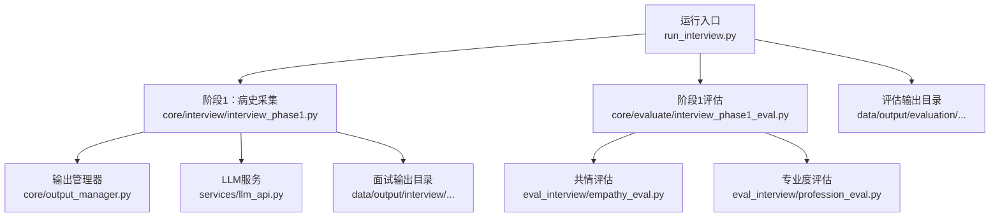
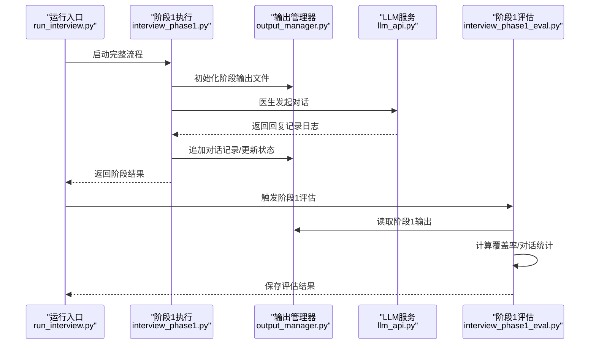
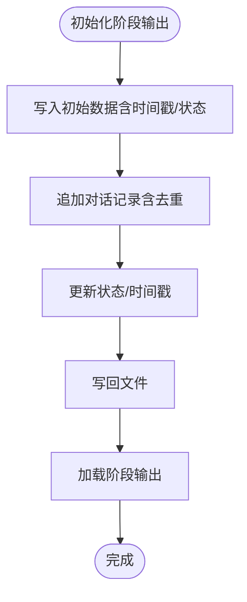
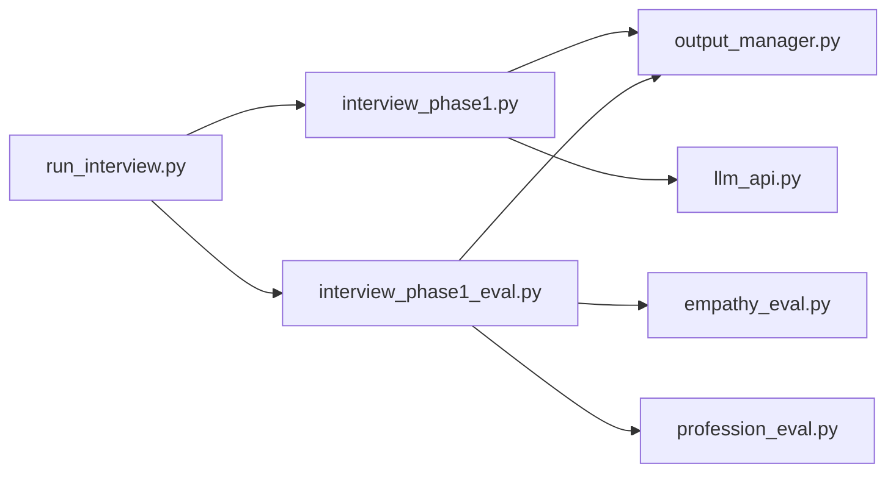

# 监控与日志

<cite>
**本文档引用的文件**
- [run_interview.py](file://run_interview.py)
- [output_manager.py](file://core/output_manager.py)
- [llm_api.py](file://services/llm_api.py)
- [interview_phase1.py](file://core/interview/interview_phase1.py)
- [interview_phase1_eval.py](file://core/evaluate/interview_phase1_eval.py)
- [empathy_eval.py](file://eval_interview/empathy_eval.py)
- [profession_eval.py](file://eval_interview/profession_eval.py)
- [test_phase1_evaluation.py](file://scripts/test_phase1_evaluation.py)
- [test_api.py](file://test/test_api.py)
</cite>

## 目录
1. [简介](#简介)
2. [项目结构](#项目结构)
3. [核心组件](#核心组件)
4. [架构总览](#架构总览)
5. [详细组件分析](#详细组件分析)
6. [依赖分析](#依赖分析)
7. [性能考虑](#性能考虑)
8. [故障排查指南](#故障排查指南)
9. [结论](#结论)
10. [附录](#附录)

## 简介
本指南围绕 MentalHospital 项目的系统监控与日志管理展开，目标是帮助读者：
- 正确设置应用程序的日志级别与输出格式，覆盖 INFO、WARNING、ERROR 等日志级别。
- 理解数据输出管理器的工作原理，包括文件系统组织结构与数据持久化策略。
- 建立性能指标监控方法，涵盖 API 调用延迟、错误率与资源使用情况的跟踪。
- 设定告警机制与异常通知策略。
- 形成日志分析与调试的最佳实践，并提供常见问题的排查路径。

## 项目结构
该项目采用“功能域+层次化”的组织方式：
- 核心业务流程位于 core/ 下，按阶段拆分（interview、evaluate 等）。
- 服务层位于 services/，封装 LLM API 调用与配置。
- 评估工具位于 eval_interview/，提供共情与专业度评估。
- 数据输出统一由 core/output_manager.py 管理，按模型与病例 ID 维度组织文件。
- 运行入口 run_interview.py 负责串联完整流程并汇总结果。

图表来源
- [run_interview.py:46-396](file://run_interview.py#L46-L396)
- [interview_phase1.py:241-428](file://core/interview/interview_phase1.py#L241-L428)
- [output_manager.py:20-189](file://core/output_manager.py#L20-L189)
- [llm_api.py:79-250](file://services/llm_api.py#L79-L250)
- [interview_phase1_eval.py:174-331](file://core/evaluate/interview_phase1_eval.py#L174-L331)
- [empathy_eval.py:9-248](file://eval_interview/empathy_eval.py#L9-L248)
- [profession_eval.py:9-204](file://eval_interview/profession_eval.py#L9-L204)

章节来源
- [run_interview.py:1-408](file://run_interview.py#L1-L408)
- [output_manager.py:1-189](file://core/output_manager.py#L1-L189)

## 核心组件
- 日志与监控基础设施
  - LLM API 服务内置日志记录，使用 Python logging 模块，对 HTTP 客户端日志进行降噪处理，并在重试失败时输出 WARNING 级日志。
  - 运行入口与阶段脚本通过 print 输出流程状态与结果摘要，便于快速定位问题。
- 数据输出管理器
  - 统一管理面试与评估输出目录与文件，提供初始化、追加、更新与加载能力，确保数据持久化与并发安全。
- 评估与指标
  - 阶段1评估模块负责覆盖率与对话统计，并可选地调用 LLM 评估共情与专业度，产出结构化指标文件。
- 测试与验证
  - 提供 API 功能测试与评估脚本，便于验证日志输出、错误处理与指标生成。

章节来源
- [llm_api.py:28-44](file://services/llm_api.py#L28-L44)
- [llm_api.py:96-169](file://services/llm_api.py#L96-L169)
- [output_manager.py:50-189](file://core/output_manager.py#L50-L189)
- [interview_phase1_eval.py:174-331](file://core/evaluate/interview_phase1_eval.py#L174-L331)
- [test_api.py:19-234](file://test/test_api.py#L19-L234)
- [test_phase1_evaluation.py:16-63](file://scripts/test_phase1_evaluation.py#L16-L63)

## 架构总览
下图展示从运行入口到输出管理器与评估模块的整体交互，以及日志记录的关键节点。

图表来源
- [run_interview.py:46-396](file://run_interview.py#L46-L396)
- [interview_phase1.py:241-428](file://core/interview/interview_phase1.py#L241-L428)
- [output_manager.py:50-189](file://core/output_manager.py#L50-L189)
- [llm_api.py:144-169](file://services/llm_api.py#L144-L169)
- [interview_phase1_eval.py:174-331](file://core/evaluate/interview_phase1_eval.py#L174-L331)

## 详细组件分析

### 日志级别与输出格式
- 日志级别
  - WARNING：当 LLM API 调用失败并触发指数退避重试时，记录 WARNING 级日志，包含角色、重试次数与错误信息。
  - ERROR：HTTP 客户端日志被显式降噪至 ERROR 级别，避免过多噪声干扰。
  - INFO：运行入口与阶段脚本通过 print 输出流程状态与结果摘要，便于人类阅读与 CI/CD 日志抓取。
- 输出格式
  - LLM 服务内部使用标准 logging 格式；print 输出采用人类可读的文本格式。
  - 建议在生产环境中引入 structured logging（如 JSON 格式）以便机器解析与聚合。

章节来源
- [llm_api.py:44-44](file://services/llm_api.py#L44-L44)
- [llm_api.py:96-98](file://services/llm_api.py#L96-L98)
- [llm_api.py:158-169](file://services/llm_api.py#L158-L169)
- [run_interview.py:399-408](file://run_interview.py#L399-L408)

### 数据输出管理器（文件系统与持久化）
- 文件系统组织结构
  - 面试输出：data/output/interview/{model_name}/{case_id}/interview_phaseX_output.json
  - 评估输出：data/output/evaluation/{model_name}/{case_id}/evaluation_phaseX_output.json
- 持久化策略
  - 初始化：写入包含元数据（阶段、模型、时间戳、状态）的 JSON 文件。
  - 追加与更新：读取现有 JSON，合并更新字段，写回文件，同时更新 last_update 时间戳。
  - 并发安全：当前实现为顺序读写，建议在高并发场景引入文件锁或原子写入策略。
  - 数据完整性：提供 load_phase_output 读取接口，若文件不存在返回 None，便于上层容错。

图表来源
- [output_manager.py:50-115](file://core/output_manager.py#L50-L115)
- [output_manager.py:117-189](file://core/output_manager.py#L117-L189)

章节来源
- [output_manager.py:20-189](file://core/output_manager.py#L20-L189)

### 性能指标监控（API 调用、错误率、资源使用）
- API 调用延迟
  - 当前未内置计时与埋点，可在 LLMService._call_api 外围增加计时器，记录请求耗时并上报指标。
- 错误率
  - LLMService._retry_with_backoff 记录 WARNING 级日志，可用于统计失败次数与重试次数，作为错误率来源。
- 资源使用
  - 建议集成进程级监控（CPU/内存/IO）与第三方 APM（如 OpenTelemetry）以捕获更细粒度指标。

章节来源
- [llm_api.py:144-169](file://services/llm_api.py#L144-L169)

### 告警机制与异常通知
- 现状
  - LLM API 在重试失败时输出 WARNING 日志；运行入口在异常时打印堆栈并退出。
- 建议
  - 引入外部告警通道（如邮件、Webhook、IM 机器人），在达到阈值（如连续失败、超时）时触发。
  - 将 WARNING/ERROR 日志接入集中式日志系统（如 ELK、Loki），设置告警规则。

章节来源
- [llm_api.py:158-169](file://services/llm_api.py#L158-L169)
- [run_interview.py:404-407](file://run_interview.py#L404-L407)

### 日志分析与调试最佳实践
- 结构化日志
  - 建议将 print 输出转换为结构化日志（JSON），包含时间戳、级别、模块、消息、上下文字段（模型名、病例ID、阶段、轮次）。
- 分层日志
  - 将业务日志与框架日志分离，业务日志使用 INFO/WARNING，框架日志使用 ERROR。
- 上下文关联
  - 在关键流程（阶段开始/结束、评估完成）输出结构化摘要，便于跨文件检索与关联分析。
- 错误归因
  - 对 LLM API 的异常进行分类（网络、超时、认证、解析失败），并在日志中附带错误码与重试次数。

章节来源
- [interview_phase1.py:350-398](file://core/interview/interview_phase1.py#L350-L398)
- [interview_phase1_eval.py:254-298](file://core/evaluate/interview_phase1_eval.py#L254-L298)

### 常见问题排查
- API 调用失败
  - 现象：WARNING 日志频繁出现，响应为空或报错。
  - 排查：检查 .env 中 API 配置、网络连通性、超时设置；确认重试间隔与最大重试次数。
- 输出文件缺失
  - 现象：评估模块无法读取阶段输出。
  - 排查：确认模型名与病例ID一致；检查输出目录权限；确认文件命名与扩展名正确。
- 评估结果异常
  - 现象：评估指标为默认值或报错。
  - 排查：检查对话文本是否为空；确认量表文件存在且格式正确；查看评估模块的异常分支输出。

章节来源
- [llm_api.py:158-169](file://services/llm_api.py#L158-L169)
- [interview_phase1_eval.py:254-298](file://core/evaluate/interview_phase1_eval.py#L254-L298)
- [empathy_eval.py:43-44](file://eval_interview/empathy_eval.py#L43-L44)
- [profession_eval.py:41-42](file://eval_interview/profession_eval.py#L41-L42)

## 依赖分析
- 组件耦合
  - run_interview.py 依赖各阶段实现与输出管理器；阶段实现依赖 LLM 服务与输出管理器；评估模块依赖输出管理器与评估工具。
- 外部依赖
  - LLM API 服务依赖 httpx、openai SDK；评估模块依赖 LLM 服务；部分阶段解析依赖正则与 JSON 解析。
- 循环依赖
  - 未发现循环依赖；模块间为单向依赖（入口 → 阶段 → 服务/输出）。

图表来源
- [run_interview.py:32-43](file://run_interview.py#L32-L43)
- [interview_phase1.py:41-46](file://core/interview/interview_phase1.py#L41-L46)
- [output_manager.py:14-17](file://core/output_manager.py#L14-L17)
- [llm_api.py:36-38](file://services/llm_api.py#L36-L38)
- [interview_phase1_eval.py:212-217](file://core/evaluate/interview_phase1_eval.py#L212-L217)
- [empathy_eval.py](file://eval_interview/empathy_eval.py#L6)
- [profession_eval.py](file://eval_interview/profession_eval.py#L6)

章节来源
- [run_interview.py:32-43](file://run_interview.py#L32-L43)
- [interview_phase1.py:41-46](file://core/interview/interview_phase1.py#L41-L46)
- [interview_phase1_eval.py:212-217](file://core/evaluate/interview_phase1_eval.py#L212-L217)

## 性能考虑
- I/O 优化
  - 输出管理器采用同步 JSON 读写，建议在高并发场景引入异步 I/O 或批量写入策略。
- LLM 调用
  - 当前未内置计时与指标上报，建议在调用层增加埋点，区分不同角色与阶段的延迟分布。
- 资源占用
  - 大规模评估时注意内存占用，建议分批处理对话文本或流式处理评估结果。

## 故障排查指南
- API 层
  - 检查 .env 配置是否正确加载；确认网络代理与证书校验设置；观察 WARNING 日志中的错误类型。
- 输出层
  - 确认输出目录存在且可写；核对文件命名与扩展名；检查 JSON 格式是否被破坏。
- 评估层
  - 若评估失败，优先检查量表文件是否存在与格式正确；查看评估模块的异常分支输出，定位具体环节。

章节来源
- [llm_api.py:40-43](file://services/llm_api.py#L40-L43)
- [output_manager.py:171-189](file://core/output_manager.py#L171-L189)
- [interview_phase1_eval.py:294-298](file://core/evaluate/interview_phase1_eval.py#L294-L298)

## 结论
本项目已具备基础的日志记录与数据持久化能力，建议在现有基础上：
- 引入结构化日志与集中式日志系统；
- 在 LLM 调用层增加性能指标埋点；
- 建立告警与异常通知机制；
- 优化输出管理器的并发与可靠性；
- 完善评估模块的错误处理与可观测性。

## 附录
- 快速测试
  - 运行 LLM API 测试脚本验证配置与连通性。
  - 运行阶段1评估脚本验证评估流程与指标生成。

章节来源
- [test_api.py:207-234](file://test/test_api.py#L207-L234)
- [test_phase1_evaluation.py:61-63](file://scripts/test_phase1_evaluation.py#L61-L63)