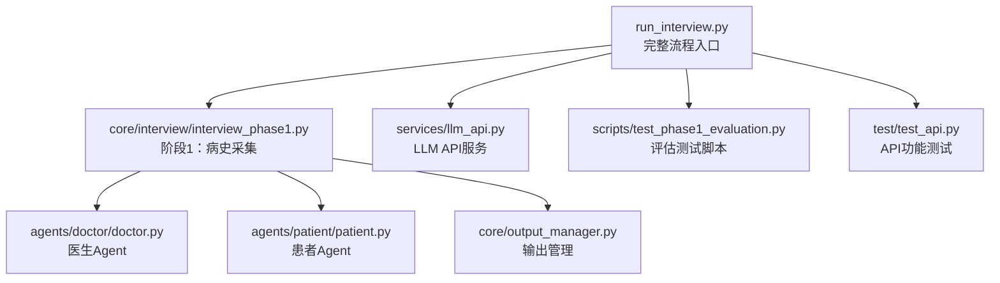
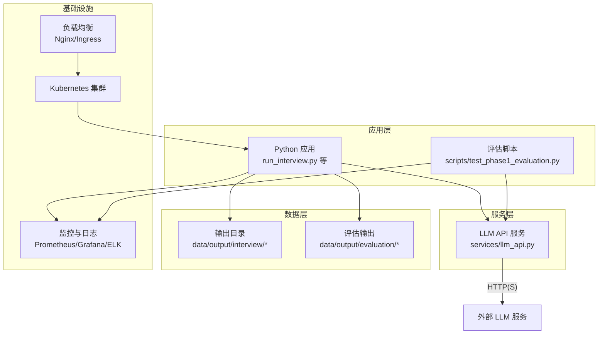
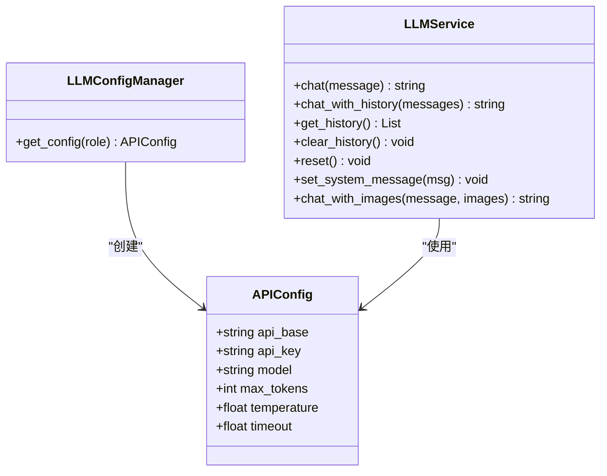
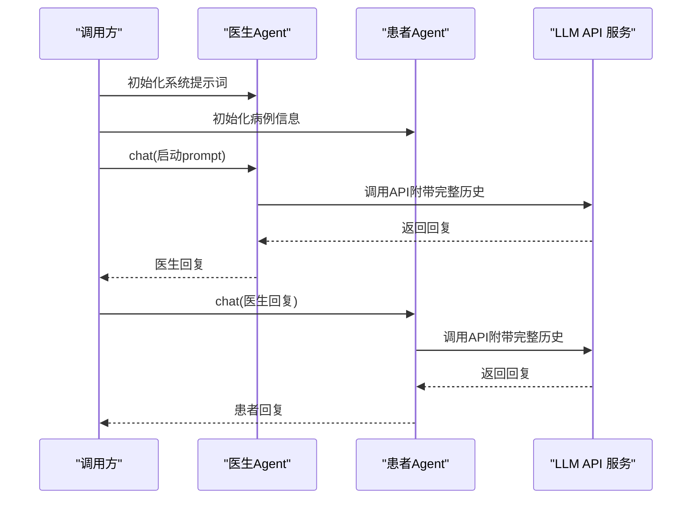
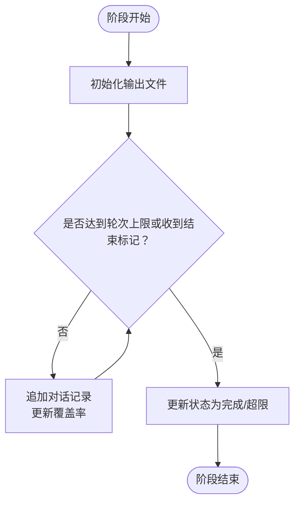
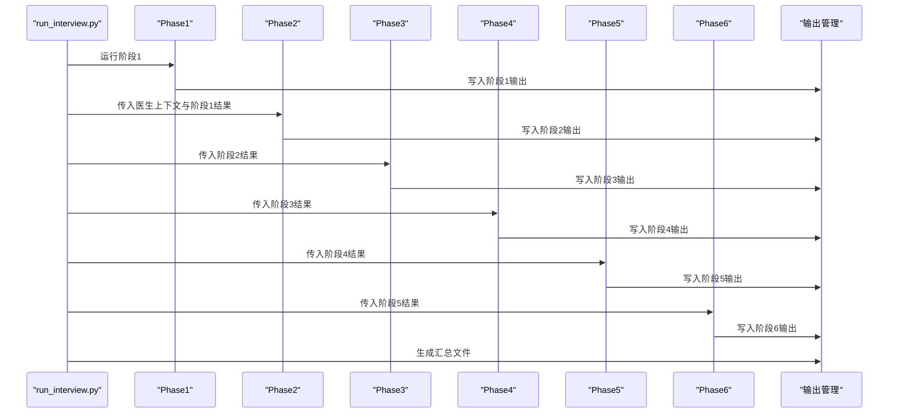
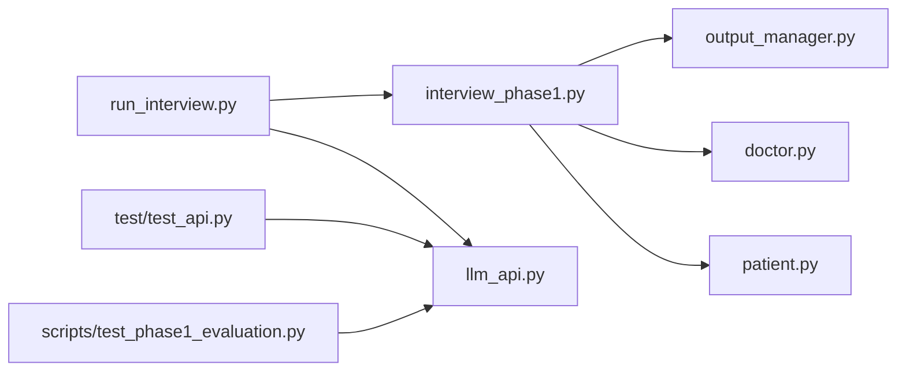

# 部署与运维

<cite>
**本文引用的文件**   
- [run_interview.py](file://run_interview.py)
- [llm_api.py](file://services/llm_api.py)
- [test_api.py](file://test/test_api.py)
- [doctor.py](file://agents/doctor/doctor.py)
- [patient.py](file://agents/patient/patient.py)
- [interview_phase1.py](file://core/interview/interview_phase1.py)
- [output_manager.py](file://core/output_manager.py)
- [test_phase1_evaluation.py](file://scripts/test_phase1_evaluation.py)
</cite>

## 目录
1. [简介](#简介)
2. [项目结构](#项目结构)
3. [核心组件](#核心组件)
4. [架构总览](#架构总览)
5. [详细组件分析](#详细组件分析)
6. [依赖分析](#依赖分析)
7. [性能考虑](#性能考虑)
8. [故障排除指南](#故障排除指南)
9. [结论](#结论)
10. [附录](#附录)

## 简介
本指南面向生产环境部署与运维，围绕 MentalHospital 项目提供从服务器配置、依赖安装、环境准备，到容器化与 Kubernetes 部署、监控与日志、高可用与负载均衡、安全与访问控制、备份与灾备、版本与升级策略，以及故障排除与性能调优的完整实践建议。文档同时结合项目代码结构与关键模块，给出可落地的实施步骤与可视化图示。

## 项目结构
项目采用按功能域划分的层次化组织方式：
- 顶层入口脚本负责完整流程编排与结果汇总
- 服务层封装 LLM API 调用与配置管理
- 代理层（Agent）封装医生与患者的系统提示词与对话行为
- 核心流程层实现各阶段访谈逻辑与输出管理
- 评估与脚本层提供评估工具与测试脚本

图表来源
- [run_interview.py:1-408](file://run_interview.py#L1-L408)
- [interview_phase1.py:1-462](file://core/interview/interview_phase1.py#L1-L462)
- [doctor.py:1-95](file://agents/doctor/doctor.py#L1-L95)
- [patient.py:1-171](file://agents/patient/patient.py#L1-L171)
- [output_manager.py:1-189](file://core/output_manager.py#L1-L189)
- [llm_api.py:1-250](file://services/llm_api.py#L1-L250)
- [test_phase1_evaluation.py:1-63](file://scripts/test_phase1_evaluation.py#L1-L63)
- [test_api.py:1-234](file://test/test_api.py#L1-L234)

章节来源
- [run_interview.py:1-408](file://run_interview.py#L1-L408)
- [interview_phase1.py:1-462](file://core/interview/interview_phase1.py#L1-L462)
- [output_manager.py:1-189](file://core/output_manager.py#L1-L189)

## 核心组件
- LLM API 服务：统一管理不同角色（医生/患者/评估器）的 API 配置，封装上下文维护与重试机制
- 医生/患者 Agent：基于系统提示词与角色配置，提供稳定的对话能力
- 输出管理：统一管理各阶段输出文件路径、写入与增量更新
- 完整流程入口：编排六阶段流程，汇总结果并持久化

章节来源
- [llm_api.py:1-250](file://services/llm_api.py#L1-L250)
- [doctor.py:1-95](file://agents/doctor/doctor.py#L1-L95)
- [patient.py:1-171](file://agents/patient/patient.py#L1-L171)
- [output_manager.py:1-189](file://core/output_manager.py#L1-L189)
- [run_interview.py:1-408](file://run_interview.py#L1-L408)

## 架构总览
下图展示生产环境部署与运维视角下的系统架构：应用层由 Python 应用与评估脚本组成；服务层依赖外部 LLM API；数据层包含本地输出目录与评估结果；监控与日志通过集中式采集与告警体系保障稳定性。

图表来源
- [run_interview.py:1-408](file://run_interview.py#L1-L408)
- [llm_api.py:1-250](file://services/llm_api.py#L1-L250)
- [output_manager.py:1-189](file://core/output_manager.py#L1-L189)
- [test_phase1_evaluation.py:1-63](file://scripts/test_phase1_evaluation.py#L1-L63)

## 详细组件分析

### LLM API 服务（生产部署要点）
- 配置管理：通过 .env 文件集中管理各角色 API 基础地址、密钥与模型参数
- 上下文维护：实例级对话历史自动维护，确保多轮对话连贯性
- 重试与退避：内置指数退避重试，降低瞬时故障影响
- 多模态支持：可扩展图片输入能力（如需要）

图表来源
- [llm_api.py:47-250](file://services/llm_api.py#L47-L250)

章节来源
- [llm_api.py:1-250](file://services/llm_api.py#L1-L250)

### 医生/患者 Agent（对话编排）
- 医生 Agent：基于系统提示词启动，维持上下文，适合作为稳定对话发起方
- 患者 Agent：注入病例信息，按系统提示词生成标准化 JSON 响应，便于覆盖率统计与解析

图表来源
- [doctor.py:32-55](file://agents/doctor/doctor.py#L32-L55)
- [patient.py:40-92](file://agents/patient/patient.py#L40-L92)
- [llm_api.py:113-156](file://services/llm_api.py#L113-L156)

章节来源
- [doctor.py:1-95](file://agents/doctor/doctor.py#L1-L95)
- [patient.py:1-171](file://agents/patient/patient.py#L1-L171)

### 输出管理（数据持久化与增量更新）
- 输出目录结构：按模型名与病例 ID 组织，阶段化 JSON 文件
- 增量写入：对话记录与覆盖率统计实时追加，保证中断可恢复
- 状态管理：阶段状态（运行中/完成/超限）统一更新

图表来源
- [output_manager.py:50-169](file://core/output_manager.py#L50-L169)
- [interview_phase1.py:350-398](file://core/interview/interview_phase1.py#L350-L398)

章节来源
- [output_manager.py:1-189](file://core/output_manager.py#L1-L189)
- [interview_phase1.py:1-462](file://core/interview/interview_phase1.py#L1-L462)

### 完整流程入口（编排与汇总）
- 六阶段顺序执行：病史采集 → 检查推荐 → 临床病历 → 诊断类别 → 诊断假设 → 鉴别诊断
- 评估串联：每个阶段结束后调用对应评估模块，生成评估指标与维度得分
- 结果汇总：生成完整摘要与输出目录清单，便于审计与复盘

图表来源
- [run_interview.py:46-396](file://run_interview.py#L46-L396)
- [output_manager.py:50-115](file://core/output_manager.py#L50-L115)

章节来源
- [run_interview.py:1-408](file://run_interview.py#L1-L408)

## 依赖分析
- 组件耦合：流程入口对阶段模块与输出管理强依赖；阶段模块对 Agent 与输出管理弱耦合；Agent 对 LLM API 弱耦合
- 外部依赖：OpenAI SDK、httpx、python-dotenv、json_repair（可选）
- 配置来源：.env 文件集中管理 API 基础地址、密钥、模型与超时等参数

图表来源
- [run_interview.py:1-408](file://run_interview.py#L1-L408)
- [interview_phase1.py:1-462](file://core/interview/interview_phase1.py#L1-L462)
- [output_manager.py:1-189](file://core/output_manager.py#L1-L189)
- [doctor.py:1-95](file://agents/doctor/doctor.py#L1-L95)
- [patient.py:1-171](file://agents/patient/patient.py#L1-L171)
- [llm_api.py:1-250](file://services/llm_api.py#L1-L250)
- [test_api.py:1-234](file://test/test_api.py#L1-L234)
- [test_phase1_evaluation.py:1-63](file://scripts/test_phase1_evaluation.py#L1-L63)

章节来源
- [llm_api.py:1-250](file://services/llm_api.py#L1-L250)
- [test_api.py:1-234](file://test/test_api.py#L1-L234)

## 性能考虑
- API 调用优化
  - 合理设置温度与最大令牌数，平衡创造性与稳定性
  - 使用指数退避重试，避免雪崩效应
  - 控制上下文长度，减少不必要的历史拼接
- I/O 与并发
  - 输出采用增量写入，降低大文件写入压力
  - 评估脚本可并行执行（如启用并行评估），缩短总耗时
- 缓存与预热
  - 在容器启动阶段预热常用模型，减少首请求延迟
- 资源配额
  - 为评估与流程执行设置合理的 CPU/内存资源请求与限制，避免争抢

## 故障排除指南
- API 连接失败
  - 检查 .env 中 API 基础地址与密钥是否正确
  - 使用测试脚本验证单轮/多轮对话与上下文记忆
- 响应格式异常
  - 患者端 JSON 解析失败时，启用 JSON 修复与正则提取兜底
  - 评估脚本提供评估开关与并行选项，便于定位瓶颈
- 输出缺失或中断
  - 检查输出目录权限与磁盘空间
  - 利用增量写入特性，从中间阶段恢复执行

章节来源
- [test_api.py:19-168](file://test/test_api.py#L19-L168)
- [interview_phase1.py:90-191](file://core/interview/interview_phase1.py#L90-L191)
- [output_manager.py:117-169](file://core/output_manager.py#L117-L169)

## 结论
通过统一的配置管理、清晰的模块边界与稳健的输出管理，MentalHospital 项目可在生产环境中实现稳定、可观测、可扩展的部署与运维。建议结合容器化与 Kubernetes 实现弹性伸缩与高可用，配合完善的监控与日志体系，持续优化性能并提升系统韧性。

## 附录

### 生产环境部署步骤（建议）
- 服务器与依赖
  - 安装 Python 3.9+、pip 与虚拟环境工具
  - 安装项目依赖（OpenAI SDK、httpx、python-dotenv、json_repair 等）
- 环境准备
  - 在项目根目录创建 .env，配置各角色 API 基础地址、密钥与模型
  - 准备数据目录（如 cases.jsonl）与输出目录权限
- 容器化与 Kubernetes
  - 构建 Docker 镜像，暴露必要的端口与卷挂载输出目录
  - 使用 Deployment/StatefulSet 管理应用与持久化存储
  - 使用 Service/Ingress 暴露服务，配置 TLS 与限流
- 监控与日志
  - 部署 Prometheus/Grafana 采集关键指标（请求时延、错误率、上下文长度）
  - 集成 ELK 或类似平台收集应用日志，建立告警规则
- 高可用与负载均衡
  - 使用 Nginx/Ingress 做四层/七层负载均衡
  - 多副本部署，结合健康检查与滚动更新
- 安全与访问控制
  - 限制 .env 与密钥访问权限，使用 Secret 管理敏感信息
  - 启用网络策略与最小权限原则
- 备份与灾备
  - 定期备份输出目录与评估结果
  - 制定快照与异地容灾策略
- 升级与版本管理
  - 使用 GitOps 管理配置与镜像标签
  - 分批灰度发布，结合回滚策略
- 故障排除与性能调优
  - 建立 SLO/SLO，设置阈值告警
  - 基于日志与指标定位热点，优化上下文长度与并发