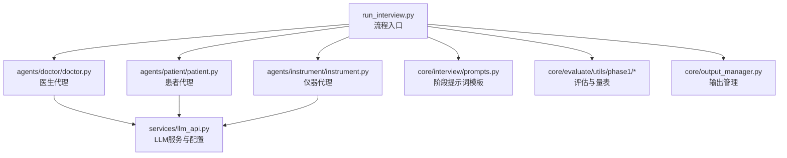
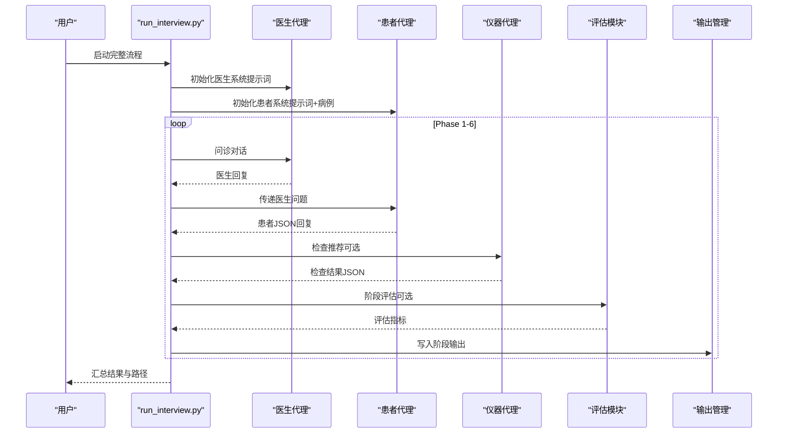
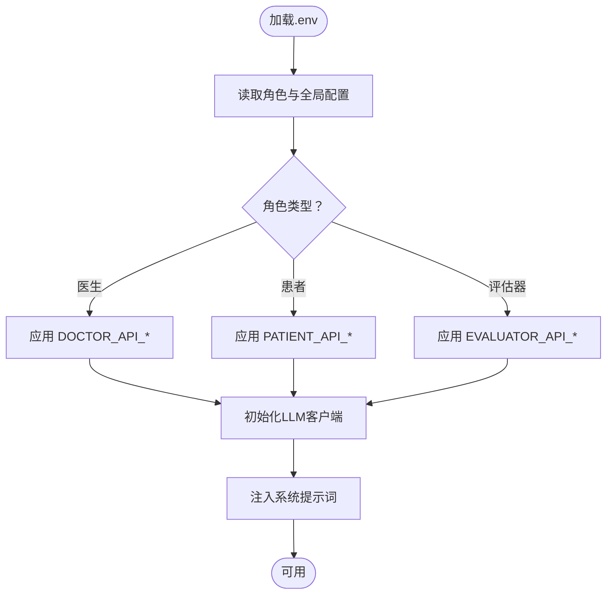
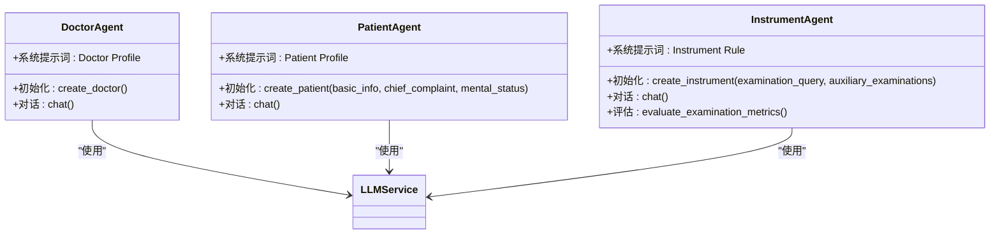
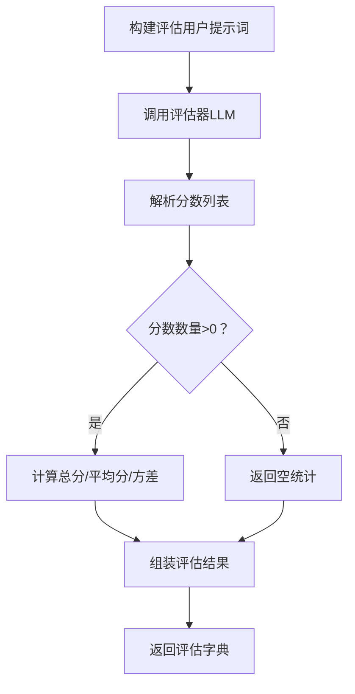
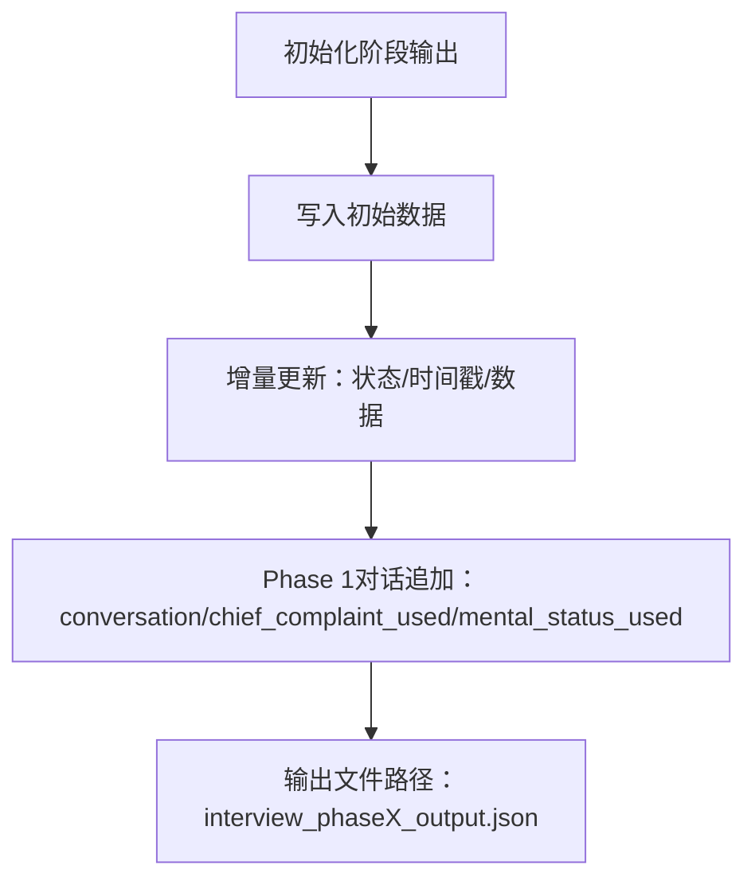
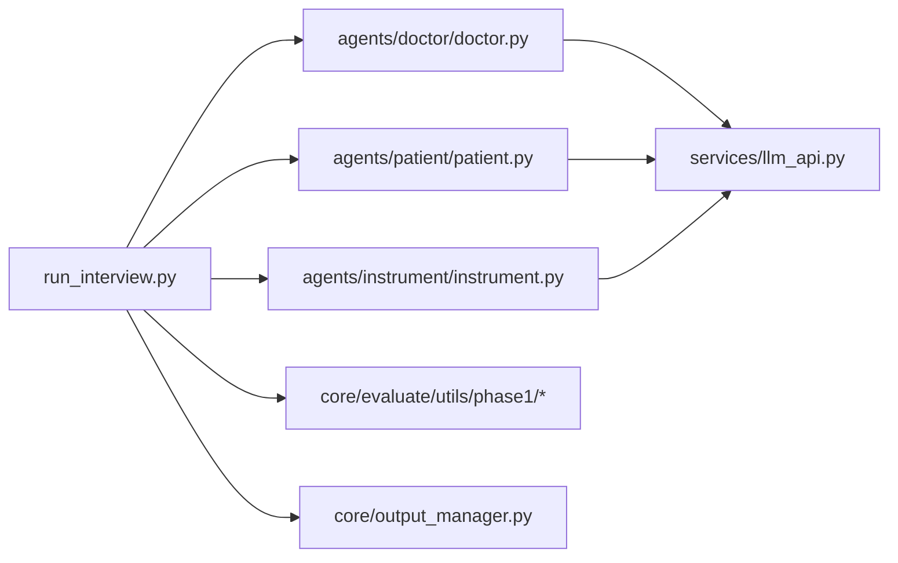

# 配置与定制

<cite>
**本文档引用的文件**
- [run_interview.py](file://run_interview.py)
- [llm_api.py](file://services/llm_api.py)
- [doctor.py](file://agents/doctor/doctor.py)
- [prompts.py（医生）](file://agents/doctor/prompts.py)
- [patient.py](file://agents/patient/patient.py)
- [prompts.py（患者）](file://agents/patient/prompts.py)
- [instrument.py](file://agents/instrument/instrument.py)
- [prompts.py（仪器）](file://agents/instrument/prompts.py)
- [prompts.py（访谈阶段）](file://core/interview/prompts.py)
- [evaluator.py（评估核心）](file://core/evaluate/utils/phase1/evaluator.py)
- [scales.py（评估量表）](file://core/evaluate/utils/phase1/scales.py)
- [scale.json（评估量表）](file://eval_interview/scale.json)
- [output_manager.py](file://core/output_manager.py)
</cite>

## 目录
1. [简介](#简介)
2. [项目结构](#项目结构)
3. [核心组件](#核心组件)
4. [架构总览](#架构总览)
5. [详细组件分析](#详细组件分析)
6. [依赖分析](#依赖分析)
7. [性能考虑](#性能考虑)
8. [故障排查指南](#故障排查指南)
9. [结论](#结论)
10. [附录](#附录)

## 简介
本指南面向需要在精神科问诊自动化系统中进行“配置与定制”的工程师与研究人员，涵盖以下主题：
- 环境变量配置：LLM API密钥、模型参数与系统路径
- 提示词定制：医生、患者、仪器代理的对话策略与系统提示词
- 模型参数调优：温度、最大令牌数等关键参数的设置建议
- 评估量表扩展：新增评估维度与评估指标
- 界面与输出格式：输出目录、文件命名与结构
- 批量配置与模板化：通过环境变量与模板化提示词实现规模化定制
- 医疗机构定制：针对不同机构的问诊流程与评估策略

## 项目结构
系统采用“阶段化流程 + 代理化角色 + 评估与输出管理”的分层设计：
- 入口与流程编排：run_interview.py
- LLM服务与配置：services/llm_api.py
- 角色代理：agents/doctor、agents/patient、agents/instrument
- 访谈阶段提示词：core/interview/prompts.py
- 评估与量表：core/evaluate/utils/phase1/*
- 输出管理：core/output_manager.py

**图表来源**
- [run_interview.py:46-396](file://run_interview.py#L46-L396)
- [llm_api.py:79-250](file://services/llm_api.py#L79-L250)
- [doctor.py:32-55](file://agents/doctor/doctor.py#L32-L55)
- [patient.py:40-92](file://agents/patient/patient.py#L40-L92)
- [instrument.py:13-45](file://agents/instrument/instrument.py#L13-L45)
- [prompts.py（访谈阶段）:1-233](file://core/interview/prompts.py#L1-L233)
- [evaluator.py（评估核心）:1-160](file://core/evaluate/utils/phase1/evaluator.py#L1-L160)
- [output_manager.py:20-189](file://core/output_manager.py#L20-L189)

**章节来源**
- [run_interview.py:1-408](file://run_interview.py#L1-L408)
- [llm_api.py:1-250](file://services/llm_api.py#L1-L250)
- [prompts.py（访谈阶段）:1-233](file://core/interview/prompts.py#L1-L233)

## 核心组件
- LLM服务与配置
  - 通过.env加载各角色API配置，支持基础URL、密钥、模型、最大令牌数、温度、超时等
  - 支持多轮对话上下文、系统提示词注入、重试与指数退避
- 角色代理
  - 医生：以“医生档案”系统提示词启动，支持多轮对话
  - 患者：以“患者档案”系统提示词启动，支持主诉与精神状态注入
  - 仪器：以“仪器规则”系统提示词启动，支持检查项目与结果映射
- 访谈阶段提示词
  - 提供各阶段系统提示词模板，包含输出格式约束与结束标志
- 评估与量表
  - 专业度与共情度量表，支持并行评估
- 输出管理
  - 统一输出目录结构，支持阶段文件初始化、增量更新与对话追加

**章节来源**
- [llm_api.py:58-191](file://services/llm_api.py#L58-L191)
- [doctor.py:32-55](file://agents/doctor/doctor.py#L32-L55)
- [patient.py:40-92](file://agents/patient/patient.py#L40-L92)
- [instrument.py:13-45](file://agents/instrument/instrument.py#L13-L45)
- [prompts.py（访谈阶段）:1-233](file://core/interview/prompts.py#L1-L233)
- [evaluator.py（评估核心）:50-160](file://core/evaluate/utils/phase1/evaluator.py#L50-L160)
- [output_manager.py:20-189](file://core/output_manager.py#L20-L189)

## 架构总览
系统以“流程编排”为核心，串联各阶段与评估模块，LLM服务统一提供API调用能力。

**图表来源**
- [run_interview.py:46-396](file://run_interview.py#L46-L396)
- [doctor.py:32-55](file://agents/doctor/doctor.py#L32-L55)
- [patient.py:40-92](file://agents/patient/patient.py#L40-L92)
- [instrument.py:13-45](file://agents/instrument/instrument.py#L13-L45)
- [evaluator.py（评估核心）:133-160](file://core/evaluate/utils/phase1/evaluator.py#L133-L160)
- [output_manager.py:50-115](file://core/output_manager.py#L50-L115)

## 详细组件分析

### 环境变量与模型参数配置
- 配置来源
  - .env文件，由LLM服务自动加载
  - 支持的角色变量：{ROLE}_API_BASE、{ROLE}_API_KEY、{ROLE}_MODEL
  - 全局变量：MAX_TOKENS、TEMPERATURE、TIMEOUT
- 配置生效范围
  - 医生、患者、评估器分别使用各自角色的API配置
  - 也可通过系统提示词参数覆盖部分行为
- 参数建议
  - 温度：1.0适合探索性对话；0.7适合稳定输出
  - 最大令牌数：根据阶段输出格式与上下文长度调整
  - 超时：网络不稳定时适当增大

**图表来源**
- [llm_api.py:58-112](file://services/llm_api.py#L58-L112)

**章节来源**
- [llm_api.py:58-112](file://services/llm_api.py#L58-L112)

### 提示词定制：医生、患者、仪器代理
- 医生系统提示词
  - 位于 agents/doctor/prompts.py，定义医生角色职责与输出约束
  - 可通过系统提示词参数在初始化时覆盖
- 患者系统提示词
  - 位于 agents/patient/prompts.py，支持基本信息、主诉、精神状态注入
  - 注入字段：<BASIC_INFO>、<CHIEF_COMPLAINT>、<MENTAL_STATUS>
- 仪器系统提示词
  - 位于 agents/instrument/prompts.py，支持检查项目与结果映射
  - 注入字段：<EXAMINATION_QUERY>、<AUXILIARY_EXAMINATIONS>
- 访谈阶段提示词
  - 位于 core/interview/prompts.py，包含各阶段系统提示词模板
  - 输出格式约束：BEGIN_* 与 END_* 标志，JSON数组或纯文本

**图表来源**
- [doctor.py:32-55](file://agents/doctor/doctor.py#L32-L55)
- [prompts.py（医生）:5-20](file://agents/doctor/prompts.py#L5-L20)
- [patient.py:40-92](file://agents/patient/patient.py#L40-L92)
- [prompts.py（患者）:3-47](file://agents/patient/prompts.py#L3-L47)
- [instrument.py:13-45](file://agents/instrument/instrument.py#L13-L45)
- [prompts.py（仪器）:3-57](file://agents/instrument/prompts.py#L3-L57)

**章节来源**
- [prompts.py（医生）:5-20](file://agents/doctor/prompts.py#L5-L20)
- [prompts.py（患者）:3-47](file://agents/patient/prompts.py#L3-L47)
- [prompts.py（仪器）:3-57](file://agents/instrument/prompts.py#L3-L57)
- [prompts.py（访谈阶段）:1-233](file://core/interview/prompts.py#L1-L233)

### 模型参数调优指南
- 关键参数
  - 温度（temperature）：控制创造性与多样性
  - 最大令牌数（max_tokens）：控制输出长度与上下文占用
  - 超时（timeout）：控制API等待时间
- 调优建议
  - 症状采集与病历整理：较低温度 + 适中max_tokens
  - 诊断类别与假设生成：中等温度 + 较大max_tokens
  - 评估阶段：稳定温度 + 明确输出格式约束
- 注意事项
  - 不同模型对温度与max_tokens的敏感度不同
  - 过大的max_tokens会显著增加延迟与成本

**章节来源**
- [llm_api.py:144-156](file://services/llm_api.py#L144-L156)

### 扩展评估量表与新增评估维度
- 现有量表
  - 共情度量表（16条目）与专业度量表（12条目），定义评分标准与关注点
- 扩展方法
  - 在 core/evaluate/utils/phase1/scales.py 中新增条目，遵循既有结构
  - 在 core/evaluate/utils/phase1/evaluator.py 中更新评估函数，确保解析与统计逻辑兼容
  - 评估结果包含题目数量、原始响应、解析分数、总分与平均分等字段
- 评估流程
  - 生成用户提示词 → 调用评估器LLM → 解析分数 → 计算方差/平均分 → 返回结果

**图表来源**
- [evaluator.py（评估核心）:50-160](file://core/evaluate/utils/phase1/evaluator.py#L50-L160)
- [scales.py（评估量表）:10-464](file://core/evaluate/utils/phase1/scales.py#L10-L464)

**章节来源**
- [evaluator.py（评估核心）:50-160](file://core/evaluate/utils/phase1/evaluator.py#L50-L160)
- [scales.py（评估量表）:10-464](file://core/evaluate/utils/phase1/scales.py#L10-L464)
- [scale.json（评估量表）:1-258](file://eval_interview/scale.json#L1-L258)

### 界面定制与输出格式调整
- 输出目录与文件
  - interview输出：data/output/interview/{model_name}/{case_id}/interview_phaseX_output.json
  - evaluation输出：data/output/evaluation/{model_name}/{case_id}/evaluation_phaseX_output.json
  - 汇总文件：interview_summary.json
- 输出管理
  - 初始化阶段输出文件，写入元数据与初始数据
  - 增量更新：追加状态、时间戳与统计数据
  - Phase 1对话追加：支持对话记录与使用过的主诉/精神状态集合去重更新
- 输出格式
  - 阶段输出包含阶段号、病例ID、模型名、时间戳、状态与业务数据
  - 评估输出包含指标、计数与原始响应等

**图表来源**
- [output_manager.py:50-168](file://core/output_manager.py#L50-L168)

**章节来源**
- [output_manager.py:20-189](file://core/output_manager.py#L20-L189)

### 批量配置与模板化配置
- 批量配置
  - 通过.env集中管理各角色API配置，支持多实例共享同一配置
  - 通过系统提示词模板实现角色行为的批量定制
- 模板化提示词
  - 使用占位符注入动态数据（如主诉、检查项目）
  - 通过替换函数实现模板渲染与注入
- 流程定制
  - 通过修改阶段提示词模板与评估逻辑，实现不同医疗机构的流程差异

**章节来源**
- [llm_api.py:58-76](file://services/llm_api.py#L58-L76)
- [patient.py:69-78](file://agents/patient/patient.py#L69-L78)
- [instrument.py:31-33](file://agents/instrument/instrument.py#L31-L33)
- [prompts.py（访谈阶段）:1-233](file://core/interview/prompts.py#L1-L233)

### 为不同医疗机构定制问诊流程
- 角色职责定制
  - 医生：根据机构标准流程调整系统提示词与输出约束
  - 患者：注入机构常用主诉与精神状态模板
  - 仪器：根据机构检查目录与报告格式调整规则
- 阶段流程定制
  - 修改阶段提示词模板，调整输出格式与结束标志
  - 在评估模块中增加或调整评估维度与指标
- 输出与报告
  - 统一输出目录结构，便于机构归档与审计
  - 可扩展评估模块以满足机构特定的评分体系

**章节来源**
- [prompts.py（医生）:5-20](file://agents/doctor/prompts.py#L5-L20)
- [prompts.py（患者）:3-47](file://agents/patient/prompts.py#L3-L47)
- [prompts.py（仪器）:3-57](file://agents/instrument/prompts.py#L3-L57)
- [prompts.py（访谈阶段）:1-233](file://core/interview/prompts.py#L1-L233)
- [output_manager.py:20-47](file://core/output_manager.py#L20-L47)

## 依赖分析
- 组件耦合
  - run_interview.py 依赖各阶段代理与评估模块
  - 代理模块依赖 LLM服务与提示词模板
  - 评估模块依赖量表定义与评估器LLM
  - 输出管理独立于其他模块，提供统一接口
- 外部依赖
  - OpenAI SDK、httpx、python-dotenv
- 潜在循环依赖
  - 未发现循环导入；模块间通过函数接口交互

**图表来源**
- [run_interview.py:32-43](file://run_interview.py#L32-L43)
- [llm_api.py:28-42](file://services/llm_api.py#L28-L42)

**章节来源**
- [run_interview.py:32-43](file://run_interview.py#L32-L43)
- [llm_api.py:28-42](file://services/llm_api.py#L28-L42)

## 性能考虑
- API调用优化
  - 合理设置超时与重试策略，避免长时间阻塞
  - 控制每轮上下文长度，减少max_tokens
- 评估并发
  - 评估模块支持并行评估，提升吞吐
- 输出写入
  - 采用即时写入策略，避免大对象累积导致内存压力

## 故障排查指南
- 常见问题
  - API密钥或基础URL错误：检查.env中对应角色变量
  - 温度过高导致输出不稳定：适当降低温度
  - 输出目录权限不足：确认输出路径可写
- 排查步骤
  - 验证.env配置是否正确加载
  - 检查代理初始化是否成功
  - 查看评估器LLM响应与解析过程
  - 确认输出文件是否成功写入

**章节来源**
- [llm_api.py:158-169](file://services/llm_api.py#L158-L169)
- [output_manager.py:98-114](file://core/output_manager.py#L98-L114)

## 结论
通过环境变量集中配置、提示词模板化与评估量表扩展，系统可在不改动核心代码的前提下实现大规模定制。结合输出管理与评估模块，可满足不同医疗机构在流程、评估与报告方面的差异化需求。

## 附录
- 环境变量清单
  - {ROLE}_API_BASE、{ROLE}_API_KEY、{ROLE}_MODEL、MAX_TOKENS、TEMPERATURE、TIMEOUT
- 输出文件命名
  - interview_phaseX_output.json、evaluation_phaseX_output.json、interview_summary.json