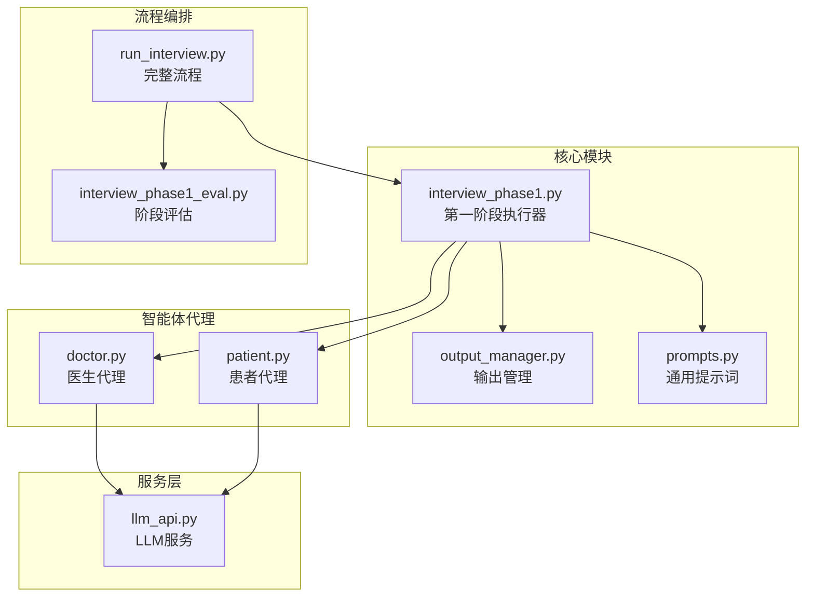
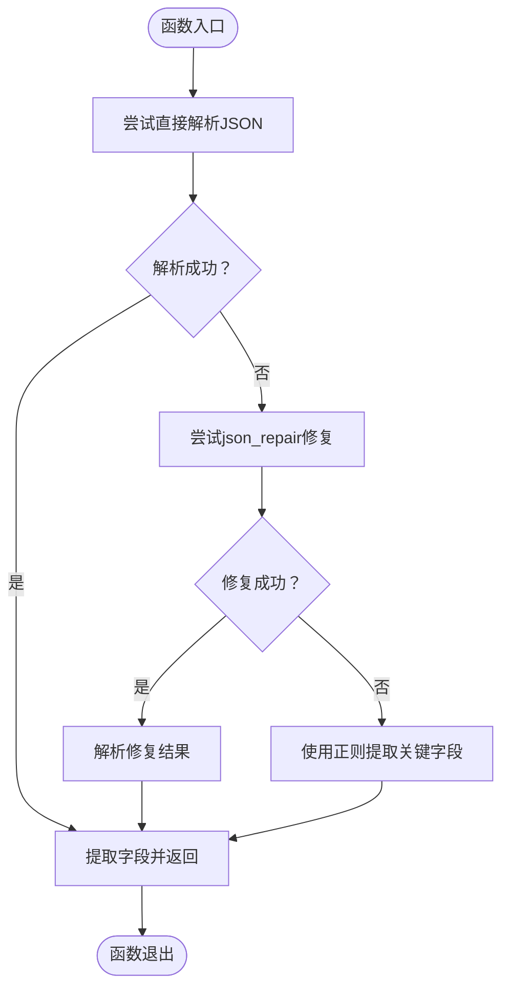
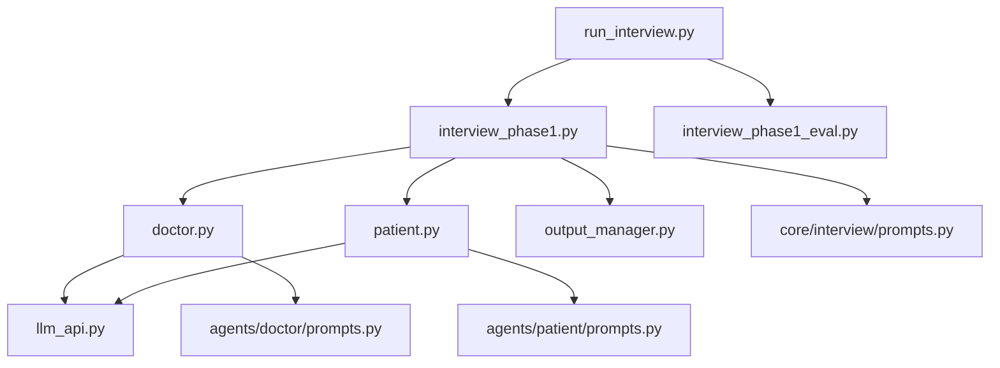

# 第一阶段：病史采集

<cite>
**本文档引用的文件**
- [interview_phase1.py](file://core/interview/interview_phase1.py)
- [doctor.py](file://agents/doctor/doctor.py)
- [patient.py](file://agents/patient/patient.py)
- [prompts.py](file://core/interview/prompts.py)
- [prompts.py](file://agents/doctor/prompts.py)
- [prompts.py](file://agents/patient/prompts.py)
- [output_manager.py](file://core/output_manager.py)
- [llm_api.py](file://services/llm_api.py)
- [run_interview.py](file://run_interview.py)
- [interview_phase1_eval.py](file://core/evaluate/interview_phase1_eval.py)
</cite>

## 目录
1. [简介](#简介)
2. [项目结构](#项目结构)
3. [核心组件](#核心组件)
4. [架构概览](#架构概览)
5. [详细组件分析](#详细组件分析)
6. [依赖关系分析](#依赖关系分析)
7. [性能考虑](#性能考虑)
8. [故障排查指南](#故障排查指南)
9. [结论](#结论)
10. [附录](#附录)

## 简介
本文件面向第一阶段“病史采集”模块，提供从随机病例加载、医生与患者代理初始化、多轮对话执行到结果输出的完整技术文档。重点涵盖以下方面：
- 病史采集目标与数据收集策略
- parse_patient_response 的 JSON 解析与容错处理（含正则提取与 json_repair 修复）
- check_end_interview 的结束条件检测逻辑
- init_phase1_output 的输出文件初始化过程
- 与其他阶段的衔接方式与数据传递机制
- 使用示例、配置选项与性能优化建议

## 项目结构
第一阶段位于 core/interview/interview_phase1.py，配合 agents/doctor、agents/patient、services/llm_api、core/output_manager 等模块协同工作。run_interview.py 提供完整流程入口，可串联 Phase 1 至 Phase 6。



图表来源
- [interview_phase1.py:1-462](file://core/interview/interview_phase1.py#L1-L462)
- [doctor.py:1-95](file://agents/doctor/doctor.py#L1-L95)
- [patient.py:1-171](file://agents/patient/patient.py#L1-L171)
- [output_manager.py:1-189](file://core/output_manager.py#L1-L189)
- [prompts.py:1-233](file://core/interview/prompts.py#L1-L233)
- [llm_api.py:1-250](file://services/llm_api.py#L1-L250)
- [run_interview.py:1-408](file://run_interview.py#L1-L408)
- [interview_phase1_eval.py:1-376](file://core/evaluate/interview_phase1_eval.py#L1-L376)

章节来源
- [interview_phase1.py:1-462](file://core/interview/interview_phase1.py#L1-L462)
- [run_interview.py:1-408](file://run_interview.py#L1-L408)

## 核心组件
- 病史采集执行器：负责加载随机病例、初始化医生与患者代理、启动多轮对话、检测结束条件、实时保存输出。
- 医生代理：基于 LLMService，使用“Doctor Profile”系统提示词，维持对话上下文。
- 患者代理：基于 LLMService，注入“Patient Profile”系统提示词与病例信息，按 JSON 格式输出。
- 输出管理器：统一管理各阶段输出文件路径、初始化、追加对话记录与更新状态。
- 提示词模板：包含“Clinical History Collection”等阶段提示词，驱动对话行为。
- LLM 服务：封装 OpenAI Chat Completions API，自动维护上下文、指数退避重试。
- 评估模块：对 Phase 1 的覆盖率与对话统计进行评估，生成评估报告。

章节来源
- [interview_phase1.py:241-429](file://core/interview/interview_phase1.py#L241-L429)
- [doctor.py:32-55](file://agents/doctor/doctor.py#L32-L55)
- [patient.py:40-92](file://agents/patient/patient.py#L40-L92)
- [output_manager.py:50-169](file://core/output_manager.py#L50-L169)
- [prompts.py:2-22](file://core/interview/prompts.py#L2-L22)
- [llm_api.py:79-191](file://services/llm_api.py#L79-L191)
- [interview_phase1_eval.py:174-330](file://core/evaluate/interview_phase1_eval.py#L174-L330)

## 架构概览
第一阶段采用“医生-患者”双智能体协作模式，通过提示词驱动对话，实时保存对话记录与覆盖率统计，支持通过 [END_INTERVIEW] 标记结束。

```mermaid
sequenceDiagram
participant Runner as "运行器(run_interview.py)"
participant IP1 as "执行器(interview_phase1.py)"
participant Doc as "医生代理(doctor.py)"
participant Pat as "患者代理(patient.py)"
participant OM as "输出管理(output_manager.py)"
Runner->>IP1 : 调用 run_interview_phase1()
IP1->>IP1 : 加载随机病例(load_random_case)
IP1->>Doc : create_doctor()
IP1->>Pat : create_patient(basic_info, chief_complaint, mental_status)
IP1->>OM : init_phase1_output()
IP1->>Doc : chat(启动prompt)
loop 多轮对话
IP1->>Pat : chat(医生上一轮回复)
Pat-->>IP1 : 原始响应(可能非标准JSON)
IP1->>IP1 : parse_patient_response()
IP1->>OM : append_conversation()
IP1->>Doc : chat(患者回复+提醒)
Doc-->>IP1 : 医生回复
IP1->>IP1 : check_end_interview()
alt 检测到结束标记
IP1->>OM : update_phase_output(status=completed)
break
end
end
IP1-->>Runner : 返回结果字典
```

图表来源
- [run_interview.py:46-90](file://run_interview.py#L46-L90)
- [interview_phase1.py:241-429](file://core/interview/interview_phase1.py#L241-L429)
- [doctor.py:32-55](file://agents/doctor/doctor.py#L32-L55)
- [patient.py:40-92](file://agents/patient/patient.py#L40-L92)
- [output_manager.py:117-169](file://core/output_manager.py#L117-L169)

## 详细组件分析

### 数据加载与初始化
- 随机病例加载：从 data/cases.jsonl 逐行读取 JSONL 文件，过滤空行与解析失败的行，随机选择一个病例。
- 医生代理初始化：使用“Doctor Profile”系统提示词创建 LLMService 实例，维持对话上下文。
- 患者代理初始化：将 basic_info、chief_complaint、mental_status 注入“Patient Profile”，并以 JSON 字符串形式替换占位符，再创建 LLMService 实例。
- 输出文件初始化：调用 init_phase_output 写入初始数据（基础信息、主诉与精神状态列表、空对话记录、状态等）。

章节来源
- [interview_phase1.py:63-88](file://core/interview/interview_phase1.py#L63-L88)
- [interview_phase1.py:298-319](file://core/interview/interview_phase1.py#L298-L319)
- [output_manager.py:50-84](file://core/output_manager.py#L50-L84)
- [patient.py:69-92](file://agents/patient/patient.py#L69-L92)
- [doctor.py:46-55](file://agents/doctor/doctor.py#L46-L55)

### 多轮对话执行机制
- 启动对话：使用“Clinical History Collection”提示词替换占位符后发送给医生。
- 患者回复：调用 patient.chat，接收原始响应（可能非标准 JSON）。
- 响应解析：parse_patient_response 依次尝试标准 JSON 解析、json_repair 修复、正则提取，最终拼接 presentation 与 utterance，并提取 grounding 中的 chief_complaint_used 与 mental_status_used。
- 医生回复：将患者回复（必要时附加系统提醒）发送给医生，等待回复。
- 结束检测：check_end_interview 在医生回复中检测 [END_INTERVIEW] 及变体，一旦命中则结束。
- 实时保存：append_conversation 将每轮对话追加到输出文件，并更新去重后的使用条目集合。

章节来源
- [interview_phase1.py:325-398](file://core/interview/interview_phase1.py#L325-L398)
- [interview_phase1.py:355-392](file://core/interview/interview_phase1.py#L355-L392)
- [interview_phase1.py:90-144](file://core/interview/interview_phase1.py#L90-L144)
- [interview_phase1.py:194-208](file://core/interview/interview_phase1.py#L194-L208)
- [output_manager.py:117-169](file://core/output_manager.py#L117-L169)

### parse_patient_response 的 JSON 解析与容错处理
- 直接解析：尝试 json.loads(response)，失败则继续。
- 修复解析：若安装 json_repair，调用 repair_json 修复后再次解析。
- 正则提取：当修复失败时，使用正则表达式从响应中提取 presentation、utterance、grounding.chief_complaint、grounding.mental_status。
- 字段拼接：若 presentation 存在则与 utterance 拼接，否则仅使用 utterance。
- 返回值：返回拼接后的患者响应、使用过的主诉条目列表、使用过的精神状态条目列表。



图表来源
- [interview_phase1.py:90-144](file://core/interview/interview_phase1.py#L90-L144)
- [interview_phase1.py:146-191](file://core/interview/interview_phase1.py#L146-L191)

章节来源
- [interview_phase1.py:90-191](file://core/interview/interview_phase1.py#L90-L191)

### check_end_interview 的结束条件检测逻辑
- 支持多种标记变体：[END_INTERVIEW]、[end_interview]、END_INTERVIEW、end_interview、[END_INTERVIEW、END_INTERVIEW]。
- 使用包含关系检测，一旦匹配任一变体即判定结束。
- 该函数确保医生在完成病史采集后能稳定触发下一阶段。

章节来源
- [interview_phase1.py:194-208](file://core/interview/interview_phase1.py#L194-L208)

### init_phase1_output 的输出文件初始化过程
- 输入参数：模型名、病例ID、基本信息、主诉列表、精神状态列表。
- 初始数据：包含 basic_info、chief_complaint_all、mental_status_all、空 conversation、空使用条目集合、初始状态 running。
- 文件路径：data/output/interview/{model_name}/{case_id}/interview_phase1_output.json。
- 写入策略：立即写入初始数据，便于后续实时追加对话与状态更新。

章节来源
- [interview_phase1.py:210-239](file://core/interview/interview_phase1.py#L210-L239)
- [output_manager.py:50-84](file://core/output_manager.py#L50-L84)

### 与其他阶段的衔接方式与数据传递机制
- 作为完整流程的一部分：run_interview.py 依次调用各阶段，将 doctor 实例与 case_data 从 Phase 1 传递到 Phase 2，形成上下文延续。
- 输出文件：Phase 1 的 interview_phase1_output.json 作为后续阶段评估与流程编排的数据源。
- 评估模块：interview_phase1_eval.py 读取 Phase 1 输出，计算覆盖率与对话统计，并生成评估报告。

章节来源
- [run_interview.py:64-90](file://run_interview.py#L64-L90)
- [interview_phase1_eval.py:174-250](file://core/evaluate/interview_phase1_eval.py#L174-L250)

## 依赖关系分析



图表来源
- [interview_phase1.py:38-46](file://core/interview/interview_phase1.py#L38-L46)
- [doctor.py:28-29](file://agents/doctor/doctor.py#L28-L29)
- [patient.py:36-37](file://agents/patient/patient.py#L36-L37)
- [output_manager.py:1-189](file://core/output_manager.py#L1-L189)
- [llm_api.py:1-250](file://services/llm_api.py#L1-L250)
- [prompts.py:1-233](file://core/interview/prompts.py#L1-L233)
- [prompts.py:1-21](file://agents/doctor/prompts.py#L1-L21)
- [prompts.py:1-48](file://agents/patient/prompts.py#L1-L48)
- [run_interview.py:32-43](file://run_interview.py#L32-L43)
- [interview_phase1_eval.py:1-376](file://core/evaluate/interview_phase1_eval.py#L1-L376)

章节来源
- [interview_phase1.py:38-46](file://core/interview/interview_phase1.py#L38-L46)
- [run_interview.py:32-43](file://run_interview.py#L32-L43)

## 性能考虑
- 轮次上限：MAX_TURNS 默认 50，防止无限对话导致资源消耗过高。
- 实时持久化：append_conversation 每轮即时写入，降低内存压力并保证中断可恢复。
- 重试与退避：LLMService 的 _retry_with_backoff 指数退避，提升网络波动下的稳定性。
- 正则提取：在 JSON 解析失败时使用正则提取，减少因格式异常导致的重试次数。
- json_repair 可选：若安装 json_repair，可显著提升非标准 JSON 的修复成功率。

章节来源
- [interview_phase1.py:60-61](file://core/interview/interview_phase1.py#L60-L61)
- [interview_phase1.py:350-397](file://core/interview/interview_phase1.py#L350-L397)
- [llm_api.py:158-169](file://services/llm_api.py#L158-L169)
- [interview_phase1.py:111-118](file://core/interview/interview_phase1.py#L111-L118)

## 故障排查指南
- 病例加载失败：确认 data/cases.jsonl 存在且为有效 JSONL 格式，检查空行与解析异常。
- 医生/患者初始化失败：检查 .env 中 DOCTOR_* 与 PATIENT_* 配置项是否正确。
- 输出文件未生成：确认 init_phase1_output 调用成功，检查输出目录权限。
- 患者响应非标准 JSON：parse_patient_response 已内置正则提取与修复逻辑，若仍失败，检查患者提示词是否被修改。
- 结束标记未生效：确认医生回复中包含 [END_INTERVIEW] 或其变体，大小写与方括号需严格匹配。
- 评估模块报错：确保 interview_phase1_output.json 存在且包含必需字段，检查评估依赖是否安装。

章节来源
- [interview_phase1.py:63-88](file://core/interview/interview_phase1.py#L63-L88)
- [interview_phase1.py:210-239](file://core/interview/interview_phase1.py#L210-L239)
- [interview_phase1.py:90-191](file://core/interview/interview_phase1.py#L90-L191)
- [interview_phase1.py:194-208](file://core/interview/interview_phase1.py#L194-L208)
- [interview_phase1_eval.py:208-218](file://core/evaluate/interview_phase1_eval.py#L208-L218)

## 结论
第一阶段“病史采集”通过严格的提示词驱动与多层容错解析，实现了从随机病例加载到多轮对话、实时覆盖率统计与稳定结束标记的完整闭环。其输出文件为后续阶段提供可靠数据基础，评估模块进一步量化了采集质量。建议在生产环境中启用 json_repair、合理设置 MAX_TURNS，并确保 .env 配置正确。

## 附录

### 使用示例
- 单独测试 Phase 1
  - 运行脚本：python core/interview/interview_phase1.py
  - 返回结果包含：case_id、conversation、chief_complaint_used、mental_status_used、coverage_stats、output_file、status、doctor、case_data
- 作为完整流程的一部分
  - 从 run_interview.py 调用 run_full_interview，Phase 1 的 doctor 实例与 case_data 可直接传递到后续阶段

章节来源
- [interview_phase1.py:431-462](file://core/interview/interview_phase1.py#L431-L462)
- [run_interview.py:46-90](file://run_interview.py#L46-L90)

### 配置选项
- MAX_TURNS：对话轮次上限，默认 50
- .env 中的 DOCTOR_* 与 PATIENT_* 配置项：API 地址、密钥、模型、温度、超时等
- PROMPTS：包含“Clinical History Collection”等阶段提示词

章节来源
- [interview_phase1.py:56-61](file://core/interview/interview_phase1.py#L56-L61)
- [llm_api.py:58-77](file://services/llm_api.py#L58-L77)
- [prompts.py:2-22](file://core/interview/prompts.py#L2-L22)