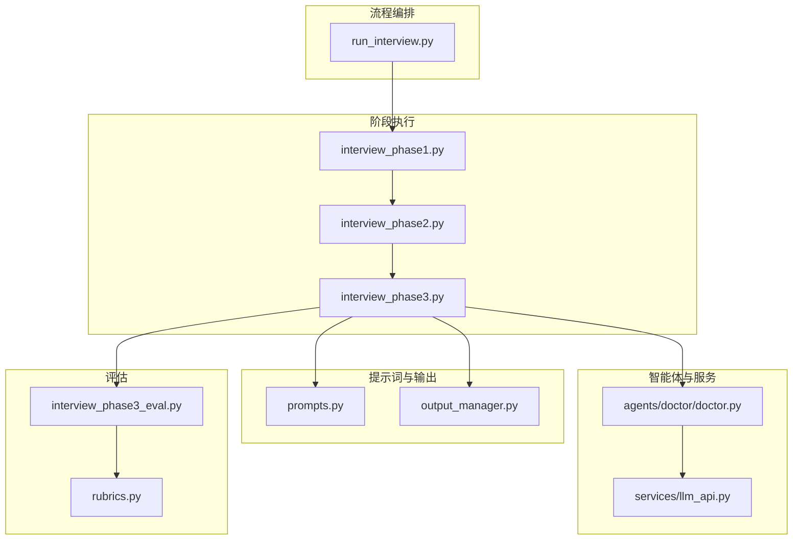
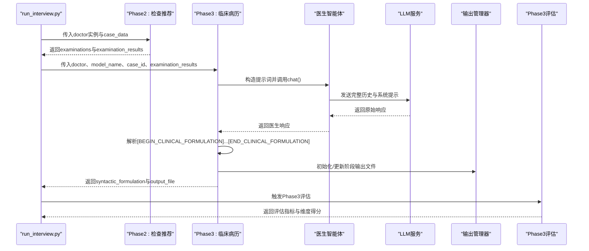
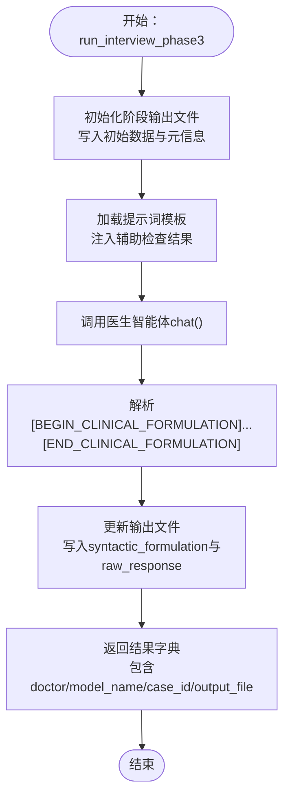
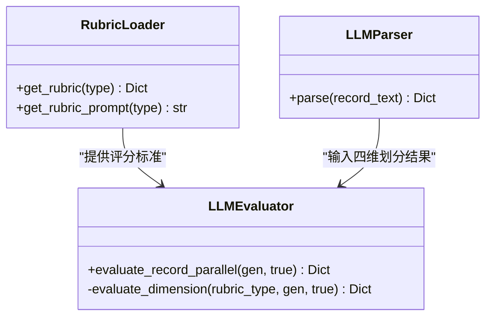
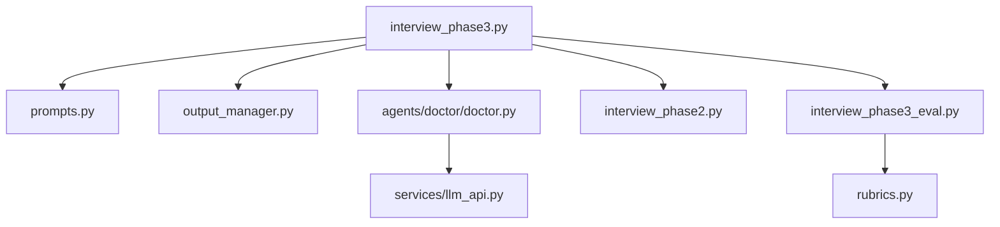

# 第三阶段：临床病历

<cite>
**本文档引用的文件**
- [interview_phase3.py](file://core/interview/interview_phase3.py)
- [prompts.py](file://core/interview/prompts.py)
- [output_manager.py](file://core/output_manager.py)
- [run_interview.py](file://run_interview.py)
- [doctor.py](file://agents/doctor/doctor.py)
- [llm_api.py](file://services/llm_api.py)
- [interview_phase2.py](file://core/interview/interview_phase2.py)
- [interview_phase3_eval.py](file://core/evaluate/interview_phase3_eval.py)
- [rubrics.py](file://core/evaluate/utils/phase3/rubrics.py)
</cite>

## 目录
1. [引言](#引言)
2. [项目结构](#项目结构)
3. [核心组件](#核心组件)
4. [架构总览](#架构总览)
5. [详细组件分析](#详细组件分析)
6. [依赖关系分析](#依赖关系分析)
7. [性能考虑](#性能考虑)
8. [故障排查指南](#故障排查指南)
9. [结论](#结论)
10. [附录](#附录)

## 引言
本阶段面向“第三阶段：临床病历整理（Clinical Formulation）”。其目标是：基于前两阶段的对话上下文与辅助检查结果，由医生智能体生成标准化的结构化病历文本，并通过统一的输出管理与评估体系保障质量。本阶段输出的病历文本将作为第四阶段“诊断类别识别”的输入基础，支撑后续诊断阶段的推理。

## 项目结构
第三阶段位于核心流程的中间位置，承接第一、二阶段的产出，为后续诊断阶段提供结构化输入。关键文件与职责如下：
- 核心执行：core/interview/interview_phase3.py
- 提示词模板：core/interview/prompts.py
- 输出管理：core/output_manager.py
- 完整流程编排：run_interview.py
- 医生智能体：agents/doctor/doctor.py
- LLM服务：services/llm_api.py
- 前置阶段（检查推荐）：core/interview/interview_phase2.py
- 质量评估：core/evaluate/interview_phase3_eval.py、core/evaluate/utils/phase3/rubrics.py

图表来源
- [run_interview.py:46-396](file://run_interview.py#L46-L396)
- [interview_phase3.py:83-181](file://core/interview/interview_phase3.py#L83-L181)
- [prompts.py:60-89](file://core/interview/prompts.py#L60-L89)
- [output_manager.py:50-115](file://core/output_manager.py#L50-L115)
- [doctor.py:32-55](file://agents/doctor/doctor.py#L32-L55)
- [llm_api.py:79-191](file://services/llm_api.py#L79-L191)
- [interview_phase2.py:75-244](file://core/interview/interview_phase2.py#L75-L244)
- [interview_phase3_eval.py:422-552](file://core/evaluate/interview_phase3_eval.py#L422-L552)
- [rubrics.py:17-422](file://core/evaluate/utils/phase3/rubrics.py#L17-L422)

章节来源
- [run_interview.py:46-396](file://run_interview.py#L46-L396)
- [interview_phase3.py:83-181](file://core/interview/interview_phase3.py#L83-L181)

## 核心组件
- 第三阶段执行器：负责拼装提示词、调用医生智能体、解析并保存病历文本，同时维护阶段输出文件。
- 提示词模板：定义第三阶段的系统提示词，强调“结构化病历正文”“标记包裹”“简洁清晰”等要求。
- 输出管理器：提供阶段输出文件的初始化、更新与读取，确保数据持久化与状态追踪。
- 医生智能体：封装LLM调用与上下文管理，保证多轮对话的连贯性。
- LLM服务：统一的OpenAI兼容接口，支持重试、超时控制与历史维护。
- 前置阶段（检查推荐）：为第三阶段提供辅助检查结果，作为病历整理的重要输入。
- 质量评估：将生成病历与真值病历进行四维划分与评分，提供覆盖度与准确度双维度指标。

章节来源
- [interview_phase3.py:40-181](file://core/interview/interview_phase3.py#L40-L181)
- [prompts.py:60-89](file://core/interview/prompts.py#L60-L89)
- [output_manager.py:50-115](file://core/output_manager.py#L50-L115)
- [doctor.py:32-55](file://agents/doctor/doctor.py#L32-L55)
- [llm_api.py:79-191](file://services/llm_api.py#L79-L191)
- [interview_phase2.py:75-244](file://core/interview/interview_phase2.py#L75-L244)
- [interview_phase3_eval.py:422-552](file://core/evaluate/interview_phase3_eval.py#L422-L552)
- [rubrics.py:17-422](file://core/evaluate/utils/phase3/rubrics.py#L17-L422)

## 架构总览
第三阶段在完整流程中的位置与交互如下：

图表来源
- [run_interview.py:112-136](file://run_interview.py#L112-L136)
- [interview_phase2.py:117-244](file://core/interview/interview_phase2.py#L117-L244)
- [interview_phase3.py:135-181](file://core/interview/interview_phase3.py#L135-L181)
- [output_manager.py:50-115](file://core/output_manager.py#L50-L115)
- [interview_phase3_eval.py:422-552](file://core/evaluate/interview_phase3_eval.py#L422-L552)

## 详细组件分析

### 组件A：第三阶段执行器（interview_phase3.py）
职责与流程要点：
- 初始化阶段输出文件，写入初始状态与元数据。
- 从提示词模板加载第三阶段系统提示，注入辅助检查结果。
- 调用医生智能体生成病历，解析标记包裹的正文。
- 更新输出文件，记录原始响应与解析后的病历正文。
- 返回结果字典，便于后续评估与传递到下一阶段。

图表来源
- [interview_phase3.py:120-181](file://core/interview/interview_phase3.py#L120-L181)

章节来源
- [interview_phase3.py:83-181](file://core/interview/interview_phase3.py#L83-L181)

### 组件B：提示词模板（prompts.py）
- 第三阶段提示词强调：
  - 输出必须为“纯文本病历正文”，不可包含JSON、Markdown或解释性内容。
  - 必须使用[BEGIN_CLINICAL_FORMULATION]与[END_CLINICAL_FORMULATION]包裹整篇病历。
  - 病历需简洁、清晰、信息完整，避免冗长与无关扩展。
- 辅助检查结果通过占位符注入，作为病历整理的结构化输入。

章节来源
- [prompts.py:60-89](file://core/interview/prompts.py#L60-L89)

### 组件C：输出管理器（output_manager.py）
- 提供阶段输出文件的初始化与更新：
  - 初始化：写入阶段号、病例ID、模型名、时间戳与初始数据，状态为“running”。
  - 更新：读取现有数据，合并更新字段，刷新时间戳与状态，立即落盘。
- 为第三阶段提供统一的文件命名与目录结构，便于评估与汇总。

章节来源
- [output_manager.py:50-115](file://core/output_manager.py#L50-L115)

### 组件D：医生智能体与LLM服务（doctor.py, llm_api.py）
- 医生智能体：
  - 通过系统提示词初始化，封装LLMService实例，支持多轮对话上下文。
- LLM服务：
  - 统一的OpenAI兼容接口，维护完整对话历史，支持重试与超时控制。
  - 支持多模态图文对话（本阶段不涉及）。

章节来源
- [doctor.py:32-55](file://agents/doctor/doctor.py#L32-L55)
- [llm_api.py:79-191](file://services/llm_api.py#L79-L191)

### 组件E：前置阶段（检查推荐）与数据衔接（interview_phase2.py）
- 第二阶段生成“检查项目列表”与“检查结果字典”，作为第三阶段的输入。
- 第三阶段将检查结果格式化后注入提示词，确保病历整合真实、可追溯的客观信息。

章节来源
- [interview_phase2.py:175-228](file://core/interview/interview_phase2.py#L175-L228)

### 组件F：质量评估与评分标准（interview_phase3_eval.py, rubrics.py）
- 评估流程：
  - 使用LLM将生成病历与真值病历分别划分为四维区域（主诉、体格检查、精神检查、既往/家族史）。
  - 并行对四维度进行评分，计算覆盖度与准确度，加权汇总得到总分与百分比。
- 评分标准（rubrics）：
  - 主诉：起病时间、主要症状、症状表现、伴随症状、病程演变、加重因素。
  - 体格检查：生命体征、一般情况、皮肤黏膜、头颈部、胸部/心肺、腹部、四肢/神经系统。
  - 精神检查：外观行为、言语、情感、感知觉、思维形式、思维内容、认知功能、自知力。
  - 既往/家族史：既往史、个人史、家族史、物质接触史。
- 权重分配：四维度各占25%，总分按加权平均换算为百分比。

图表来源
- [interview_phase3_eval.py:41-390](file://core/evaluate/interview_phase3_eval.py#L41-L390)
- [rubrics.py:17-422](file://core/evaluate/utils/phase3/rubrics.py#L17-L422)

章节来源
- [interview_phase3_eval.py:422-552](file://core/evaluate/interview_phase3_eval.py#L422-L552)
- [rubrics.py:17-422](file://core/evaluate/utils/phase3/rubrics.py#L17-L422)

## 依赖关系分析
- 第三阶段依赖：
  - 提示词模板：提供系统提示与占位符替换。
  - 输出管理器：提供阶段文件的初始化与更新。
  - 医生智能体：提供多轮对话上下文与LLM调用。
  - 前置阶段：提供检查项目与检查结果。
  - 评估模块：提供四维评分与加权统计。
- 数据流耦合：
  - 第二阶段的检查结果经格式化后注入第三阶段提示词。
  - 第三阶段的病历正文经评估模块划分为四维并评分。
  - 输出管理器贯穿初始化、更新与读取，确保数据一致性。

图表来源
- [interview_phase3.py:135-181](file://core/interview/interview_phase3.py#L135-L181)
- [prompts.py:60-89](file://core/interview/prompts.py#L60-L89)
- [output_manager.py:50-115](file://core/output_manager.py#L50-L115)
- [doctor.py:32-55](file://agents/doctor/doctor.py#L32-L55)
- [llm_api.py:79-191](file://services/llm_api.py#L79-L191)
- [interview_phase2.py:175-228](file://core/interview/interview_phase2.py#L175-L228)
- [interview_phase3_eval.py:422-552](file://core/evaluate/interview_phase3_eval.py#L422-L552)
- [rubrics.py:17-422](file://core/evaluate/utils/phase3/rubrics.py#L17-L422)

章节来源
- [interview_phase3.py:135-181](file://core/interview/interview_phase3.py#L135-L181)
- [interview_phase2.py:175-228](file://core/interview/interview_phase2.py#L175-L228)
- [interview_phase3_eval.py:422-552](file://core/evaluate/interview_phase3_eval.py#L422-L552)

## 性能考虑
- 提示词长度控制：第三阶段提示词包含辅助检查结果字符串，建议在注入前进行长度校验与截断，避免超出模型上下文限制。
- 并行评估：评估模块对四维度采用并行评分，显著缩短评估耗时，适合批量评测场景。
- 输出落盘策略：输出管理器采用即时写入，确保阶段性结果可恢复；在高并发场景下建议控制写入频率或引入队列。
- LLM调用稳定性：服务层具备指数退避重试机制，建议在生产环境设置合理的最大重试次数与超时阈值。

## 故障排查指南
- 病历正文未解析：
  - 检查医生响应是否包含正确的标记包裹（[BEGIN_CLINICAL_FORMULATION]...[END_CLINICAL_FORMULATION]）。
  - 确认提示词模板未被意外修改，且辅助检查结果已正确注入。
- 输出文件异常：
  - 核对输出目录权限与路径，确认初始化与更新流程均正常执行。
  - 如状态异常（如“completed_with_error”），检查前置阶段是否成功返回检查结果。
- 评估结果为0或缺失：
  - 确认真值病历文件存在且包含对应病例ID。
  - 检查生成病历与真值病历的四维划分是否成功（JSON解析失败会回退为空）。
- LLM调用失败：
  - 查看服务层日志与重试记录，确认API密钥、Base URL与超时配置正确。
  - 在网络不稳定环境下适当增大超时与重试间隔。

章节来源
- [interview_phase3.py:40-61](file://core/interview/interview_phase3.py#L40-L61)
- [output_manager.py:86-115](file://core/output_manager.py#L86-L115)
- [interview_phase3_eval.py:469-495](file://core/evaluate/interview_phase3_eval.py#L469-L495)
- [llm_api.py:158-169](file://services/llm_api.py#L158-L169)

## 结论
第三阶段通过“结构化提示词+智能体生成+统一输出+四维评估”的闭环设计，实现了从多轮对话与检查结果到标准化病历文本的高质量转换。其输出为后续诊断阶段提供坚实基础，评估模块则确保了质量可控与可量化。建议在实际部署中关注提示词长度、输出落盘与LLM稳定性，以提升整体吞吐与可靠性。

## 附录

### 数据转换示例（概念性说明）
- 输入：
  - 前置阶段生成的检查项目列表与检查结果字典。
  - 医生智能体的多轮对话历史。
- 处理：
  - 将检查结果格式化为字符串并注入提示词。
  - 调用医生智能体生成病历正文，并解析标记包裹内容。
- 输出：
  - 结构化病历正文（syntactic_formulation）。
  - 原始响应（raw_response）。
  - 阶段输出文件路径（output_file）。

章节来源
- [interview_phase3.py:135-181](file://core/interview/interview_phase3.py#L135-L181)
- [interview_phase2.py:175-228](file://core/interview/interview_phase2.py#L175-L228)

### 格式规范与输出标准
- 病历正文必须为纯文本，使用[BEGIN_CLINICAL_FORMULATION]与[END_CLINICAL_FORMULATION]包裹。
- 四维划分与评分：
  - 主诉、体格检查、精神检查、既往/家族史各占25%权重。
  - 覆盖度与准确度均为0或1，总分按加权百分比呈现。
- 输出文件：
  - interview_phase3_output.json包含syntactic_formulation、raw_response、状态与元数据。
  - 评估结果保存在evaluation子目录，包含维度明细与总分。

章节来源
- [prompts.py:78-87](file://core/interview/prompts.py#L78-L87)
- [rubrics.py:17-422](file://core/evaluate/utils/phase3/rubrics.py#L17-L422)
- [output_manager.py:50-115](file://core/output_manager.py#L50-L115)
- [interview_phase3_eval.py:515-552](file://core/evaluate/interview_phase3_eval.py#L515-L552)