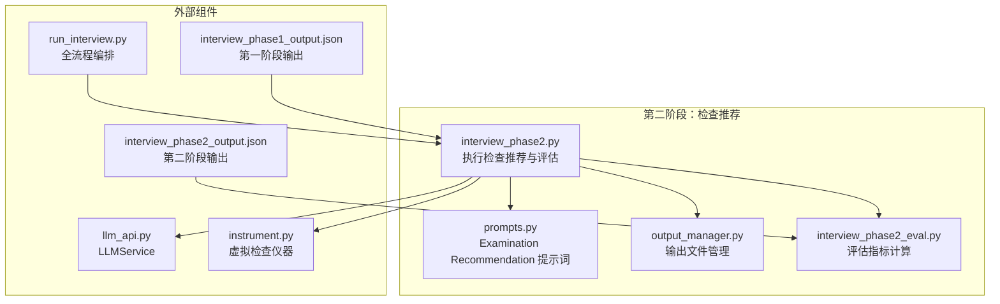
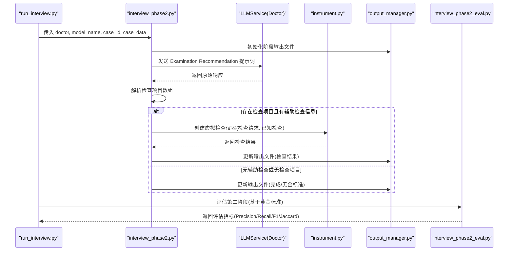
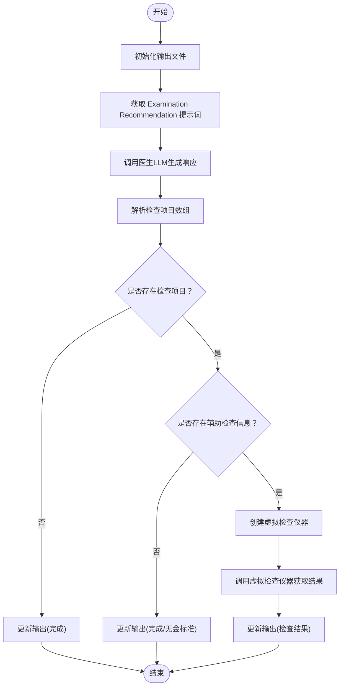
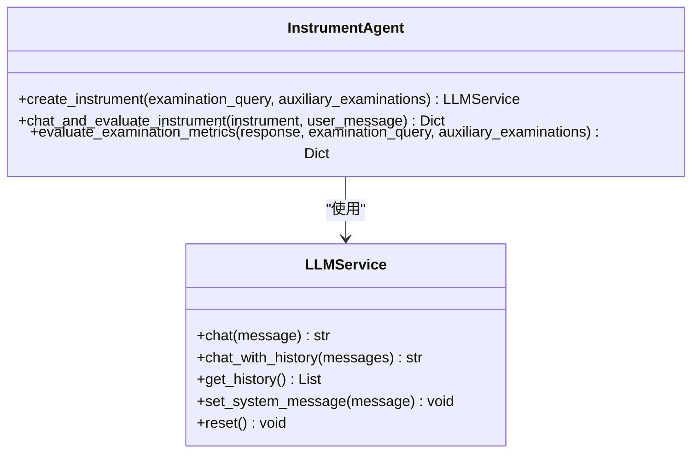
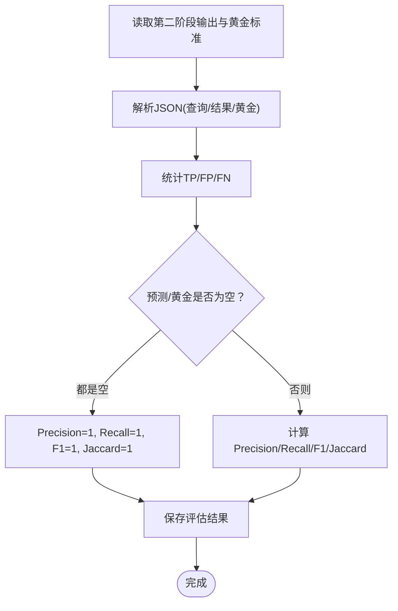
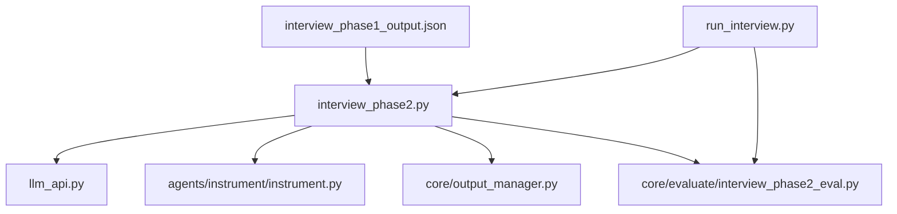

# 第二阶段：检查推荐

<cite>
**本文引用的文件**
- [interview_phase2.py](file://core/interview/interview_phase2.py)
- [prompts.py](file://core/interview/prompts.py)
- [instrument.py](file://agents/instrument/instrument.py)
- [output_manager.py](file://core/output_manager.py)
- [interview_phase2_eval.py](file://core/evaluate/interview_phase2_eval.py)
- [llm_api.py](file://services/llm_api.py)
- [run_interview.py](file://run_interview.py)
- [interview_phase1_output.json](file://data/output/interview/qwen-flash/1009904/interview_phase1_output.json)
- [interview_phase2_output.json](file://data/output/interview/qwen-flash/1009904/interview_phase2_output.json)
</cite>

## 目录
1. [简介](#简介)
2. [项目结构](#项目结构)
3. [核心组件](#核心组件)
4. [架构总览](#架构总览)
5. [详细组件分析](#详细组件分析)
6. [依赖关系分析](#依赖关系分析)
7. [性能考量](#性能考量)
8. [故障排查指南](#故障排查指南)
9. [结论](#结论)
10. [附录](#附录)

## 简介
本文件面向第二阶段“检查推荐”模块，系统化阐述辅助检查推荐的算法与决策逻辑，说明如何基于第一阶段收集的病史信息生成合适的检查项目，解释检查推荐的分类体系、优先级排序机制与个性化定制策略，深入分析检查项目的医学依据、适用症状与禁忌症，提供检查推荐的质量评估方法与准确性验证机制，并给出使用示例、配置参数与扩展开发指南，最后说明与第一阶段的数据依赖关系与与后续阶段的衔接方式。

## 项目结构
第二阶段位于核心流程的中间位置，承接第一阶段的病史采集结果，产出“检查项目列表”与“检查结果”，并为第三阶段“临床病历”提供输入。其关键文件与职责如下：
- 核心执行：core/interview/interview_phase2.py
- 提示词定义：core/interview/prompts.py
- 检查仪器代理：agents/instrument/instrument.py
- 输出管理：core/output_manager.py
- 评估模块：core/evaluate/interview_phase2_eval.py
- LLM服务：services/llm_api.py
- 流程编排：run_interview.py
- 示例数据：data/output/interview/qwen-flash/1009904/*

图表来源
- [interview_phase2.py:1-265](file://core/interview/interview_phase2.py#L1-L265)
- [prompts.py:25-57](file://core/interview/prompts.py#L25-L57)
- [output_manager.py:1-189](file://core/output_manager.py#L1-L189)
- [instrument.py:13-45](file://agents/instrument/instrument.py#L13-L45)
- [interview_phase2_eval.py:153-255](file://core/evaluate/interview_phase2_eval.py#L153-L255)
- [llm_api.py:79-250](file://services/llm_api.py#L79-L250)
- [run_interview.py:46-111](file://run_interview.py#L46-L111)
- [interview_phase1_output.json:1-193](file://data/output/interview/qwen-flash/1009904/interview_phase1_output.json#L1-L193)
- [interview_phase2_output.json:1-28](file://data/output/interview/qwen-flash/1009904/interview_phase2_output.json#L1-L28)

章节来源
- [interview_phase2.py:1-265](file://core/interview/interview_phase2.py#L1-L265)
- [prompts.py:25-57](file://core/interview/prompts.py#L25-L57)
- [output_manager.py:1-189](file://core/output_manager.py#L1-L189)
- [instrument.py:13-45](file://agents/instrument/instrument.py#L13-L45)
- [interview_phase2_eval.py:153-255](file://core/evaluate/interview_phase2_eval.py#L153-L255)
- [llm_api.py:79-250](file://services/llm_api.py#L79-L250)
- [run_interview.py:46-111](file://run_interview.py#L46-L111)
- [interview_phase1_output.json:1-193](file://data/output/interview/qwen-flash/1009904/interview_phase1_output.json#L1-L193)
- [interview_phase2_output.json:1-28](file://data/output/interview/qwen-flash/1009904/interview_phase2_output.json#L1-L28)

## 核心组件
- 检查推荐执行器：负责调用医生LLM生成检查项目列表，解析响应，必要时调用虚拟检查仪器获取检查结果，并写入输出文件。
- 虚拟检查仪器：接收医生请求的检查项目与已知辅助检查信息，模拟返回检查结果，并计算评估指标。
- 输出管理器：统一管理各阶段输出文件的创建、更新与读取。
- 评估模块：基于黄金标准（第一阶段提供的辅助检查信息）计算Precision/Recall/F1/Jaccard等指标。
- LLM服务：封装OpenAI风格的聊天接口，维护对话上下文，支持重试与多模态能力。

章节来源
- [interview_phase2.py:75-244](file://core/interview/interview_phase2.py#L75-L244)
- [instrument.py:13-182](file://agents/instrument/instrument.py#L13-L182)
- [output_manager.py:50-115](file://core/output_manager.py#L50-L115)
- [interview_phase2_eval.py:66-255](file://core/evaluate/interview_phase2_eval.py#L66-L255)
- [llm_api.py:79-250](file://services/llm_api.py#L79-L250)

## 架构总览
第二阶段的端到端流程如下：
- 输入：第一阶段输出的医生实例、模型名、病例ID与病例数据（含辅助检查信息）。
- 步骤：
  1) 医生LLM根据提示词生成检查项目列表；
  2) 解析响应，提取标准检查项目数组；
  3) 若存在病例辅助检查信息，启动虚拟检查仪器，返回检查结果；
  4) 写入输出文件，包含检查项目、检查结果、原始响应与状态。
- 输出：检查项目列表、检查结果、评估指标（在评估模块中计算）。

图表来源
- [run_interview.py:85-110](file://run_interview.py#L85-L110)
- [interview_phase2.py:136-229](file://core/interview/interview_phase2.py#L136-L229)
- [prompts.py:25-57](file://core/interview/prompts.py#L25-L57)
- [instrument.py:13-45](file://agents/instrument/instrument.py#L13-L45)
- [output_manager.py:50-115](file://core/output_manager.py#L50-L115)
- [interview_phase2_eval.py:153-255](file://core/evaluate/interview_phase2_eval.py#L153-L255)

## 详细组件分析

### 组件A：检查推荐执行器（interview_phase2.py）
- 职责
  - 生成并解析检查项目列表；
  - 调用虚拟检查仪器获取检查结果；
  - 维护输出文件状态与时间戳。
- 关键流程
  - 初始化输出文件，写入初始数据；
  - 读取提示词，调用医生LLM生成响应；
  - 使用正则与JSON解析提取检查项目数组；
  - 若存在检查项目且有辅助检查信息，创建并调用虚拟检查仪器；
  - 更新输出文件，记录检查结果与状态。
- 错误处理
  - Instrument调用异常时，记录错误并标记状态为“completed_with_error”。

图表来源
- [interview_phase2.py:122-229](file://core/interview/interview_phase2.py#L122-L229)

章节来源
- [interview_phase2.py:75-244](file://core/interview/interview_phase2.py#L75-L244)

### 组件B：虚拟检查仪器（agents/instrument/instrument.py）
- 职责
  - 根据医生请求的检查项目与已知辅助检查信息，构造系统提示词；
  - 通过LLMService生成检查结果；
  - 计算评估指标（Precision/Recall/F1/Jaccard）。
- 关键流程
  - create_instrument：替换系统提示词中的占位符，注入检查请求与已知检查；
  - chat_and_evaluate_instrument：调用LLM并调用评估函数；
  - evaluate_examination_metrics：统计TP/FP/FN并计算指标。
- 数据结构
  - examination_query：医生请求的检查项目数组；
  - auxiliary_examinations：已知检查对象（键为检查名称，值为结果）；
  - response：LLM返回的检查结果对象。

图表来源
- [instrument.py:13-182](file://agents/instrument/instrument.py#L13-L182)
- [llm_api.py:79-250](file://services/llm_api.py#L79-L250)

章节来源
- [instrument.py:13-182](file://agents/instrument/instrument.py#L13-L182)

### 组件C：评估模块（core/evaluate/interview_phase2_eval.py）
- 职责
  - 基于黄金标准（第一阶段提供的辅助检查信息）计算指标；
  - 支持从文件或内存数据读取并评估。
- 指标计算
  - TP：非“NONE”的返回数量；
  - FP：等于“NONE”的数量；
  - FN：黄金数量 - TP；
  - Precision/Recall/F1/Jaccard：按标准公式计算；
  - 特殊情况：当预测与黄金均为空时，四指标均为1.0。

图表来源
- [interview_phase2_eval.py:66-150](file://core/evaluate/interview_phase2_eval.py#L66-L150)

章节来源
- [interview_phase2_eval.py:66-255](file://core/evaluate/interview_phase2_eval.py#L66-L255)

### 组件D：提示词与输出管理（prompts.py, output_manager.py）
- Examination Recommendation 提示词要点
  - 明确输出格式：[BEGIN_EXAMINATIONS] 与 [END_EXAMINATIONS] 包裹的JSON数组；
  - 要求检查项目具体、标准、必要，避免宽泛类别；
  - 若无需检查，输出空数组。
- 输出管理
  - 统一输出目录结构：data/output/interview/{model_name}/{case_id}/；
  - 初始化阶段输出文件，写入元数据与初始数据；
  - 更新输出文件，即时写入最新状态与时间戳。

章节来源
- [prompts.py:25-57](file://core/interview/prompts.py#L25-L57)
- [output_manager.py:20-115](file://core/output_manager.py#L20-L115)

## 依赖关系分析
- 第二阶段依赖第一阶段的医生实例与病例数据（含辅助检查信息）；
- 第二阶段依赖LLM服务进行对话与上下文维护；
- 第二阶段依赖虚拟检查仪器进行检查结果模拟与评估；
- 评估模块依赖输出管理器定位与读取阶段输出文件；
- 全流程由run_interview.py编排，串联各阶段。

图表来源
- [run_interview.py:85-110](file://run_interview.py#L85-L110)
- [interview_phase2.py:136-229](file://core/interview/interview_phase2.py#L136-L229)
- [output_manager.py:50-115](file://core/output_manager.py#L50-L115)
- [instrument.py:13-45](file://agents/instrument/instrument.py#L13-L45)
- [interview_phase2_eval.py:153-255](file://core/evaluate/interview_phase2_eval.py#L153-L255)

章节来源
- [run_interview.py:46-111](file://run_interview.py#L46-L111)
- [interview_phase2.py:136-229](file://core/interview/interview_phase2.py#L136-L229)
- [output_manager.py:50-115](file://core/output_manager.py#L50-L115)
- [instrument.py:13-45](file://agents/instrument/instrument.py#L13-L45)
- [interview_phase2_eval.py:153-255](file://core/evaluate/interview_phase2_eval.py#L153-L255)

## 性能考量
- LLM调用延迟与重试：LLMService内置指数退避重试，避免瞬时网络波动影响；
- 输出文件即时写入：输出管理器在关键节点即时写入，降低数据丢失风险；
- 指标计算轻量：评估模块仅进行简单统计与计算，复杂度低；
- 建议优化
  - 在大规模批量运行时，可并发调用LLM与Instrument，但需注意令牌与速率限制；
  - 对于长对话历史，可考虑截断策略以控制上下文长度；
  - 评估指标可缓存，避免重复计算。

## 故障排查指南
- 检查项目解析失败
  - 现象：解析返回为空数组；
  - 排查：确认医生响应是否严格遵循[BEGIN_EXAMINATIONS]/[END_EXAMINATIONS]包裹与JSON数组格式。
- 虚拟检查仪器调用异常
  - 现象：输出状态标记为“completed_with_error”；
  - 排查：检查环境变量与API配置，确认网络连通性与超时设置。
- 缺失辅助检查信息
  - 现象：输出状态标记为“completed_no_gold”；
  - 排查：确认第一阶段输出中是否包含auxiliaryExamination字段。
- 评估指标缺失
  - 现象：评估结果为空；
  - 排查：确认评估模块输入的模型名、病例ID或输出文件路径正确。

章节来源
- [interview_phase2.py:217-228](file://core/interview/interview_phase2.py#L217-L228)
- [llm_api.py:158-169](file://services/llm_api.py#L158-L169)
- [interview_phase2_eval.py:205-221](file://core/evaluate/interview_phase2_eval.py#L205-L221)

## 结论
第二阶段“检查推荐”通过标准化提示词约束输出格式，结合LLM生成检查项目列表，并在存在黄金标准时通过虚拟检查仪器模拟结果与计算评估指标，形成闭环的质量保障。该模块与第一阶段紧密耦合，为后续“临床病历”与“诊断”阶段提供高质量输入，整体流程清晰、可评估、可扩展。

## 附录

### 使用示例
- 单独运行第二阶段
  - 从第一阶段获取医生实例与数据，调用第二阶段执行器；
  - 获取检查项目列表与检查结果；
  - 可选：调用评估模块计算指标。
- 完整流程运行
  - 通过run_interview.py一次性运行Phase 1-6，并在Phase 2后自动评估。

章节来源
- [interview_phase2.py:101-117](file://core/interview/interview_phase2.py#L101-L117)
- [run_interview.py:85-110](file://run_interview.py#L85-L110)

### 配置参数
- LLM配置（来自.env）
  - 角色相关：{ROLE}_API_BASE、{ROLE}_API_KEY、{ROLE}_MODEL、{ROLE}_MAX_TOKENS、{ROLE}_TEMPERATURE、{ROLE}_TIMEOUT
  - 通用：MAX_TOKENS、TEMPERATURE、TIMEOUT
- 输出目录
  - data/output/interview/{model_name}/{case_id}/

章节来源
- [llm_api.py:58-77](file://services/llm_api.py#L58-L77)
- [output_manager.py:20-48](file://core/output_manager.py#L20-L48)

### 扩展开发指南
- 新增检查项目类别
  - 在提示词中明确新增类别的命名规范与边界条件；
  - 确保医生输出严格遵循JSON数组格式与占位符包裹。
- 自定义评估口径
  - 修改评估模块的统计规则（如TP/FP/FN定义），确保与业务目标一致；
  - 保持指标计算的数值稳定性与边界条件处理。
- 增强Instrument能力
  - 引入更复杂的检查结果生成策略（如基于症状权重的采样）；
  - 增加检查结果的结构化输出与解释说明。

章节来源
- [prompts.py:25-57](file://core/interview/prompts.py#L25-L57)
- [interview_phase2_eval.py:66-150](file://core/evaluate/interview_phase2_eval.py#L66-L150)
- [instrument.py:13-45](file://agents/instrument/instrument.py#L13-L45)

### 数据依赖与衔接
- 与第一阶段的依赖
  - 医生实例：保持对话上下文，确保推荐与病史一致；
  - 病例数据：包含auxiliaryExamination字段，作为评估黄金标准。
- 与后续阶段的衔接
  - 第三阶段“临床病历”将使用第二阶段的检查结果作为输入；
  - 第五阶段“诊断假设”与第六阶段“鉴别诊断”将基于前序结果进一步推理。

章节来源
- [interview_phase2.py:177-229](file://core/interview/interview_phase2.py#L177-L229)
- [run_interview.py:117-122](file://run_interview.py#L117-L122)
- [interview_phase1_output.json:1-193](file://data/output/interview/qwen-flash/1009904/interview_phase1_output.json#L1-L193)
- [interview_phase2_output.json:1-28](file://data/output/interview/qwen-flash/1009904/interview_phase2_output.json#L1-L28)