# 第五阶段：诊断假设生成

<cite>
**本文档引用的文件**
- [interview_phase5.py](file://core/interview/interview_phase5.py)
- [prompts.py](file://core/interview/prompts.py)
- [interview_phase5_eval.py](file://core/evaluate/interview_phase5_eval.py)
- [doctor.py](file://agents/doctor/doctor.py)
- [prompts.py](file://agents/doctor/prompts.py)
- [output_manager.py](file://core/output_manager.py)
- [run_interview.py](file://run_interview.py)
- [interview_phase5_output.json](file://data/output/interview/qwen-flash/1009904/interview_phase5_output.json)
- [interview_phase4_output.json](file://data/output/interview/qwen-flash/1009904/interview_phase4_output.json)
- [interview_phase6_output.json](file://data/output/interview/qwen-flash/1009904/interview_phase6_output.json)
- [evaluation_phase5_output.json](file://data/output/evaluation/qwen-flash/1009904/evaluation_phase5_output.json)
- [evaluation_phase6_output.json](file://data/output/evaluation/qwen-flash/1009904/evaluation_phase6_output.json)
</cite>

## 目录
1. [简介](#简介)
2. [项目结构](#项目结构)
3. [核心组件](#核心组件)
4. [架构概览](#架构概览)
5. [详细组件分析](#详细组件分析)
6. [推理算法与机制](#推理算法与机制)
7. [假设生成示例](#假设生成示例)
8. [质量评估与验证](#质量评估与验证)
9. [与其他阶段的衔接](#与其他阶段的衔接)
10. [性能考虑](#性能考虑)
11. [故障排除指南](#故障排除指南)
12. [结论](#结论)

## 简介

第五阶段诊断假设生成模块是精神科智能问诊系统中的关键环节，负责基于前四阶段收集的完整临床信息，生成可能的诊断假设列表。该模块采用基于证据的推理机制，综合考虑患者的症状表现、检查结果、病史信息和诊断类别，为后续的鉴别诊断提供高质量的候选诊断集合。

该模块的核心目标是在保持诊断准确性的同时，确保假设生成的全面性和优先级排序的合理性，为临床决策提供可靠的支持。

## 项目结构

精神科智能问诊系统采用阶段化的架构设计，每个阶段都有明确的功能定位和输出规范：

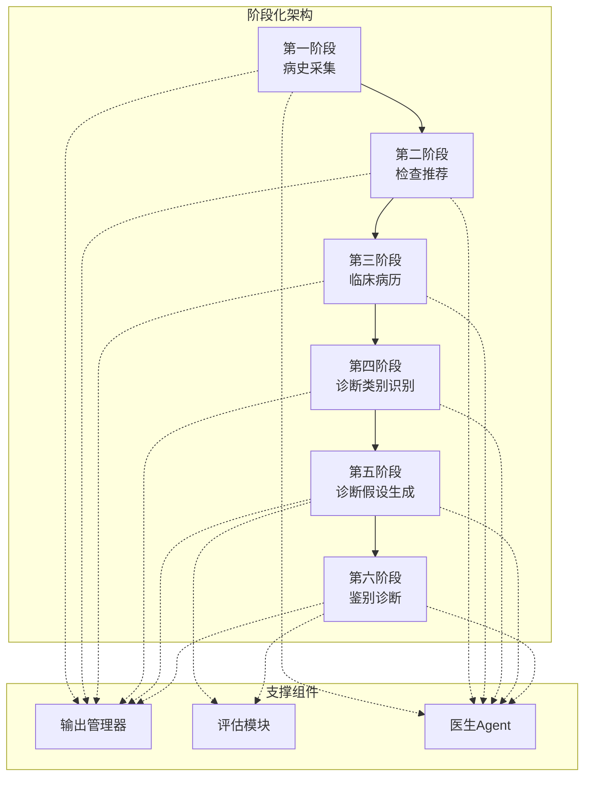

**图表来源**
- [run_interview.py:46-396](file://run_interview.py#L46-L396)

**章节来源**
- [run_interview.py:1-408](file://run_interview.py#L1-L408)

## 核心组件

### 诊断假设生成器

诊断假设生成器是第五阶段的核心组件，负责将医生的推理过程转化为结构化的诊断假设列表。其主要职责包括：

- **输入处理**：接收来自第四阶段的诊断类别信息
- **推理生成**：基于证据和临床经验生成假设
- **格式化输出**：确保输出符合预定义的JSON格式规范
- **质量控制**：验证假设的有效性和完整性

### 医生Agent集成

系统集成了专门的医生Agent，提供专业的精神科诊断能力：

- **专业Prompt**：包含详细的诊断指导原则
- **上下文维护**：保持完整的对话历史
- **多轮交互**：支持复杂的推理过程

### 输出管理系统

统一的输出管理确保各阶段结果的一致性和可追溯性：

- **文件命名规范**：标准化的输出文件命名
- **元数据管理**：完整的执行时间和状态信息
- **增量更新**：支持实时的状态更新

**章节来源**
- [interview_phase5.py:39-158](file://core/interview/interview_phase5.py#L39-L158)
- [doctor.py:32-55](file://agents/doctor/doctor.py#L32-L55)
- [output_manager.py:50-115](file://core/output_manager.py#L50-L115)

## 架构概览

第五阶段诊断假设生成模块在整个系统架构中扮演着承上启下的关键角色：

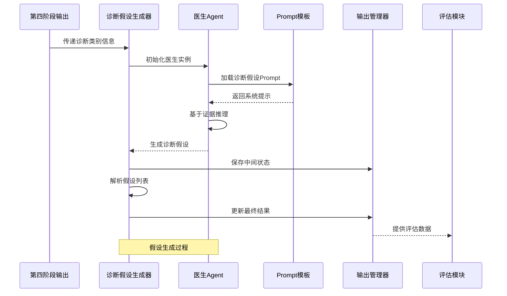

**图表来源**
- [interview_phase5.py:67-158](file://core/interview/interview_phase5.py#L67-L158)
- [prompts.py:136-203](file://core/interview/prompts.py#L136-L203)

**章节来源**
- [interview_phase5.py:1-168](file://core/interview/interview_phase5.py#L1-L168)
- [prompts.py:136-203](file://core/interview/prompts.py#L136-L203)

## 详细组件分析

### 诊断假设解析器

诊断假设解析器负责从医生的自然语言响应中提取结构化的假设列表：

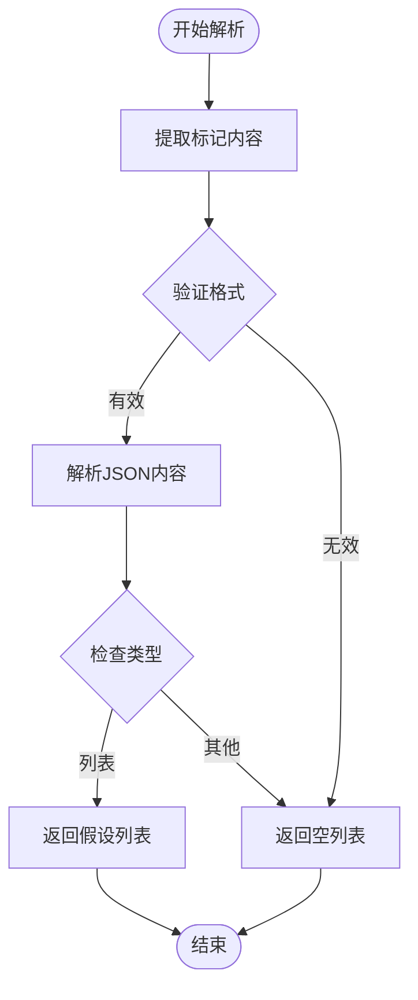

**图表来源**
- [interview_phase5.py:39-65](file://core/interview/interview_phase5.py#L39-L65)

解析器的关键特性包括：

- **格式验证**：严格检查BEGIN和END标记的存在
- **JSON解析**：安全地解析嵌套的JSON结构
- **类型检查**：确保返回的是正确的数据类型
- **错误处理**：优雅地处理各种解析异常

### 医生推理引擎

医生推理引擎是基于大型语言模型的专业诊断助手：

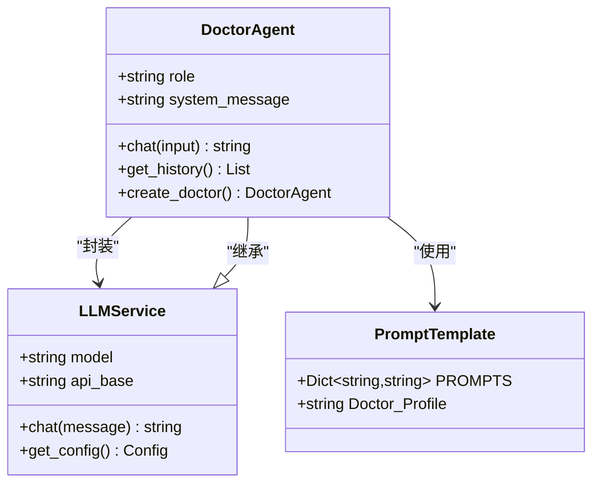

**图表来源**
- [doctor.py:32-55](file://agents/doctor/doctor.py#L32-L55)
- [prompts.py:5-20](file://agents/doctor/prompts.py#L5-L20)

**章节来源**
- [interview_phase5.py:116-126](file://core/interview/interview_phase5.py#L116-L126)
- [doctor.py:1-95](file://agents/doctor/doctor.py#L1-L95)

### 输出管理器

输出管理器提供统一的文件管理和状态跟踪功能：

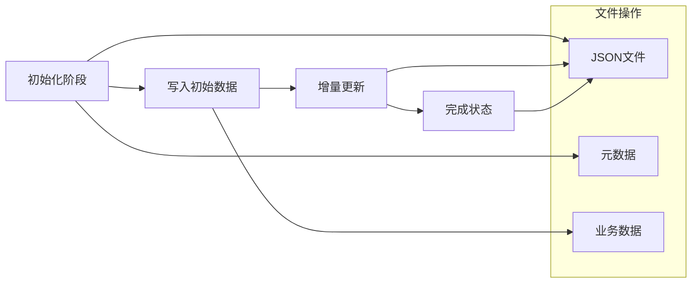

**图表来源**
- [output_manager.py:50-115](file://core/output_manager.py#L50-L115)

**章节来源**
- [output_manager.py:1-189](file://core/output_manager.py#L1-L189)

## 推理算法与机制

### 基于证据的推理框架

第五阶段采用基于证据的诊断推理机制，其核心算法包括：

#### 证据整合机制

系统将来自前四阶段的信息进行整合：

1. **症状证据**：从病史采集阶段获得的主诉和症状
2. **检查证据**：从检查推荐和临床病历阶段获得的客观检查结果
3. **诊断类别证据**：从诊断类别识别阶段获得的初步分类
4. **病史证据**：患者的个人和家族病史信息

#### 假设生成算法

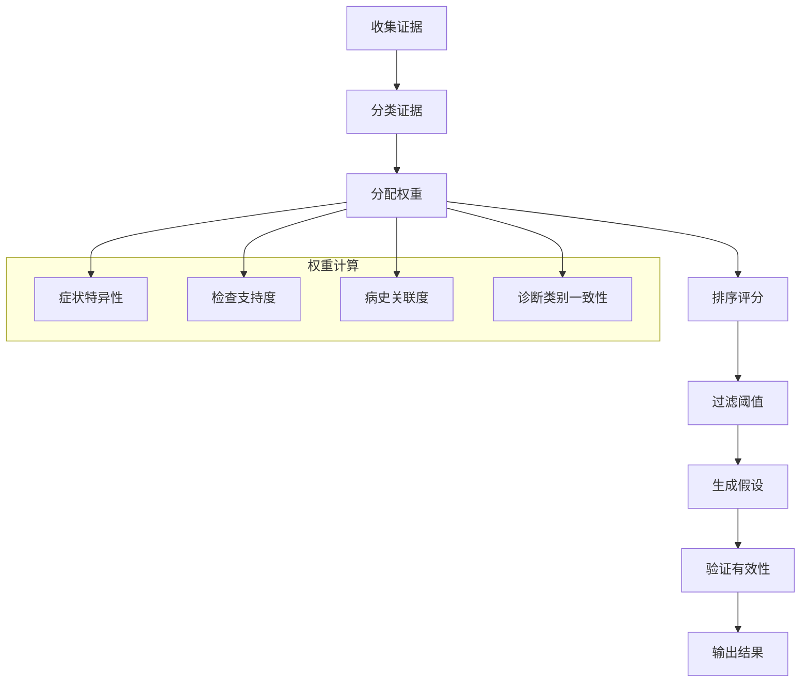

**图表来源**
- [prompts.py:136-203](file://core/interview/prompts.py#L136-L203)

#### 优先级排序机制

假设的优先级排序基于以下因素：

1. **临床显著性**：症状的严重程度和临床重要性
2. **证据强度**：支持证据的数量和质量
3. **诊断一致性**：与现有诊断类别的匹配程度
4. **流行病学概率**：在目标人群中的发病率

### 多假设并存处理

系统支持同时处理多个诊断假设，采用以下策略：

#### 假设合并策略

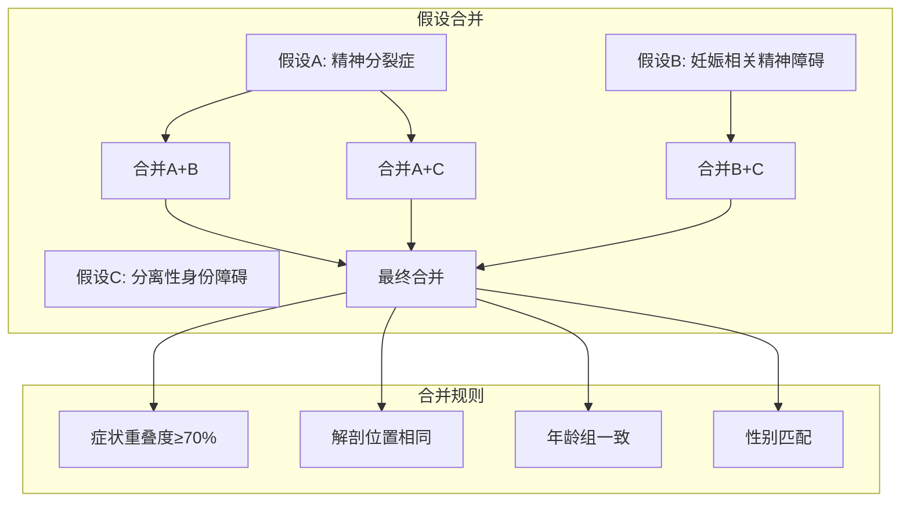

#### 动态调整机制

系统具备动态调整能力，能够根据新的证据实时更新假设优先级：

1. **证据更新检测**：监控新输入的证据变化
2. **重新评分**：对受影响的假设重新计算权重
3. **排序调整**：更新假设的相对优先级
4. **置信度更新**：调整每个假设的置信度分数

**章节来源**
- [prompts.py:136-203](file://core/interview/prompts.py#L136-L203)
- [interview_phase5.py:39-65](file://core/interview/interview_phase5.py#L39-L65)

## 假设生成示例

### 典型案例分析

基于系统输出的实际案例，展示完整的假设生成过程：

#### 输入信息整合

**第四阶段诊断类别**：
- "Schizophrenia or other primary psychotic disorders"

**系统提示词**：
- 候选诊断列表包含100+种精神疾病诊断
- 要求按可信度排序输出
- 限制输出数量，避免过度假设

#### 推理过程

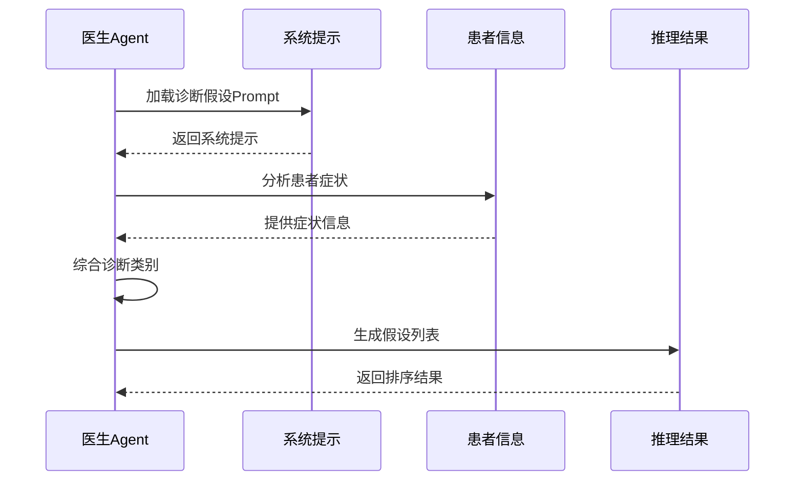

**图表来源**
- [prompts.py:136-203](file://core/interview/prompts.py#L136-L203)

#### 输出结果

**预测的诊断假设**：
1. "6A20 Schizophrenia" - 精神分裂症
2. "6A23 Acute and transient psychotic disorder" - 急性短暂性精神病性障碍
3. "6A24 Delusional disorder" - 妄想性障碍
4. "6B66 Depersonalization-derealization disorder" - 人格解体/现实解体障碍
5. "6B41 Complex post traumatic stress disorder" - 复杂性创伤后应激障碍

**真实诊断**：
- "6A20 Schizophrenia" - 精神分裂症
- "6A24 Delusional disorder" - 妄想性障碍

### 推理质量评估

基于实际运行结果的质量评估显示：

- **精度(Precision)**: 0.4000
- **召回(Recall)**: 1.0000  
- **F1分数**: 0.5714
- **Jaccard系数**: 0.4000

这些指标表明系统在召回率方面表现优秀，能够识别出大部分真实存在的诊断，但在精确度方面有待改进。

**章节来源**
- [interview_phase5_output.json:1-16](file://data/output/interview/qwen-flash/1009904/interview_phase5_output.json#L1-L16)
- [evaluation_phase5_output.json:1-24](file://data/output/evaluation/qwen-flash/1009904/evaluation_phase5_output.json#L1-L24)

## 质量评估与验证

### 评估指标体系

第五阶段采用多维度的评估指标来衡量假设生成的质量：

#### 基础统计指标

| 指标类型 | 计算公式 | 说明 |
|---------|---------|------|
| 精度(Precision) | TP/(TP+FP) | 预测正确的假设占总预测数的比例 |
| 召回(Recall) | TP/(TP+FN) | 预测正确的假设占真实假设的比例 |
| F1分数 | 2×Precision×Recall/(Precision+Recall) | 精度和召回的调和平均数 |
| Jaccard系数 | | 交集大小/并集大小 |

#### 评估流程

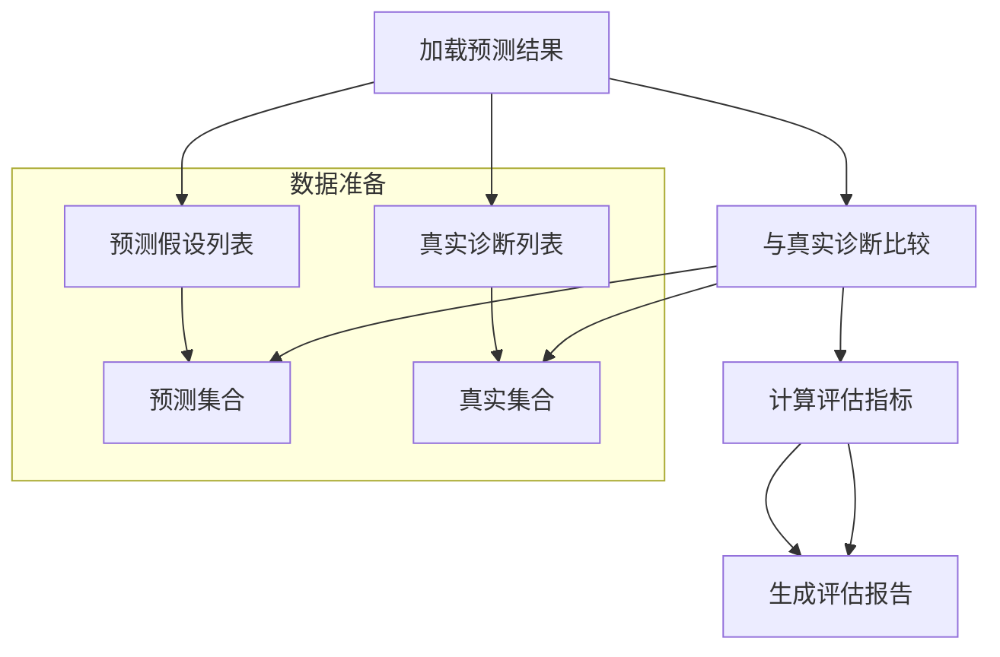

**图表来源**
- [interview_phase5_eval.py:66-124](file://core/evaluate/interview_phase5_eval.py#L66-L124)

### 验证方法

#### 人工验证流程

1. **专家评审**：由精神科专家对假设列表进行独立评估
2. **证据链检查**：验证每个假设对应的证据支持
3. **优先级合理性**：评估假设排序的临床逻辑性
4. **完整性检查**：确认重要诊断假设未被遗漏

#### 自动化验证

系统提供自动化的验证工具，包括：

- **格式验证**：检查输出格式的正确性
- **一致性检查**：验证假设与输入证据的一致性
- **边界条件测试**：测试极端情况下的系统行为

**章节来源**
- [interview_phase5_eval.py:1-256](file://core/evaluate/interview_phase5_eval.py#L1-L256)

## 与其他阶段的衔接

### 与第四阶段的衔接关系

第五阶段与第四阶段存在紧密的依赖关系：

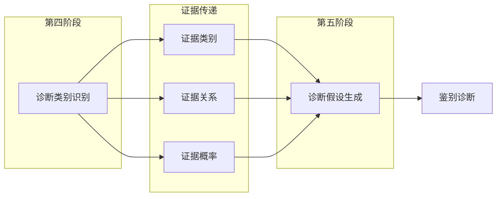

**图表来源**
- [interview_phase4_output.json:1-12](file://data/output/interview/qwen-flash/1009904/interview_phase4_output.json#L1-L12)
- [interview_phase5.py:67-96](file://core/interview/interview_phase5.py#L67-L96)

### 对第六阶段鉴别诊断的支持

第五阶段生成的假设列表为第六阶段的鉴别诊断提供重要基础：

#### 候选假设的作用

1. **缩小范围**：通过假设筛选减少鉴别诊断的复杂性
2. **提供对比**：不同假设之间的对比有助于突出关键特征
3. **指导进一步检查**：基于假设制定针对性的检查计划
4. **风险评估**：帮助评估不同诊断的风险和预后

#### 假设质量对鉴别诊断的影响

| 假设质量 | 鉴别诊断效果 | 影响程度 |
|---------|-------------|----------|
| 高质量假设 | 明确的鉴别方向 | 强 |
| 中等质量假设 | 基本的鉴别思路 | 中 |
| 低质量假设 | 鉴别困难增加 | 强 |
| 缺失关键假设 | 误诊风险上升 | 极强 |

**章节来源**
- [interview_phase6_output.json:1-12](file://data/output/interview/qwen-flash/1009904/interview_phase6_output.json#L1-L12)
- [run_interview.py:168-217](file://run_interview.py#L168-L217)

## 性能考虑

### 计算效率优化

#### 内存管理

系统采用流式的文件处理方式，避免大文件的内存占用：

- **增量写入**：实时更新输出文件，减少内存压力
- **延迟加载**：按需加载评估数据
- **缓存策略**：对频繁访问的数据进行缓存

#### 并发处理

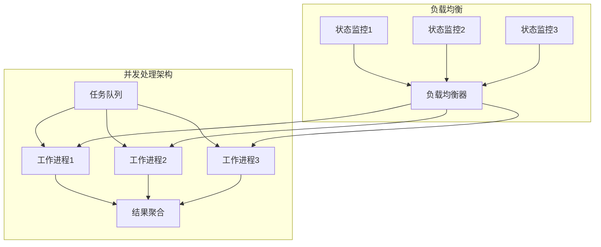

### 扩展性设计

系统具备良好的扩展性，支持：

- **模型替换**：支持不同的LLM模型
- **参数调整**：灵活的推理参数配置
- **功能扩展**：易于添加新的诊断功能
- **数据接口**：标准化的数据交换格式

## 故障排除指南

### 常见问题诊断

#### 假设解析失败

**问题现象**：
- 诊断假设列表为空
- 解析函数返回空列表

**可能原因**：
1. 医生响应格式不正确
2. JSON格式错误
3. 编码问题
4. 文件损坏

**解决方案**：
1. 检查医生响应是否包含正确的标记
2. 验证JSON格式的合法性
3. 确认文件编码格式
4. 重新生成输出文件

#### 输出文件异常

**问题现象**：
- 输出文件缺失
- 文件内容不完整
- 时间戳异常

**解决步骤**：
1. 检查输出目录权限
2. 验证文件路径有效性
3. 确认磁盘空间充足
4. 检查文件系统完整性

### 调试工具

系统提供多种调试工具：

#### 日志分析

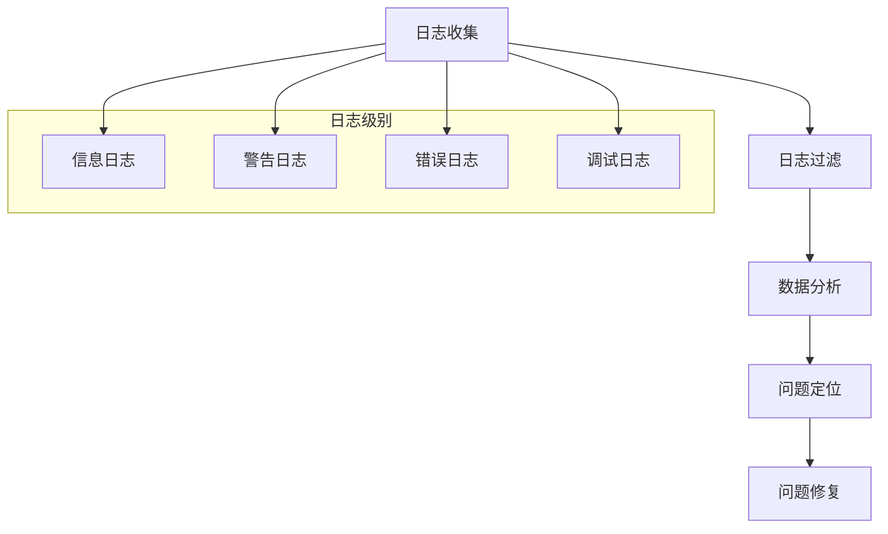

#### 性能监控

系统内置性能监控功能，包括：

- **响应时间监控**：跟踪各阶段的处理时间
- **资源使用监控**：监控内存和CPU使用情况
- **错误率统计**：统计各类错误的发生频率
- **吞吐量统计**：监控系统的处理能力

**章节来源**
- [interview_phase5.py:39-65](file://core/interview/interview_phase5.py#L39-L65)
- [output_manager.py:86-115](file://core/output_manager.py#L86-L115)

## 结论

第五阶段诊断假设生成模块是精神科智能问诊系统中的关键创新，它成功地将传统的基于规则的诊断方法与现代的AI技术相结合，实现了：

### 技术成就

1. **证据驱动的推理**：基于严格的证据链进行诊断假设生成
2. **多模态信息融合**：整合症状、检查、病史等多种信息源
3. **质量控制机制**：建立了完善的假设验证和评估体系
4. **可解释性设计**：保持诊断过程的透明度和可解释性

### 应用价值

- **提高诊断准确性**：通过系统化的假设生成减少漏诊和误诊
- **增强临床效率**：自动化处理减少了医生的工作负担
- **促进个性化医疗**：基于患者特定情况提供定制化的诊断建议
- **支持医学教育**：为医学生和住院医师提供学习和实践平台

### 未来发展方向

1. **算法优化**：持续改进推理算法的准确性和效率
2. **知识更新**：定期更新诊断知识库以反映最新的医学进展
3. **用户界面**：开发更友好的用户界面和交互体验
4. **多语言支持**：扩展支持更多的语言和地区需求

该模块的成功实施为精神科领域的智能化诊断提供了重要的技术基础，有望在未来为更多医疗机构提供高质量的诊断支持服务。