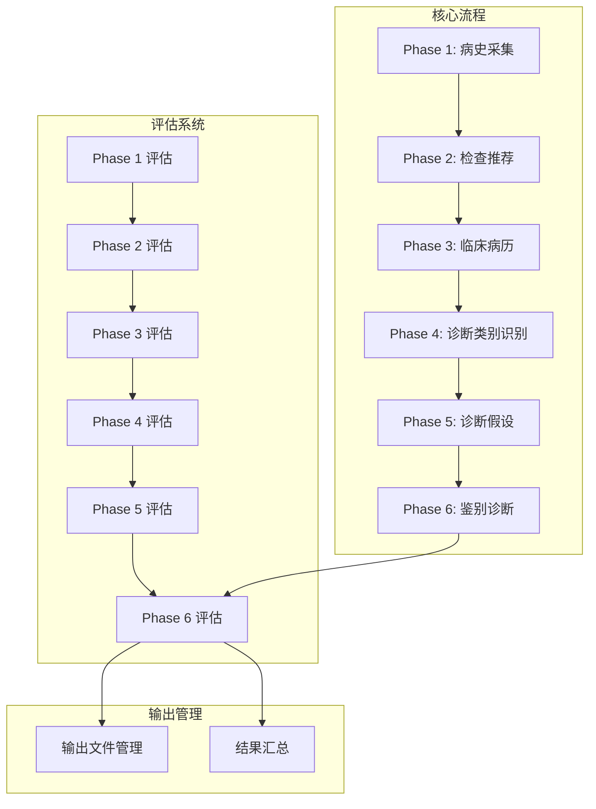
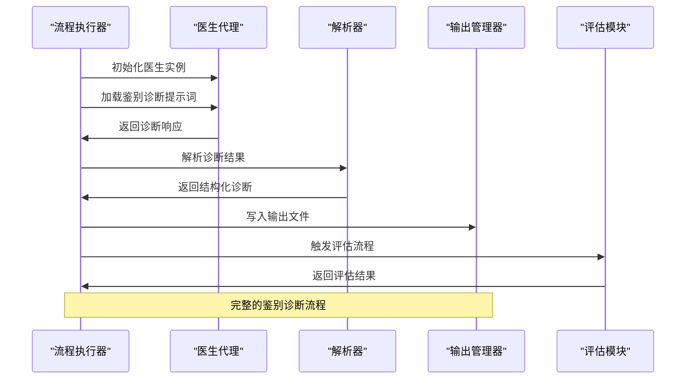
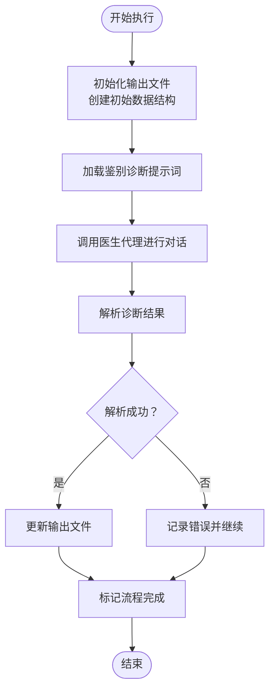
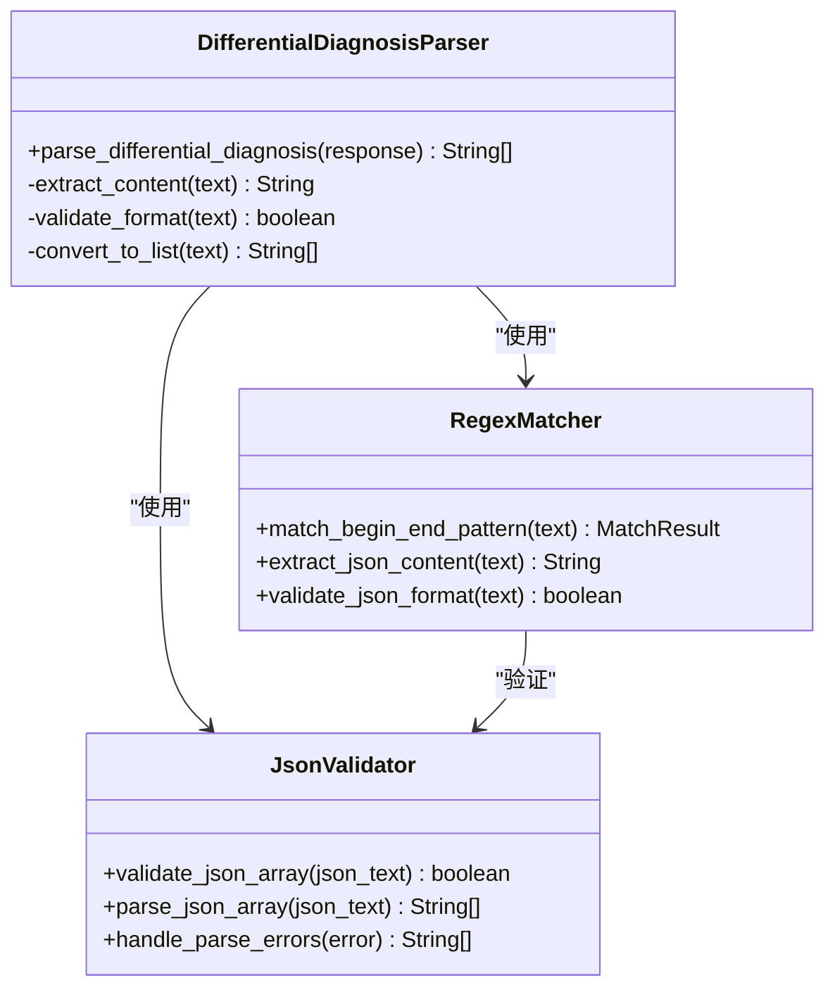
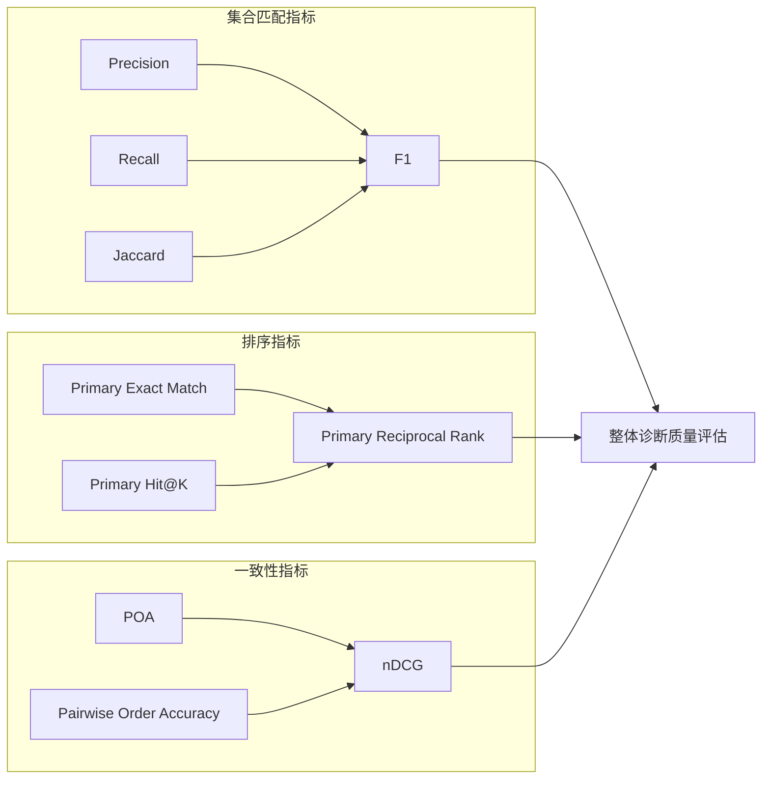
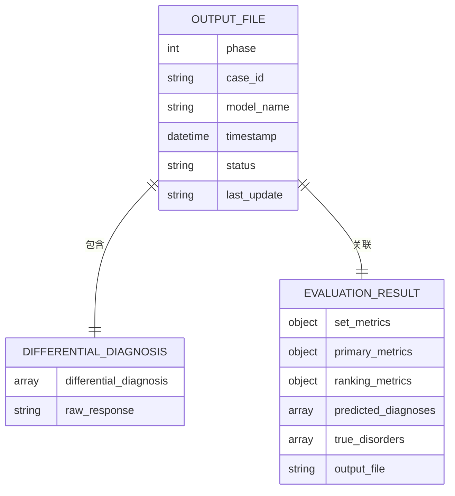
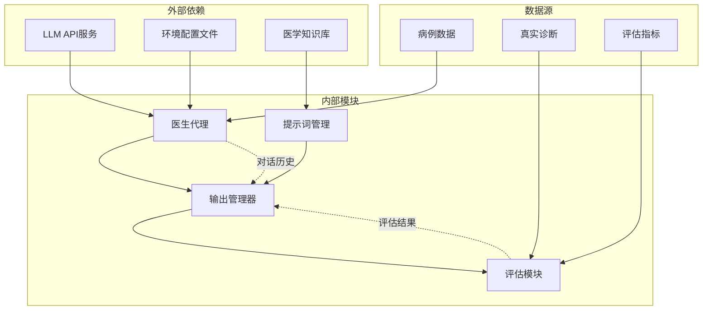
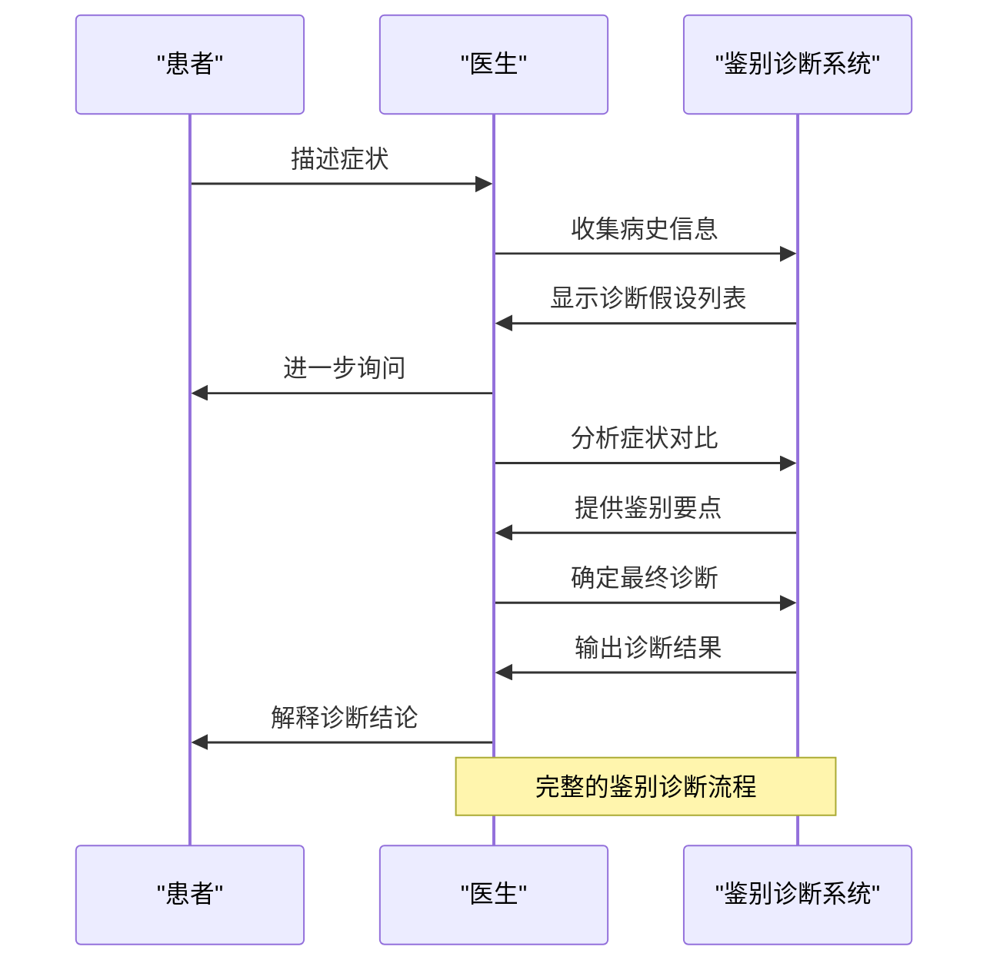

# 第六阶段：鉴别诊断

<cite>
**本文档引用的文件**
- [interview_phase6.py](file://core/interview/interview_phase6.py)
- [interview_phase6_eval.py](file://core/evaluate/interview_phase6_eval.py)
- [prompts.py](file://core/interview/prompts.py)
- [doctor.py](file://agents/doctor/doctor.py)
- [run_interview.py](file://run_interview.py)
- [output_manager.py](file://core/output_manager.py)
- [interview_phase6_output.json](file://data/output/interview/qwen-flash/1009904/interview_phase6_output.json)
- [evaluation_phase6_output.json](file://data/output/evaluation/qwen-flash/1009904/evaluation_phase6_output.json)
</cite>

## 目录
1. [引言](#引言)
2. [项目结构](#项目结构)
3. [核心组件](#核心组件)
4. [架构概览](#架构概览)
5. [详细组件分析](#详细组件分析)
6. [依赖关系分析](#依赖关系分析)
7. [性能考虑](#性能考虑)
8. [故障排除指南](#故障排除指南)
9. [结论](#结论)
10. [附录](#附录)

## 引言

第六阶段鉴别诊断模块是精神科智能问诊系统的核心环节，负责在前五阶段收集的大量信息基础上，通过系统性的鉴别诊断方法确定最终诊断。该模块采用严格的医学推理框架，通过对症状对比分析、诊断标准应用和证据权重分配，实现从诊断假设到最终诊断的精准收敛。

本模块不仅实现了完整的鉴别诊断流程，还提供了全面的准确性评估和专家验证机制，确保诊断结果的可靠性和可解释性。通过与评估系统的深度集成，形成了从问诊到评估的完整闭环。

## 项目结构

精神科智能问诊系统采用分阶段设计，每个阶段都有独立的执行模块和评估模块。第六阶段鉴别诊断位于核心流程的末端，负责最终诊断的确定和输出。

**图表来源**
- [run_interview.py:46-396](file://run_interview.py#L46-L396)
- [interview_phase6.py:66-158](file://core/interview/interview_phase6.py#L66-L158)

**章节来源**
- [run_interview.py:1-408](file://run_interview.py#L1-L408)
- [interview_phase6.py:1-168](file://core/interview/interview_phase6.py#L1-L168)

## 核心组件

第六阶段鉴别诊断系统由四个核心组件构成：诊断执行引擎、解析器、评估模块和输出管理器。这些组件协同工作，确保鉴别诊断过程的完整性和准确性。

### 诊断执行引擎

诊断执行引擎是整个系统的核心，负责调用医生代理、处理对话上下文和生成最终诊断。其主要职责包括：
- 加载和初始化医生代理实例
- 构建鉴别诊断提示词
- 处理医生响应并提取诊断结果
- 管理输出文件的创建和更新

### 解析器组件

解析器专门负责从医生的自然语言响应中提取结构化的诊断信息。它使用正则表达式模式匹配技术，确保诊断结果的标准化格式。

### 评估模块

评估模块提供多层次的准确性评估，包括集合匹配指标、排序指标和一致性指标，为诊断质量提供客观的量化评价。

### 输出管理器

输出管理器统一管理各阶段的输出文件，确保数据的一致性和可追溯性，支持完整的流程追踪和结果分析。

**章节来源**
- [interview_phase6.py:38-158](file://core/interview/interview_phase6.py#L38-L158)
- [interview_phase6_eval.py:267-370](file://core/evaluate/interview_phase6_eval.py#L267-L370)
- [output_manager.py:50-115](file://core/output_manager.py#L50-L115)

## 架构概览

第六阶段鉴别诊断系统采用模块化架构设计，通过清晰的接口定义和数据流控制，实现了高度的可维护性和扩展性。

**图表来源**
- [interview_phase6.py:66-158](file://core/interview/interview_phase6.py#L66-L158)
- [run_interview.py:198-226](file://run_interview.py#L198-L226)

系统架构的关键特点：
- **模块解耦**：各组件职责明确，接口清晰
- **数据驱动**：通过标准化的数据格式实现组件间通信
- **状态管理**：完整的生命周期管理确保流程的可靠性
- **错误处理**：完善的异常处理机制保证系统稳定性

## 详细组件分析

### 鉴别诊断执行器

鉴别诊断执行器是系统的核心控制器，负责协调整个诊断流程。其工作流程包括初始化、对话执行、结果解析和状态更新等关键步骤。

**图表来源**
- [interview_phase6.py:66-158](file://core/interview/interview_phase6.py#L66-L158)

执行器的主要功能特性：
- **上下文保持**：通过医生代理实例保持完整的对话历史
- **格式标准化**：确保输出符合预定义的JSON格式规范
- **状态跟踪**：实时更新流程状态和时间戳信息
- **错误恢复**：具备基本的错误处理和恢复能力

### 诊断解析器

诊断解析器采用正则表达式技术，从医生的自然语言响应中提取结构化的诊断信息。其设计考虑了医学文本的复杂性和多样性。

**图表来源**
- [interview_phase6.py:38-64](file://core/interview/interview_phase6.py#L38-L64)

解析器的工作原理：
- **模式匹配**：使用BEGIN_END标记识别诊断内容范围
- **JSON解析**：将结构化内容转换为Python列表
- **类型验证**：确保输出数据类型正确
- **错误处理**：优雅处理解析失败的情况

### 评估系统

评估系统提供多层次的诊断准确性评估，涵盖集合匹配、排序准确性和一致性分析等多个维度。

**图表来源**
- [interview_phase6_eval.py:69-264](file://core/evaluate/interview_phase6_eval.py#L69-L264)

评估指标的数学定义：
- **集合匹配指标**：基于集合论的精确率、召回率和Jaccard相似度
- **排序指标**：关注主诊断的排序准确性和位置权重
- **一致性指标**：衡量诊断排序的一致性和信息增益

### 输出管理系统

输出管理系统负责统一管理各阶段的输出文件，确保数据的完整性、一致性和可追溯性。

**图表来源**
- [output_manager.py:50-115](file://core/output_manager.py#L50-L115)
- [interview_phase6_output.json:1-12](file://data/output/interview/qwen-flash/1009904/interview_phase6_output.json#L1-L12)

系统特性：
- **文件结构规范化**：统一的文件命名和目录结构
- **数据完整性保障**：原子性操作确保数据一致性
- **版本控制**：时间戳和状态字段支持流程追踪
- **扩展性设计**：支持新的评估指标和输出格式

**章节来源**
- [interview_phase6.py:101-143](file://core/interview/interview_phase6.py#L101-L143)
- [interview_phase6_eval.py:267-370](file://core/evaluate/interview_phase6_eval.py#L267-L370)
- [output_manager.py:50-115](file://core/output_manager.py#L50-L115)

## 依赖关系分析

第六阶段鉴别诊断系统与其他模块存在密切的依赖关系，形成了完整的问诊评估生态系统。

**图表来源**
- [doctor.py:28-55](file://agents/doctor/doctor.py#L28-L55)
- [prompts.py:206-233](file://core/interview/prompts.py#L206-L233)
- [run_interview.py:32-43](file://run_interview.py#L32-L43)

依赖关系的特点：
- **单向依赖**：从底层服务到上层应用的清晰层次
- **松耦合设计**：通过抽象接口减少直接依赖
- **可替换性**：底层服务可以独立替换和升级
- **数据流向**：清晰的输入输出数据流

**章节来源**
- [run_interview.py:32-43](file://run_interview.py#L32-L43)
- [doctor.py:28-55](file://agents/doctor/doctor.py#L28-L55)

## 性能考虑

鉴别诊断系统的性能优化主要体现在响应时间、内存使用和并发处理等方面。系统采用了多种策略来确保高效的运行表现。

### 响应时间优化

- **异步处理**：医生代理的调用采用异步模式，避免阻塞等待
- **缓存机制**：常用提示词和配置信息进行内存缓存
- **批量处理**：多个诊断案例可以并行处理

### 内存使用优化

- **流式处理**：大文件读写采用流式处理方式
- **增量更新**：输出文件采用增量更新策略
- **对象复用**：医生代理实例在流程中复用

### 并发处理能力

- **多线程支持**：评估模块支持多线程并行计算
- **资源池管理**：LLM API调用使用连接池管理
- **负载均衡**：多个评估任务可以分布处理

## 故障排除指南

鉴别诊断系统在运行过程中可能遇到各种问题，以下是常见问题的诊断和解决方法。

### 常见问题及解决方案

**问题1：医生代理初始化失败**
- **症状**：系统无法创建医生实例
- **原因**：API配置错误或网络连接问题
- **解决方案**：检查.env文件中的API配置，验证网络连接

**问题2：诊断解析失败**
- **症状**：无法从医生响应中提取诊断结果
- **原因**：响应格式不符合预期或JSON解析错误
- **解决方案**：检查提示词格式，验证医生响应的结构

**问题3：输出文件写入失败**
- **症状**：诊断结果无法保存到文件
- **原因**：文件权限问题或磁盘空间不足
- **解决方案**：检查目标目录权限，清理磁盘空间

**问题4：评估结果为空**
- **症状**：评估模块返回空结果
- **原因**：缺少真实诊断数据或文件路径错误
- **解决方案**：验证ground_truth.jsonl文件存在性，检查文件路径

### 调试工具和技巧

系统提供了丰富的调试功能，帮助开发者快速定位和解决问题：

- **日志记录**：详细的执行日志便于问题追踪
- **状态监控**：实时显示流程执行状态
- **中间结果**：保存各阶段的中间结果便于分析
- **错误报告**：结构化的错误信息包含详细上下文

**章节来源**
- [interview_phase6.py:66-158](file://core/interview/interview_phase6.py#L66-L158)
- [interview_phase6_eval.py:267-370](file://core/evaluate/interview_phase6_eval.py#L267-L370)

## 结论

第六阶段鉴别诊断模块代表了精神科智能问诊系统的技术巅峰，通过严谨的医学推理框架和先进的评估机制，实现了从诊断假设到最终诊断的精准收敛。

该模块的核心价值在于：
- **系统性方法**：建立了完整的鉴别诊断理论框架
- **可解释性**：通过详细的评估指标提供诊断过程的透明度
- **准确性保障**：多层次的评估体系确保诊断质量
- **专家验证**：与真实诊断数据的对比验证诊断可靠性

未来的发展方向包括：
- **机器学习集成**：引入更高级的AI算法提升诊断准确性
- **个性化定制**：根据不同科室和患者群体优化诊断策略
- **实时更新**：动态更新诊断标准和医学知识库
- **多模态支持**：整合影像学、实验室检查等多源数据

## 附录

### 鉴别诊断示例

以下是一个完整的鉴别诊断示例，展示了从诊断假设到最终诊断的完整过程：

### 诊断标准应用

系统在鉴别诊断过程中严格遵循以下标准：
- **症状对比分析**：系统性比较各候选诊断的症状符合度
- **排除逻辑**：通过否定性证据排除不可能的诊断
- **权重分配**：根据证据强度分配诊断权重
- **最终确定**：综合所有因素得出最终诊断

### 准确性评估机制

系统采用多层次的准确性评估机制：
- **集合匹配**：评估诊断覆盖的完整性
- **排序准确**：检验诊断的重要程度排序
- **一致性分析**：验证诊断排序的稳定性
- **专家对比**：与真实诊断进行对比验证

通过这些机制，系统不仅能够提供准确的诊断结果，还能为医疗质量改进提供宝贵的反馈信息。