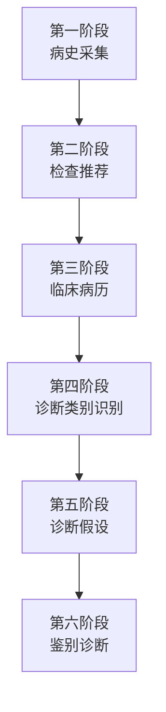
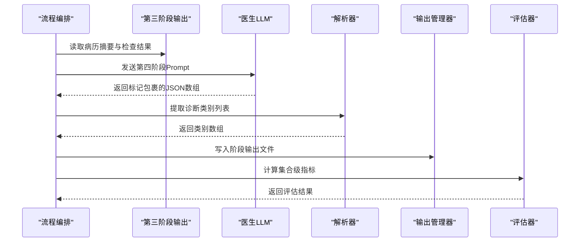
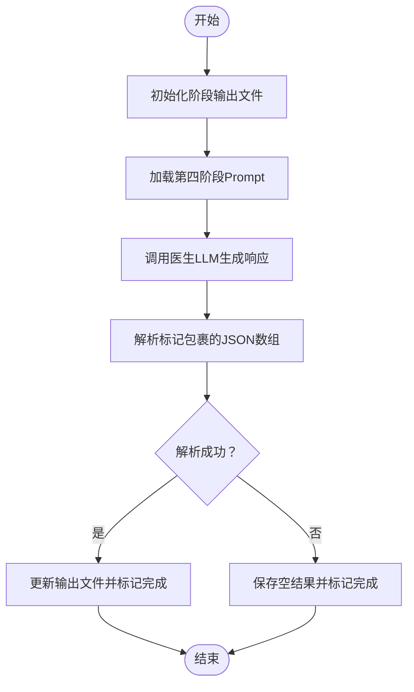
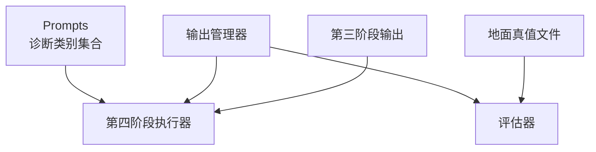

# 第四阶段：诊断类别识别

<cite>
**本文引用的文件**
- [run_interview.py](file://run_interview.py)
- [interview_phase4.py](file://core/interview/interview_phase4.py)
- [prompts.py](file://core/interview/prompts.py)
- [interview_phase3.py](file://core/interview/interview_phase3.py)
- [output_manager.py](file://core/output_manager.py)
- [interview_phase4_eval.py](file://core/evaluate/interview_phase4_eval.py)
- [interview_phase3_output.json](file://data/output/interview/qwen-flash/1009904/interview_phase3_output.json)
- [interview_phase4_output.json](file://data/output/interview/qwen-flash/1009904/interview_phase4_output.json)
- [evaluation_phase4_output.json](file://data/output/evaluation/qwen-flash/1009904/evaluation_phase4_output.json)
- [ground_truth.jsonl](file://data/ground_truth.jsonl)
- [cases.jsonl](file://data/cases.jsonl)
</cite>

## 目录
1. [简介](#简介)
2. [项目结构](#项目结构)
3. [核心组件](#核心组件)
4. [架构概览](#架构概览)
5. [详细组件分析](#详细组件分析)
6. [依赖关系分析](#依赖关系分析)
7. [性能考量](#性能考量)
8. [故障排查指南](#故障排查指南)
9. [结论](#结论)
10. [附录](#附录)

## 简介
本阶段面向精神科疾病分类系统的应用与识别，目标是基于前三阶段生成的病历摘要，自动识别可能的诊断类别。系统采用ICD-10分类体系的广义类别集合，结合医生LLM的推理能力，输出符合当前病例核心表现的诊断类别列表。识别过程强调：
- 诊断类别匹配：从预定义类别集合中选择，避免外部扩展
- 共病与优先级：当存在多重核心维度时允许输出多个类别，并按重要性排序
- 结构化输出：统一使用标记包裹的JSON数组，便于解析与评估
- 评估指标：采用集合级别的精确率、召回率、F1与Jaccard相似系数

本阶段输出为后续“诊断假设生成”提供候选类别基础，支撑第五阶段的假设筛选与排序。

## 项目结构
第四阶段位于完整的六阶段流程中，依赖前序阶段的上下文与产出：
- 第一阶段：病史采集（对话驱动）
- 第二阶段：检查推荐（基于对话与病例）
- 第三阶段：临床病历（整合对话与检查结果）
- 第四阶段：诊断类别识别（基于病历与检查结果）
- 第五阶段：诊断假设（从候选中生成假设列表）
- 第六阶段：鉴别诊断（最终诊断排序）

图表来源
- [run_interview.py:138-147](file://run_interview.py#L138-L147)
- [interview_phase4.py:67-96](file://core/interview/interview_phase4.py#L67-L96)

章节来源
- [run_interview.py:138-147](file://run_interview.py#L138-L147)
- [interview_phase4.py:67-96](file://core/interview/interview_phase4.py#L67-L96)

## 核心组件
- 诊断类别识别执行器：负责构造第四阶段Prompt、调用医生LLM、解析输出并持久化
- Prompt模板：提供诊断类别列表与输出约束，确保结构化与可评估性
- 输出管理器：统一管理各阶段输出文件的创建、更新与读取
- 评估器：基于地面真值计算集合级指标，支持精度、召回、F1与Jaccard

章节来源
- [interview_phase4.py:39-65](file://core/interview/interview_phase4.py#L39-L65)
- [prompts.py:91-133](file://core/interview/prompts.py#L91-L133)
- [output_manager.py:50-115](file://core/output_manager.py#L50-L115)
- [interview_phase4_eval.py:126-210](file://core/evaluate/interview_phase4_eval.py#L126-L210)

## 架构概览
第四阶段的处理链路如下：
- 输入：第三阶段生成的病历摘要（syntactic_formulation）与检查结果
- 处理：医生LLM基于Prompt进行推理，输出诊断类别JSON数组
- 解析：从标记包裹的响应中提取诊断类别列表
- 存储：写入阶段输出文件，包含诊断类别与原始响应
- 评估：读取地面真值，计算集合级指标并保存评估结果

图表来源
- [run_interview.py:138-166](file://run_interview.py#L138-L166)
- [interview_phase4.py:116-143](file://core/interview/interview_phase4.py#L116-L143)
- [interview_phase4_eval.py:126-210](file://core/evaluate/interview_phase4_eval.py#L126-L210)

## 详细组件分析

### 诊断类别识别执行器
职责与流程：
- 初始化阶段输出文件，设置初始状态
- 从Prompt模板加载第四阶段指令
- 调用医生LLM生成响应
- 使用正则与JSON解析提取诊断类别
- 更新输出文件并标记完成状态

图表来源
- [interview_phase4.py:101-143](file://core/interview/interview_phase4.py#L101-L143)
- [interview_phase4.py:39-65](file://core/interview/interview_phase4.py#L39-L65)

章节来源
- [interview_phase4.py:67-158](file://core/interview/interview_phase4.py#L67-L158)

### Prompt模板与诊断类别集合
- Prompt明确限定可选诊断类别集合，要求输出JSON数组并按重要性排序
- 输出必须使用特定标记包裹，保证结构化与可解析性
- 当存在共病或多维核心表现时，允许输出多个类别

章节来源
- [prompts.py:91-133](file://core/interview/prompts.py#L91-L133)

### 输出管理与持久化
- 统一输出目录结构：按模型名与病例ID组织
- 支持阶段输出文件的初始化、更新与读取
- 写入时自动添加时间戳与状态字段，便于追踪

章节来源
- [output_manager.py:20-115](file://core/output_manager.py#L20-L115)

### 评估器与指标
- 从地面真值文件加载真实诊断类别
- 计算集合级指标：精确率、召回率、F1、Jaccard相似系数
- 评估结果保存至独立的评估输出目录

章节来源
- [interview_phase4_eval.py:37-63](file://core/evaluate/interview_phase4_eval.py#L37-L63)
- [interview_phase4_eval.py:66-123](file://core/evaluate/interview_phase4_eval.py#L66-L123)
- [interview_phase4_eval.py:126-210](file://core/evaluate/interview_phase4_eval.py#L126-L210)

### 数据依赖与示例
- 第三阶段输出包含病历摘要与原始响应，作为第四阶段输入
- 示例输出展示诊断类别列表与原始响应的结构
- 评估输出展示集合级指标与预测/真实类别

章节来源
- [interview_phase3_output.json:1-10](file://data/output/interview/qwen-flash/1009904/interview_phase3_output.json#L1-L10)
- [interview_phase4_output.json:1-12](file://data/output/interview/qwen-flash/1009904/interview_phase4_output.json#L1-L12)
- [evaluation_phase4_output.json:1-19](file://data/output/evaluation/qwen-flash/1009904/evaluation_phase4_output.json#L1-L19)
- [ground_truth.jsonl:1-1](file://data/ground_truth.jsonl#L1-L1)

## 依赖关系分析
- 第四阶段依赖第三阶段的病历摘要与检查结果
- Prompt模板集中定义诊断类别集合与输出约束
- 输出管理器提供统一的文件读写接口
- 评估器依赖地面真值文件与阶段输出文件

图表来源
- [prompts.py:91-133](file://core/interview/prompts.py#L91-L133)
- [interview_phase4.py:116-143](file://core/interview/interview_phase4.py#L116-L143)
- [output_manager.py:50-115](file://core/output_manager.py#L50-L115)
- [interview_phase4_eval.py:154-187](file://core/evaluate/interview_phase4_eval.py#L154-L187)

章节来源
- [prompts.py:91-133](file://core/interview/prompts.py#L91-L133)
- [interview_phase4.py:116-143](file://core/interview/interview_phase4.py#L116-L143)
- [output_manager.py:50-115](file://core/output_manager.py#L50-L115)
- [interview_phase4_eval.py:154-187](file://core/evaluate/interview_phase4_eval.py#L154-L187)

## 性能考量
- Prompt长度与复杂度：较长的Prompt会增加LLM推理时间，建议保持结构化与简洁
- 解析稳定性：依赖标记包裹的JSON数组，需确保LLM输出严格遵循约定
- 文件I/O开销：阶段输出采用即时写入策略，避免大对象重复序列化
- 评估批处理：评估器支持从默认路径批量读取输出文件，便于大规模评测

## 故障排查指南
- 诊断类别为空：检查Prompt是否正确加载、LLM是否遵循标记包裹规则、解析函数是否能匹配标记
- 输出文件缺失：确认输出目录权限与路径拼接逻辑，验证初始化与更新函数调用
- 评估指标异常：核对地面真值文件格式与字段，确保预测类别与真实类别均为非嵌套列表
- 数据依赖问题：确认第三阶段输出文件存在且包含病历摘要字段

章节来源
- [interview_phase4.py:39-65](file://core/interview/interview_phase4.py#L39-L65)
- [output_manager.py:86-115](file://core/output_manager.py#L86-L115)
- [interview_phase4_eval.py:174-178](file://core/evaluate/interview_phase4_eval.py#L174-L178)

## 结论
第四阶段通过结构化的Prompt与严格的输出约定，实现了基于病历摘要的诊断类别自动识别。系统以集合级指标衡量识别效果，并为后续诊断假设生成与鉴别诊断提供高质量的候选基础。建议在扩展新类别时，严格遵循输出格式与评估指标设计，确保整体流程的一致性与可评估性。

## 附录

### ICD-10分类体系与诊断类别映射
- 本系统采用广义诊断类别集合，覆盖神经发育、精神病性、情感、焦虑、应激相关、解离、进食与排泄、躯体症状、物质使用与成瘾、冲动控制、品行与反社会、人格障碍、性偏离、神经认知、围产期、伪装障碍等类别
- 诊断类别与ICD-10具体编码在后续阶段（诊断假设与鉴别诊断）中进行映射与细化

章节来源
- [prompts.py:100-111](file://core/interview/prompts.py#L100-L111)

### 识别准确性评估指标
- 精确率（Precision）：预测正确的类别数 / 预测类别总数
- 召回率（Recall）：预测正确的类别数 / 真实类别总数
- F1值：精确率与召回率的调和平均
- Jaccard相似系数：交集大小 / 并集大小

章节来源
- [interview_phase4_eval.py:66-123](file://core/evaluate/interview_phase4_eval.py#L66-L123)

### 识别示例与扩展开发指南
- 示例：基于病历摘要识别出“精神分裂症谱系障碍”为主要诊断类别
- 扩展指南：
  - 新增类别：在Prompt中扩展诊断类别集合，确保输出仍为标记包裹的JSON数组
  - 输出格式：严格遵循BEGIN/END标记与JSON数组格式，避免自由文本混入
  - 评估兼容：保持集合级指标计算逻辑不变，确保评估脚本可直接复用

章节来源
- [interview_phase4_output.json:7-10](file://data/output/interview/qwen-flash/1009904/interview_phase4_output.json#L7-L10)
- [evaluation_phase4_output.json:6-11](file://data/output/evaluation/qwen-flash/1009904/evaluation_phase4_output.json#L6-L11)
- [prompts.py:116-124](file://core/interview/prompts.py#L116-L124)