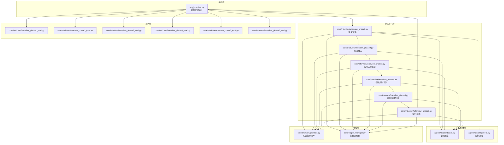
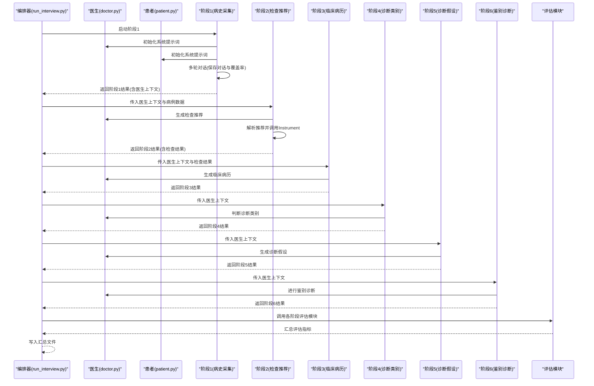
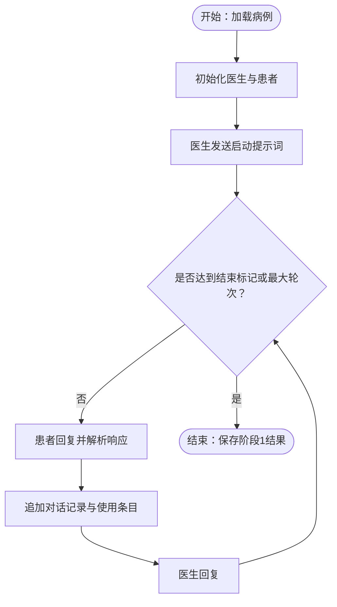
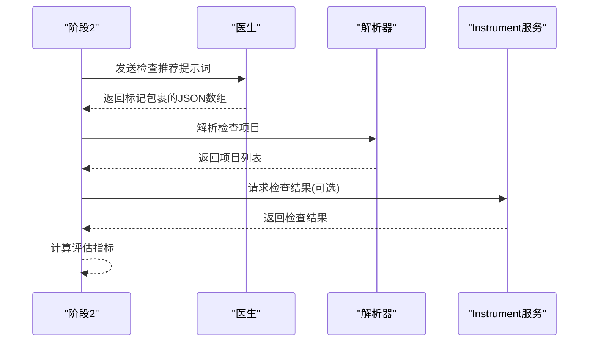
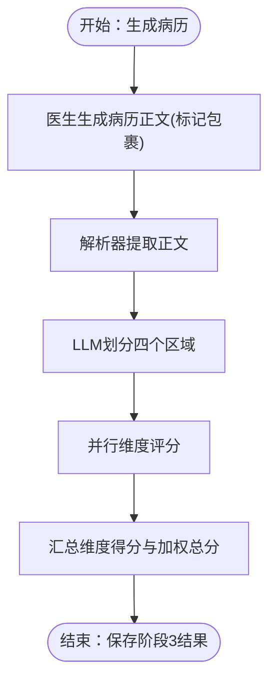
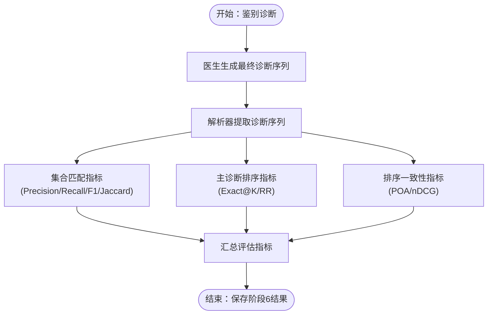
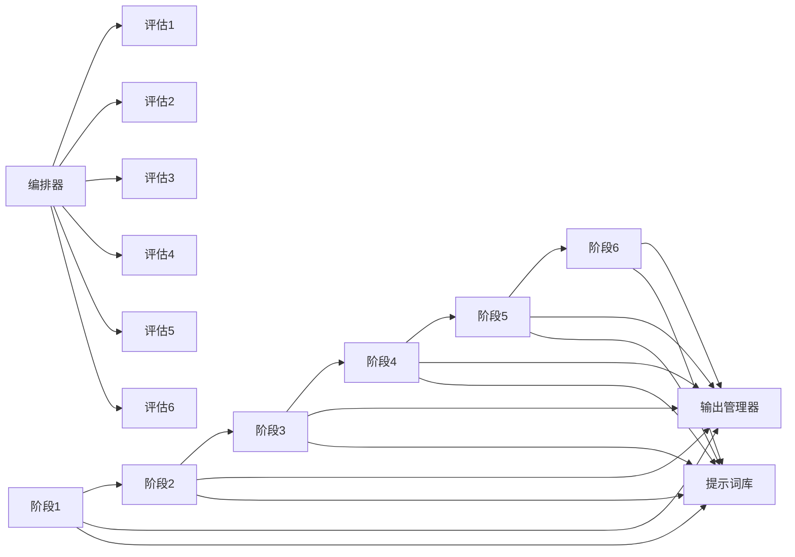

# 问诊流程模块

<cite>
**本文档引用的文件**
- [run_interview.py](file://run_interview.py)
- [doctor.py](file://agents/doctor/doctor.py)
- [patient.py](file://agents/patient/patient.py)
- [prompts.py](file://core/interview/prompts.py)
- [output_manager.py](file://core/output_manager.py)
- [interview_phase1.py](file://core/interview/interview_phase1.py)
- [interview_phase2.py](file://core/interview/interview_phase2.py)
- [interview_phase3.py](file://core/interview/interview_phase3.py)
- [interview_phase4.py](file://core/interview/interview_phase4.py)
- [interview_phase5.py](file://core/interview/interview_phase5.py)
- [interview_phase6.py](file://core/interview/interview_phase6.py)
- [interview_phase1_eval.py](file://core/evaluate/interview_phase1_eval.py)
- [interview_phase2_eval.py](file://core/evaluate/interview_phase2_eval.py)
- [interview_phase3_eval.py](file://core/evaluate/interview_phase3_eval.py)
- [interview_phase4_eval.py](file://core/evaluate/interview_phase4_eval.py)
- [interview_phase5_eval.py](file://core/evaluate/interview_phase5_eval.py)
- [interview_phase6_eval.py](file://core/evaluate/interview_phase6_eval.py)
</cite>

## 目录
1. [简介](#简介)
2. [项目结构](#项目结构)
3. [核心组件](#核心组件)
4. [架构总览](#架构总览)
5. [详细组件分析](#详细组件分析)
6. [依赖关系分析](#依赖关系分析)
7. [性能考虑](#性能考虑)
8. [故障排查指南](#故障排查指南)
9. [结论](#结论)
10. [附录](#附录)

## 简介
本项目实现了一个完整的六阶段精神科问诊流程，涵盖从病史采集、检查推荐、临床病历整理，到诊断类别识别、诊断假设生成与鉴别诊断的全流程自动化评估。系统通过统一的输出管理器持久化各阶段中间结果与最终总结，并提供标准化的评估模块用于量化各阶段质量。

## 项目结构
项目采用按阶段与职责分离的组织方式：
- agents：智能体代理层，包含医生与患者两个角色，封装与大模型交互的接口与系统提示词。
- core/interview：六阶段问诊执行模块，负责各阶段的对话驱动、数据解析与结果输出。
- core/evaluate：各阶段评估模块，提供指标计算与评分体系。
- core/output_manager.py：统一的输出文件管理，负责阶段间数据传递与持久化。
- run_interview.py：完整流程编排入口，串联各阶段并汇总结果。

图表来源
- [run_interview.py:1-408](file://run_interview.py#L1-L408)
- [doctor.py:1-95](file://agents/doctor/doctor.py#L1-L95)
- [patient.py:1-171](file://agents/patient/patient.py#L1-L171)
- [prompts.py:1-233](file://core/interview/prompts.py#L1-L233)
- [output_manager.py:1-189](file://core/output_manager.py#L1-L189)
- [interview_phase1.py:1-462](file://core/interview/interview_phase1.py#L1-L462)
- [interview_phase2.py:1-265](file://core/interview/interview_phase2.py#L1-L265)
- [interview_phase3.py:1-208](file://core/interview/interview_phase3.py#L1-L208)
- [interview_phase4.py:1-168](file://core/interview/interview_phase4.py#L1-L168)
- [interview_phase5.py:1-168](file://core/interview/interview_phase5.py#L1-L168)
- [interview_phase6.py:1-168](file://core/interview/interview_phase6.py#L1-L168)
- [interview_phase1_eval.py:1-376](file://core/evaluate/interview_phase1_eval.py#L1-L376)
- [interview_phase2_eval.py:1-301](file://core/evaluate/interview_phase2_eval.py#L1-L301)
- [interview_phase3_eval.py:1-598](file://core/evaluate/interview_phase3_eval.py#L1-L598)
- [interview_phase4_eval.py:1-256](file://core/evaluate/interview_phase4_eval.py#L1-L256)
- [interview_phase5_eval.py:1-256](file://core/evaluate/interview_phase5_eval.py#L1-L256)
- [interview_phase6_eval.py:1-416](file://core/evaluate/interview_phase6_eval.py#L1-L416)

章节来源
- [run_interview.py:1-408](file://run_interview.py#L1-L408)
- [output_manager.py:1-189](file://core/output_manager.py#L1-L189)

## 核心组件
- 编排器：run_interview.py负责按序调用各阶段，串联评估模块，并汇总最终报告。
- 智能体：doctor.py与patient.py分别封装医生与患者的系统提示词与对话接口，维持上下文。
- 提示词库：prompts.py集中定义各阶段系统提示词，确保推理目标与输出格式标准化。
- 输出管理：output_manager.py统一管理各阶段输出文件路径、初始化、追加与更新。
- 评估模块：各阶段评估模块按阶段特性设计指标，提供可复现的评分体系。

章节来源
- [run_interview.py:46-396](file://run_interview.py#L46-L396)
- [doctor.py:32-55](file://agents/doctor/doctor.py#L32-L55)
- [patient.py:40-92](file://agents/patient/patient.py#L40-L92)
- [prompts.py:1-233](file://core/interview/prompts.py#L1-L233)
- [output_manager.py:20-189](file://core/output_manager.py#L20-L189)

## 架构总览
系统采用“阶段化流水线”架构，每个阶段独立执行并依赖前一阶段的输出。阶段间通过输出文件与医生实例上下文传递实现解耦。评估模块在各阶段完成后独立运行，保证评估的可重复性与可扩展性。

图表来源
- [run_interview.py:46-396](file://run_interview.py#L46-L396)
- [interview_phase1.py:241-428](file://core/interview/interview_phase1.py#L241-L428)
- [interview_phase2.py:75-244](file://core/interview/interview_phase2.py#L75-L244)
- [interview_phase3.py:83-181](file://core/interview/interview_phase3.py#L83-L181)
- [interview_phase4.py:67-158](file://core/interview/interview_phase4.py#L67-L158)
- [interview_phase5.py:67-158](file://core/interview/interview_phase5.py#L67-L158)
- [interview_phase6.py:66-158](file://core/interview/interview_phase6.py#L66-L158)

## 详细组件分析

### 阶段1：病史采集（Clinical History Collection）
- 目标：通过多轮对话收集主诉、精神状态与体格检查相关信息，确保覆盖率达标。
- 输入：随机或指定的病例数据（基本信息、主诉、精神状态、体格检查）。
- 处理逻辑：
  - 初始化医生与患者智能体，注入系统提示词。
  - 医生首轮发起对话，随后与患者进行多轮交互。
  - 实时保存对话记录、使用的主诉与精神状态条目。
  - 检测医生输出中的结束标记以终止阶段。
  - 超过最大轮次时自动结束。
- 输出：阶段1输出文件包含对话历史、覆盖率统计、状态与医生实例。
- 评估标准：主诉覆盖率、精神状态覆盖率、整体覆盖率与对话轮次统计。

图表来源
- [interview_phase1.py:241-428](file://core/interview/interview_phase1.py#L241-L428)
- [output_manager.py:117-169](file://core/output_manager.py#L117-L169)

章节来源
- [interview_phase1.py:241-428](file://core/interview/interview_phase1.py#L241-L428)
- [interview_phase1_eval.py:174-330](file://core/evaluate/interview_phase1_eval.py#L174-L330)

### 阶段2：检查推荐（Examination Recommendation）
- 目标：基于对话上下文与已收集信息，生成标准化的辅助检查项目清单。
- 输入：阶段1的医生上下文与病例数据（含辅助检查字段）。
- 处理逻辑：
  - 医生生成检查推荐（限定在特定格式标记内）。
  - 解析医生响应，提取检查项目列表。
  - 如提供真实检查信息，调用Instrument服务获取检查结果并评估。
- 输出：检查项目列表、检查结果与评估指标（Precision/Recall/F1/Jaccard）。
- 评估标准：与真实检查集合的集合匹配指标。

图表来源
- [interview_phase2.py:75-244](file://core/interview/interview_phase2.py#L75-L244)
- [interview_phase2_eval.py:153-255](file://core/evaluate/interview_phase2_eval.py#L153-L255)

章节来源
- [interview_phase2.py:75-244](file://core/interview/interview_phase2.py#L75-L244)
- [interview_phase2_eval.py:153-255](file://core/evaluate/interview_phase2_eval.py#L153-L255)

### 阶段3：临床病历整理（Clinical Formulation）
- 目标：整合对话与检查结果，生成结构化的临床病历文本。
- 输入：阶段2的医生上下文与检查结果。
- 处理逻辑：
  - 医生根据提示词生成病历正文，使用特定标记包裹。
  - 解析器提取标记内的文本作为病历正文。
  - 评估模块使用Rubric评分体系与LLM评分器进行四维度并行评分。
- 输出：病历正文、解析结果与评分详情（总分百分比、各维度权重得分）。
- 评估标准：四维度覆盖度与准确度的加权总分。

图表来源
- [interview_phase3.py:83-181](file://core/interview/interview_phase3.py#L83-L181)
- [interview_phase3_eval.py:422-552](file://core/evaluate/interview_phase3_eval.py#L422-L552)

章节来源
- [interview_phase3.py:83-181](file://core/interview/interview_phase3.py#L83-L181)
- [interview_phase3_eval.py:422-552](file://core/evaluate/interview_phase3_eval.py#L422-L552)

### 阶段4：诊断类别识别（Diagnostic Category Identification）
- 目标：从预定义诊断类别中识别最可能的诊断类别集合。
- 输入：阶段3的医生上下文。
- 处理逻辑：
  - 医生基于上下文与病历生成诊断类别列表。
  - 解析器提取标记内的JSON数组。
  - 评估模块计算集合匹配指标（Precision/Recall/F1/Jaccard）。
- 输出：诊断类别列表与评估指标。
- 评估标准：与真实类别集合的集合匹配指标。

章节来源
- [interview_phase4.py:67-158](file://core/interview/interview_phase4.py#L67-L158)
- [interview_phase4_eval.py:126-210](file://core/evaluate/interview_phase4_eval.py#L126-L210)

### 阶段5：诊断假设生成（Diagnostic Hypotheses）
- 目标：生成候选诊断假设列表，为鉴别诊断提供基础。
- 输入：阶段4的医生上下文。
- 处理逻辑：
  - 医生生成诊断假设列表（标记包裹的JSON数组）。
  - 解析器提取假设列表。
  - 评估模块计算集合匹配指标。
- 输出：诊断假设列表与评估指标。
- 评估标准：与真实诊断集合的集合匹配指标。

章节来源
- [interview_phase5.py:67-158](file://core/interview/interview_phase5.py#L67-L158)
- [interview_phase5_eval.py:126-210](file://core/evaluate/interview_phase5_eval.py#L126-L210)

### 阶段6：鉴别诊断（Differential Diagnosis）
- 目标：在诊断假设基础上进行鉴别诊断，输出最终诊断序列。
- 输入：阶段5的医生上下文。
- 处理逻辑：
  - 医生生成最终诊断序列（标记包裹的JSON数组）。
  - 解析器提取诊断序列。
  - 评估模块计算集合匹配指标、主诊断排序指标与排序一致性指标。
- 输出：最终诊断序列与多维评估指标。
- 评估标准：集合匹配（Precision/Recall/F1/Jaccard）、主诊断精确匹配/Hit@K/倒数排名、排序一致性（POA/nDCG）。

图表来源
- [interview_phase6.py:66-158](file://core/interview/interview_phase6.py#L66-L158)
- [interview_phase6_eval.py:267-370](file://core/evaluate/interview_phase6_eval.py#L267-L370)

章节来源
- [interview_phase6.py:66-158](file://core/interview/interview_phase6.py#L66-L158)
- [interview_phase6_eval.py:267-370](file://core/evaluate/interview_phase6_eval.py#L267-L370)

## 依赖关系分析
- 阶段间依赖：阶段N依赖阶段(N-1)的医生上下文与部分数据（如检查结果）。
- 模块内聚：各阶段内部高度内聚，统一通过提示词库与输出管理器解耦。
- 评估独立：评估模块通过输出文件读取各阶段结果，避免对执行模块的耦合。
- 数据传递：通过输出文件路径与医生实例上下文实现数据传递，避免全局状态。

图表来源
- [run_interview.py:46-396](file://run_interview.py#L46-L396)
- [output_manager.py:20-189](file://core/output_manager.py#L20-L189)
- [prompts.py:1-233](file://core/interview/prompts.py#L1-L233)

章节来源
- [run_interview.py:46-396](file://run_interview.py#L46-L396)
- [output_manager.py:20-189](file://core/output_manager.py#L20-L189)

## 性能考虑
- I/O与持久化：阶段间通过文件系统持久化中间结果，建议使用SSD与合理的文件命名策略降低I/O开销。
- 并行评估：阶段3的四维度评分采用多线程并行，显著提升评估吞吐。
- 上下文复用：医生实例在阶段间复用，减少重复初始化成本。
- 轮次控制：阶段1设置最大轮次阈值，避免长时间无效对话。
- JSON解析容错：阶段1对患者响应提供多种解析策略（直接解析、修复、正则提取），提高鲁棒性。

## 故障排查指南
- 阶段1解析失败：检查患者响应是否符合JSON格式，系统会尝试修复与正则提取；确认json_repair库可用。
- 阶段2检查结果为空：确认病例数据中包含辅助检查字段，且检查项目与真实检查集合匹配。
- 阶段3评分异常：确认生成病历与真值病历均存在，检查Rubric评分标准与LLM服务可用性。
- 阶段4-6评估指标异常：确认ground_truth.jsonl中存在对应病例的真实标签，检查集合运算与指标计算逻辑。
- 文件路径问题：检查输出目录权限与路径拼接，确保输出管理器正确创建目录。

章节来源
- [interview_phase1.py:90-192](file://core/interview/interview_phase1.py#L90-L192)
- [interview_phase2_eval.py:205-255](file://core/evaluate/interview_phase2_eval.py#L205-L255)
- [interview_phase3_eval.py:497-552](file://core/evaluate/interview_phase3_eval.py#L497-L552)
- [interview_phase4_eval.py:126-210](file://core/evaluate/interview_phase4_eval.py#L126-L210)
- [interview_phase5_eval.py:126-210](file://core/evaluate/interview_phase5_eval.py#L126-L210)
- [interview_phase6_eval.py:267-370](file://core/evaluate/interview_phase6_eval.py#L267-L370)

## 结论
本系统通过标准化的提示词、严格的输出格式与完善的评估体系，实现了从病史采集到鉴别诊断的全链路自动化问诊流程。阶段间通过输出文件与上下文传递实现解耦，评估模块独立运行保证了结果的可复现性与可扩展性。建议在实际部署中关注I/O性能、评估并行化与数据质量，以进一步提升整体效率与稳定性。

## 附录
- 配置选项与参数调优建议：
  - MAX_TURNS（阶段1最大轮次）：根据对话复杂度调整，建议范围在30-80之间。
  - 并行评估（阶段3）：根据CPU核心数调整线程池大小，建议4核以上使用4线程。
  - 评估指标阈值：根据业务需求设定Precision/Recall目标，动态调整提示词与解析策略。
- 实际对话示例与处理流程图：
  - 阶段1示例：医生通过系统提示词引导患者按主诉与精神状态回答，逐步覆盖关键信息。
  - 阶段2示例：医生根据上下文生成检查项目清单，解析器严格提取标记内的JSON数组。
  - 阶段3示例：医生生成病历正文，评估模块并行评分四个维度，输出加权总分。
  - 阶段4-6示例：医生在候选集合中进行分类、假设与鉴别，评估模块计算集合匹配与排序指标。