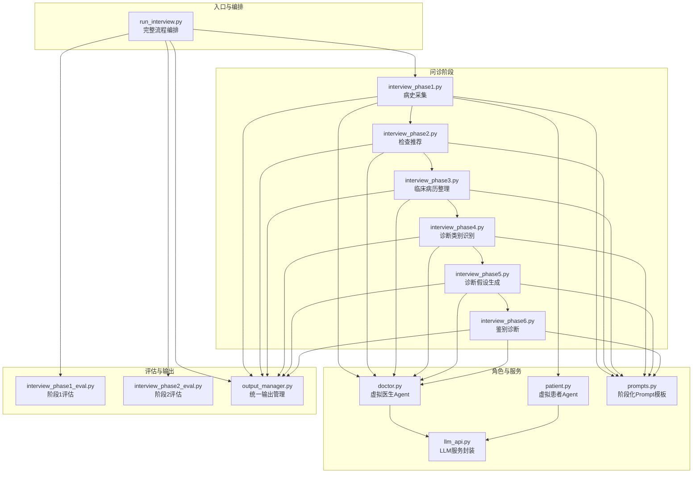
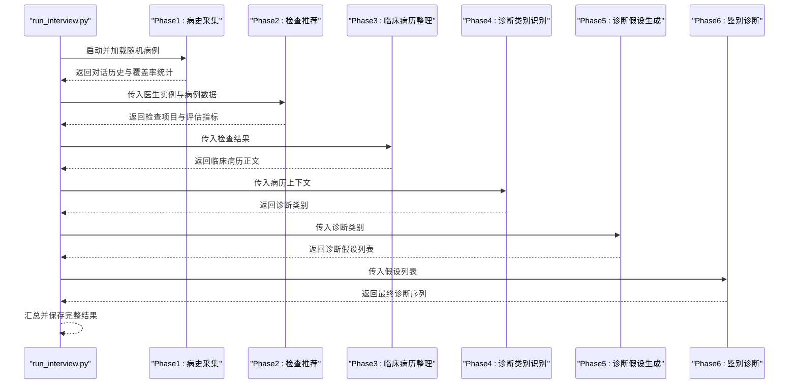
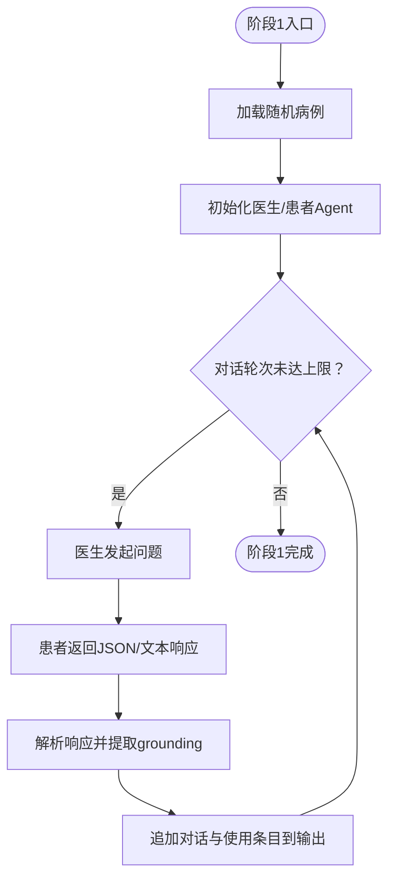
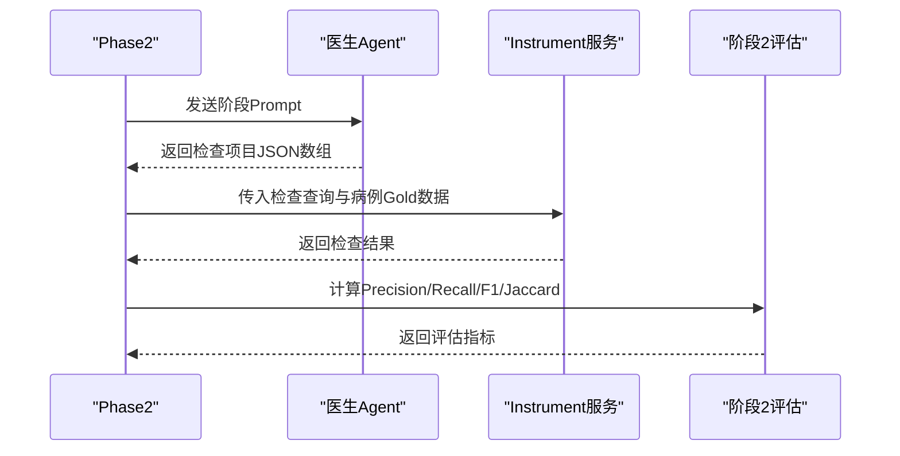
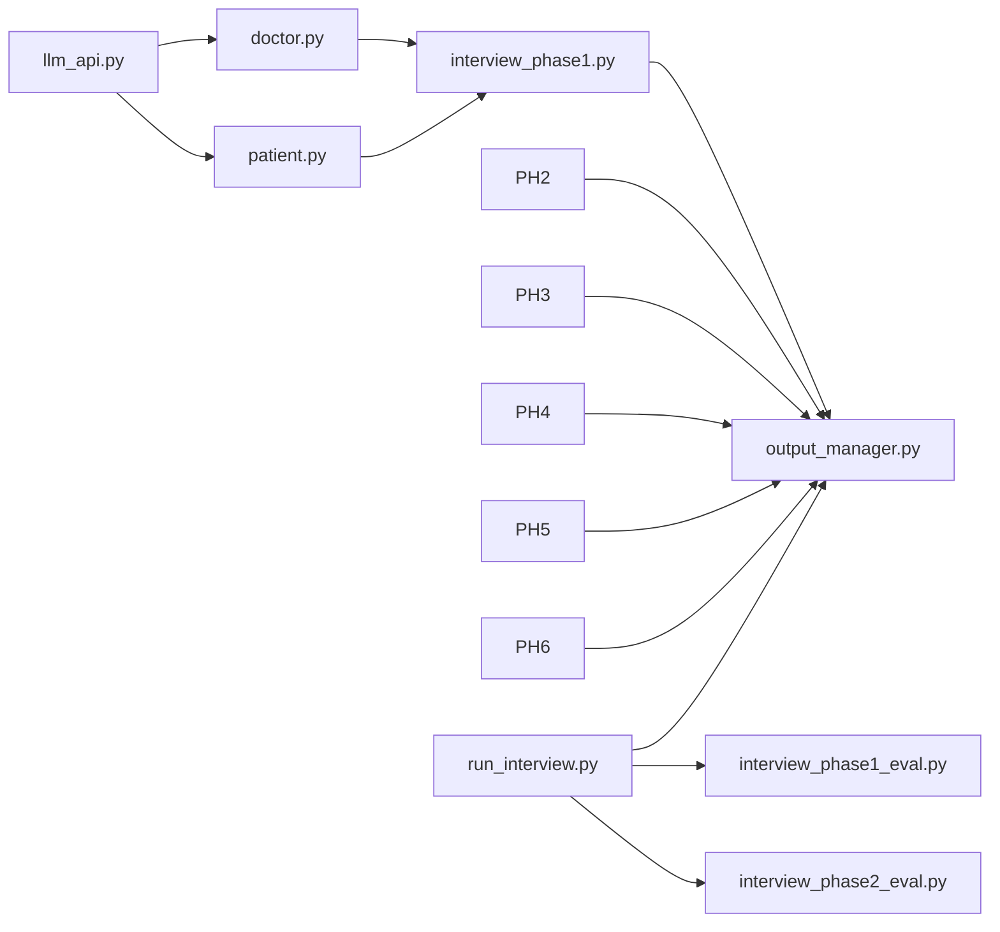

# 项目概述

<cite>
**本文档引用的文件**
- [run_interview.py](file://run_interview.py)
- [doctor.py](file://agents/doctor/doctor.py)
- [patient.py](file://agents/patient/patient.py)
- [llm_api.py](file://services/llm_api.py)
- [prompts.py](file://core/interview/prompts.py)
- [interview_phase1.py](file://core/interview/interview_phase1.py)
- [interview_phase2.py](file://core/interview/interview_phase2.py)
- [interview_phase3.py](file://core/interview/interview_phase3.py)
- [interview_phase4.py](file://core/interview/interview_phase4.py)
- [interview_phase5.py](file://core/interview/interview_phase5.py)
- [interview_phase6.py](file://core/interview/interview_phase6.py)
- [interview_phase1_eval.py](file://core/evaluate/interview_phase1_eval.py)
- [interview_phase2_eval.py](file://core/evaluate/interview_phase2_eval.py)
- [output_manager.py](file://core/output_manager.py)
</cite>

## 目录
1. [简介](#简介)
2. [项目结构](#项目结构)
3. [核心组件](#核心组件)
4. [架构总览](#架构总览)
5. [详细组件分析](#详细组件分析)
6. [依赖关系分析](#依赖关系分析)
7. [性能考虑](#性能考虑)
8. [故障排查指南](#故障排查指南)
9. [结论](#结论)
10. [附录](#附录)

## 简介
本项目是一个基于大语言模型的“精神卫生智能问诊系统”，旨在模拟真实的精神科问诊流程，构建从病史采集到最终诊断的完整六阶段闭环。系统通过虚拟医生与虚拟患者的多轮对话，结合辅助检查推荐、临床病历整理、诊断类别识别、诊断假设生成与鉴别诊断，形成可评估、可复现、可扩展的AI医疗问诊范式。

项目创新价值体现在：
- 将精神科问诊标准化为可编程的六阶段流程，便于自动化与评估；
- 引入结构化输出与统一输出管理，确保结果可追踪、可复盘；
- 提供阶段化评估指标，覆盖覆盖率、专业度、集合匹配与排序一致性等维度；
- 以模块化设计支撑不同模型与数据集的快速切换与扩展。

## 项目结构
项目采用“阶段化模块 + 统一输出管理 + 评估体系”的组织方式，核心目录与职责如下：
- agents：虚拟角色（医生、患者、仪器）的Agent封装与Prompt管理
- core：问诊流程与评估逻辑（六阶段实现、评估脚本、输出管理）
- services：LLM服务抽象与API调用封装
- data：输出目录结构（按模型与病例ID组织）
- scripts/test：测试脚本
- run_interview.py：完整流程编排入口

图表来源
- [run_interview.py:1-408](file://run_interview.py#L1-L408)
- [interview_phase1.py:1-200](file://core/interview/interview_phase1.py#L1-L200)
- [interview_phase2.py:1-200](file://core/interview/interview_phase2.py#L1-L200)
- [interview_phase3.py:1-200](file://core/interview/interview_phase3.py#L1-L200)
- [interview_phase4.py:1-168](file://core/interview/interview_phase4.py#L1-L168)
- [interview_phase5.py:1-168](file://core/interview/interview_phase5.py#L1-L168)
- [interview_phase6.py:1-168](file://core/interview/interview_phase6.py#L1-L168)
- [doctor.py:1-95](file://agents/doctor/doctor.py#L1-L95)
- [patient.py:1-171](file://agents/patient/patient.py#L1-L171)
- [llm_api.py:1-250](file://services/llm_api.py#L1-L250)
- [prompts.py:1-233](file://core/interview/prompts.py#L1-L233)
- [output_manager.py:1-189](file://core/output_manager.py#L1-L189)
- [interview_phase1_eval.py:1-200](file://core/evaluate/interview_phase1_eval.py#L1-L200)
- [interview_phase2_eval.py:1-200](file://core/evaluate/interview_phase2_eval.py#L1-L200)

章节来源
- [run_interview.py:1-408](file://run_interview.py#L1-L408)
- [output_manager.py:1-189](file://core/output_manager.py#L1-L189)

## 核心组件
- LLM服务层（LLMService）：封装OpenAI Chat Completions API，自动维护对话上下文，支持重试与多模态图文输入。
- 角色Agent层（Doctor/Patient）：分别以“医生”和“患者”角色加载系统Prompt，驱动多轮对话。
- 阶段化流程层（Phase1-6）：将问诊过程分解为病史采集、检查推荐、临床病历整理、诊断类别识别、诊断假设生成、鉴别诊断六个阶段，每个阶段有明确的输出规范与解析策略。
- 评估与输出管理：统一输出文件结构，按阶段写入中间结果与最终摘要；提供阶段化评估指标，涵盖覆盖率、专业度、集合匹配与排序一致性等。

章节来源
- [llm_api.py:1-250](file://services/llm_api.py#L1-L250)
- [doctor.py:1-95](file://agents/doctor/doctor.py#L1-L95)
- [patient.py:1-171](file://agents/patient/patient.py#L1-L171)
- [prompts.py:1-233](file://core/interview/prompts.py#L1-L233)
- [output_manager.py:1-189](file://core/output_manager.py#L1-L189)

## 架构总览
系统采用“阶段化流水线 + 统一输出 + 评估闭环”的架构模式。完整流程从随机加载病例开始，依次经过六个阶段，每个阶段的输出作为下一阶段的输入，最终汇总生成完整报告与评估结果。

图表来源
- [run_interview.py:46-396](file://run_interview.py#L46-L396)
- [interview_phase1.py:63-88](file://core/interview/interview_phase1.py#L63-L88)
- [interview_phase2.py:75-117](file://core/interview/interview_phase2.py#L75-L117)
- [interview_phase3.py:83-121](file://core/interview/interview_phase3.py#L83-L121)
- [interview_phase4.py:67-101](file://core/interview/interview_phase4.py#L67-L101)
- [interview_phase5.py:67-101](file://core/interview/interview_phase5.py#L67-L101)
- [interview_phase6.py:66-101](file://core/interview/interview_phase6.py#L66-L101)

## 详细组件分析

### 阶段1：病史采集（Clinical History Collection）
- 目标：通过医生与患者的多轮对话，系统性收集主诉与精神状态信息。
- 关键点：解析患者响应（支持JSON与非JSON），提取presentation与utterance，记录grounding中的主诉与精神状态使用情况；支持正则与JSON修复增强容错。
- 输出：对话历史、覆盖率统计、使用的主诉与精神状态条目、阶段输出文件。

图表来源
- [interview_phase1.py:63-88](file://core/interview/interview_phase1.py#L63-L88)
- [interview_phase1.py:90-144](file://core/interview/interview_phase1.py#L90-L144)
- [output_manager.py:117-169](file://core/output_manager.py#L117-L169)

章节来源
- [interview_phase1.py:1-200](file://core/interview/interview_phase1.py#L1-L200)
- [output_manager.py:117-169](file://core/output_manager.py#L117-L169)

### 阶段2：检查推荐（Examination Recommendation）
- 目标：基于对话上下文与已收集信息，推荐必要的辅助检查项目。
- 关键点：解析医生输出中的BEGIN/END标记包裹的JSON数组；调用Instrument服务获取检查结果；计算Precision/Recall/F1/Jaccard等指标。
- 输出：检查项目列表、检查结果、评估指标、原始响应、阶段输出文件。

图表来源
- [interview_phase2.py:75-117](file://core/interview/interview_phase2.py#L75-L117)
- [interview_phase2.py:136-173](file://core/interview/interview_phase2.py#L136-L173)
- [interview_phase2_eval.py:153-200](file://core/evaluate/interview_phase2_eval.py#L153-L200)

章节来源
- [interview_phase2.py:1-200](file://core/interview/interview_phase2.py#L1-L200)
- [interview_phase2_eval.py:1-200](file://core/evaluate/interview_phase2_eval.py#L1-L200)

### 阶段3：临床病历整理（Clinical Formulation）
- 目标：整合对话与检查结果，生成结构化的临床病历正文。
- 关键点：替换Prompt中的检查结果占位符；解析BEGIN/END标记包裹的病历正文；更新输出文件状态为completed。
- 输出：病历正文、原始响应、阶段输出文件。

章节来源
- [interview_phase3.py:1-200](file://core/interview/interview_phase3.py#L1-L200)

### 阶段4：诊断类别识别（Diagnostic Category Identification）
- 目标：从预定义诊断类别列表中识别当前病例最可能涉及的类别。
- 关键点：解析JSON数组输出；更新输出文件并标记完成。
- 输出：诊断类别列表、原始响应、阶段输出文件。

章节来源
- [interview_phase4.py:1-168](file://core/interview/interview_phase4.py#L1-L168)

### 阶段5：诊断假设生成（Diagnostic Hypotheses）
- 目标：在候选诊断列表中生成当前最可能的诊断假设列表。
- 关键点：解析JSON数组输出；更新输出文件并标记完成。
- 输出：诊断假设列表、原始响应、阶段输出文件。

章节来源
- [interview_phase5.py:1-168](file://core/interview/interview_phase5.py#L1-L168)

### 阶段6：鉴别诊断（Differential Diagnosis）
- 目标：在诊断假设基础上进行鉴别诊断，输出最终诊断序列。
- 关键点：解析JSON数组输出；更新输出文件并标记完成。
- 输出：最终诊断序列、原始响应、阶段输出文件。

章节来源
- [interview_phase6.py:1-168](file://core/interview/interview_phase6.py#L1-L168)

### 评估模块（阶段1与阶段2）
- 阶段1评估：计算主诉覆盖率、精神状态覆盖率、整体覆盖率与对话统计；支持可选的共情度与专业度评估。
- 阶段2评估：基于Instrument返回结果计算Precision/Recall/F1/Jaccard与集合统计。

章节来源
- [interview_phase1_eval.py:1-200](file://core/evaluate/interview_phase1_eval.py#L1-L200)
- [interview_phase2_eval.py:1-200](file://core/evaluate/interview_phase2_eval.py#L1-L200)

## 依赖关系分析
- 模块耦合：各阶段通过统一的输出管理与阶段Prompt进行解耦；医生Agent贯穿所有阶段，保持上下文一致性。
- 外部依赖：OpenAI Chat Completions API、.env环境变量配置、可选的json_repair库用于响应修复。
- 数据流：阶段间以JSON输出文件为契约，确保数据可追踪、可复现；评估模块独立于流程执行，按阶段读取输出文件进行指标计算。

图表来源
- [llm_api.py:1-250](file://services/llm_api.py#L1-L250)
- [doctor.py:1-95](file://agents/doctor/doctor.py#L1-L95)
- [patient.py:1-171](file://agents/patient/patient.py#L1-L171)
- [interview_phase1.py:1-200](file://core/interview/interview_phase1.py#L1-L200)
- [output_manager.py:1-189](file://core/output_manager.py#L1-L189)
- [run_interview.py:1-408](file://run_interview.py#L1-L408)
- [interview_phase1_eval.py:1-200](file://core/evaluate/interview_phase1_eval.py#L1-L200)
- [interview_phase2_eval.py:1-200](file://core/evaluate/interview_phase2_eval.py#L1-L200)

章节来源
- [run_interview.py:1-408](file://run_interview.py#L1-L408)
- [output_manager.py:1-189](file://core/output_manager.py#L1-L189)

## 性能考虑
- API调用重试与指数退避：在网络波动或服务抖动时提升稳定性。
- 上下文管理：单实例内自动维护历史，减少重复上下文传输开销。
- 输出即时写入：阶段输出文件在关键节点即时落盘，降低内存占用并支持断点恢复。
- 评估指标并行化：评估模块可按需开启并行评估，缩短总耗时。

章节来源
- [llm_api.py:158-170](file://services/llm_api.py#L158-L170)
- [output_manager.py:86-115](file://core/output_manager.py#L86-L115)

## 故障排查指南
- 响应解析失败：阶段1对非标准JSON响应提供正则提取与json_repair修复；若仍失败，检查Prompt是否正确注入参数。
- 检查推荐为空：确认阶段2的BEGIN/END标记与JSON数组格式；核对Instrument返回的NONE计数。
- 评估指标异常：检查阶段2评估输入（预测数组、Gold对象、响应对象）的JSON格式与字段一致性。
- 输出文件缺失：确认输出目录权限与路径拼接逻辑；检查阶段初始化与更新函数调用顺序。

章节来源
- [interview_phase1.py:90-144](file://core/interview/interview_phase1.py#L90-L144)
- [interview_phase2_eval.py:66-151](file://core/evaluate/interview_phase2_eval.py#L66-L151)
- [output_manager.py:50-84](file://core/output_manager.py#L50-L84)

## 结论
本项目以阶段化、模块化的方式实现了精神科问诊的全流程自动化，结合结构化输出与评估体系，为AI在精神卫生领域的应用提供了可复现、可评估的实践范式。通过统一的Agent与Prompt管理、稳健的LLM服务封装以及完善的评估指标，系统在保证易用性的同时，也为进一步扩展与优化奠定了坚实基础。

## 附录
- 使用场景与预期成果：
  - 临床培训：模拟真实问诊流程，辅助医学生与住院医师训练问诊技巧。
  - AI问诊评估：提供标准化的阶段化评估指标，衡量AI问诊的专业度与覆盖面。
  - 病例研究：以统一格式沉淀问诊过程与结果，支持回顾性分析与模型迭代。
- 实际运行方式：直接运行完整流程入口，系统将自动加载随机病例并依次执行六个阶段，最终生成汇总报告与评估结果。

章节来源
- [run_interview.py:399-408](file://run_interview.py#L399-L408)